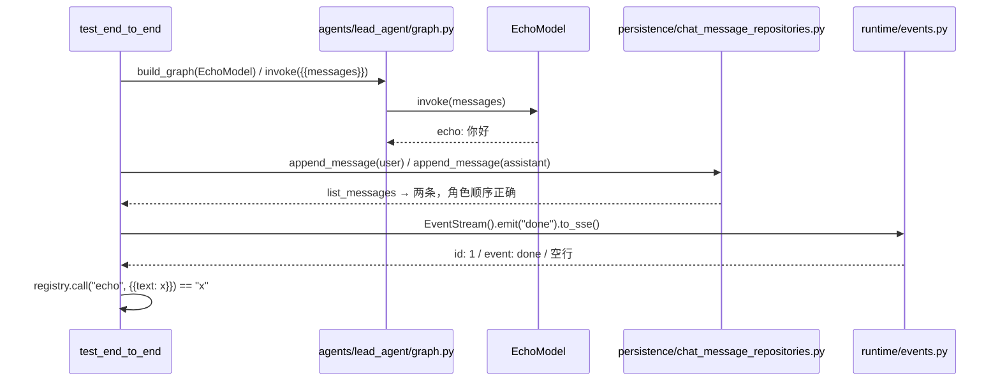

# 第 6 章　第 1 部分综合验收 / Part 1 Acceptance

## 调用逻辑 / Invocation logic



- **入口**：`backend/tests/chapters/test_ch01_06_e2e.py::test_end_to_end`，不启动 HTTP，直接驱动 Part 1 的模块。
- **关键节点**：模型换成 `EchoModel`（离线），数据库用临时文件（`MYAF_DB_PATH` + `db.reset_db()`），事件用 `EventStream` 直接产出。
- **出口**：断言三件事——消息按 `user/assistant` 顺序读回、SSE 首帧以 `id: 1` 开头且以空行结尾、工具注册表能调到 `echo`。
- **最容易断的地方**：为了跑通去改生产代码。验收测试只准换依赖（假模型、临时库），不准改逻辑。

## 验收场景 / Scenario

一条消息进图 → 假模型回显 → 回复写进 `chat_messages` → 按角色读回 → 同一套事件序列化产出合法 SSE 帧。重启后会话仍在，靠第 3 章的 SQLite 仓储；流式断线恢复不在本部分（见第 5 章的限制）。

## 运行 / How to run

```bash
cd /Users/main/my-agent-flow/backend
uv run pytest tests/chapters -q          # 全部章节测试，离线
uv run ruff check packages app tools tests
```

Part 1 的五个测试文件合计 14 个用例：`test_ch01_01_config.py`（6）、`test_ch01_02_graph.py`（2）、`test_ch01_03_messages.py`（3）、`test_ch01_04_tools.py`（2）、`test_ch01_06_e2e.py`（1）。

## 通过标准 / Pass criteria

| # | 检查项 | 对应测试 |
|---|---|---|
| 1 | 配置加载、env 兜底、providers 摊平、无模型报错 | `test_ch01_01_config.py`（6 个） |
| 2 | 单轮执行：一节点两边界；同 thread 历史累积 | `test_ch01_02_graph.py`（2 个） |
| 3 | 消息 seq 连续、limit 取最近 N 条、会话标题不被覆盖 | `test_ch01_03_messages.py`（3 个） |
| 4 | 工具 schema 形状、调用、未知工具报错 | `test_ch01_04_tools.py`（2 个） |
| 5 | 配置 → 图 → 消息表 → SSE 串成一条链 | `test_ch01_06_e2e.py`（1 个） |

## 已知限制 / Known limitations（诚实清单）

- `stream_graph()` 没有独立单测：只有导入级检查（`test_ch01_06_e2e.py` 不跑它）。要钉事件映射，得另写异步用例。
- 服务端不做 SSE 重放：`seq` 只用于排序/去重，断线重连等于开新流。
- `backend/app/gateway/routers/chat.py` 还没有接持久化：消息表由测试直接调用，不经过路由。
- 路由建图时**没传 checkpointer**：同一 thread 的历史只在测试里用 `InMemorySaver` 验证。
- SQLite 单连接 + 全局锁，不适合高并发。
- 模型只实现 `openai` vendor；`use:` 不解析。
- 没有取消、鉴权、工具循环；取消在第 2 部分只有组件，工具循环尚未实现，后续需单列。

## 常见坑

| 症状 | 原因 | 动作 |
|---|---|---|
| `ModuleNotFoundError: myagentflow` | 不在 `backend/` 根目录跑，或没 `uv sync` | `cd backend && uv run pytest tests/chapters -q` |
| 单章全绿、一起跑就挂 | 模块级单例/环境变量在测试间串味 | 每个用例用 `tmp_path`；改配置后 `reset_app_config()`；换库后 `db.reset_db()` |
| 临时库残留导致第二次失败 | SQLite 文件写到了仓库目录 | 路径一律 `tmp_path / "x.sqlite"`，不要写死 `data/` |

## 从零实现（手把手）

> 读完这章你有一条完整链路：配置 → 图 → 消息表 → 工具 → 事件流，并且有一个集成测试兜底。
> 文件路径一律写仓库全路径（`backend/...`）。

### Step 1　写集成测试：一次调用串起五个模块

**文件**：`backend/tests/chapters/test_ch01_06_e2e.py（新建）`

**要写的逻辑**

1. `monkeypatch.setenv("MYAF_DB_PATH", ...)` 指向 `tmp_path`，再 `db.reset_db()` 丢掉可能存在的旧连接。
2. 用 `EchoModel` 替掉真模型：只实现 `invoke`，不发 HTTP。
3. 手工写 user 消息、跑图、把回复写回 assistant——路由还没接持久化，所以测试直接调仓储。
4. 断言角色顺序、SSE 帧形状、工具调用返回值。

**代码（全文，50 行）**

```python
"""一、文件说明
    第 1 部分验收：模型 → 图 → 消息落库 → SSE 串成一条链。

二、覆盖
    EchoModel()        假模型：不联网，只回显；测试里所有模型都该这样替身。
    test_end_to_end()  模型回复落库后按角色读回，SSE 首帧带 id。

三、运行
    uv run pytest tests/chapters/test_ch01_06_e2e.py -q
"""

from __future__ import annotations

from langchain_core.messages import AIMessage, HumanMessage


class EchoModel:
    """假模型：不联网，只回显；测试里所有模型都该这样替身。"""
    def invoke(self, messages, *_a, **_k):
        return AIMessage(content="echo: " + messages[-1].content)


def test_end_to_end(monkeypatch, tmp_path):
    """模型回复落库后按角色读回，SSE 首帧带 id。"""
    from myagentflow.agents.lead_agent.graph import build_graph
    from myagentflow.persistence.chat_message_repositories import (
        append_message,
        list_messages,
    )
    from myagentflow.runtime.events import EventStream
    from myagentflow.tools.builtins.echo import register_echo
    from myagentflow.tools.registry import ToolRegistry

    monkeypatch.setenv("MYAF_DB_PATH", str(tmp_path / "e2e.sqlite"))
    from myagentflow.persistence import db
    db.reset_db()
    registry = ToolRegistry()
    register_echo(registry)

    graph = build_graph(EchoModel())
    append_message("t1", "user", "你好")
    out = graph.invoke({"messages": [HumanMessage(content="你好")]})

    append_message("t1", "assistant", out["messages"][-1].content)
    history = list_messages("t1")
    assert [m["role"] for m in history] == ["user", "assistant"]

    sse = EventStream().emit("done").to_sse()
    assert sse.startswith("id: 1") and sse.endswith("\n\n")
    assert registry.call("echo", {"text": "x"}) == "x"
```

**验证**

```bash
uv run pytest tests/chapters/test_ch01_06_e2e.py -v
# 期望：1 passed
```

### Step 2　跑一遍全量，确认没有互相踩

**文件**：`（无新文件，回归）`

**要写的逻辑**：Part 1 的五个测试文件一起跑，检查环境变量、配置缓存、数据库单例之间是否串味。

**验证**

```bash
uv run pytest tests/chapters -q
# 期望：97 passed（含其他部分的章节测试）

uv run python -m ruff check packages app tools tests
# 期望：All checks passed!
```

### 与 EvoFlow 对照

| 我们的做法 | EvoFlow | 为什么 |
|---|---|---|
| 集成测试放 `backend/tests/chapters/` | EvoFlow 的 `tests/` 分层 | 每章一个测试文件，失败时能直接定位章节 |
| 假模型 + 临时 SQLite | EvoFlow 也用替身与临时库 | 验收不烧 token、不受网络影响 |

### 知识点

- [agent-book](https://g0-000.github.io/agent-book/)：整体课程结构
- 下一部分（02）开始接持久化与生命周期
