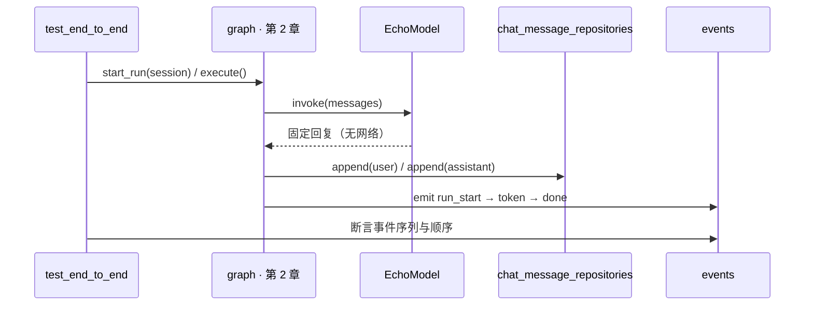

# 第 6 章　第 1 部分综合验收 / Part 1 Acceptance

## 调用逻辑 / Invocation logic



- **入口**：`tests/chapters/test_ch01_06_e2e.py::test_end_to_end`，它不启动 HTTP，直接驱动 Part 1 的四个模块。
- **关键节点**：模型换成 `EchoModel`（离线），数据库用临时文件，事件用内存列表收集——三处都可在测试里替换，才叫「可验收」。
- **出口**：断言三件事：消息落库条数、事件首尾类型、`done` 只出现一次。
- **最容易断的地方**：为了跑通去改生产代码；验收测试只准换依赖，不准改逻辑。

## 验收场景 / Scenario
发送一条需要计算的消息 → 观察流式事件（token、tool_start/tool_end、done）→ 重启服务 → 历史与结果完整。

## 运行 / How to run
```bash
cd code
python3 -m unittest discover -s tests -v   # 35 个测试，全部离线
python3 demo.py                            # 打印一次完整 SSE 流和一次断线重连
```

## 通过标准 / Pass criteria
| # | 检查项 | 对应测试 |
|---|---|---|
| 1 | 配置加载/校验、模型库、密钥不泄露 | `tests/test_ch1_config.py`（24 个） |
| 2 | 单轮执行、Agent 无状态串扰 | `test_part1.py::Ch2Agent` |
| 3 | 重启后会话仍在 | `test_part1.py::Ch3Store`, `Part1Acceptance` |
| 4 | 工具循环、安全求值、截断、max_steps | `test_part1.py::Ch4Tools` |
| 5 | SSE 顺序、重放、错误路径 | `test_part1.py::Ch5Stream` |

## 已知限制 / Known limitations（诚实清单）
- 真实模型适配器 `OpenAICompatModel` **未经联网验证**，且不是流式解析。
- SSE 使用轮询，未做并发压测。
- 存储用 SQLite + 全局锁，不适合高并发。
- 没有取消、检查点、鉴权 —— 分别属于第 2、11 部分。
- 第 1–5 章均为按 EvoFlow 模块职责逐步构建的教学实现；逐项行为是否等同上游，以各章对照表为准，不以“结构对齐”暗示“功能等同”。

## 常见坑

| 症状 | 原因 | 动作 |
|---|---|---|
| `ModuleNotFoundError: myagentflow` | 不在 `backend/` 根目录跑，或没 `uv sync` | `cd backend && uv run pytest tests/chapters -q` |
| 单章全绿、一起跑就挂 | 模块级单例/环境变量在测试间串味 | 每个用例用 `tmp_path`；改环境变量后 `reset_checkpointer()` |
| 临时库残留导致第二次失败 | SQLite 文件写到了仓库目录 | 路径一律 `tmp_path / "x.sqlite"`，不要写死 `data/` |

## 从零实现（手把手）
> 读完这章你有一条完整链路：配置 → 图 → 消息表 → 工具 → 事件流，并且有一个集成测试兜底。
> 路径均相对 `backend/`，代码注释写「为什么」。

### Step 1　写集成测试：一次调用串起四个模块
**文件**：`tests/chapters/test_ch01_06_e2e.py（新建）`
**要写的逻辑**：假模型 + 注册表 + 消息表 + 事件流；断言消息落库、schema 可枚举、SSE 帧合法。

**代码**

```python
from __future__ import annotations

from langchain_core.messages import AIMessage, HumanMessage


class EchoModel:
    def invoke(self, messages, *_a, **_k):
        return AIMessage(content="echo: " + messages[-1].content)


def test_end_to_end(monkeypatch, tmp_path):
    from myagentflow.agents.lead_agent.graph import build_graph
    from myagentflow.persistence.chat_message_repositories import append_message, list_messages
    from myagentflow.persistence.session_repositories import upsert_session_row
    from myagentflow.runtime.events import EventStream
    from myagentflow.tools.builtins.echo import register_echo
    from myagentflow.tools.registry import ToolRegistry

    monkeypatch.setenv("MYAF_DB_PATH", str(tmp_path / "e2e.sqlite"))
    registry = ToolRegistry()
    register_echo(registry)

    graph = build_graph(EchoModel())
    upsert_session_row("t1", title="验收")
    append_message("t1", "user", "你好")
    out = graph.invoke({"messages": [HumanMessage(content="你好")]})

    append_message("t1", "assistant", out["messages"][-1].content)
    history = list_messages("t1")
    assert [m["role"] for m in history] == ["user", "assistant"]

    sse = EventStream().emit("done").to_sse()
    assert sse.startswith("id: 1") and sse.endswith("\n\n")
    assert registry.call("echo", {"text": "x"}) == "x"
```

**验证**

```bash
uv run pytest tests/chapters/test_ch01_06_e2e.py -v
# 期望：1 passed
```

### Step 2　跑一遍全量，确认没有互相踩
**文件**：`（无新文件，回归）`
**要写的逻辑**：Part 1 的五个测试文件一起跑，检查环境变量/单例/临时库之间是否串味。

**代码**

这一步不写新代码，也没有新文件可建——它考的是「五个模块放一起会不会互相踩」，所以只跑命令，见下面「验证」。

**验证**

```bash
uv run pytest tests/chapters -v
# 期望：Part 1 相关用例全绿
```

### 与 EvoFlow 对照

| 我们的做法 | EvoFlow | 为什么 |
|---|---|---|
| 集成测试放 `tests/chapters/` | EvoFlow 的 `tests/` 分层 | 每章一个测试文件，失败时能直接定位章节 |

### 知识点

- [agent-book](https://g0-000.github.io/agent-book/)：整体课程结构
- 下一部分（02）开始接持久化与生命周期

### 验收

```bash
uv run pytest tests/chapters -q
```
