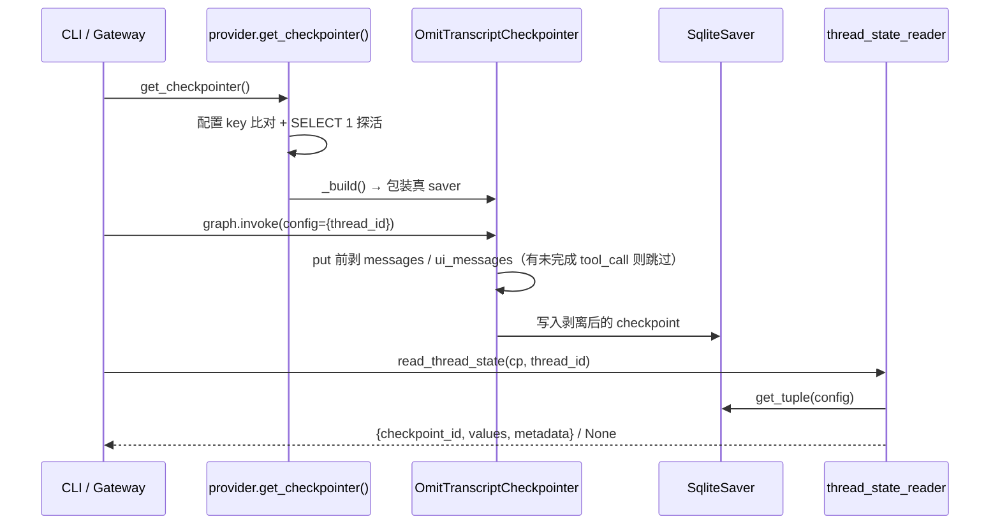

# 第 1 章　检查点与线程恢复 / Checkpoints

> **本章状态**：✅ 已实现并跑过验收。EvoFlow 侧事实标「源码事实」，本项目取舍标「本项目」。
> 基准：EvoFlow `f22af539`（v1.3.22）；本项目 `backend/packages/harness/myagentflow/`。

## 本章目标 / Goals

- 用 LangGraph saver 把「执行到哪一步」落盘，进程重启后同一 `thread_id` 能续上。
- 检查点里**不存对话记录**：历史的事实源是 `chat_messages` 表；检查点只存恢复所需的状态。
- 例外：工具执行到一半（AI 有 `tool_calls`、还没有对应 `ToolMessage`）时必须保留消息，否则恢复失败。
- 读线程状态走轻量路径，**不编译图**。

**本章不做**：跨会话检索（EvoFlow `session_search.py`）、异步 provider（`async_provider.py`）、网关 `GET /threads/{id}/state` 路由（第 10 部分）。EvoFlow 的 `CheckpointTranscriptSlimMiddleware` 也不在本章。

## 前置 / Prerequisites

- 第 1 部分：`config/checkpointer_config.py`、`config/app_config.py`、`agents/lead_agent/graph.py`。
- 依赖包：`langgraph`、`langgraph-checkpoint-sqlite`（sqlite 后端）。

## EvoFlow 源码导读 / Source reading

按这个顺序读，读完能回答「检查点存什么、不存什么、连接怎么管」：

| 顺序 | 文件 | 看什么 |
|---|---|---|
| 1 | `backend/packages/harness/evoflow/agents/checkpointer/provider.py`（264 行） | `_create_sqlite_saver()` 的长连接 + 两条 PRAGMA；`_checkpointer_connection_alive()` 探活；`_wrap_omit_transcript()` 包装 |
| 2 | `.../omit_transcript.py`（270 行） | `_TRANSCRIPT_CHANNELS`、`has_unresolved_tool_calls()`、`put/aput` 两个写入口 |
| 3 | `.../thread_state_reader.py`（172 行） | 读状态不 `make_lead_agent`；`get_tuple()` 后把 `channel_values` 转 JSON |
| 4 | `.../async_provider.py`（122 行） | 🟡 本章未实现，只记录存在 |

## 调用逻辑 / Invocation logic



## 事实与状态 / Facts

| # | 事实 | 归属 | 本项目状态 |
|---|---|---|---|
| 1 | 同步单例 `get_checkpointer()` + 一次性 `checkpointer_context()` | 源码事实 | ✅ 同名实现 |
| 2 | 后端 `memory` / `sqlite` / `postgres` | 源码事实 | ✅ 三分支（postgres 需 DSN 与依赖） |
| 3 | SQLite 用长连接 + `check_same_thread=False`，写前 `WAL`、`busy_timeout=5000`，再 `setup()` | 源码事实 | ✅ 相同 |
| 4 | 取单例前 `SELECT 1` 探活，失败重建 | 源码事实 | ✅ `_checkpointer_connection_alive()` |
| 5 | 缺包抛带安装命令的错误 | 源码事实 | ✅ 常量 `SQLITE_INSTALL` / `POSTGRES_INSTALL` |
| 6 | 写检查点前剥 `messages` / `ui_messages` | 源码事实 | ✅ `omit_transcript.py` |
| 7 | 开关默认开，可用环境变量关闭 | 源码事实（`EVOFLOW_CHECKPOINT_OMIT_TRANSCRIPT`） | ✅ 变量名换成 `MYAF_CHECKPOINT_OMIT_TRANSCRIPT` |
| 8 | 未完成 `tool_calls` 时保留 `messages` | 源码事实 | ✅ `has_unresolved_tool_calls()` |
| 9 | 读状态不编译图 | 源码事实 | ✅ `read_thread_state()` |
| 10 | 最终检查点再由 middleware 瘦身 | 源码事实 | ❌ 未实现（第 3 部分中间件章节） |

## 为什么检查点里不能有 `messages`

- 会话历史的事实源是 `chat_messages` 表：UI 历史、hydrate 都从那儿读。
- 检查点每轮都带完整 `messages`，体积随对话线性增长；同一份数据两处存，迟早不一致。
- 恢复只需要「哪个 superstep、哪些通道值」，不需要整段对白。

唯一例外是工具调用未完成：LangGraph 恢复时要看到「AIMessage 带 `tool_calls`、缺 `ToolMessage`」的形状，这个形状无法只凭消息表重建。

## 实现步骤 / Step by step

### Step 0　环境

```bash
cd /Users/main/my-agent-flow/backend
uv sync
uv add langgraph-checkpoint-sqlite     # 只用 memory 可跳过
```

---

### Step 1　`backend/packages/harness/myagentflow/agents/checkpointer/omit_transcript.py`：写前剥对话

**职责**：判断「能不能剥」+ 剥两个通道 + 包一层 saver。

**逻辑**

1. `_TRANSCRIPT_CHANNELS = ("messages", "ui_messages")`：只这两个通道算对话，其他通道（`plan`、`files` 等）一律不动。
2. `has_unresolved_tool_calls()`：扫消息，AI 的 `tool_call id` 进集合，`ToolMessage.tool_call_id` 出集合；集合非空 = 还欠工具结果。
3. `omit_transcript_channels()` 返回**新 dict**，不原地改：checkpoint 可能还被调用方持有。
4. `OmitTranscriptCheckpointer` 只覆盖 `put` / `aput`；`delete_thread` / `alist` 等显式透传，否则 LangGraph 的类级 capability 探测会误报「不支持删线程」。

**代码（全文，169 行）**

```python
"""一、文件说明
    检查点写入前剥离对话记录（messages / ui_messages）。
    为什么这么做：会话历史的事实源是 chat_messages 表，检查点只负责「恢复到哪个 superstep」。
    每轮都把完整 messages 写进检查点，库会随对话线性膨胀，同一份数据两处存也迟早不一致。
    例外：还有未完成的 tool_call（工具执行到一半、等人审批）时必须保留，
    否则 LangGraph 恢复时看不到「AIMessage 带 tool_calls、缺 ToolMessage」这个形状。

二、目录结构
    packages/harness/myagentflow/agents/checkpointer/
    ├── __init__.py  检查点层：对外只暴露「拿 saver / 重置 / 一次性上下文」三件事。
    ├── omit_transcript.py  ← 本文件：写入前剥对话、未完成 tool_call 例外
    ├── provider.py  检查点提供者：单例 + 一次性上下文（memory / sqlite / postgres）。
    └── thread_state_reader.py  只读检查点读线程状态：不编译图。

三、关键方法
    omit_transcript_on_checkpoint_put_enabled()  开关：MYAF_CHECKPOINT_OMIT_TRANSCRIPT，默认开。
    has_unresolved_tool_calls()                  是否有 AI tool_call 还没配对的 ToolMessage。
    omit_transcript_channels()                   安全时清空两个对话通道，返回新 dict。
    OmitTranscriptCheckpointer                   包在真 saver 外面，只改 put/aput，其余透传。
"""
from __future__ import annotations

import os
from typing import Any

# 要剥离的两个通道：messages 给模型/工具用，ui_messages 给前端投影用，都不是检查点该存的
_TRANSCRIPT_CHANNELS = ("messages", "ui_messages")

# 关掉开关的写法：0 / false / no / off（大小写不敏感）
_FALSE_VALUES = {"0", "false", "no", "off"}


def omit_transcript_on_checkpoint_put_enabled() -> bool:
    """开关：MYAF_CHECKPOINT_OMIT_TRANSCRIPT，默认开。"""
    raw = (os.getenv("MYAF_CHECKPOINT_OMIT_TRANSCRIPT") or "1").strip().lower()
    return raw not in _FALSE_VALUES


def _tool_call_id(tc: Any) -> str:
    """从 tool_call 里取 id：dict 与对象两种形状都认。"""
    if isinstance(tc, dict):
        return str(tc.get("id") or tc.get("tool_call_id") or "").strip()
    return str(getattr(tc, "id", None) or getattr(tc, "tool_call_id", None) or "").strip()


def _message_type_name(msg: Any) -> str:
    """把消息归一成 ai / tool / 其他：LangChain 对象与 dict 两种形状都认。"""
    if isinstance(msg, dict):
        t = str(msg.get("type") or msg.get("role") or "").strip().lower()
        if t in {"ai", "assistant"}:
            return "ai"
        if t == "tool":
            return "tool"
        return t
    name = type(msg).__name__.lower()
    if "ai" in name:
        return "ai"
    if "tool" in name:
        return "tool"
    return name


def has_unresolved_tool_calls(messages: Any) -> bool:
    """有 AI tool_call 没配对的 ToolMessage 时返回 True（中断/工具中途）。

    做法：扫一遍，AI 的 tool_call id 进集合，ToolMessage 的 tool_call_id 出集合；
    最后集合非空就是「还欠一个工具结果」。
    """
    if not isinstance(messages, list) or not messages:
        return False

    pending: set[str] = set()
    for msg in messages:
        kind = _message_type_name(msg)
        if kind == "ai":
            if isinstance(msg, dict):
                raw_tcs = msg.get("tool_calls")
                if raw_tcs is None and isinstance(msg.get("kwargs"), dict):
                    raw_tcs = msg["kwargs"].get("tool_calls")
            else:
                raw_tcs = getattr(msg, "tool_calls", None)
            for tc in raw_tcs or []:
                tid = _tool_call_id(tc)
                if tid:
                    pending.add(tid)
        elif kind == "tool":
            if isinstance(msg, dict):
                tid = str(msg.get("tool_call_id") or "").strip()
                if not tid and isinstance(msg.get("kwargs"), dict):
                    tid = str(msg["kwargs"].get("tool_call_id") or "").strip()
            else:
                tid = str(getattr(msg, "tool_call_id", None) or "").strip()
            if tid:
                pending.discard(tid)
    return bool(pending)


def omit_transcript_channels(checkpoint: dict[str, Any]) -> dict[str, Any]:
    """安全时清空 messages / ui_messages，返回浅拷贝；不安全或没东西可剥就原样返回。

    返回新 dict 而不是原地改：checkpoint 可能还被调用方持有，原地改会污染它的状态。
    """
    if not isinstance(checkpoint, dict):
        return checkpoint

    channel_values = checkpoint.get("channel_values")
    if not isinstance(channel_values, dict):
        return checkpoint

    messages = channel_values.get("messages")
    if has_unresolved_tool_calls(messages):
        return checkpoint

    # 没有对话也没有 UI 消息：不用白拷一份
    if not messages and not channel_values.get("ui_messages"):
        return checkpoint

    new_values = dict(channel_values)
    new_values["messages"] = []
    if "ui_messages" in new_values:
        new_values["ui_messages"] = []
    out = dict(checkpoint)
    out["channel_values"] = new_values
    return out


class OmitTranscriptCheckpointer:
    """包在真 saver 外面：put/aput 前剥对话，其余方法原样透传。

    为什么要包一层而不是改 Saver 子类：memory / sqlite / postgres 三个 saver 的
    写入口签名一致，包一层就能同时覆盖；子类化要给每个后端各写一遍。
    """

    def __init__(self, inner: Any) -> None:
        self._inner = inner

    def __getattr__(self, name: str) -> Any:
        # 没显式声明的方法一律转给真 saver：capability 探测以外都够用
        return getattr(self._inner, name)

    def put(self, config: Any, checkpoint: Any, metadata: Any, new_versions: Any) -> Any:
        """写检查点前剥对话；开关关闭时原样写。"""
        if omit_transcript_on_checkpoint_put_enabled() and isinstance(checkpoint, dict):
            checkpoint = omit_transcript_channels(checkpoint)
        return self._inner.put(config, checkpoint, metadata, new_versions)

    async def aput(self, config: Any, checkpoint: Any, metadata: Any, new_versions: Any) -> Any:
        """异步写入口，规则与 put 相同。"""
        if omit_transcript_on_checkpoint_put_enabled() and isinstance(checkpoint, dict):
            checkpoint = omit_transcript_channels(checkpoint)
        return await self._inner.aput(config, checkpoint, metadata, new_versions)

    # 下面这些显式声明只为让 LangGraph 的类级 capability 探测看到它们；
    # 只靠 __getattr__ 的话，类上查不到 adelete_thread，会误报「不支持删线程」。
    async def aput_writes(self, config: Any, writes: Any, task_id: str, task_path: str = "") -> Any:
        """透传异步写 writes。"""
        return await self._inner.aput_writes(config, writes, task_id, task_path)

    async def adelete_thread(self, thread_id: str) -> None:
        """透传删线程：删的是检查点，不动消息表。"""
        return await self._inner.adelete_thread(thread_id)

    def delete_thread(self, thread_id: str) -> None:
        """透传同步删线程。"""
        return self._inner.delete_thread(thread_id)

    async def alist(self, config: Any, *, filter: dict[str, Any] | None = None, before: Any = None, limit: int | None = None) -> Any:
        """透传异步列举；返回的是异步迭代器，不要 await。"""
        return self._inner.alist(config, filter=filter, before=before, limit=limit)
```

**验证**

```bash
cd /Users/main/my-agent-flow/backend
uv run python -c "
from langchain_core.messages import HumanMessage
from myagentflow.agents.checkpointer.omit_transcript import omit_transcript_channels
cp = {'channel_values': {'messages': [HumanMessage(content='hi')], 'plan': 1}}
print(omit_transcript_channels(cp)['channel_values'])
"
# 期望：{'messages': [], 'plan': 1}
```

---

### Step 2　`backend/packages/harness/myagentflow/agents/checkpointer/provider.py`：单例 + 探活 + 包装

**职责**：按配置造 saver、缓存单例、连接死了能重建。

**逻辑**

1. 配置来源 `_checkpointer_config()`：优先环境变量（测试覆盖），否则 `AppConfig.checkpointer`。
2. `_build()` 三分支；sqlite 走长连接 + 两条 PRAGMA；每个分支返回前都套 `_wrap_omit_transcript()`。
3. `_checkpointer_connection_alive()`：`inner.conn` 存在就 `SELECT 1`；memory / postgres 没有 `.conn`，视为活着。
4. `get_checkpointer()`：key（backend + DSN/path）不变且连接活着就复用；否则关旧连接重建。
5. `checkpointer_context()`：一次性 saver，退出即关，给 CLI / 测试用。

**代码（节选：包装、探活、单例、重置；完整文件 207 行）**

```python
def _wrap_omit_transcript(saver: Checkpointer) -> Checkpointer:
    """给 saver 套上「写前剥对话」的包装；开关关闭时原样返回。"""
    from myagentflow.agents.checkpointer.omit_transcript import (
        OmitTranscriptCheckpointer,
        omit_transcript_on_checkpoint_put_enabled,
    )

    if not omit_transcript_on_checkpoint_put_enabled():
        return saver
    return OmitTranscriptCheckpointer(saver)


def _build(backend: str) -> Checkpointer:
    """按 backend 造一个全新的 saver（不缓存）。"""
    if backend == "memory":
        from langgraph.checkpoint.memory import InMemorySaver

        return _wrap_omit_transcript(InMemorySaver())

    if backend == "sqlite":
        try:
            from langgraph.checkpoint.sqlite import SqliteSaver
        except ImportError as exc:  # 缺包给「怎么装」
            raise RuntimeError(SQLITE_INSTALL) from exc

        path = _sqlite_path()
        os.makedirs(os.path.dirname(path) or ".", exist_ok=True)

        # 长连接而非每次 new：SqliteSaver 持有 connection，
        # 频繁开关会导致 setup 反复执行，并发时还会互相锁表。
        conn = sqlite3.connect(path, check_same_thread=False)
        # WAL：读不阻塞写、写不阻塞读。检查点是「短写 + 高频读」，收益最大。
        conn.execute("PRAGMA journal_mode=WAL")
        # busy_timeout：并发写最多等 5s 再报 locked，不设就直接抛 database is locked。
        conn.execute("PRAGMA busy_timeout=5000")

        saver = SqliteSaver(conn)
        saver.setup()  # 建表：v3.x 实测为 checkpoints + writes（版本不同表名会变，以实际为准）
        return _wrap_omit_transcript(saver)

    if backend == "postgres":
        dsn = _pg_dsn()
        if not dsn:
            raise RuntimeError(POSTGRES_CONN_REQUIRED)
        try:
            from langgraph.checkpoint.postgres import PostgresSaver
        except ImportError as exc:
            raise RuntimeError(POSTGRES_INSTALL) from exc

        saver = PostgresSaver.from_conn_string(dsn)
        saver.setup()
        return _wrap_omit_transcript(saver)

    raise RuntimeError(f"未知的 checkpointer 后端：{backend}")


def _checkpointer_connection_alive(cp: Checkpointer) -> bool:
    """长连接可能已被关闭：取用前 SELECT 1 探活，失败就让单例重建。"""
    inner = getattr(cp, "_inner", cp)
    conn = getattr(inner, "conn", None) or getattr(cp, "conn", None)
    if conn is None:            # memory / postgres pool 没有 .conn，视为活着
        return True
    try:
        conn.execute("SELECT 1")
        return True
    except Exception:
        return False


_lock = threading.RLock()
_singleton: Checkpointer | None = None
_singleton_key: tuple[str, str] | None = None


def _close(saver: Checkpointer) -> None:
    """关掉 saver 底下的真实连接。不是所有后端都暴露 .conn，所以探测着来。"""
    conn = getattr(saver, "conn", None)
    if conn is not None:
        with contextlib.suppress(Exception):
            conn.close()


def get_checkpointer() -> Checkpointer:
    """取全局 saver：同一份配置返回同一对象，配置变了自动重建。"""
    global _singleton, _singleton_key
    backend = _backend()
    key = (backend, _pg_dsn() or _sqlite_path())

    with _lock:  # 两个线程同时首次调用时，只允许一个真的去 build
        if _singleton is not None and _singleton_key == key:
            if _checkpointer_connection_alive(_singleton):
                return _singleton
            _close(_singleton)      # 连接已死：清掉，下面重建
        if _singleton is not None:  # 旧配置：先关连接
            _close(_singleton)
        _singleton = _build(backend)
        _singleton_key = key
        logger.info("checkpointer 初始化完成 backend=%s", backend)
        return _singleton


def reset_checkpointer() -> None:
    """测试与「运行中改配置」用：关连接 + 清空单例。"""
    global _singleton, _singleton_key
    with _lock:
        if _singleton is not None:
            _close(_singleton)
        _singleton = None
        _singleton_key = None
```

**验证**

```bash
cd /Users/main/my-agent-flow/backend
MYAF_CHECKPOINTER=sqlite MYAF_CHECKPOINT_SQLITE_PATH=/tmp/myaf-cp.sqlite uv run python -c "
from myagentflow.agents.checkpointer import get_checkpointer, reset_checkpointer
a = get_checkpointer(); b = get_checkpointer()
print(a is b, type(a).__name__)
reset_checkpointer()
print(a is get_checkpointer())
"
# 期望：True OmitTranscriptCheckpointer / False
```

---

### Step 3　`backend/packages/harness/myagentflow/agents/checkpointer/thread_state_reader.py`：读状态不编译图

**职责**：只调 `get_tuple()`，返回最小快照。

**代码（全文，38 行）**

```python
"""一、文件说明
    只读检查点读线程状态：不编译图。
    为什么独立成文件：刷新页面、拉历史这类高频路径会反复调它。
    一旦有人顺手在这里 compile/invoke 图，整条读路径就变成秒级。

二、目录结构
    packages/harness/myagentflow/agents/checkpointer/
    ├── __init__.py  检查点层：对外只暴露「拿 saver / 重置 / 一次性上下文」三件事。
    ├── provider.py  检查点提供者：单例 + 一次性上下文（memory / sqlite / pos
    └── thread_state_reader.py  ← 本文件

三、关键方法
    read_thread_state()  返回最新检查点的最小快照；线程不存在返回 None。
"""
from __future__ import annotations

from typing import Any

from langgraph.types import Checkpointer


def read_thread_state(checkpointer: Checkpointer, thread_id: str) -> dict[str, Any] | None:
    """返回最新检查点的最小快照；线程不存在返回 None。

    返回结构刻意收窄：只给 checkpoint_id / values / metadata。
    要完整对话去消息表找 —— 检查点里没有消息，这是设计，不是缺陷。
    """
    config = {"configurable": {"thread_id": str(thread_id)}}
    tup = checkpointer.get_tuple(config)
    if tup is None:
        return None

    checkpoint = tup.checkpoint or {}
    return {
        "checkpoint_id": checkpoint.get("id"),
        "values": checkpoint.get("channel_values", {}),
        "metadata": dict(tup.metadata or {}),
    }
```

**验证**

```bash
cd /Users/main/my-agent-flow/backend
uv run python -c "
from myagentflow.agents.checkpointer import get_checkpointer
from myagentflow.agents.checkpointer.thread_state_reader import read_thread_state
print(read_thread_state(get_checkpointer(), 'no-such-thread'))
"
# 期望：None
```

---

### Step 4　`backend/packages/harness/myagentflow/agents/checkpointer/__init__.py`：只暴露三个名字

```python
"""一、文件说明
    检查点层：对外只暴露「拿 saver / 重置 / 一次性上下文」三件事。

二、目录结构
    packages/harness/myagentflow/agents/checkpointer/
    ├── __init__.py  ← 本文件
    ├── omit_transcript.py  写入前剥对话：messages / ui_messages，未完成 tool_call 例外
    ├── provider.py  检查点提供者：单例 + 一次性上下文（memory / sqlite / postgres）
    └── thread_state_reader.py  只读检查点读线程状态：不编译图。

三、关键方法
    （仅模块级常量，无公开函数）
"""
from .provider import checkpointer_context, get_checkpointer, reset_checkpointer

__all__ = ["checkpointer_context", "get_checkpointer", "reset_checkpointer"]
```

---

### Step 5　`backend/tests/chapters/test_ch02_01_checkpointer.py`：5 个用例

覆盖：单例 + 建表、空线程、正常轮次剥离、未完成 tool_call 保留、开关关闭。

**代码（全文，128 行）**

```python
"""一、文件说明
    02/01 检查点：单例、建表、空线程读取。

二、覆盖
    test_sqlite_setup_and_singleton()  两次取检查点返回同一对象，且 setup() 建出了 checkpoints 表。
    test_read_unknown_thread()         读不存在的线程返回 None，不抛异常。
    test_omit_transcript_on_put()      正常轮次写入前把 messages / ui_messages 清空。
    test_keep_messages_for_unresolved_tool_call()  工具没配对的轮次必须保留 messages。
    test_omit_switch_off()             开关关闭时原样写入，不剥对话。

三、运行
    uv run pytest tests/chapters/test_ch02_01_checkpointer.py -q
"""
from __future__ import annotations

import sqlite3


def test_sqlite_setup_and_singleton(tmp_path, monkeypatch):
    """两次取检查点返回同一对象，且 setup() 建出了 checkpoints 表。"""
    db = tmp_path / "cp.sqlite"
    monkeypatch.setenv("MYAF_CHECKPOINTER", "sqlite")
    monkeypatch.setenv("MYAF_CHECKPOINT_SQLITE_PATH", str(db))

    from myagentflow.agents.checkpointer import provider

    provider.reset_checkpointer()      # 清掉上一条用例留下的单例
    cp1 = provider.get_checkpointer()
    cp2 = provider.get_checkpointer()
    assert cp1 is cp2                  # 单例

    tables = {
        row[0]
        for row in sqlite3.connect(db).execute(
            "select name from sqlite_master where type='table'"
        )
    }
    assert "checkpoints" in tables     # setup() 真的跑过

    provider.reset_checkpointer()


def test_read_unknown_thread(tmp_path, monkeypatch):
    """读不存在的线程返回 None，不抛异常。"""
    monkeypatch.setenv("MYAF_CHECKPOINTER", "sqlite")
    monkeypatch.setenv("MYAF_CHECKPOINT_SQLITE_PATH", str(tmp_path / "x.sqlite"))

    from myagentflow.agents.checkpointer import provider
    from myagentflow.agents.checkpointer.thread_state_reader import read_thread_state

    provider.reset_checkpointer()
    assert read_thread_state(provider.get_checkpointer(), "nope") is None
    provider.reset_checkpointer()


class _RecordingSaver:
    """记录 put 收到什么的假 saver：只验证「写之前被改成了什么」。"""

    def __init__(self) -> None:
        self.checkpoint = None

    def put(self, config, checkpoint, metadata, new_versions):
        self.checkpoint = checkpoint

    async def aput(self, config, checkpoint, metadata, new_versions):
        self.checkpoint = checkpoint


def test_omit_transcript_on_put(monkeypatch):
    """正常轮次（工具都配对）写入前把两个对话通道清空，其他通道保留。"""
    monkeypatch.delenv("MYAF_CHECKPOINT_OMIT_TRANSCRIPT", raising=False)
    from langchain_core.messages import AIMessage, HumanMessage
    from myagentflow.agents.checkpointer.omit_transcript import (
        OmitTranscriptCheckpointer,
    )

    inner = _RecordingSaver()
    cp = OmitTranscriptCheckpointer(inner)
    cp.put(
        {"configurable": {"thread_id": "t1"}},
        {
            "channel_values": {
                "messages": [HumanMessage(content="hi"), AIMessage(content="ok")],
                "ui_messages": [{"type": "human"}],
                "plan": {"steps": 1},
            }
        },
        {},
        {},
    )
    assert inner.checkpoint["channel_values"]["messages"] == []
    assert inner.checkpoint["channel_values"]["ui_messages"] == []
    assert inner.checkpoint["channel_values"]["plan"] == {"steps": 1}   # 非对话通道不许动


def test_keep_messages_for_unresolved_tool_call(monkeypatch):
    """AI 带 tool_call、还没有对应 ToolMessage 时，messages 必须原样保留。"""
    monkeypatch.delenv("MYAF_CHECKPOINT_OMIT_TRANSCRIPT", raising=False)
    from langchain_core.messages import AIMessage
    from myagentflow.agents.checkpointer.omit_transcript import (
        OmitTranscriptCheckpointer,
    )

    messages = [
        AIMessage(
            content="",
            tool_calls=[{"name": "echo", "args": {"text": "x"}, "id": "call-1"}],
        )
    ]
    inner = _RecordingSaver()
    cp = OmitTranscriptCheckpointer(inner)
    cp.put({"configurable": {"thread_id": "t1"}}, {"channel_values": {"messages": messages}}, {}, {})
    assert inner.checkpoint["channel_values"]["messages"] == messages


def test_omit_switch_off(monkeypatch):
    """开关设 0 时，put 收到的 checkpoint 保持原样。"""
    monkeypatch.setenv("MYAF_CHECKPOINT_OMIT_TRANSCRIPT", "0")
    from langchain_core.messages import HumanMessage
    from myagentflow.agents.checkpointer.omit_transcript import (
        OmitTranscriptCheckpointer,
    )

    messages = [HumanMessage(content="hi")]
    inner = _RecordingSaver()
    cp = OmitTranscriptCheckpointer(inner)
    cp.put({"configurable": {"thread_id": "t1"}}, {"channel_values": {"messages": messages}}, {}, {})
    assert inner.checkpoint["channel_values"]["messages"] == messages
```

**验证**

```bash
cd /Users/main/my-agent-flow/backend
uv run pytest tests/chapters/test_ch02_01_checkpointer.py -q
# 期望：5 passed
```

## 对照与差异 / Alignment

| EvoFlow 文件 | 本项目文件 | 本章实现 | 未实现 |
|---|---|---|---|
| `agents/checkpointer/provider.py` | `backend/packages/harness/myagentflow/agents/checkpointer/provider.py` | `get_checkpointer` / `reset_checkpointer` / `checkpointer_context` / 探活 / 包装 | async provider、data_paths 的 `$EVOFLOW_HOME` 解析 |
| `agents/checkpointer/omit_transcript.py` | `backend/packages/harness/myagentflow/agents/checkpointer/omit_transcript.py` | 剥对话、未完成 tool_call 例外、开关 | 延迟观测事件 `_emit_cp_io` |
| `agents/checkpointer/thread_state_reader.py` | `backend/packages/harness/myagentflow/agents/checkpointer/thread_state_reader.py` | `read_thread_state()` 最小快照 | 消息扁平化、`next/tasks`、路径解析、重试 |
| `agents/checkpointer/async_provider.py` | — | — | 本章不需要 |
| `agents/checkpointer/session_search.py` | — | — | 跨会话检索，后续章节 |

**本项目设计选择**：环境变量前缀用 `MYAF_` 而不是 `EVOFLOW_`；检查点默认路径 `.myaf/checkpoints.sqlite`；`read_thread_state` 只返回 `checkpoint_id` / `values` / `metadata`，够本章用。

## 验收 / Acceptance

```bash
cd /Users/main/my-agent-flow/backend
uv run pytest tests/chapters/test_ch02_01_checkpointer.py -q          # 5 passed
uv run python -m ruff check packages tests                            # All checks passed
```

**行为验收**（手工，需 sqlite 后端）：

1. 用同一 `thread_id` 跑两轮，检查点里有 `checkpoints` 表、`messages` 通道为空；
2. 造一个「AI 带 tool_call、无 ToolMessage」的状态写入，确认 `messages` 未被清空；
3. `reset_checkpointer()` 后旧对象不再被复用。

## 常见坑 / Troubleshooting

| 症状 | 原因 | 动作 |
|---|---|---|
| `ModuleNotFoundError: langgraph.checkpoint.sqlite` | 没装后端包 | `uv add langgraph-checkpoint-sqlite`，或先用 memory |
| `database is locked` | 多个长连接 / 没设 busy_timeout | 确认走单例；确认两条 PRAGMA |
| `SQLite objects created in a thread ...` | 漏 `check_same_thread=False` | 补上，别改成每请求新连接 |
| `no such table: checkpoints` | `setup()` 没调 | 在 `_build()` 里补 |
| 恢复后没有历史 | 检查点本来就不存 messages | 从 `chat_messages` hydrate，别指望检查点 |
| 工具中断后恢复失败 | 剥离时把未完成 `tool_calls` 也清了 | 确认 `has_unresolved_tool_calls()` 生效 |

## 知识点

- [agent-book · LangGraph](https://g0-000.github.io/agent-book/langgraph/)：`thread_id` 与 `checkpoint_id` 的区别
- [agent-book · 记忆章](https://g0-000.github.io/agent-book/agent-learning/chapter_memory/)：状态持久化与消息存档的分工
- [Harbor404 · 推理链路延迟优化](https://harbor404.fushenlin.com/notes/llm-agent-latency-optimization/)：读路径为什么不编译图
