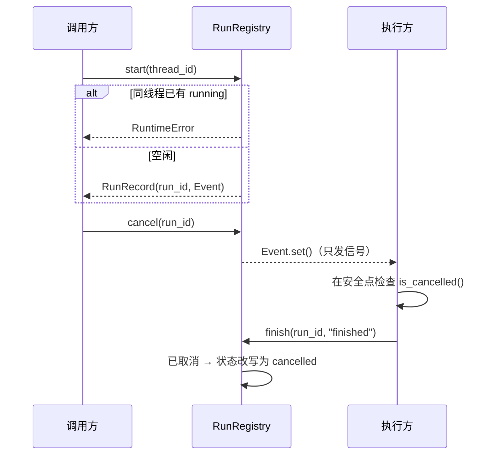

# 第 2 章　运行生命周期与取消 / Run Lifecycle

> **本章状态**：🟡 最小实现（进程内注册表）已落地并测试；EvoFlow 的 DB 单写入口、4 秒停止扫描、远程 HTTP 取消**本章未实现**。
> 基准：EvoFlow `f22af539`（v1.3.22）。

## 本章目标 / Goals

- 给「一次 run」一个可查询的状态：`running` → `finished` / `cancelled` / `error`。
- 同一线程同时只允许一个活跃 run：两条 run 会抢写同一个 checkpoint。
- 取消是「发信号」，不是「杀线程」：执行方在安全点检查信号并自己收尾。
- 取消过的 run 不许再报成功（`finish("finished")` 会被改写成 `cancelled`）。

**本章不做**：把状态写进 DB（EvoFlow 的 `persistence/session_run_state.py`）、停止扫描、调 LangGraph Server 的 `/runs/{id}/cancel`。这些属于第 10 部分「Gateway 与运行控制」。本章先把状态机与并发语义写对。

## EvoFlow 源码导读 / Source reading

| 文件 | 行数 | 读什么 |
|---|---|---|
| `backend/packages/harness/evoflow/session_execution/lifecycle.py` | 228 | `start_session_turn()` / `force_end_session_turn()` / `_after_run_ended()`：状态变更只走 DB，且结束要清缓存 |
| `.../session_execution/langgraph_cancel.py` | 279 | `_post_cancel_run()` 三态 `cancelled` / `already_gone` / `rejected`；4 秒上限来自 `EVOFLOW_STOP_SWEEP_MAX_WAIT_S=4` |
| `.../session_execution/types.py` | 14 | 运行状态的类型定义 |
| `.../persistence/session_run_state.py` | — | `RUN_STATUS_RUNNING`、`mark_session_run_started/ended`、`resolve_terminal_run_status` |

**EvoFlow 的事实**：

1. 状态是**数据库里的一个字段**，不是进程内对象；所以 Gateway、worker 看到的是同一份状态。
2. 结束状态由 `resolve_terminal_run_status(reason, source)` 决定，避免每个调用点各写一套判断。
3. 取消是向 LangGraph Server 发 HTTP 请求，失败分三态；停止扫描最多等 4 秒，每 0.25 秒轮询。
4. run 结束后要失效 `runs_probe` 与 `active_sessions` 缓存。

## 本章的取舍 / Scope trade-off

| 能力 | EvoFlow | 本章 |
|---|---|---|
| 状态存哪 | DB 字段 | 进程内 `dict` + `threading.Event` |
| 同线程单活 | DB 唯一约束 / 状态检查 | `RunRegistry.start()` 抛 `RuntimeError` |
| 取消 | HTTP 调 LangGraph Server + 停止扫描 | 只置 `Event`，由执行方检查 |
| 跨进程可见 | 是 | **否**（仅当前进程） |
| 收尾缓存失效 | 有 | 无（没有缓存层） |

这不是「对齐简化版」，是**范围更小**：本章只保证单进程内的语义正确。后续接 Gateway 时把 `RunRegistry` 的状态写进 `session_run_state` 即可，状态机不用改。

## 调用逻辑 / Invocation logic



## 实现步骤 / Step by step

### Step 1　`backend/packages/harness/myagentflow/session_execution/lifecycle.py`

**职责**：`RunRecord` 保存一次 run 的事实；`RunRegistry` 管注册、单活、取消、收尾。

**关键决策**

1. **用 `threading.Event` 而不是 `bool`**：取消可能来自另一个线程（将来 HTTP 接口），`bool` 读写没有同步语义，`Event` 有。
2. **`ALLOWED_END`** 只放三个终态：`finished` / `cancelled` / `error`。放 `failed` 进来会让调用方分不清「取消」和「出错」。
3. **`start()` 内先查活跃 run 再插入**，整段在 `RLock` 里：否则两个请求同时 start 都能过检查。
4. **`cancel()` 只置位**：不直接把状态改 `cancelled`，因为执行方可能正握着 checkpoint 写一半；让它自己在安全点收尾。
5. **`finish()` 的取消优先**：`cancelled.is_set() and status == "finished"` → 强制 `cancelled`。用户点了停止，UI 就不能显示「成功」。
6. **`active_for_thread()` 读也加锁**：它会被 HTTP 线程调用，和 `start()` 并发。

**代码（全文，83 行）**

```python
"""一、文件说明
    运行生命周期：登记、取消、收尾。
    为什么用 Event 而不是 bool：取消可能来自另一个线程（HTTP cancel 接口），
    bool 读写没有内存屏障，Event 有。

二、目录结构
    packages/harness/myagentflow/session_execution/
    ├── __init__.py
    ├── idempotency.py  幂等：同一个请求只执行一次。
    └── lifecycle.py  ← 本文件

三、关键方法
    RunRecord    一次运行的记录：线程、状态、起止时间。
    RunRegistry  线程内 run 的注册表：启动、完成、取消、查询。
"""
from __future__ import annotations

import threading
import time
import uuid
from dataclasses import dataclass, field

# 允许的终态：running 之外的三个。别把 "failed" 也放进来，否则调用方分不清「取消」和「出错」
ALLOWED_END = {"finished", "cancelled", "error"}


@dataclass
class RunRecord:
    """一次运行的记录：线程、状态、起止时间。"""
    thread_id: str
    run_id: str = field(default_factory=lambda: uuid.uuid4().hex)
    status: str = "running"
    started_at: float = field(default_factory=time.time)
    ended_at: float | None = None
    cancelled: threading.Event = field(default_factory=threading.Event)


class RunRegistry:
    """线程内 run 的注册表：启动、完成、取消、查询。"""
    def __init__(self) -> None:
        self._runs: dict[str, RunRecord] = {}
        self._lock = threading.RLock()

    def start(self, thread_id: str) -> RunRecord:
        """开一个 run。同线程已有活跃 run 时直接拒绝：两条 run 会抢写同一个 checkpoint。"""
        with self._lock:
            active = self.active_for_thread(thread_id)
            if active is not None:
                raise RuntimeError(f"线程 {thread_id} 已有活跃 run：{active.run_id}")
            rec = RunRecord(thread_id=thread_id)
            self._runs[rec.run_id] = rec
            return rec

    def active_for_thread(self, thread_id: str) -> RunRecord | None:
        with self._lock:      # 可能被别的线程查（HTTP 层），读也要锁
            for rec in self._runs.values():
                if rec.thread_id == thread_id and rec.status == "running":
                    return rec
            return None

    def cancel(self, run_id: str) -> bool:
        with self._lock:
            rec = self._runs.get(run_id)
            if rec is None or rec.status != "running":
                return False
            rec.cancelled.set()   # 只发信号，真正的收尾由执行方做
            return True

    def is_cancelled(self, run_id: str) -> bool:
        rec = self._runs.get(run_id)
        return bool(rec and rec.cancelled.is_set())

    def finish(self, run_id: str, status: str = "finished") -> None:
        if status not in ALLOWED_END:
            raise ValueError(f"非法终态：{status}")
        with self._lock:
            rec = self._runs.get(run_id)
            if rec is None:
                return
            if rec.cancelled.is_set() and status == "finished":
                status = "cancelled"   # 取消过的 run 不许报成功
            rec.status = status
            rec.ended_at = time.time()
```

**验证**

```bash
cd /Users/main/my-agent-flow/backend
uv run python -c "
from myagentflow.session_execution.lifecycle import RunRegistry
r = RunRegistry(); run = r.start('t1')
print(run.status, r.cancel(run.run_id))
r.finish(run.run_id, 'finished')
print(r._runs[run.run_id].status)
"
# 期望：running True / cancelled
```

---

### Step 2　`backend/tests/chapters/test_ch02_02_lifecycle.py`

覆盖四个点：单活、取消优先、取消只影响目标 run、取消未知/已结束返回 False。

**代码（全文，64 行）**

```python
"""一、文件说明
    02/02 run 生命周期：线程内单活、取消优先。

二、覆盖
    test_one_active_run_per_thread()  同线程第二次 start 抛 RuntimeError，finish 后可再开。
    test_cancel_wins_over_finish()    cancel 后即使再 finish，状态仍是 cancelled。
    test_cancel_is_per_run()          取消只影响目标 run，不误伤别的线程。
    test_cancel_unknown_and_done()    取消不存在/已收尾的 run 返回 False，不抛异常。

三、运行
    uv run pytest tests/chapters/test_ch02_02_lifecycle.py -q
"""

from __future__ import annotations

import pytest


def test_one_active_run_per_thread():
    """同线程第二次 start 抛 RuntimeError，finish 后可再开。"""
    from myagentflow.session_execution.lifecycle import RunRegistry

    reg = RunRegistry()
    r1 = reg.start("t1")
    with pytest.raises(RuntimeError):
        reg.start("t1")
    reg.finish(r1.run_id)
    reg.start("t1")            # 收尾后可以再开


def test_cancel_wins_over_finish():
    """cancel 后即使再 finish，状态仍是 cancelled。"""
    from myagentflow.session_execution.lifecycle import RunRegistry

    reg = RunRegistry()
    r = reg.start("t2")
    assert reg.cancel(r.run_id) is True
    reg.finish(r.run_id, "finished")
    assert reg._runs[r.run_id].status == "cancelled"


def test_cancel_is_per_run():
    """取消只影响目标 run：另一个线程的 run 仍然能正常收尾。"""
    from myagentflow.session_execution.lifecycle import RunRegistry

    reg = RunRegistry()
    r1 = reg.start("t1")
    r2 = reg.start("t2")
    assert reg.cancel(r1.run_id) is True
    assert reg.is_cancelled(r1.run_id) is True
    assert reg.is_cancelled(r2.run_id) is False
    reg.finish(r2.run_id)
    assert reg._runs[r2.run_id].status == "finished"


def test_cancel_unknown_and_done():
    """取消不存在的 run 或已收尾的 run 都返回 False。"""
    from myagentflow.session_execution.lifecycle import RunRegistry

    reg = RunRegistry()
    assert reg.cancel("no-such-run") is False
    r = reg.start("t3")
    reg.finish(r.run_id)
    assert reg.cancel(r.run_id) is False
```

**验证**

```bash
cd /Users/main/my-agent-flow/backend
uv run pytest tests/chapters/test_ch02_02_lifecycle.py -q
# 期望：4 passed
```

---

### Step 3　接到执行方（本章只给接口，不接图）

执行方（未来的 chat 路由 / CLI）应该这样用：

```python
reg = RunRegistry()
rec = reg.start(thread_id)
try:
    for event in stream_graph(...):
        if reg.is_cancelled(rec.run_id):
            reg.finish(rec.run_id, "cancelled")
            break
        yield event
    else:
        reg.finish(rec.run_id)
except Exception:
    reg.finish(rec.run_id, "error")
    raise
```

**为什么在流循环里检查**：取消要尽快生效，但不能打断一次 checkpoint 写入；每个事件边界就是安全点。

## 与 EvoFlow 的差异 / Differences

| 点 | EvoFlow | 本章 | 影响 |
|---|---|---|---|
| 状态可见范围 | 全进程/多 worker（DB） | 当前进程 | 多 worker 部署时取消不了别的进程的 run |
| 取消实现 | HTTP + 停止扫描 + 三态结果 | 置 `Event` | 无法取消卡在外部工具里的 run |
| 终态判定 | `resolve_terminal_run_status()` 统一 | `finish()` 里一条 if | 规则少，够本章 |
| 缓存失效 | `_after_run_ended()` | 无 | 没有缓存，不需要 |
| 清理 | 结束后按策略清 | 记录一直留在 dict | 长跑进程会缓慢增长（见「已知限制」） |

## 已知限制 / Known limits

- `RunRegistry._runs` 不清理已结束的记录：本章不跑长驻服务，可接受；接 Gateway 前要加保留策略或落库。
- 没有跨进程取消；没有停止扫描；没有 LangGraph Server 的 `run_id` 对齐。
- 取消只在执行方主动检查时生效，同步阻塞的工具调用无法中断。

## 验收 / Acceptance

```bash
cd /Users/main/my-agent-flow/backend
uv run pytest tests/chapters/test_ch02_02_lifecycle.py -q     # 4 passed
uv run python -m ruff check packages tests                   # All checks passed
```

## 常见坑 / Troubleshooting

| 症状 | 原因 | 动作 |
|---|---|---|
| 两个请求都 start 成功 | 检查与插入不在同一把锁里 | 整段包在 `RLock` |
| 取消后 UI 显示成功 | `finish` 没做取消优先 | 保留 `cancelled.is_set()` 分支 |
| 取消迟迟不生效 | 执行方没在流循环里检查 | 每个事件边界查一次 |
| 线程一直「忙」 | `finish` 没被调用（异常路径漏了） | `try/finally` 或 `except` 里补 |
| 换成多进程后取消失效 | 状态在进程内存 | 接 DB 状态表（第 10 部分） |

## 知识点

- [agent-book · 并发与取消](https://g0-000.github.io/agent-book/)：为什么取消用信号而不是强杀
- [Harbor404 · 推理链路延迟优化](https://harbor404.fushenlin.com/notes/llm-agent-latency-optimization/)：流式响应里的安全点
