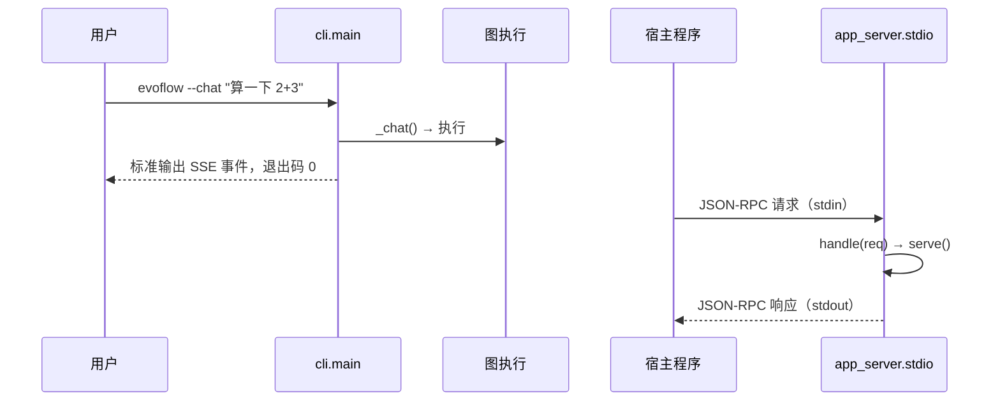

# 第 3 章　CLI 与 stdio App Server

> **EvoFlow 对照状态 / Alignment status：** 🔍 结构已核对（路径、行数、符号均取自源码实测），**行为**（调用顺序、边界条件）尚未逐行核对。

## 本章目标
让同一个 Agent 内核能被 **终端、编辑器、桌面端** 复用，而不必各自重写一遍逻辑。

## 最小闭环
`evoflow --chat "算一下 2+3"` → 标准输出 SSE 事件 → 退出码 0；同一套逻辑通过 stdio JSON-RPC 被宿主程序调用。

## 调用逻辑



```text
CLI  → 直接调用 harness 会话服务 → 流事件打印
stdio → 宿主进程 spawn → JSON-RPC 2.0 over stdin/stdout → chat_bridge → harness
HTTP  → Gateway（Part 10）
```
三者共用 `session_execution` 与 `chat_session_service`，差别只在传输层。

## 真实模块地图（已核对：路径 · 行数 · 符号）

| 文件 | 行数 | 关键符号 | 模块常量 |
|---|---|---|---|
| `packages/harness/evoflow/cli/main.py:52` | 105 | `_peek_command`、`build_parser`、`main` | — |
| `packages/harness/evoflow/cli/common.py:13` | 44 | `add_json_input_flags`、`load_json_payload`、`add_output_flags` | — |
| `packages/harness/evoflow/app_server/stdio_rpc.py:26` | 719 | `StdioAppServer`；`_force_utf8_stdio`、`serve_stdio`、`serve_stdio_async` | PROTOCOL_VERSION |
| `packages/harness/evoflow/app_server/embed.py:17` | 96 | `resolve_app_server_listen_port`、`resolve_gateway_base_url_for_embed`、`start_embedded_app_server` | — |
| `packages/harness/evoflow/app_server/chat_bridge.py:21` | 396 | `_client_lock`、`_get_shared_gateway_client`、`reset_shared_gateway_client_for_tests` | — |
| `packages/harness/evoflow/desktop_stdio.py:270` | 363 | `_UnclosableStdio`；`apply_windows_stdio_env`、`_stream_is_usable`、`_is_colorama_wrapped` | — |
| `packages/harness/evoflow/app_server/stdio_rpc.py:26` | 719 | `StdioAppServer`；`_force_utf8_stdio`、`serve_stdio`、`serve_stdio_async` | PROTOCOL_VERSION |

## 核心概念
- **stdio 协议要点**：stdout 只能放协议消息，日志必须走 stderr，否则宿主解析失败。
- **一次连接一条会话**：连接即 session，断开即结束；不做隐式全局状态。
- **背压**：宿主读得慢时，事件要排队或合并，不能阻塞执行线程。

## 自研实现要点
```json
{"jsonrpc":"2.0","id":1,"method":"chat/send","params":{"session":"s1","text":"hi"}}
{"jsonrpc":"2.0","method":"chat/event","params":{"type":"delta","text":"你"}}
```
- 事件 `id` 单调递增，支持 `chat/resume` 从 last_id 续传。
- 退出：`chat/cancel` → 等终态事件 → 关闭管道。

## 业务规则
- 错误也走 JSON-RPC error，不往 stdout 打人类可读堆栈。
- 未授权方法直接拒绝，不暴露内部路径。

## 常见坑
- `print()` 调试污染 stdout。
- 子进程未随父进程退出 → 僵尸积累。
- 缓冲区不 flush → 宿主永远收不到最后一条事件。

## 验收
- [ ] CLI 与 HTTP 对同一输入产生等价事件序列
- [ ] stdout 无任何非协议输出
- [ ] 宿主 kill 后子进程同步退出

### 源码核对记录（路径与符号实测）

- `packages/harness/evoflow/cli/main.py`（105 行）；环境变量 `EVOFLOW_CONFIG_PATH`
  - 模块自述：EvoFlow CLI — manage models, skills, agents, MCP, assets, and more.…
- `packages/harness/evoflow/cli/common.py`（44 行）
  - 模块自述：Shared argparse helpers for EvoFlow CLI.…
- `packages/harness/evoflow/app_server/stdio_rpc.py`（719 行）：类 `StdioAppServer`；环境变量 `EVOFLOW_PSS_LOG`
  - 模块自述：Newline-delimited JSON-RPC app-server (stdio or local TCP). Desktop clients use this pipe; the web UI keeps HT…
- `packages/harness/evoflow/app_server/embed.py`（96 行）；环境变量 `EVOFLOW_APP_SERVER_HOST`、`EVOFLOW_APP_SERVER_PORT`、`EVOFLOW_GATEWAY_BIND_PORT`、`EVOFLOW_GATEWAY_PORT`
  - 模块自述：Optional embedded app-server TCP listener inside Gateway (debug only). Desktop uses native-style: Tauri spawns…
- `packages/harness/evoflow/app_server/chat_bridge.py`（396 行）；环境变量 `EVOFLOW_PSS_LOG`
  - 模块自述：Proxy interactive chat turns to Gateway LangGraph SSE and re-emit as RPC notifications.…
- `packages/harness/evoflow/desktop_stdio.py`（363 行）：类 `_UnclosableStdio`
  - 模块自述：Windows desktop / frozen EXE: UTF-8 stdio and no ANSI colors for LangGraph logging. Chinese Windows defaults t…
- `packages/harness/evoflow/app_server/stdio_rpc.py`（719 行）：类 `StdioAppServer`；环境变量 `EVOFLOW_PSS_LOG`
  - 模块自述：Newline-delimited JSON-RPC app-server (stdio or local TCP). Desktop clients use this pipe; the web UI keeps HT…

> 本节只证明**路径、行数、符号存在**；调用顺序与边界条件仍属「行为」，未逐行核对。

## 对照 EvoFlow 核对清单
- [ ] `stdio_rpc.py` 的方法清单与错误码
- [ ] CLI 是否复用 Gateway 还是直连 harness

## 从零实现（手把手）
> 读完这章你有两个入口：一个命令行，一个 JSON-Lines 的 stdio 服务，共用同一套图。
> 路径均相对 `backend/`，代码注释写「为什么」。

### Step 1　新建 CLI：两个子命令
**文件**：`packages/harness/myagentflow/cli/main.py（新建）`
**要写的逻辑**：`chat` 跑一轮并打印回复；`state` 用 02/01 的 `read_thread_state` 直接读，不编译图。

**代码**

```python
"""CLI：最小两个子命令。

为什么 CLI 要和 Gateway 共用代码：调试时想在终端复现线上问题，
两条代码路径一定会分叉。
"""
from __future__ import annotations

import argparse
import json

from myagentflow.config.settings import load_config


def _chat(args: argparse.Namespace) -> int:
    from langchain_core.messages import HumanMessage

    from myagentflow.agents.lead_agent.graph import build_graph
    from myagentflow.models.factory import build_chat_model

    graph = build_graph(build_chat_model(load_config().model))
    out = graph.invoke(
        {"messages": [HumanMessage(content=args.text)]},
        {"configurable": {"thread_id": args.thread}},
    )
    print(out["messages"][-1].content)
    return 0


def _state(args: argparse.Namespace) -> int:
    from myagentflow.agents.checkpointer import get_checkpointer
    from myagentflow.agents.checkpointer.thread_state_reader import read_thread_state

    # 注意：这里绝不导入 build_graph —— 读状态不该编译图
    print(json.dumps(read_thread_state(get_checkpointer(), args.thread), ensure_ascii=False))
    return 0


def main(argv: list[str] | None = None) -> int:
    parser = argparse.ArgumentParser(prog="myaf")
    sub = parser.add_subparsers(dest="cmd", required=True)

    p_chat = sub.add_parser("chat", help="跑一轮对话")
    p_chat.add_argument("text")
    p_chat.add_argument("--thread", default="cli")
    p_chat.set_defaults(fn=_chat)

    p_state = sub.add_parser("state", help="读线程状态（不编译图）")
    p_state.add_argument("--thread", default="cli")
    p_state.set_defaults(fn=_state)

    args = parser.parse_args(argv)
    return int(args.fn(args))


if __name__ == "__main__":
    raise SystemExit(main())
```

**验证**

```bash
uv run python -m myagentflow.cli.main state --thread demo
# 期望：null（线程还没跑过），且不报「图编译失败」
```

### Step 2　新建 stdio 服务：一行一请求
**文件**：`packages/harness/myagentflow/app_server/stdio.py（新建）`
**要写的逻辑**：从 stdin 读 JSON 行，回一行 JSON；异常也回一行（带 error 字段），绝不静默退出。

**代码**

```python
"""stdio app server：一行请求、一行响应。

为什么用 JSONL 而不是 HTTP：桌面端/编辑器插件拉起子进程时没有端口可用，
stdin/stdout 是最稳的通道。
"""
from __future__ import annotations

import json
import sys
from typing import Any


def handle(req: dict[str, Any]) -> dict[str, Any]:
    if req.get("method") != "ping":
        return {"id": req.get("id"), "error": f"未知方法：{req.get('method')}"}
    return {"id": req.get("id"), "result": "pong"}


def serve(stdin=sys.stdin, stdout=sys.stdout) -> None:
    for line in stdin:
        line = line.strip()
        if not line:
            continue
        try:
            resp = handle(json.loads(line))
        except Exception as exc:
            resp = {"id": None, "error": str(exc)}
        stdout.write(json.dumps(resp, ensure_ascii=False) + "\n")
        stdout.flush()   # 不 flush 的话父进程会一直等
```

**验证**

```bash
printf '{"id":1,"method":"ping"}\n' | uv run python -m myagentflow.app_server.stdio
# 期望：{"id": 1, "result": "pong"}
```

### 与 EvoFlow 对照

| 我们的做法 | EvoFlow | 为什么 |
|---|---|---|
| `chat` / `state` 两个子命令 | `cli/` 的命令划分 | 读状态与跑对话是两条不同路径 |
| JSONL stdio | `app_server/` 的 stdio 通道 | 编辑器插件拉起子进程时无端口 |

### 知识点

- [agent-book](https://g0-000.github.io/agent-book/)：CLI 与 Agent 的交互形态
- Harbor404：进程间通信与阻塞排查

### 验收

```bash
printf '{"id":2,"method":"x"}\n' | uv run python -m myagentflow.app_server.stdio
```
