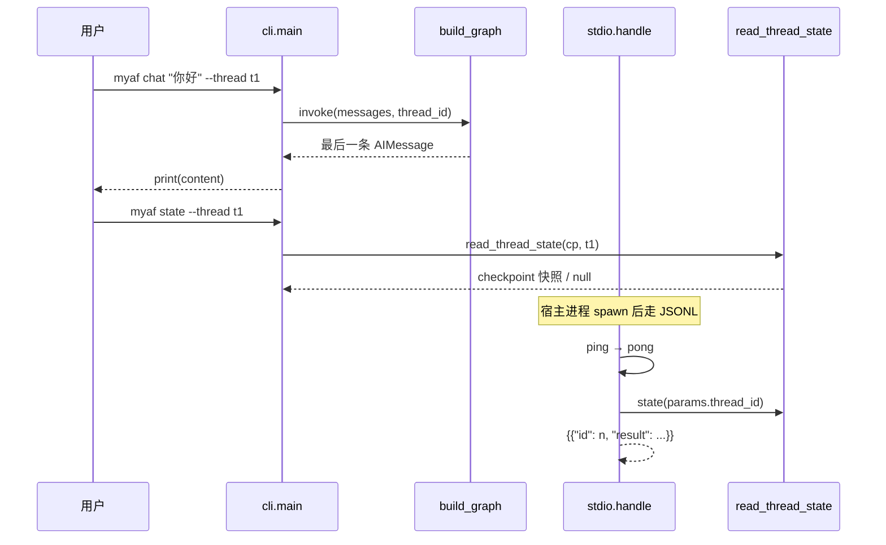

# 第 3 章　CLI 与 stdio App Server

> **本章状态**：🟡 最小实现。CLI 有 `chat` / `state` 两个子命令；stdio 有 `ping` / `state` 两个方法，**没有** `chat/send` 这类流式协议。
> 基准：EvoFlow `f22af539`（v1.3.22）。

## 本章目标 / Goals

- 同一套内核有两个入口：终端（CLI）与宿主进程（stdio），不在入口层重写业务逻辑。
- CLI 的 `state` 子命令**不编译图**：读状态不该拉起模型和中间件。
- stdio 一行请求一行响应；坏行只回错误，不退出进程。
- stdout 只放协议，日志走 stderr（否则宿主解析失败）。

**本章不做**：JSON-RPC 的 `chat/send` / `chat/event` / `chat/resume` / `chat/cancel` 流式协议；stdio 的 TCP 监听；Windows UTF-8 包装；嵌入式 app server。这些在 EvoFlow 的 `stdio_rpc.py`（719 行）与 `chat_bridge.py`（396 行）里，属于后续「Gateway 与桌面端」范围。

## EvoFlow 源码导读 / Source reading

| 文件 | 行数 | 读什么 |
|---|---|---|
| `backend/packages/harness/evoflow/cli/main.py` | 105 | `_peek_command`、`build_parser`、`main`：子命令怎么分发 |
| `.../cli/common.py` | 44 | `add_json_input_flags` / `load_json_payload` / `add_output_flags`：参数与 JSON 载荷约定 |
| `.../app_server/stdio_rpc.py` | 719 | `StdioAppServer`、`serve_stdio`、`serve_stdio_async`、`PROTOCOL_VERSION`：方法表、通知、错误码 |
| `.../app_server/chat_bridge.py` | 396 | chat 轮次怎么把 Gateway SSE 转成 RPC 通知 |
| `.../desktop_stdio.py` | 363 | Windows 下强制 UTF-8、禁用 ANSI 颜色 |

**EvoFlow 的事实**：stdio 是「桌面客户端 ↔ Gateway」的桥，chat 事件是**通知**（无 `id`），不是请求响应；CLI 自己也通过 Gateway 跑，不是直接调 harness。

## 本章的取舍 / Scope trade-off

| 能力 | EvoFlow | 本章 |
|---|---|---|
| CLI 跑对话 | 经 Gateway / LangGraph SSE | 直接 `build_graph().invoke()`，同步打印最后一条 |
| CLI 读状态 | 调 Gateway API | `read_thread_state()` 本地读 saver |
| stdio 方法 | 完整 chat 生命周期 | `ping` + `state` |
| 传输 | stdio 或 local TCP | 仅 stdin/stdout |
| 协议通知 | `chat/event` 流 | 无（本章没有流式 chat） |

本章的选择是**先把两个入口的骨架跑通**；chat 流式协议等第 10 部分接 Gateway 时再补，避免现在造一套和最终协议不一致的消息格式。

## 调用逻辑 / Invocation logic



## 实现步骤 / Step by step

### Step 1　`backend/packages/harness/myagentflow/cli/main.py`

**职责**：解析 `chat` / `state`，各走一条路径。

**逻辑**

1. `main()` 用 `argparse` 子解析器；`set_defaults(fn=...)` 把「解析」和「执行」分开，测试可以直接传 argv。
2. `_chat()` 懒加载图与模型：只跑 `state` 的人不需要模型配置。
3. `_state()` **绝不导入 `build_graph`**：读状态编译图会拉起中间件、模型客户端和 MCP，慢且可能报错。
4. 默认 `--thread cli`：终端调试不用每次编一个线程名。

**代码（全文，68 行）**

```python
"""一、文件说明
    CLI：最小两个子命令。
    为什么 CLI 要和 Gateway 共用代码：调试时想在终端复现线上问题，
    两条代码路径一定会分叉。

二、目录结构
    packages/harness/myagentflow/cli/
    ├── __init__.py
    └── main.py  ← 本文件

三、关键方法
    _chat()   命令行跑一轮对话：读一条输入、调图、打印回复。
    _state()  打印某线程的检查点状态；刻意不编译图。
    main()    解析 chat/state 子命令并分发。
"""
from __future__ import annotations

import argparse
import json

from myagentflow.models.factory import create_chat_model


def _chat(args: argparse.Namespace) -> int:
    """命令行跑一轮对话：读一条输入、调图、打印回复。"""
    from langchain_core.messages import HumanMessage

    from myagentflow.agents.lead_agent.graph import build_graph

    graph = build_graph(create_chat_model())
    out = graph.invoke(
        {"messages": [HumanMessage(content=args.text)]},
        {"configurable": {"thread_id": args.thread}},
    )
    print(out["messages"][-1].content)
    return 0


def _state(args: argparse.Namespace) -> int:
    """打印某线程的检查点状态；刻意不编译图。"""
    from myagentflow.agents.checkpointer import get_checkpointer
    from myagentflow.agents.checkpointer.thread_state_reader import read_thread_state

    # 注意：这里绝不导入 build_graph —— 读状态不该编译图
    print(json.dumps(read_thread_state(get_checkpointer(), args.thread), ensure_ascii=False))
    return 0


def main(argv: list[str] | None = None) -> int:
    """解析 chat/state 子命令并分发。"""
    parser = argparse.ArgumentParser(prog="myaf")
    sub = parser.add_subparsers(dest="cmd", required=True)

    p_chat = sub.add_parser("chat", help="跑一轮对话")
    p_chat.add_argument("text")
    p_chat.add_argument("--thread", default="cli")
    p_chat.set_defaults(fn=_chat)

    p_state = sub.add_parser("state", help="读线程状态（不编译图）")
    p_state.add_argument("--thread", default="cli")
    p_state.set_defaults(fn=_state)

    args = parser.parse_args(argv)
    return int(args.fn(args))


if __name__ == "__main__":
    raise SystemExit(main())
```

**验证**

```bash
cd /Users/main/my-agent-flow/backend
uv run python -m myagentflow.cli.main state --thread demo
# 期望：null（没跑过这个线程），且没有模型相关的报错
```

> `chat` 需要真实模型配置（第 1 部分的 `AppConfig`）。本章验收只跑 `state`，避免测试依赖网络。

---

### Step 2　`backend/packages/harness/myagentflow/app_server/stdio.py`

**职责**：一行 JSON 进，一行 JSON 出。

**逻辑**

1. `handle()` 按 `method` 分派：`ping` 握手，`state` 读状态，其他一律 error（不泄露内部方法名）。
2. `state` 的参数兼容 `thread_id` 与 `thread`，缺省 `cli`；返回 `read_thread_state()` 的结果或 `null`。
3. `serve()` 逐行读；空行跳过；JSON 解析失败回 `{{"id": null, "error": ...}}` 并**继续下一行**。
4. 每行 `flush()`：不 flush 父进程会一直等，看起来像「服务卡死」。

**代码（全文，180 行）**

```python
"""一、文件说明
    stdio app server：把 Agent 暴露成一个「一行请求、一行响应」的子进程。
    给谁用：桌面端、编辑器插件、脚本 spawn 本进程，通过 stdin/stdout 通信。
    为什么用 JSONL 而不是 HTTP：
      1) 宿主拉起子进程时没有端口可用，也不该为了本地通信去占端口；
      2) 父子进程生命周期天然绑定：父进程关管道，子进程读到 EOF 就退出；
      3) 一根管道只连一个父进程，不会出现多客户端串消息。
    纪律：stdout 只许写协议 JSON；日志、调试输出一律走 stderr。
          混进一行 print()，宿主就会解析失败。

    当前能力边界（别误解）：
      - 已实现：ping 握手、state 读线程检查点。
      - 未实现：chat/send、chat/event、chat/resume、chat/cancel 等流式对话协议；
        也还没有并发、鉴权、TCP 监听。真正的聊天入口在后续 Gateway 章节。

二、目录结构
    packages/harness/myagentflow/app_server/
    ├── __init__.py  包入口（当前为空）。
    └── stdio.py  ← 本文件：JSONL 传输 + 方法分发。

三、关键方法
    handle()  处理一行请求：ping 握手、state 读线程状态；未知方法回 error。
    serve()   从 stdin 逐行读 JSON、调用 handle、把响应写回 stdout；
              坏行只回错误，不退出进程。
    <module>  被 `python -m myagentflow.app_server.stdio` 执行时，__main__ 调 serve()。

四、协议速查
    请求：{"id": 1, "method": "ping"}
    响应：{"id": 1, "result": "pong"}

    请求：{"id": 2, "method": "state", "params": {"thread_id": "t1"}}
    响应：{"id": 2, "result": {...检查点快照...}}  或  {"id": 2, "result": null}

    未知方法：{"id": 3, "error": "未知方法：xxx"}
    坏 JSON：  {"id": null, "error": "Expecting value: ..."}

    注意：这不是完整 JSON-RPC 2.0 —— 没有 "jsonrpc": "2.0" 字段，
    error 也只是字符串，不是 {code, message} 对象。接正式宿主前要补齐。
"""
from __future__ import annotations

import json
import sys
from typing import Any


def handle(req: dict[str, Any]) -> dict[str, Any]:
    """处理一行 JSON-RPC 风格请求，返回一行响应。

    Args:
        req: 已经 json.loads 过的请求对象；不保证字段齐全。

    Returns:
        可直接 json.dumps 的响应 dict：
          - 成功：{"id": ..., "result": ...}
          - 失败：{"id": ..., "error": "..."}

    只做分发，不在这里读 stdin / 写 stdout：方便测试直接传 dict。
    """
    method = req.get("method")
    req_id = req.get("id")       # 原样带回，宿主靠它把响应和请求对上

    # 握手：宿主 spawn 子进程后先发这个，收到 pong 才认为 Agent 就绪。
    # 不加载模型、不连数据库，保证冷启动也很快。
    if method == "ping":
        return {"id": req_id, "result": "pong"}

    # 读线程状态：只读检查点，不编译图、不调模型。
    if method == "state":
        # 懒加载：只发 ping 的宿主不该被迫初始化数据库连接。
        # 放在函数内 import，模块被导入时就不会触发 AppConfig / sqlite 初始化。
        from myagentflow.agents.checkpointer import get_checkpointer
        from myagentflow.agents.checkpointer.thread_state_reader import (
            read_thread_state,
        )

        # params 允许缺省；thread_id 与 thread 两种写法都认，方便不同宿主。
        # 都没给时落到 "cli"，和 CLI 的默认线程名保持一致。
        params = req.get("params") or {}
        thread_id = str(params.get("thread_id") or params.get("thread") or "cli")

        # 返回 None 表示该线程没有检查点；这是正常结果，不是错误。
        return {"id": req_id, "result": read_thread_state(get_checkpointer(), thread_id)}

    # 未知方法：明确拒绝，不猜、不暴露内部方法清单。
    # 不返回 result=None，避免宿主把「方法不存在」误判成「执行成功但没结果」。
    return {"id": req_id, "error": f"未知方法：{method}"}


def serve(stdin=sys.stdin, stdout=sys.stdout) -> None:
    """从 stdin 逐行读 JSON 请求，处理完写一行 JSON 到 stdout。

    Args:
        stdin:  可迭代的文本流；默认进程标准输入。
        stdout: 可写的文本流；默认进程标准输出。
                参数化是为了测试能传 io.StringIO，不用真的开子进程。

    循环直到 EOF（父进程关闭管道）才返回；单行出错不终止进程。
    """
    for line in stdin:                 # 阻塞读；EOF 时循环自然结束，进程退出
        line = line.strip()
        if not line:                   # 空行不是请求，直接跳过
            continue

        try:
            resp = handle(json.loads(line))
        except Exception as exc:
            # 两种情况会到这里：
            #   1) 行不是合法 JSON —— 连 id 都拿不到，只能回 id=None；
            #   2) handle() 内部抛出未预期异常。
            # 都不能让进程退出：宿主可能只是某一行写错了。
            resp = {"id": None, "error": str(exc)}

        # ensure_ascii=False：中文原样输出，不转成 \uXXXX，方便人看日志。
        # 末尾换行是消息边界：宿主按行拆 JSON。
        stdout.write(json.dumps(resp, ensure_ascii=False) + "\n")
        # 必须 flush：否则响应可能卡在缓冲区，父进程一直等，表现为「服务卡死」。
        stdout.flush()


# 只有被 `python -m myagentflow.app_server.stdio` 直接执行时才启动循环；
# 被其它模块 import 时不会自动读 stdin，避免测试/宿主进程被意外阻塞。
if __name__ == "__main__":
    serve()


# =============================================================================
# 设计说明（读代码之外，理解这个文件为什么长这样）
# =============================================================================
#
# 1. 它和 cli/main.py 是什么关系
# -----------------------------------------------------------------------------
#   两个都是入口，但服务对象不同：
#     cli/main.py      → 给人用：命令行参数进，终端打印出；
#     app_server/stdio.py → 给程序用：stdin 的 JSON 进，stdout 的 JSON 出。
#   两者互不 import；可以同时作为两个独立进程运行，互不影响。
#
#   如果硬把 serve() 和 CLI 放进同一个进程开线程，会共享全局状态：
#     - provider 的 checkpointer 单例、SQLite 连接；
#     - os.environ；
#     - sys.stdout —— CLI 的 print() 会混进 stdio 协议，宿主直接解析失败。
#   所以正式用法是「分开进程」，不是「同进程开线程」。
#
# 2. 为什么只有 ping / state
# -----------------------------------------------------------------------------
#   本章只验证「子进程 + 管道 + 一行一答」这条链路能通。
#   chat 需要流式事件、取消、断线续传、并发 run 管理，属于后续 Gateway /
#   桌面端章节；现在硬造一套简化协议，后面一定和正式协议不一致。
#
# 3. 为什么错误也走 stdout，而不是抛异常/写 stderr
# -----------------------------------------------------------------------------
#   对宿主来说，「请求失败」也是协议的一部分：它需要知道哪条请求失败了、
#   为什么失败。抛异常会让父进程只看到进程退出；写 stderr 则无法和请求 id
#   对应。所以错误统一包成 {"id", "error"} 从 stdout 回去。
#   真正的日志/堆栈仍应走 stderr，二者不要混。
#
# 4. 已知限制
# -----------------------------------------------------------------------------
#   - 单线程顺序处理：一条请求处理完才读下一行，没有并发；
#   - 没有请求超时：handle 卡住，整个管道就卡住；
#   - 没有鉴权：能启动这个子进程的父进程就能调用；
#   - 没有协议版本协商；
#   - 只支持本机父子进程，不能远程访问。
#
# 5. 最小实测
# -----------------------------------------------------------------------------
#   cd /Users/main/my-agent-flow/backend
#   printf '{"id":1,"method":"ping"}\n{"id":2,"method":"state"}\nnot-json\n' \
#     | uv run python -m myagentflow.app_server.stdio
#
#   期望三行：
#     {"id": 1, "result": "pong"}
#     {"id": 2, "result": null}
#     {"id": null, "error": "Expecting value: line 1 column 1 (char 0)"}
#   且进程退出码为 0 —— 坏行没有拖垮服务。
#
# 6. 对应测试
# -----------------------------------------------------------------------------
#   uv run pytest tests/chapters/test_ch02_03_cli_stdio.py -q
#   覆盖：ping、state、未知方法、坏行恢复、CLI state 输出。
```

**验证**

```bash
cd /Users/main/my-agent-flow/backend
printf '{{"id":1,"method":"ping"}}\n{{"id":2,"method":"state","params":{{"thread_id":"demo"}}}}\nnot-json\n' | uv run python -m myagentflow.app_server.stdio
# 期望三行：pong / null / error；进程不退出
```

---

### Step 3　`backend/tests/chapters/test_ch02_03_cli_stdio.py`

覆盖：ping、state、未知方法、坏行恢复、CLI state 输出。

**代码（全文，65 行）**

```python
"""一、文件说明
    02/03 CLI 与 stdio：命令行参数分发、stdin/stdout 一行一答。

二、覆盖
    test_stdio_ping()             ping 返回 pong，id 原样带回。
    test_stdio_state_unknown()     state 读不存在的线程返回 None，不抛异常。
    test_stdio_unknown_method()    未知方法回 error，id 不丢。
    test_serve_bad_json()          坏行回 error，且后续好行仍能处理。
    test_cli_state(capsys)         CLI state 子命令走通，输出 JSON null。

三、运行
    uv run pytest tests/chapters/test_ch02_03_cli_stdio.py -q
"""

from __future__ import annotations

import io
import json


def test_stdio_ping():
    """ping 返回 pong，id 原样带回。"""
    from myagentflow.app_server.stdio import handle

    resp = handle({"id": 1, "method": "ping"})
    assert resp == {"id": 1, "result": "pong"}


def test_stdio_state_unknown(monkeypatch, tmp_path):
    """state 读不存在的线程返回 None，不抛异常。"""
    monkeypatch.setenv("MYAF_CHECKPOINTER", "sqlite")
    monkeypatch.setenv("MYAF_CHECKPOINT_SQLITE_PATH", str(tmp_path / "cp.sqlite"))
    from myagentflow.app_server.stdio import handle

    resp = handle({"id": 2, "method": "state", "params": {"thread_id": "no-such"}})
    assert resp == {"id": 2, "result": None}


def test_stdio_unknown_method():
    """未知方法回 error，id 不丢。"""
    from myagentflow.app_server.stdio import handle

    resp = handle({"id": 3, "method": "chat/send"})
    assert resp["id"] == 3 and "未知方法" in resp["error"]


def test_serve_bad_json():
    """坏行回 error，且后续好行仍能处理：一行坏不能拖垮整个管道。"""
    from myagentflow.app_server.stdio import serve

    stdin = io.StringIO('not-json\n{"id":4,"method":"ping"}\n')
    stdout = io.StringIO()
    serve(stdin=stdin, stdout=stdout)
    lines = [json.loads(x) for x in stdout.getvalue().splitlines()]
    assert "error" in lines[0] and lines[1] == {"id": 4, "result": "pong"}


def test_cli_state(capsys, monkeypatch, tmp_path):
    """CLI state 子命令走通，输出 JSON null。"""
    monkeypatch.setenv("MYAF_CHECKPOINTER", "sqlite")
    monkeypatch.setenv("MYAF_CHECKPOINT_SQLITE_PATH", str(tmp_path / "cp.sqlite"))
    from myagentflow.cli.main import main

    assert main(["state", "--thread", "no-such"]) == 0
    assert capsys.readouterr().out.strip() == "null"
```

**验证**

```bash
cd /Users/main/my-agent-flow/backend
uv run pytest tests/chapters/test_ch02_03_cli_stdio.py -q
# 期望：5 passed
```

## 与 EvoFlow 的差异 / Differences

| 点 | EvoFlow | 本章 | 影响 |
|---|---|---|---|
| CLI chat 数据流 | Gateway SSE → 事件渲染 | 同步 `invoke`，只打印最终回复 | 没有 token 流、没有工具事件 |
| stdio chat | `chat/send` + `chat/event` 通知 | 未实现 | 宿主只能握手和读状态 |
| 协议版本 | `PROTOCOL_VERSION` | 无 | 还没有版本协商的必要 |
| 错误码 | JSON-RPC 标准码 | 字符串 error | 够本地调试，接宿主前要统一 |
| 日志隔离 | stderr + `_UnclosableStdio` | 代码里不 `print`，靠调用方自觉 | Windows 下仍需 UTF-8 包装 |

## 常见坑 / Troubleshooting

| 症状 | 原因 | 动作 |
|---|---|---|
| 宿主解析失败 | 代码里有 `print()` 混进 stdout | 日志改 `stderr`；stdout 只写协议 |
| 最后一条永远收不到 | 没 `flush()` | 每行写完立即 flush |
| 一行坏 JSON 导致进程退出 | `serve` 没包 `try` | 捕获后回 error，继续循环 |
| `state` 很慢 / 报模型错误 | 误导入 `build_graph` | 只导入 `read_thread_state` |
| `chat` 报没有 API key | 没配模型 | 先跑 `state`；`chat` 需要第 1 部分配置 |

## 验收 / Acceptance

```bash
cd /Users/main/my-agent-flow/backend
uv run pytest tests/chapters/test_ch02_03_cli_stdio.py -q     # 5 passed
uv run python -m ruff check packages tests                   # All checks passed
```

## 知识点

- [agent-book](https://g0-000.github.io/agent-book/)：CLI、stdio、HTTP 三种入口的分工
- [Harbor404 · 流式输出](https://harbor404.fushenlin.com/)：为什么 stdout 只能放协议
