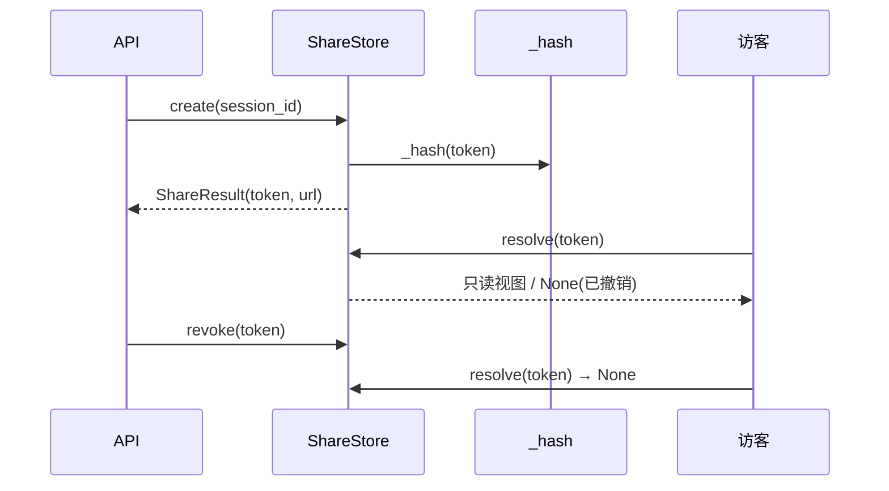

# 第 4 章　分享生命周期 / Sharing

> **EvoFlow 对照状态 / Alignment status：** 🔍 结构已核对（路径、行数、符号均取自源码实测），**行为**（调用顺序、边界条件）尚未逐行核对。

## 本章目标
把「一次会话」安全地投影成「一个只读链接」，并定义它的有效期与撤销语义。

## 最小闭环
创建分享 → 拿到 token 链接 → 未登录可读 → 撤销后链接 404 → 原会话不受影响。

## 调用逻辑 / Invocation logic



- **入口（EvoFlow 实际行为）**：token 在路由层生成——`app/gateway/routers/share.py:71` `secrets.token_urlsafe(24)`；落库是 `persistence/chat_share_repositories.py:121` `create_share(*, token, session_key, title, messages, include_tools, expires_in_days=7, created_by)`，**token 原样明文写入 `evoflow_chat_shares`，没有 hash**（列里有 `token` 也有 `revoked_at`，`:172` 的 INSERT 语句可直接看到）。**没有 `ShareStore` 这个类**。本复刻改用 `token_hash TEXT PRIMARY KEY` + `sha256`（`collab/shares.py:32`）——这是我们的设计选择，不是 EvoFlow 行为。
- **关键节点**：EvoFlow 的读路径是 `routers/share.py:124` 的 `get_share(token)` → `share_repo.get_public_share(token)`，按 token 明文等值查；撤销是 `routers/share.py:143` `revoke_share()` → `share_repo.revoke_share(token)`，先把 `revoked_at` 置位再返回 `{"ok": true, "revoked": true}`。本复刻的 `resolve()` 多一步「先 hash 再查行」，所以多一层不可逆性。
- **出口**：`revoke_share()` 只改状态不删行（这一条 EvoFlow 与我们的实现一致）；区别是 EvoFlow 直接把 token 串返回给调用方（`:157`），我们只返回 ok。
- **最容易断的地方**：撤销直接删行，导致审计断链；以及 token 用 `uuid1` 泄露时间与机器信息。

## 真实模块地图（已核对：路径 · 行数 · 符号）

| 文件 | 行数 | 关键符号 | 模块常量 |
|---|---|---|---|
| `app/gateway/routers/share.py` | 154 | `CreateShareBody`、`CreateShareResponse`、`PublicShareResponse`；`create_share`、`latest_share_for_session`、`get_share` | — |
| `packages/harness/evoflow/persistence/chat_share_repositories.py:18` | 311 | `_utc_now_iso`、`_parse_iso`、`_extract_text_from_content` | — |
| `app/gateway/auth.py` | 164 | `CallerCtx`；`verify_bearer_token`、`verify_capability_bearer_token`、`verify_app_bearer_token` | — |
| `packages/harness/evoflow/authz/http_guard.py:10` | 549 | `resolve_authz_from_request`、`require_thread_visible`、`_has_auth_signals` | — |

## 核心概念
- **分享是投影不是副本**：读的是被授权的快照/只读视图，避免数据漂移。
- **token 不是身份**：token 只授予「读这个分享」的最小权限。
- **撤销要级联**：撤销后缓存、CDN、SSE 长连接都要失效。

## 自研实现要点
```text
shares(share_id, session_id, token_hash, scope, created_at, expires_at, revoked_at)
```
- token 只存哈希；校验走常量时间比较。
- `scope` 决定是否暴露工具输出、附件、思考过程。

## 业务规则
- 分享页不返回工作区绝对路径、环境变量、模型密钥。
- 过期与撤销返回同一状态码，避免探测。

## 常见坑
- 把 session_id 直接当 token（可枚举）。
- 分享页复用管理端接口 → 越权。

## 验收
- [ ] 未授权访问 404/403 一致
- [ ] 撤销后旧链接立即失效
- [ ] 分享内容不含敏感字段

### 源码核对记录（路径与符号实测）

- `app/gateway/routers/share.py`（154 行）：类 `CreateShareBody`、`CreateShareResponse`、`PublicShareResponse`
  - 模块自述：Read-only chat session share links (immutable snapshots).…
- `packages/harness/evoflow/persistence/chat_share_repositories.py`（311 行）
  - 模块自述：CRUD for evoflow_chat_shares (immutable transcript snapshots).…
- `app/gateway/auth.py`（164 行）：类 `CallerCtx`
  - 模块自述：Bearer-token authentication dependency for the open-capability gateway. Exposes :func:`verify_bearer_token` — …
- `packages/harness/evoflow/authz/http_guard.py`（549 行）
  - 模块自述：HTTP request guards for resource visibility (anti-IDOR).…

> 本节只证明**路径、行数、符号存在**；调用顺序与边界条件仍属「行为」，未逐行核对。

## 对照 EvoFlow 核对清单
- [ ] `chat_share_repositories` 的字段与过期策略
- [ ] 分享是否支持按消息区间

## 从零实现（手把手）
> 读完这章你能把自己的会话分享出去，并且分享链接会过期、可撤销。
> 路径均相对 `backend/`，代码注释写「为什么」。

### Step 1　新建 shares.py：三分支状态
**文件**：`packages/harness/myagentflow/collab/shares.py（新建）`
**要写的逻辑**：只存 sha256(token) 不存明文；`resolve()` 三态：有效 / 过期 / 撤销；过期用时间戳比较，避免定时任务。

**代码**

```python
"""分享链接：创建、解析、撤销。

为什么存 hash 不存 token：数据库泄露时明文 token 等于把所有人的会话送出去。
"""
from __future__ import annotations

import hashlib
import secrets
import sqlite3
import time
from dataclasses import dataclass
from pathlib import Path

_SCHEMA = """
CREATE TABLE IF NOT EXISTS shares (
    token_hash TEXT PRIMARY KEY,
    thread_id  TEXT NOT NULL,
    created_at REAL NOT NULL,
    expires_at REAL,
    revoked_at REAL
);
"""


@dataclass(frozen=True)
class ShareResult:
    status: str          # ok | expired | revoked | missing
    thread_id: str | None = None


def _hash(token: str) -> str:
    return hashlib.sha256(token.encode()).hexdigest()


class ShareStore:
    def __init__(self, db_path: str | Path):
        Path(db_path).parent.mkdir(parents=True, exist_ok=True)
        self._conn = sqlite3.connect(str(db_path), check_same_thread=False)
        self._conn.executescript(_SCHEMA)

    def create(self, thread_id: str, ttl_seconds: int = 7 * 86400) -> str:
        token = secrets.token_urlsafe(24)
        self._conn.execute(
            "INSERT INTO shares (token_hash, thread_id, created_at, expires_at) VALUES (?, ?, ?, ?)",
            (_hash(token), thread_id, time.time(), time.time() + ttl_seconds),
        )
        self._conn.commit()
        return token          # 明文只在这里出现一次

    def resolve(self, token: str, now: float | None = None) -> ShareResult:
        row = self._conn.execute(
            "SELECT thread_id, expires_at, revoked_at FROM shares WHERE token_hash = ?",
            (_hash(token),),
        ).fetchone()
        if row is None:
            return ShareResult("missing")
        thread_id, expires_at, revoked_at = row
        if revoked_at is not None:
            return ShareResult("revoked")
        if expires_at is not None and (now or time.time()) > expires_at:
            return ShareResult("expired")
        return ShareResult("ok", thread_id)

    def revoke(self, token: str) -> None:
        self._conn.execute(
            "UPDATE shares SET revoked_at = ? WHERE token_hash = ?",
            (time.time(), _hash(token)),
        )
        self._conn.commit()
```

**验证**

```bash
uv run python -c "
from myagentflow.collab.shares import ShareStore
s = ShareStore('/tmp/myaf-share.sqlite')
t = s.create('t1', ttl_seconds=10)
print(s.resolve(t))
print(s.resolve(t, now=10**12))   # 过期
"
```

### Step 2　写测试：三态齐全
**文件**：`tests/chapters/test_ch02_04_shares.py（新建）`
**要写的逻辑**：有效、过期、撤销、缺失各一条断言。

**代码**

```python
from __future__ import annotations


def test_share_states(tmp_path):
    from myagentflow.collab.shares import ShareStore

    store = ShareStore(tmp_path / "s.sqlite")
    token = store.create("t1", ttl_seconds=60)
    assert store.resolve(token).status == "ok"
    assert store.resolve("bogus").status == "missing"

    store.revoke(token)
    assert store.resolve(token).status == "revoked"
    assert store.resolve(token, now=10**12).status in {"revoked", "expired"}
```

**验证**

```bash
uv run pytest tests/chapters/test_ch02_04_shares.py -v
# 期望：1 passed
```

### 与 EvoFlow 对照

| 我们的做法 | EvoFlow | 为什么 |
|---|---|---|
| 只存 token hash | `collab/` 的分享表 | 数据库泄露不等于会话泄露 |
| 撤销优先于过期 | 解析顺序 revoked → expired | 用户点撤销后不该再能用 |

### 知识点

- [幂等性设计：分享链接重复创建为什么不能产生两份](https://harbor404.fushenlin.com/notes/idempotency-design/)
- [系统课入口：会话隔离与权限](https://g0-000.github.io/agent-book/)

### 验收

```bash
uv run pytest tests/chapters/test_ch02_04_shares.py -q
```
