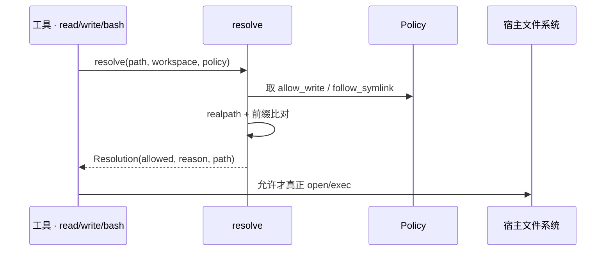

# 第 1 章　文件/终端与宿主边界

> **EvoFlow 对照状态 / Alignment status：** ✅ **已核对源码**（`workspace_path_guard.py` 286 行全文、`workspace_guard_middleware.py` 35 行全文、`tool_catalog.py` 常量表）。
>
> ::: danger 先纠正一个常见误解
> 本章旧稿写「EvoFlow 用中间件做路径围栏，`realpath` + 前缀校验防 `..` 逃逸」——**这是错的**。
> `WorkspaceGuardMiddleware` 是**空实现**（模块 docstring 原文：`Legacy workspace preflight (disabled: host-direct tools resolve paths without blocking)`），`wrap_tool_call` 直接 `return handler(request)`。
> 真正的路径解析在 `tools/host_direct/workspace_path_guard.py`，而它自己的 docstring 写的是：`no confinement to workspace root`。
> :::

## 本章目标
定义「工具跑在哪台机器、以什么权限、能碰哪些路径」，并把这条边界写成配置而不是口头约定。

## 最小闭环
读文件 → 列出目录 → 执行一条只读命令 → 写文件被策略拒绝（或要求审批）。

## 调用逻辑 / Invocation logic



- **入口**：所有宿主工具第一步都调 `resolve()`，不允许各工具自己拼路径。
- **关键节点**：先 `realpath` 再比对前缀，顺序反了 `../` 和 symlink 都能逃逸；`Resolution` 带 `reason` 是为了让拒绝可解释。
- **出口**：`allowed=False` 时工具直接返回结构化拒绝，不抛异常（抛异常会被模型当成工具坏了反复重试）。
- **最容易断的地方**：只查 `..` 字符串不查 realpath；以及 `policy` 默认放开（本章刻意默认收口，与 EvoFlow 的 `disabled` 语义对齐）。

## 真实模块地图（已核对：路径 · 行数 · 符号）

| 文件 | 行数 | 关键符号 | 模块常量 |
|---|---|---|---|
| `packages/harness/evoflow/tools/tools.py` | 649 | `_LazyToolSequence`；`_tool_name`、`_drop_removed_tools`、`_read_tool_aliases` | REMOVED_LEGACY_TOOL_NAMES、BUILTIN_TOOLS、SUBAGENT_TOOLS |
| `packages/harness/evoflow/tools/tool_catalog.py` | 358 | `_core_tool_names`、`_plan_scenario_extra_tools`、`_workspace_scenario_extra_tools` | TOOL_TIER_ORDER、TOOL_TIER_LABELS_ZH、ROLE_EDITOR_CONFIGURABLE_TOOL_TIERS |
| `packages/harness/evoflow/tools/tool_aliases.py` | 136 | `augment_process_tools`、`augment_worker_tool_allowlist`、`canonical_tool_name` | PROCESS_TOOL_SUITE |
| `packages/harness/evoflow/tools/arg_coerce.py` | 228 | `parse_search_path_prefix`、`split_pipe_terms`、`coerce_str_list` | — |
| `packages/harness/evoflow/tools/minimal_schema.py` | 53 |  | READ_TOOL_DESCRIPTION、WRITE_TOOL_DESCRIPTION、REPLACE_TOOL_DESCRIPTION |
| `packages/harness/evoflow/tools/builtins/plan_tool.py` | 585 | `PlanStepInput`、`PlanInput`；`_json_loads_if_string`、`_coerce_string_list_field`、`_coerce_to_str` | — |
| `packages/harness/evoflow/tools/tool_result_shaper.py` | 230 | `_split_preserved_read_blocks`、`_split_post_search_reads`、`_attach_preserved_read_blocks` | — |
| `packages/harness/evoflow/tools/tool_activity_ui.py` | 154 | `_normalize_key`、`_parse_tool_call_args`、`_label` | — |

## 核心概念
- **宿主（host）≠ 沙箱（sandbox）**：宿主工具直接操作真实文件系统，风险最高。
- **EvoFlow 的真实做法：不围栏，只解析**。`workspace_path_guard.py` 只负责「把用户给的路径变成可用的绝对路径」：
  1. `skill:` 开头 → 走 `resolve_skill_uri(require_enabled=True)`；
  2. **绝对路径按原样使用**（绑定 workspace 也只做别名展平，不做 `..` 拦截）；
  3. 相对路径：绑定了 workspace 就拼到 root 下，未绑定就落 `Path.cwd()`；
  4. `outputs/`、`uploads/` 两个前缀走 `resolve_bound_workspace_file` 别名解析；
  5. Windows 上先过 `from_bash_posix_path`，把 Git Bash 的 `/d/...`、WSL 的 `/mnt/d/...` 归一到 `D:/...`，否则会读到幽灵目录 `D:\d\...`。
- **围栏常量是残留的**：`NO_WORKSPACE_BOUND`、`PATH_ESCAPE`、`WORKDIR_ESCAPE` 三个错误常量还在，但 `PATH_ESCAPE` 旁边就写着 `Kept for compatibility; path confinement is disabled.`
- **命令分类**：只读 / 可写 / 危险；bash 的只读策略决定是否免审批（详见 [03/02](02-后台命令浏览器桥与Computer-Use.md)）。

## 自研实现要点（**我们的设计**，EvoFlow 没有这一层）
EvoFlow 选择「不围栏」，代价由审批与沙箱兜；我们复刻时**建议补一层真正的围栏**，因为它是最便宜的安全下限：

```text
ToolSpec(name, schema, scope=host|sandbox, danger=read|write|exec, approval=auto|ask)
execute(name, args, ctx):
  1) resolve: 相对 → 拼 workspace root；绝对 → 直接接受（与 EvoFlow 一致）
  2) guard:   realpath 后校验是否仍在 root 内，含符号链接解析（EvoFlow 缺这一步）
  3) policy:  danger=write/exec → 走审批；只读白名单内 → 放行
  4) exec:    argv 数组，禁止 shell 字符串拼接
  5) shape:   结果截断 + 摘要 + 落盘引用
```

## 业务规则
- 写操作默认 `ask`；只读命令在只读白名单内可 `auto`。
- 禁止把整段 shell 字符串直接拼给 `shell=True`；用 argv 数组。
- 工具输出统一信封：`{ok, data, truncated, persisted_path?}`。

## 常见坑
- **把 `WorkspaceGuardMiddleware` 当成围栏**：它是空实现，写了也不会拦路径。
- 以为绝对路径会被限制在 workspace 内：不会，`Path(expanded).resolve()` 直接用。
- Windows 上不归一 Git Bash 路径 → 写入落到 `D:\d\workspace\...` 这种幽灵目录。
- 未绑定 workspace 时不报错而静默落 `cwd`，复刻版必须显式报 `NO_WORKSPACE_BOUND`。
- 用 `str.startswith` 判路径 → `/data-evil` 通过 `/data` 检查。
- 符号链接绕过围栏。
- 工具异常直接抛给模型 → 模型开始编造结果。

## 验收
- [ ] 路径逃逸用例全部被拒
- [ ] 危险命令必须审批
- [ ] 工具失败返回结构化错误而非堆栈

### 源码核对记录（路径与符号实测）

- `packages/harness/evoflow/tools/tools.py`（649 行）：类 `_LazyToolSequence`
- `packages/harness/evoflow/tools/tool_catalog.py`（358 行）
  - 模块自述：Builtin tool tier/type catalog for DB sync, Gateway metadata, and EvoPanel UI. Tiers (工具类型): - runtime: 系统核心 —…
- `packages/harness/evoflow/tools/tool_aliases.py`（136 行）
  - 模块自述：Normalize plan / agent YAML tool names to the host-direct tool catalog.…
- `packages/harness/evoflow/tools/arg_coerce.py`（228 行）
  - 模块自述：Coerce LLM tool arguments (models often pass JSON strings instead of lists).…
- `packages/harness/evoflow/tools/minimal_schema.py`（53 行）
  - 模块自述：Short wire descriptions for workspace / host-direct tools (no Args docstring bloat).…
- `packages/harness/evoflow/tools/builtins/plan_tool.py`（585 行）：类 `PlanStepInput`、`PlanInput`
  - 模块自述：Submit structured plan for collaboration gates (has_plan / plan_guard).…
- `packages/harness/evoflow/tools/tool_result_shaper.py`（230 行）
  - 模块自述：Unified write-time shaping for tool results (runtime-aligned inline truncation).…
- `packages/harness/evoflow/tools/tool_activity_ui.py`（154 行）
  - 模块自述：Human-friendly stream activity labels (match evopanel tool-display icons/short labels).…

> 本节只证明**路径、行数、符号存在**；调用顺序与边界条件仍属「行为」，未逐行核对。

## 对照 EvoFlow 核对清单
- [ ] `host_direct` 的路径围栏实现
- [ ] bash 只读策略的判定规则（`test_bash_readonly_policy`）

## 从零实现（手把手）
> 读完这章你能写一个「路径策略可切换」的守卫：既能全放开、也能把路径锁在 workspace 内。
> 路径均相对 `backend/`，代码注释写「为什么」。

### Step 1　新建 workspace_path_guard.py：解析 + 策略
**文件**：`packages/harness/myagentflow/tools/host_direct/workspace_path_guard.py（新建）`
**要写的逻辑**：先 `realpath` 解析（消掉 `..` 与软链），再按策略判断：`disabled` 全放行、`confine` 必须在 root 下。EvoFlow 默认是 `disabled`，我们把它做成显式开关。

**代码**

```python
"""宿主路径守卫：解析 + 可切换策略。

EvoFlow 的实现把 confinement 关掉了（docstring 明写 no confinement），
这里保留同样行为，但把它变成一个显式开关，避免「以为有护栏」。
"""
from __future__ import annotations

import os
from dataclasses import dataclass
from enum import Enum
from pathlib import Path


class Policy(str, Enum):
    disabled = "disabled"   # 原样使用，绝对路径也放行（EvoFlow 默认）
    confine = "confine"     # 必须落在 workspace 之下


@dataclass(frozen=True)
class Resolution:
    path: Path
    inside: bool
    decision: str          # allowed | escaped | resolved


def resolve(path: str, workspace: str | Path, policy: Policy = Policy.disabled) -> Resolution:
    root = Path(os.path.realpath(str(workspace)))
    # realpath 先把 `..`、软链、重复分隔符全部折平，再做前缀比较
    target = Path(os.path.realpath(os.path.expanduser(path)))
    inside = target == root or root in target.parents
    if policy is Policy.disabled:
        return Resolution(target, inside, "allowed")
    return Resolution(target, inside, "resolved" if inside else "escaped")
```

**验证**

```bash
uv run python -c "
from myagentflow.tools.host_direct.workspace_path_guard import resolve, Policy
print(resolve('/etc/passwd', '/tmp/ws').decision)          # allowed
print(resolve('/tmp/ws/../x', '/tmp/ws', Policy.confine).decision)  # escaped
"
```

### Step 2　写测试：软链与 .. 都要被测
**文件**：`tests/chapters/test_ch03_01_guard.py（新建）`
**要写的逻辑**：`confine` 下 `/tmp/ws/a` 允许、`/tmp/ws/../x` 拒绝；`disabled` 下两者都允许。

**代码**

```python
from __future__ import annotations


def test_confine_policy(tmp_path):
    from myagentflow.tools.host_direct.workspace_path_guard import Policy, resolve

    ws = tmp_path / "ws"
    ws.mkdir()
    inside = resolve(str(ws / "a.txt"), ws, Policy.confine)
    assert inside.decision == "resolved" and inside.inside

    outside = resolve(str(ws / ".." / "x.txt"), ws, Policy.confine)
    assert outside.decision == "escaped"


def test_disabled_follows_evoflow(tmp_path):
    from myagentflow.tools.host_direct.workspace_path_guard import Policy, resolve

    assert resolve("/etc/passwd", tmp_path, Policy.disabled).decision == "allowed"
```

**验证**

```bash
uv run pytest tests/chapters/test_ch03_01_guard.py -v
# 期望：2 passed
```

### 与 EvoFlow 对照

| 我们的做法 | EvoFlow | 为什么 |
|---|---|---|
| `realpath` 先解析再判断 | `tools/host_direct/workspace_path_guard.py:286` 行的解析段 | 软链与 `..` 不解析就判前缀等于没判 |
| 默认不限制 | 该文件 docstring：`path confinement is disabled` | 复刻要如实，不能写成「有防护」 |

### 知识点

- [Harbor404](https://harbor404.fushenlin.com/)：路径逃逸类问题的真实案例
- agent-book：工具沙箱章节

### 验收

```bash
uv run pytest tests/chapters/test_ch03_01_guard.py -q
```
