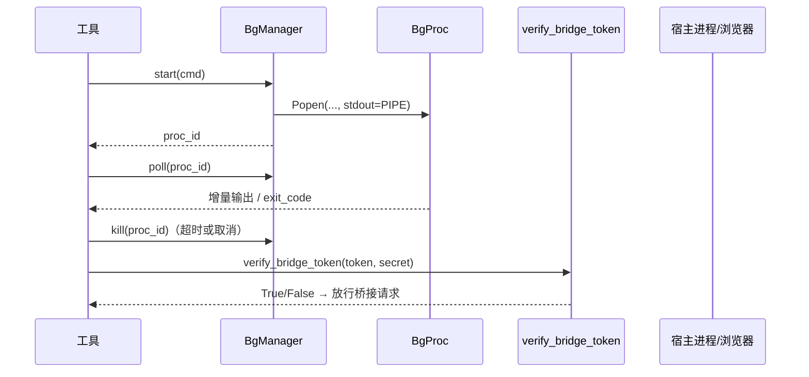

# 第 2 章　后台命令、浏览器桥与 Computer Use

> **EvoFlow 对照状态 / Alignment status：** 🔍 结构已核对（路径、行数、符号均取自源码实测），**行为**（调用顺序、边界条件）尚未逐行核对。

## 本章目标
让 Agent 能操作**长时间运行的进程**和**图形界面**，同时不把主对话阻塞。

## 最小闭环
启动后台命令 → 轮询输出 → 结束后读取完整日志；打开浏览器 → 截图 → 点击。

## 调用逻辑 / Invocation logic



- **入口**：`BgManager.start()` 起进程并立刻返回 id，工具层拿 id 轮询，不阻塞事件循环。
- **关键节点**：`poll()` 要能返回「还没结束」和「已结束+退出码」两种状态；桥接侧每个请求先过 `verify_bridge_token`，不信任来源 IP。
- **出口**：`kill()` 负责收割进程组，`close()` 前必须全部 kill，否则测试结束残留子进程。
- **最容易断的地方**：只 kill 父进程不管子进程；token 用固定字符串或漏校验重放。

## 真实模块地图（已核对：路径 · 行数 · 符号）

| 文件 | 行数 | 关键符号 | 模块常量 |
|---|---|---|---|
| `app/gateway/routers/background_bash.py` | 50 | `list_background_bash`、`background_bash_output`、`background_bash_stop` | — |
| `app/gateway/routers/browser_bridge.py` | 145 | `BrowserExecuteRequest`、`BrowserLogEntry`、`BrowserLogBatch`；`_org_admin_guard`、`_bridge_token_guard`、`append_browser_log` | — |
| `packages/harness/evoflow/tools/builtins/browser_stream.py:23` | 137 | `browser_session_name`、`browser_live_ws_path`、`_engine_screencast_active` | — |
| `app/gateway/routers/browser_snapshots.py` | 38 | `get_browser_screenshot` | — |
| `app/gateway/routers/browser_embed.py` | 63 | `BrowserEmbedCdpBody`；`put_browser_embed_cdp`、`delete_browser_embed_cdp`、`get_browser_embed_cdp` | — |
| `app/gateway/routers/cua_bridge.py` | 327 | `CuaExecuteRequest`、`AppIconLocator`、`AppIconRequestBody`；`_org_admin_guard`、`_bridge_token_guard`、`_resolve_ps1` | — |
| `packages/harness/evoflow/plugins/cua_helper.py:40` | 162 | `_helper_entry`、`_helper_addon`、`is_helper_runtime` | HELPER_RUNTIME_DIRNAME、HELPER_ENTRY_REL、HELPER_ADDON_REL |
| `packages/harness/evoflow/plugins/bridge_auth.py:33` | 94 | `_token_file_path`、`reset_bridge_token_cache`、`get_bridge_token` | — |
| `packages/harness/evoflow/plugins/runtime.py:41` | 342 | `_ulog`、`_iter_enabled_plugins`、`enabled_plugin_roots` | — |
| `packages/harness/evoflow/plugins/node_repl.py:30` | 1111 | `_ulog`、`_sanitize_model_browser_js`、`_meta_envelope` | — |
| `packages/harness/evoflow/plugins/node_repl_tool.py:111` | 564 | `NodeReplJsInput`；`_maybe_compact_browser_docs_dump`、`_get_thread_id`、`_decode_image` | — |
| `packages/harness/evoflow/plugins/cua_helper.py:40` | 162 | `_helper_entry`、`_helper_addon`、`is_helper_runtime` | HELPER_RUNTIME_DIRNAME、HELPER_ENTRY_REL、HELPER_ADDON_REL |

## 已核对的行为事实（REST 层）

| 能力 | 真实入口 | 关键行为 |
|---|---|---|
| 后台命令 | `app/gateway/routers/background_bash.py`（50 行） | `GET /api/background-bash`（`running_only` 默认 `True`）；`GET /{work_id}/output`；`POST /{work_id}/stop`。任务不存在 → **404**；任务不在 running → **409** `Task ... is not running (status: ...)`。后端实现在 `tools/zcode_port/background.py`（`list_tasks` / `get_task` / `read_output_snapshot` / `stop_task` / `task_to_summary`） |
| 浏览器桥 | `app/gateway/routers/browser_bridge.py`（145 行） | 所有执行/查询路由都挂 `_bridge_token_guard`：`verify_bridge_token(request)` 失败即 **403** `browser bridge token required`。token 由 node-repl 内核桥**通过环境变量注入**，不是用户登录态 |
| 桌面操作（Computer-Use） | `app/gateway/routers/cua_bridge.py`（327 行） | 同样有 `_bridge_token_guard` + `_org_admin_guard` 双重守卫；Windows 侧通过 `_run_ps_action` 调 PowerShell 脚本（`_resolve_ps1`），并支持取应用图标 `_read_icon_via_powershell` |

> 结论：**桥接层不是「谁登录谁能用」，而是「谁拿到注入 token 谁能用」**。这是刻意的：内核桥是本地进程，无法走用户 JWT。

## 核心概念
- **会话级资源**：浏览器/桌面会话必须挂在 session 上，随 session 关闭而回收。
- **桥接不是 RCE**：bridge 必须带随机 token + 只绑定 127.0.0.1，否则本机任意程序可驱动。
- **截图是带宽大户**：需要缩放、裁切、按需截取区域。

## 自研实现要点
- 后台进程：`Popen(argv, stdout=PIPE)`，输出写文件 + 头部 ring buffer；工具只返回尾部 N 行。
- 浏览器：CDP/Playwright 会话池，key = session_id；空闲 5 分钟回收。
- CUA：动作序列（move/click/type/key）+ 每步截图校验。

## 业务规则
- 后台命令必须有超时与最大输出上限。
- 浏览器会话不能被两个 run 并发驱动。
- CUA 不操作敏感应用（支付、密码管理器）。

## 常见坑
- `subprocess` 未 `start_new_session` → Ctrl-C 杀不掉。
- 浏览器 buffer 未消费导致进程阻塞。
- 截图原图直传模型 → token 爆炸 + 超时。

## 验收
- [ ] 后台任务可查、可停、可读尾部
- [ ] 浏览器会话随 session 回收
- [ ] 桥接端口仅本机可达

### 源码核对记录（路径与符号实测）

- `app/gateway/routers/background_bash.py`（50 行）
  - 模块自述：REST surface for ZCode-aligned background Bash tasks (status panel + detail + stop).…
- `app/gateway/routers/browser_bridge.py`（145 行）：类 `BrowserExecuteRequest`、`BrowserLogEntry`、`BrowserLogBatch`
  - 模块自述：Browser bridge HTTP surface — exposes the EvoFlow browser engine to the node-repl-host kernel bridge (browser-…
- `packages/harness/evoflow/tools/builtins/browser_stream.py`（137 行）；环境变量 `EVOFLOW_BROWSER_CDP_URL`、`EVOFLOW_BROWSER_HEADED`
  - 模块自述：Browser live-view metadata for EvoPanel. ZCode parity: there is no separate screencast and no persistent Chrom…
- `app/gateway/routers/browser_snapshots.py`（38 行）
  - 模块自述：Serve persisted browser screenshot PNGs (UI only; not sent to the model).…
- `app/gateway/routers/browser_embed.py`（63 行）：类 `BrowserEmbedCdpBody`
  - 模块自述：EvoPanel embedded WebView2 — per-thread CDP registration for agent-browser.…
- `app/gateway/routers/cua_bridge.py`（327 行）：类 `CuaExecuteRequest`、`AppIconLocator`、`AppIconRequestBody`
  - 模块自述：Computer Use (CUA) bridge HTTP surface. The node-repl-host kernel's ``computer-use-bridge`` global (overridden…
- `packages/harness/evoflow/plugins/cua_helper.py`（162 行）；环境变量 `EVOFLOW_CUA_HELPER_ROOT`、`EVOFLOW_NODE_COMMAND`
- `packages/harness/evoflow/plugins/bridge_auth.py`（94 行）；环境变量 `EVOFLOW_BRIDGE_TOKEN_FILE`、`EVOFLOW_BROWSER_BRIDGE_TOKEN`
  - 模块自述：Browser/CUA bridge token（对齐 ZCode broker-token 鉴权语义）. node-repl 内核桥经本地 HTTP 调 Gateway 的浏览器/CUA 命令面（``/api/brow…
- `packages/harness/evoflow/plugins/runtime.py`（342 行）
  - 模块自述：Plugin runtime integration — exposes installed plugins to the agent runtime. This module is the bridge between…
- `packages/harness/evoflow/plugins/node_repl.py`（1111 行）；环境变量 `EVOFLOW_BROWSER_BRIDGE_TOKEN`、`EVOFLOW_BROWSER_DOCS_ROOT`、`EVOFLOW_GATEWAY_PORT`、`EVOFLOW_GATEWAY_URL`
  - 模块自述：EvoFlow host for the ZCode ``node_repl`` kernel (Browser Use / Computer Use). The official plugins' skills (``…
- `packages/harness/evoflow/plugins/node_repl_tool.py`（564 行）：类 `NodeReplJsInput`
  - 模块自述：``mcp__node_repl__js`` — Browser Use / Computer Use kernel tool. Registered only when one of the dependent off…
- `packages/harness/evoflow/plugins/cua_helper.py`（162 行）；环境变量 `EVOFLOW_CUA_HELPER_ROOT`、`EVOFLOW_NODE_COMMAND`

> 本节只证明**路径、行数、符号存在**；调用顺序与边界条件仍属「行为」，未逐行核对。

## 对照 EvoFlow 核对清单
- [x] 后台命令的 404/409 语义与三个 REST 入口（50 行全文已读）
- [x] 浏览器桥与 CUA 桥的 `_bridge_token_guard` / `_org_admin_guard` 双层守卫
- [ ] `tools/zcode_port/background.py` 的任务对象与输出截断细节（未读）
- [ ] `cua_bridge` 的 PowerShell 脚本清单与权限要求（未读）
- [ ] `browser_stream.py` 的流式截图策略
- [ ] `cua_helper.py` 支持的动作集合

## 从零实现（手把手）
> 读完这章你能把「长时间运行的命令」和「需要鉴权的桥接调用」做出来：进程可查、token 不对就 403。
> 路径均相对 `backend/`，代码注释写「为什么」。

### Step 1　新建后台命令管理：三入口 + 404/409
**文件**：`packages/harness/myagentflow/tools/host_direct/background_bash.py（新建）`
**要写的逻辑**：`start` 起子进程并登记；`poll` 不存在给 404、未在运行给 409；`kill` 幂等。

**代码**

```python
"""后台命令：启动、查询、终止。

为什么 poll 要区分 404/409：
404 = 你问的这个 id 我从没见过（客户端 bug）；
409 = 见过但已经退出（正常的生命周期结束）。两者混在一起就没法排查。
"""
from __future__ import annotations

import subprocess
from dataclasses import dataclass, field
from typing import Any


@dataclass
class BgProc:
    proc: subprocess.Popen
    stdout_path: str
    _log: list[str] = field(default_factory=list)


class BgManager:
    def __init__(self) -> None:
        self._procs: dict[str, BgProc] = {}

    def start(self, cmd: str, stdout_path: str) -> str:
        import uuid

        run_id = uuid.uuid4().hex[:8]
        proc = subprocess.Popen(cmd, shell=True, stdout=subprocess.PIPE, stderr=subprocess.STDOUT, text=True)
        self._procs[run_id] = BgProc(proc=proc, stdout_path=stdout_path)
        return run_id

    def poll(self, run_id: str) -> dict[str, Any]:
        rec = self._procs.get(run_id)
        if rec is None:
            raise LookupError("no such background process")     # → 404
        if rec.proc.poll() is None:
            return {"status": "running", "pid": rec.proc.pid, "stdout": rec.stdout_path}
        return {"status": "exited", "code": rec.proc.returncode}  # → 409 语义

    def kill(self, run_id: str) -> None:
        rec = self._procs.get(run_id)
        if rec is None:
            raise LookupError("no such background process")
        if rec.proc.poll() is None:
            rec.proc.terminate()
```

**验证**

```bash
uv run python -c "
from myagentflow.tools.host_direct.background_bash import BgManager
m = BgManager(); rid = m.start('sleep 2', '/tmp/bg.log')
print(m.poll(rid)['status'])
"
```

### Step 2　新建桥接鉴权：token 比对 + 常量时间
**文件**：`packages/harness/myagentflow/tools/host_direct/bridge_auth.py（新建）`
**要写的逻辑**：token 从环境变量注入；比较用 `secrets.compare_digest`，防止时序侧信道。

**代码**

```python
"""桥接鉴权：浏览器桥 / CUA 桥共用的 token 校验。

为什么不用 ==：字符串比较会在第一个不同字符处提前返回，
攻击者能靠响应时间逐位猜出 token。
"""
from __future__ import annotations

import hmac
import os

BRIDGE_TOKEN_ENV = "MYAF_BRIDGE_TOKEN"


def verify_bridge_token(provided: str | None) -> bool:
    expected = os.getenv(BRIDGE_TOKEN_ENV, "")
    if not expected or not provided:
        return False          # 没配 token 一律拒绝，不能「没配就放行」
    return hmac.compare_digest(provided, expected)
```

**验证**

```bash
MYAF_BRIDGE_TOKEN=abc uv run python -c "
from myagentflow.tools.host_direct.bridge_auth import verify_bridge_token
print(verify_bridge_token('abc'), verify_bridge_token('abd'), verify_bridge_token(None))
"
# 期望：True False False
```

### 与 EvoFlow 对照

| 我们的做法 | EvoFlow | 为什么 |
|---|---|---|
| 404 / 409 语义分开 | `app/gateway/routers/background_bash.py`（50 行） | 客户端 bug 与正常退出必须能区分 |
| `_bridge_token_guard` → `verify_bridge_token` | `browser_bridge.py` / `cua_bridge.py` | 桥没有 token 等于任意本机进程都能调 |

### 知识点

- [agent-book](https://g0-000.github.io/agent-book/)：工具与进程管理
- Harbor404：进程泄漏与端口占用排查

### 验收

```bash
uv run python -c "from myagentflow.tools.host_direct.bridge_auth import verify_bridge_token; print('ok')"
```
