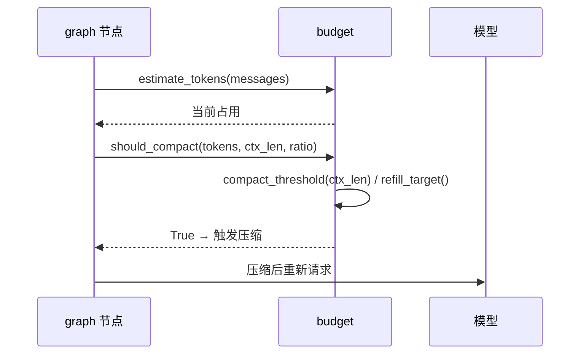

# 第 4 章　上下文预算、压缩与自动后续动作

> **EvoFlow 对照状态 / Alignment status：** ✅ **已核对源码**（`compaction_trigger.py` 660 行、`utils/model_context_length.py`、`context_compaction_core.py` 关键段）。

## 本章目标
把上下文当作**有预算的资源**管理：估算、截断、压缩、离线转存、自动续跑。

## 最小闭环
工具返回 1MB → 落盘 + 只回灌摘要 → token 超阈值 → 触发压缩 → 压缩后仍能回答原问题。

## 调用逻辑 / Invocation logic



- **入口**：每轮请求模型前先 `estimate_tokens()`，估算放在调用前而不是超限后。
- **关键节点**：阈值有两个来源——比例（`ratio=0.9`）和绝对上限（cap），**cap 胜**（本复刻测试 `tests/chapters/test_ch03_04_budget.py::test_cap_beats_ratio` 钉死这条）；压缩后**不是立刻又能压**：真实实现是「压缩后 token 得再涨回去才允许再压」——`agents/compaction_trigger.py:20` `POST_COMPRESS_REFILL_RATIO = 1.22`（跨轮），`:24` `SAME_TURN_REFILL_RATIO = 1.5`（同一轮/tool 跳，防止 compress→main→compress 抖动），门槛 = `after_gate_tokens × 比例`（`:148`–`:149`）。**注意：没有名为 `refill_target()` 的函数**，原文这里写错了。
- **出口**：`should_compact` 返回布尔，压缩动作由外层执行，`budget.py` 本身不调模型。
- **最容易断的地方**：把估算做成精确 tokenizer（慢十倍且和模型不完全一致）；压缩后再塞回全部历史，等于没压。

## 真实模块地图（已核对：路径 · 行数 · 符号）

| 文件 | 行数 | 关键符号 | 模块常量 |
|---|---|---|---|
| `packages/harness/evoflow/context/model_request_token_estimate.py:37` | 191 | `ModelCallOverheadEstimate`；`set_gate_overhead_meta`、`reset_gate_overhead_meta`、`current_gate_overhead_meta` | — |
| `packages/harness/evoflow/context/capability_token_estimate.py:23` | 167 | `_skill_catalog_xml_item`、`estimate_named_skills_tokens`、`estimate_named_tools_tokens` | — |
| `packages/harness/evoflow/context/tool_tokens.py:20` | 27 | `count_tool_tokens` | — |
| `packages/harness/evoflow/context/working_memory.py:22` | 356 | `ReadEntry`、`WriteEntry`、`_ThreadMemory`；`_normalize_path_key`、`_entry_key`、`_line_hint` | — |
| `packages/harness/evoflow/context/tool_history_ager_queue.py:31` | 138 | `ToolHistorySummaryQueue`；`get_tool_history_summary_queue` | — |
| `packages/harness/evoflow/context/tool_history_merge.py:58` | 299 | `ToolRoundEntry`、`_ColdScan`；`_evict_last_merge_locked`、`merge_cooldown_elapsed`、`mark_merge_cooldown` | — |
| `packages/harness/evoflow/context/tool_timeline.py:14` | 116 | `_extract_persisted_path`、`search_tool_timeline`、`format_tool_timeline_for_agent` | — |
| `packages/harness/evoflow/context/tool_result_summarizer.py:42` | 281 | `is_frozen_tool_history`、`is_already_shaped`、`format_structured_summary` | TOOL_HISTORY_PREFIX |
| `packages/harness/evoflow/context/tool_summary_prompts.py:20` | 132 | `_tool_family`、`build_single_tool_summary_prompt`、`build_tool_history_batch_prompt` | — |
| `packages/harness/evoflow/agents/context_compaction_core.py:1201` | 2963 | `CompactionPlan`、`ContextCompactionEngine`；`_compaction_tool_truncate_tokens`、`_compaction_moderate_truncate_tokens`、`_multimodal_extras_tokens` | MAIN_SUMMARY_PREFIX、LEGACY_SUMMARY_MARKERS、TURNS |
| `packages/harness/evoflow/agents/context_compaction_events.py:15` | 316 | `_emit`、`_inject_compaction_stream_event`、`_try_stream_writer` | — |
| `packages/harness/evoflow/agents/manual_context_compaction.py:26` | 175 | `ManualCompactionError`、`_ManualCompactionRuntime`；`_resolve_session_model_name`、`run_manual_context_compaction` | — |
| `packages/harness/evoflow/tools/large_result_store.py:18` | 188 | `_get_store_dir`、`_prune_old_files`、`build_head_summary` | — |
| `packages/harness/evoflow/tools/tool_output_truncation.py:11` | 62 | `truncate_text_to_token_budget`、`formatted_truncate_tool_output` | — |
| `packages/harness/evoflow/context/context_ref_lru.py:14` | 55 | `register_ref`、`_evict_locked`、`list_refs` | — |
| `packages/harness/evoflow/context/file_read_cache.py:17` | 83 | `_cache_key`、`get_cached_text`、`store_cached_text` | — |
| `packages/harness/evoflow/agents/context_compaction_core.py:1201` | 2963 | `CompactionPlan`、`ContextCompactionEngine`；`_compaction_tool_truncate_tokens`、`_compaction_moderate_truncate_tokens`、`_multimodal_extras_tokens` | MAIN_SUMMARY_PREFIX、LEGACY_SUMMARY_MARKERS、TURNS |
| `packages/harness/evoflow/tools/large_result_store.py:18` | 188 | `_get_store_dir`、`_prune_old_files`、`build_head_summary` | — |

## 核心概念（以下均为源码核对结论）
- **只按 token 判定，不按消息数**：`message_count_triggers_compaction()` 恒返回 `False`，`round_trigger_rearmed()` 也恒为 `False`。配置项 `compaction_trigger_message_count` 保留但被显式忽略（源码注释：消息数「must not allow or force a compress LLM call」）。
- **阈值三件套**：`compression_threshold_tokens(context_length, threshold_ratio, aggressive_ratio)`。`context_length` 取自模型表的 `context_length` 列，缺失时 `DEFAULT_CONTEXT_LENGTH = 256_000`；`AUTO_COMPACT_RATIO = 0.9`。
- **非激进阈值有绝对上限**：`_ABSOLUTE_COMPACT_CAP_DEFAULT = 150_000`，可用 `EVOFLOW_COMPACT_ABSOLUTE_TOKENS` 覆盖（下限 20K）。原因写在注释里：大窗口模型按 0.9 比例会在 334K ctx / 10.9s TTFT 之后才触发，太晚。
- **压缩后要「回填」才允许再压**：`POST_COMPRESS_REFILL_RATIO = 1.22`；**同一用户轮内**要求更高，`SAME_TURN_REFILL_RATIO = 1.5`（注释：1.22 在小窗口下几轮工具结果就撞到，导致 compress→main→compress 抖动）。
- **单飞与冷却**：`CompactionTriggerCache.try_acquire_compress()` 保证同 thread 同时只有一次压缩；快照 TTL `7200s`、最多 `1024` 条，超了按时间淘汰。
- **一次 hop 只判一次**：模型调用路径 `build_ephemeral_model_messages → compaction_gate_status → evaluate()`；从该管线调用 `compress_messages` 时必须传 `skip_trigger_check=True`。
- **截断策略**：摘要截断按 head/tail = **70/30** token 预算切（`head_budget = budget * 0.70`）；图片块按 `_IMAGE_BLOCK_TOKEN_EST = 3000` 计，避免图片消息从阈值下溜走。
- **可观测**：每次判定打一行 `[context-compaction] 压缩判定 tokens=%d/%d (%.1f%%) need_compress=%s threshold=%d reason=%s phase=%s`，并写入 `context-compaction.log`。
- **信封机制**：大结果落盘后只回灌摘要（`large_result_store.py`、`tool_result_summarizer.py`）。

## 自研实现要点
```text
1) tokens = estimate(messages) + gate_overhead
2) threshold = min(context_length * 0.9, 150_000)      # 与 EvoFlow 的封顶一致
3) 若 in_cooldown 或 try_acquire 失败 → 直接返回            # 单飞 + 冷却
4) 压缩顺序：工具原始结果 → 老化历史 → 合并同类 → LLM 摘要
5) 记录 after_gate_tokens；下次要长到 after*1.22（同轮 1.5）才允许再压
6) 丢弃项写 persisted store，追加一条合成消息说明「丢了什么、从哪取回」
```

## 业务规则
- 压缩必须幂等：同一状态重复压缩不产生额外消耗（EvoFlow 用 thread 级快照 + in-flight 标记实现）。
- 别用消息数当触发条件：EvoFlow 明确把这条路径关掉了，靠它只会制造假触发。
- 永不压缩 system prompt 与安全规则。
- 落盘文件按 session 分目录，随 session 清理。

## 常见坑
- 按字符数估算 token（中文差 2–3 倍）。
- 压缩后丢了工具返回的关键字段，模型开始编。
- 落盘文件不清理 → 磁盘打满。

## 验收
- [ ] 1MB 工具输出不导致上下文溢出
- [ ] 压缩后原问题仍可答
- [ ] 重复压缩无副作用（同 thread 并发只有一次真正压缩）

### 源码核对记录（路径与符号实测）

- `packages/harness/evoflow/context/model_request_token_estimate.py`（191 行）：类 `ModelCallOverheadEstimate`
  - 模块自述：Estimate model-call overhead tokens (system prompt + bound tools) from wire shapes. Uses LangChain's ``convert…
- `packages/harness/evoflow/context/capability_token_estimate.py`（167 行）
  - 模块自述：Per-skill / per-tool context token estimates (same path as model-bind overhead). Skills: token cost of each ``…
- `packages/harness/evoflow/context/tool_tokens.py`（27 行）
  - 模块自述：Token counting helpers for tool-result tiering. Thin wrapper that delegates to :mod:`evoflow.context.compactio…
- `packages/harness/evoflow/context/working_memory.py`（356 行）：类 `ReadEntry`、`WriteEntry`、`_ThreadMemory`
  - 模块自述：Per-thread read registry (sync); rendered inside ``<mission_state>`` — no separate LLM digest.…
- `packages/harness/evoflow/context/tool_history_ager_queue.py`（138 行）：类 `ToolHistorySummaryQueue`
  - 模块自述：Background LLM refinement for aged tool summaries (debounced per thread).…
- `packages/harness/evoflow/context/tool_history_merge.py`（299 行）：类 `ToolRoundEntry`、`_ColdScan`
  - 模块自述：Batch-merge cold-zone tool rounds into a single frozen [tool:history] block.…
- `packages/harness/evoflow/context/tool_timeline.py`（116 行）
  - 模块自述：Unified tool-call timeline for agents (observability SQLite + JSONL fallback).…
- `packages/harness/evoflow/context/tool_result_summarizer.py`（281 行）
  - 模块自述：Dedicated model summaries for tool outputs (medium tier + history aging).…
- `packages/harness/evoflow/context/tool_summary_prompts.py`（132 行）
  - 模块自述：Tool-type-aware prompts for tool result summarization.…
- `packages/harness/evoflow/agents/context_compaction_core.py`（2963 行）：类 `CompactionPlan`、`ContextCompactionEngine`
  - 模块自述：Hermes-style context compaction for LangChain message lists (main agent).…
- `packages/harness/evoflow/agents/context_compaction_events.py`（316 行）；环境变量 `EVOFLOW_GATEWAY_URL`
  - 模块自述：Stream custom events so the UI can show context compaction status.…
- `packages/harness/evoflow/agents/manual_context_compaction.py`（175 行）：类 `ManualCompactionError`、`_ManualCompactionRuntime`
  - 模块自述：Manual context compaction for Gateway API (same engine as model-call middleware).…
- `packages/harness/evoflow/tools/large_result_store.py`（188 行）；环境变量 `EVOFLOW_DATA_DIR`、`EVOFLOW_HOME`
  - 模块自述：Large tool result persistence — saves oversized outputs to files.…
- `packages/harness/evoflow/tools/tool_output_truncation.py`（62 行）
  - 模块自述：runtime-aligned inline tool output truncation (middle omit + warning header).…
- `packages/harness/evoflow/context/context_ref_lru.py`（55 行）
  - 模块自述：Per-thread LRU registry for persisted tool-result file references.…
- `packages/harness/evoflow/context/file_read_cache.py`（83 行）
  - 模块自述：In-process LRU cache for text file reads (path + mtime).…
- `packages/harness/evoflow/agents/context_compaction_core.py`（2963 行）：类 `CompactionPlan`、`ContextCompactionEngine`
  - 模块自述：Hermes-style context compaction for LangChain message lists (main agent).…
- `packages/harness/evoflow/tools/large_result_store.py`（188 行）；环境变量 `EVOFLOW_DATA_DIR`、`EVOFLOW_HOME`
  - 模块自述：Large tool result persistence — saves oversized outputs to files.…

> 本节只证明**路径、行数、符号存在**；调用顺序与边界条件仍属「行为」，未逐行核对。

## 对照 EvoFlow 核对清单
- [x] 触发只按 token，消息数触发被显式禁用（`message_count_triggers_compaction` 恒 False）
- [x] 阈值公式与 150K 绝对封顶（`EVOFLOW_COMPACT_ABSOLUTE_TOKENS`）
- [x] 回填比例 1.22 / 同轮 1.5，以及为什么需要两个数
- [x] 单飞 `try_acquire_compress()` + 冷却 + 快照 TTL 7200s / 1024 条
- [x] 摘要头尾 70/30 切分、图片块 3000 token 估算
- [ ] `context_compaction_core.py` 内部的具体裁剪顺序（2963 行，仅读了阈值与截断相关段）
- [ ] `large_result_store.py` 的引用信封格式（188 行，未展开）

## 从零实现（手把手）
> 读完这章你能算出「这轮还剩多少 token」，并在超阈值时触发压缩、压缩后回填。
> 路径均相对 `backend/`，代码注释写「为什么」。

### Step 1　新建 budget.py：估算 + 阈值 + 硬上限
**文件**：`packages/harness/myagentflow/context/budget.py（新建）`
**要写的逻辑**：按字符估 token；阈值 = 上下文 * 0.9；但再乘一个绝对上限 150K（EvoFlow 的实测取舍），取两者更小。

**代码**

```python
"""上下文预算：估算、阈值、封顶。

为什么要有绝对上限：
模型窗口写着 256K，但实测 334K ctx 时 TTFT 会飙到 10.9s，
所以「比例阈值」必须再被一个绝对值压住。
"""
from __future__ import annotations

DEFAULT_CONTEXT = 256_000
AUTO_COMPACT_RATIO = 0.9
ABSOLUTE_CAP = 150_000          # 对应 EVOFLOW_COMPACT_ABSOLUTE_TOKENS
POST_COMPRESS_REFILL = 1.22     # 压缩后回填到目标的 122%
SAME_TURN_REFILL = 1.5


def estimate_tokens(text: str) -> int:
    """粗估：中文约 1 字 1 token，英文约 4 字符 1 token。宁可高估。"""
    if not text:
        return 0
    cjk = sum(1 for ch in text if ord(ch) > 0x2E80)
    return cjk + max(1, (len(text) - cjk) // 3)


def compact_threshold(context_length: int = DEFAULT_CONTEXT) -> int:
    by_ratio = int(context_length * AUTO_COMPACT_RATIO)
    return min(by_ratio, ABSOLUTE_CAP)   # 两者取小：绝对上限永远生效


def should_compact(tokens: int, context_length: int = DEFAULT_CONTEXT) -> bool:
    return tokens >= compact_threshold(context_length)


def refill_target(threshold: int, same_turn: bool = False) -> int:
    ratio = SAME_TURN_REFILL if same_turn else POST_COMPRESS_REFILL
    return int(threshold / ratio)
```

**验证**

```bash
uv run python -c "
from myagentflow.context.budget import estimate_tokens, compact_threshold, should_compact
print(estimate_tokens('你好 world'))       # 3~4
print(compact_threshold())                  # 150000（被绝对上限压住）
print(should_compact(160_000))              # True
"
```

### Step 2　写测试：绝对上限必须压过比例
**文件**：`tests/chapters/test_ch03_04_budget.py（新建）`
**要写的逻辑**：256K 上下文下阈值是 150K 而不是 230K；同轮回填比值更大（回填更少）。

**代码**

```python
from __future__ import annotations


def test_cap_beats_ratio():
    from myagentflow.context.budget import ABSOLUTE_CAP, compact_threshold

    assert compact_threshold(256_000) == ABSOLUTE_CAP
    assert compact_threshold(100_000) == 90_000     # 小窗口时比例生效


def test_refill():
    from myagentflow.context.budget import refill_target

    assert refill_target(150_000) < 150_000
    assert refill_target(150_000, same_turn=True) < refill_target(150_000)
```

**验证**

```bash
uv run pytest tests/chapters/test_ch03_04_budget.py -v
# 期望：2 passed
```

### 与 EvoFlow 对照

| 我们的做法 | EvoFlow | 为什么 |
|---|---|---|
| 比例阈值 0.9 | `utils/model_context_length.py` 的 `AUTO_COMPACT_RATIO` | 留 10% 给输出与新消息 |
| 绝对封顶 150K | 同文件 `_ABSOLUTE_COMPACT_CAP_DEFAULT=150_000` | 生产见过 334K ctx / 10.9s TTFT |
| 回填 1.22 / 同轮 1.5 | compaction 里的两个 RATIO 常量 | 一次压太狠会立刻再触发压缩 |

### 知识点

- [Harbor404 · 推理链路延迟优化](https://harbor404.fushenlin.com/notes/llm-agent-latency-optimization/)：上下文长度与 TTFT 的关系
- agent-book：上下文压缩策略

### 验收

```bash
uv run pytest tests/chapters/test_ch03_04_budget.py -q
```
