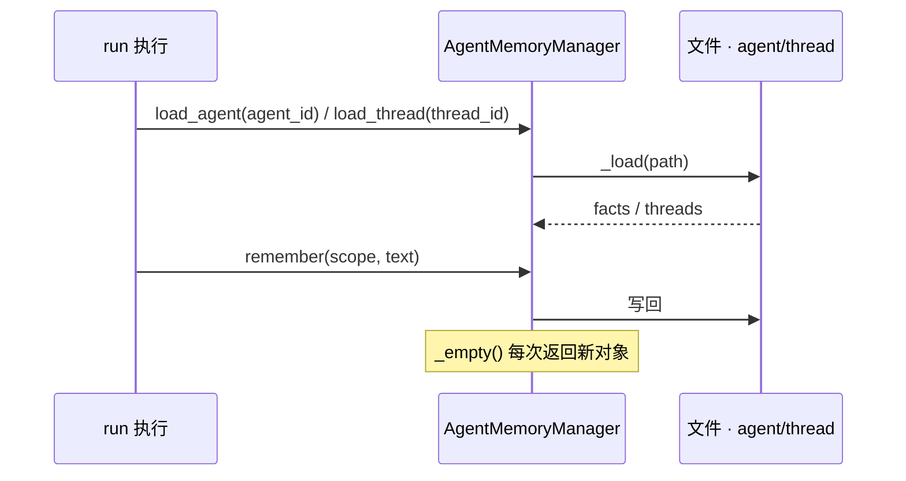

# 第 1 章　会话短期记忆与长期记忆

> **EvoFlow 对照状态 / Alignment status：** ✅ **结构 + 存储行为已核对**：两套存储路径（`agents/memory/agent_memory.py:17-21`）、读取 fail-soft 的默认结构（`:63`/`:70`）、四个命名空间（`memory/namespaces.py:6/10/17/27`）、facade 导出（`memory/facade.py:22/89/94`）、recall 快照三函数（`memory/recall_snapshot.py:27/71/80`）。**未核对**：调用顺序与跨轮边界条件。

## 本章目标
分清「上下文内的记忆」和「库里的记忆」，并设计一条从对话到长期记忆的写入链。

## 最小闭环
对话里说「我习惯用 uv」→ 本轮生效（上下文）→ 会话结束写入长期记忆 → 新会话自动带上。

## 调用逻辑 / Invocation logic



- **入口**：`load_agent()` 取跨任务偏好，`load_thread()` 取本线程事实，两者物理隔离。
- **关键节点**：`remember()` 只写调用方指定的 scope；`_empty()` 每次都建新 dict/list，绝不复用默认对象（这里踩过浅拷贝 bug，会串味）。
- **出口**：注入 prompt 时按 scope 拼接，agent 级在前、thread 级在后。
- **最容易断的地方**：`dict(DEFAULT)` 共享内部 list；以及写失败直接抛出——本章要求 fail-soft，记忆坏了不能拖垮对话。

## 真实模块地图（已核对：路径 · 行数 · 符号）

| 文件 | 行数 | 关键符号 | 模块常量 |
|---|---|---|---|
| `packages/harness/evoflow/memory/facade.py:13` | 375 | `_get_archive_floor`、`remember`、`_maybe_enqueue_threshold` | — |
| `packages/harness/evoflow/memory/store.py:33` | 747 | `_keyword_search_terms`、`_dumps`、`_loads_obj` | — |
| `packages/harness/evoflow/memory/storage.py:34` | 135 | `MemoryStorage`、`OwnedMemoryStorage`；`create_empty_memory`、`get_memory_storage`、`reset_memory_storage_for_tests` | — |
| `packages/harness/evoflow/memory/recall_snapshot.py:15` | 90 | `_trim`、`record_thread_recall`、`get_thread_recall` | — |
| `packages/harness/evoflow/memory/namespaces.py:6` | 39 | `user_ns`、`agent_ns`、`workspace_ns` | — |
| `packages/harness/evoflow/memory/namespaces_api.py:15` | 324 | `_atom_count`、`_ns_rows`、`_visibility_ctx` | — |
| `packages/harness/evoflow/memory/episodes.py:15` | 116 | `_clip`、`record_task_episode`、`record_goal_episode` | — |
| `packages/harness/evoflow/agents/memory/agent_memory.py:13` | 214 | `AgentMemoryManager`；`get_agent_memory_manager` | — |
| `packages/harness/evoflow/admin/workspace_memory.py:20` | 77 | `_normalize_path`、`get_workspace_memory`、`clear_workspace_memory_admin` | — |
| `packages/harness/evoflow/agents/memory/updater.py:260` | 464 | `MemoryUpdater`；`_create_empty_memory`、`_save_memory_to_file`、`get_memory_data` | — |
| `packages/harness/evoflow/agents/memory/queue.py:16` | 387 | `ConversationContext`、`MemoryUpdateQueue`；`get_memory_queue`、`reset_memory_queue` | — |
| `packages/harness/evoflow/agents/memory/runtime_overrides.py:63` | 248 | `_ctx_dict`、`_coerce_bool`、`role_memory_enabled_from_config` | ASSETS_TOOL_NAME |
| `packages/harness/evoflow/agents/memory/prompt.py:172` | 427 | `_count_tokens`、`_coerce_confidence`、`_truncate_summary` | MEMORY_UPDATE_PROMPT、IMPORTANT、FACT_EXTRACTION_PROMPT |
| `packages/harness/evoflow/agents/memory/workspace_prompt.py:148` | 772 | `is_ephemeral_workspace_path`、`normalize_workspace_relative_path`、`scrub_ephemeral_workspace_text` | WORKSPACE_BOOTSTRAP_PROMPT、IMPORTANT、IMPORTANT |
| `packages/harness/evoflow/memory/recall_snapshot.py:15` | 90 | `_trim`、`record_thread_recall`、`get_thread_recall` | — |

## 已核对的行为事实（源码）

- **两层记忆分文件存放**（`agents/memory/agent_memory.py` 214 行，docstring 原文）：
  - Agent 记忆：`{base_dir}/agents/{agent_name}/memory.json` —— 跨任务、跨会话；
  - 任务记忆：`{base_dir}/threads/{thread_id}/agent_memory/{agent_name}.json` —— 随线程删除可一起清掉。
- **读取是 fail-soft**：文件不存在或 JSON 解析失败，返回默认结构 `{"facts": [], "context": {}}` 并记 error 日志，不会抛异常打断对话。
- **命名空间只有四类**：`memory/namespaces.py`（39 行）暴露 `user_ns` / `agent_ns` / `workspace_ns` / `person_ns` 与 `parse_namespace`，没有第五种。
- **入口是门面不是管理器**：`memory/facade.py`（375 行）对外只有 `remember` / `forget` / `consolidate` / `_maybe_enqueue_threshold`；写库细节在 `memory/store.py`（747 行）。
- **按线程的回放快照**：`memory/recall_snapshot.py`（90 行）提供 `record_thread_recall` / `get_thread_recall` / `clear_thread_recall`，说明「本轮召回了什么」是被记录、可回放的。

## 核心概念
- **命名空间**：`user / agent / workspace / person` 四类（`memory/namespaces.py` 实际导出 `user_ns`、`agent_ns`、`workspace_ns`、`person_ns`）——**没有 `session` 这一类**，本仓库早期草稿写错，已按源码改正。
- **recall snapshot**：每轮开始时冻结一份召回结果，保证同一轮内 prompt 稳定。
- **两阶段写入**：候选提取（对话中）→ 巩固（会话结束/定时）→ 落库。

## 自研实现要点
```text
memories(id, namespace, key, value, kind, source_session, confidence, created_at, updated_at)
recall(ns, query, k) → 关键词+向量混合 → 去重 → 时间衰减 → 取 top-k
```

## 业务规则
- 冲突时「新覆盖旧」需保留旧版本（可回溯）。
- 记忆条数按命名空间限流，防止无限膨胀。
- 召回结果必须带 `source`，模型引用时要能说清来源。

## 常见坑
- 每轮都写记忆 → 垃圾记忆淹没真信息。
- 召回不分命名空间 → 别人的偏好污染当前用户。
- 把长文档整段塞进记忆 → 等价于没压缩的 RAG。

## 验收
- [ ] 跨会话可召回
- [ ] 命名空间隔离
- [ ] 记忆可定位删除

### 源码核对记录（路径与符号实测）

- `packages/harness/evoflow/memory/facade.py`（375 行）
  - 模块自述：Memory Facade: remember / recall / get_core / forget.…
- `packages/harness/evoflow/memory/store.py`（747 行）
  - 模块自述：Low-level mem_* persistence on owned.sqlite.…
- `packages/harness/evoflow/memory/storage.py`（135 行）：类 `MemoryStorage`、`OwnedMemoryStorage`
  - 模块自述：Memory storage providers — backed by unified mem_* on Owned KB.…
- `packages/harness/evoflow/memory/recall_snapshot.py`（90 行）
  - 模块自述：Per-thread memory injection snapshot for chat transparency chip.…
- `packages/harness/evoflow/memory/namespaces.py`（39 行）
  - 模块自述：Memory namespace id helpers.…
- `packages/harness/evoflow/memory/namespaces_api.py`（324 行）
  - 模块自述：List visible memory namespaces for the memory hub UI.…
- `packages/harness/evoflow/memory/episodes.py`（116 行）
  - 模块自述：Write L2 episodic memory when tasks / goals complete.…
- `packages/harness/evoflow/agents/memory/agent_memory.py`（214 行）：类 `AgentMemoryManager`
  - 模块自述：Agent memory management - separates agent memory from task memory.…
- `packages/harness/evoflow/admin/workspace_memory.py`（77 行）
  - 模块自述：Workspace memory admin (CLI / API helpers).…
- `packages/harness/evoflow/agents/memory/updater.py`（464 行）：类 `MemoryUpdater`
  - 模块自述：Memory updater for reading, writing, and updating memory data.…
- `packages/harness/evoflow/agents/memory/queue.py`（387 行）：类 `ConversationContext`、`MemoryUpdateQueue`
  - 模块自述：Memory update queue with debounce mechanism.…
- `packages/harness/evoflow/agents/memory/runtime_overrides.py`（248 行）
  - 模块自述：Per-run memory behavior overrides via LangGraph ``runtime.context``. Canonical gate: ``memory_enabled``. Resol…
- `packages/harness/evoflow/agents/memory/prompt.py`（427 行）
  - 模块自述：Prompt templates for memory update and injection.…
- `packages/harness/evoflow/agents/memory/workspace_prompt.py`（772 行）
  - 模块自述：Prompt templates and formatters for workspace (project) memory.…
- `packages/harness/evoflow/memory/recall_snapshot.py`（90 行）
  - 模块自述：Per-thread memory injection snapshot for chat transparency chip.…

> 本节只证明**路径、行数、符号存在**；调用顺序与边界条件仍属「行为」，未逐行核对。

## 对照 EvoFlow 核对清单
- [x] 两层记忆的落盘路径与生命周期（`agent_memory.py` docstring 原文）
- [x] 读取失败时的默认结构（fail-soft，不抛异常）
- [x] 四个命名空间函数名（`namespaces.py` 39 行全文）
- [x] 门面层只有四个入口（`facade.py` 符号表）
- [ ] `memory/store.py`（747 行）的检索打分与去重策略（未逐行读）
- [ ] `updater.py`（464 行）的 LLM 抽取提示词（未读）
- [ ] `recall_snapshot.py` 的冻结时机
- [ ] 四类命名空间的实际 key 规则

## 从零实现（手把手）
> 读完这章你能落盘两层记忆：agent 级（跨任务）与 thread 级（随线程），并且读不到时不会炸。
> 路径均相对 `backend/`，代码注释写「为什么」。

### Step 1　新建 agent_memory.py：两个路径 + fail-soft
**文件**：`packages/harness/myagentflow/memory/agent_memory.py（新建）`
**要写的逻辑**：agent 级存 `agents/{name}/memory.json`，thread 级存 `threads/{tid}/agent_memory/{name}.json`；解析失败返回默认结构，绝不抛异常。

**代码**

```python
"""两层记忆：agent 级跨任务，thread 级随线程删。

为什么读失败要返回默认值而不是抛异常：
记忆是增强项，不是主流程。一条记忆文件写坏了不该让整轮对话失败。
"""
from __future__ import annotations

import json
import logging
from dataclasses import dataclass, field
from pathlib import Path
from typing import Any

logger = logging.getLogger(__name__)

DEFAULT = {"facts": [], "context": {}}


def _empty() -> dict[str, Any]:
    """每次返回全新对象：dict(DEFAULT) 是浅拷贝，facts 列表会被所有调用方共享。"""
    return {"facts": [], "context": {}}


def _load(path: Path) -> dict[str, Any]:
    try:
        data = json.loads(path.read_text(encoding="utf-8"))
        if isinstance(data, dict):
            return {"facts": list(data.get("facts", [])), "context": dict(data.get("context", {}))}
        logger.error("记忆结构不是对象：%s", path)
    except FileNotFoundError:
        return _empty()               # 首次运行：空记忆
    except (json.JSONDecodeError, OSError) as exc:
        logger.error("记忆读取失败 %s：%s", path, exc)
    return _empty()


@dataclass
class AgentMemoryManager:
    base_dir: Path
    agent_name: str = "lead"
    _agent_path: Path = field(init=False)
    _thread_paths: dict[str, Path] = field(default_factory=dict, init=False)

    def __post_init__(self) -> None:
        self._agent_path = self.base_dir / "agents" / self.agent_name / "memory.json"

    def thread_path(self, thread_id: str) -> Path:
        return self.base_dir / "threads" / thread_id / "agent_memory" / f"{self.agent_name}.json"

    def load_agent(self) -> dict[str, Any]:
        return _load(self._agent_path)

    def load_thread(self, thread_id: str) -> dict[str, Any]:
        return _load(self.thread_path(thread_id))

    def remember(self, thread_id: str, fact: str, scope: str = "thread") -> None:
        """写一条事实。scope=agent 时跨任务保留。"""
        path = self._agent_path if scope == "agent" else self.thread_path(thread_id)
        path.parent.mkdir(parents=True, exist_ok=True)
        data = _load(path)
        data["facts"].append(fact)
        path.write_text(json.dumps(data, ensure_ascii=False, indent=2), encoding="utf-8")
```

**验证**

```bash
uv run python -c "
from pathlib import Path
from myagentflow.memory.agent_memory import AgentMemoryManager
m = AgentMemoryManager(Path('/tmp/myaf-mem'))
print(m.load_thread('nope'))          # 默认结构
m.remember('t1', '用户偏好中文'); print(m.load_thread('t1'))
"
```

### Step 2　写测试：坏 JSON 不抛异常
**文件**：`tests/chapters/test_ch04_01_memory.py（新建）`
**要写的逻辑**：写一个 `{bad json` 文件，读取必须回默认值；两条记忆路径互不影响。

**代码**

```python
from __future__ import annotations


def test_fail_soft(tmp_path):
    from myagentflow.memory.agent_memory import AgentMemoryManager

    m = AgentMemoryManager(tmp_path)
    path = m.thread_path("t1")
    path.parent.mkdir(parents=True)
    path.write_text("{bad json", encoding="utf-8")
    assert m.load_thread("t1") == {"facts": [], "context": {}}


def test_scopes_are_separate(tmp_path):
    from myagentflow.memory.agent_memory import AgentMemoryManager

    m = AgentMemoryManager(tmp_path)
    m.remember("t1", "只属于这个线程")
    m.remember("t1", "跨任务偏好", scope="agent")
    assert m.load_thread("t1")["facts"] == ["只属于这个线程"]
    assert m.load_agent()["facts"] == ["跨任务偏好"]
```

**验证**

```bash
uv run pytest tests/chapters/test_ch04_01_memory.py -v
# 期望：2 passed
```

### 与 EvoFlow 对照

| 我们的做法 | EvoFlow | 为什么 |
|---|---|---|
| `agents/{name}/memory.json` | `agents/memory/agent_memory.py`（214 行）docstring | agent 记忆要跨任务活 |
| `threads/{tid}/agent_memory/{name}.json` | 同文件 | thread 删了记忆跟着走 |
| fail-soft 返回 `{"facts": [], "context": {}}` | 同文件 `_load` 分支 | 记忆坏了不该拖垮对话 |

### 知识点

- [agent-book · 记忆章](https://g0-000.github.io/agent-book/agent-learning/chapter_memory/)：短期/长期记忆的分层
- Harbor404：记忆写入的成本控制

### 验收

```bash
uv run pytest tests/chapters/test_ch04_01_memory.py -q
```
