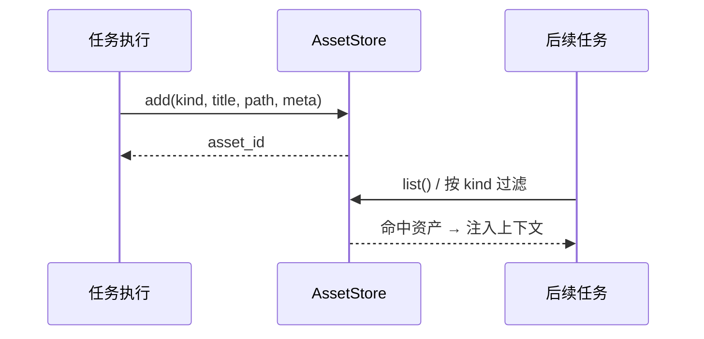

# 第 3 章　资产、产物、事项与反思

> **EvoFlow 对照状态 / Alignment status：** 🔍 结构已核对（路径、行数、符号均取自源码实测），**行为**（调用顺序、边界条件）尚未逐行核对。

## 本章目标
把「记忆」扩展成「可复用的资产」：文件、产物、待办、复盘，都能被后续任务检索和引用。

## 最小闭环
任务产出报告 → 登记为 artifact → 下一次任务可 `search_artifacts` 命中 → 反思写入改进点。

## 调用逻辑 / Invocation logic



- **入口**：任务产出文件后立刻 `add()` 登记，登记与落盘同一步完成，不留「事后补登」的空档。
- **关键节点**：`Asset` 里存 `path + meta`，正文不重复存；`list()` 支持按 kind/时间过滤，避免一次把全部资产塞进上下文。
- **出口**：后续任务拿到的是「资产引用」，需要时再读正文。
- **最容易断的地方**：登记了但文件被删（要做存在性校验）；反思写成空话，没有「下次改什么」。

## 真实模块地图（已核对：路径 · 行数 · 符号）

| 文件 | 行数 | 关键符号 | 模块常量 |
|---|---|---|---|
| `packages/harness/evoflow/persistence/artifact_repositories.py:16` | 263 | `_dumps`、`upsert_artifacts`、`list_session_artifacts` | — |
| `app/gateway/routers/artifacts.py` | 200 | `_build_content_disposition`、`_build_attachment_headers`、`is_text_file_by_content` | ACTIVE_CONTENT_MIME_TYPES |
| `app/gateway/routers/items.py` | 179 | `CreateItemRequest`、`UpdateItemRequest`、`DispatchItemRequest`；`_raise_admin`、`list_items`、`create_item` | — |
| `packages/harness/evoflow/person_wrap_up_reflect.py:67` | 720 | `build_person_wrap_up_user_prompt`、`_extract_json_object`、`parse_wrap_up_llm_result` | PERSON_WRAP_UP_SYSTEM |
| `packages/harness/evoflow/persistence/asset_memory_run_repositories.py:29` | 266 | `_safe_str`、`_paths_json`、`_detail_json` | — |
| `app/gateway/routers/media_assets.py` | 72 | `MediaAssetItem`、`MediaAssetsListResponse`；`list_media_assets_api` | — |

## 核心概念
- **产物要有身份**：`artifact_id + 路径 + 摘要 + 来源 run`，否则下次找不到。
- **事项是跨轮的意图**：不是消息，是「还没做完的事」。
- **反思是给系统看的**：把失败模式写成可检索条目，供后续中间件/提示使用。

## 自研实现要点
```text
artifacts(id, run_id, kind, path, title, summary, tags, created_at)
items(id, session_id, title, status, due_at, source)
reflections(id, run_id, what_failed, root_cause, fix_hint, tags)
```

## 业务规则
- 产物标题用人类可读名，不用 run_id。
- 反思条目必须可操作（含「下次怎么做」），否则不进库。
- 敏感产物（含密钥）不登记为可检索资产。

## 常见坑
- 产物只存路径，文件被覆盖后无法追溯。
- 事项与消息混淆 → 越堆越多没人关。
- 反思写成情绪总结，没有可执行结论。

## 验收
- [ ] 产物可被跨任务检索
- [ ] 事项有明确状态机与关闭条件
- [ ] 反思条目可被执行层消费

### 源码核对记录（路径与符号实测）

- `packages/harness/evoflow/persistence/artifact_repositories.py`（263 行）
  - 模块自述：SQLite CRUD for ``evoflow_artifacts`` (session-bound, append/upsert).…
- `app/gateway/routers/artifacts.py`（200 行）
- `app/gateway/routers/items.py`（179 行）：类 `CreateItemRequest`、`UpdateItemRequest`、`DispatchItemRequest`
  - 模块自述：用户事项 API — 与任务中心分离的个人进度账本。…
- `packages/harness/evoflow/person_wrap_up_reflect.py`（720 行）
  - 模块自述：LLM duty wrap-up reflection — distill shift evidence into person state. Prompt lineage (adapted, not copied wh…
- `packages/harness/evoflow/persistence/asset_memory_run_repositories.py`（266 行）
  - 模块自述：Asset Hub Phase1 / Phase2 processing run log. Records each consolidate/extract attempt so Asset Center can ver…
- `app/gateway/routers/media_assets.py`（72 行）：类 `MediaAssetItem`、`MediaAssetsListResponse`
  - 模块自述：List persisted media assets (SQLite index).…

> 本节只证明**路径、行数、符号存在**；调用顺序与边界条件仍属「行为」，未逐行核对。

## 对照 EvoFlow 核对清单
- [ ] `assets/prompts/memories/` 的两阶段管线
- [ ] `items/` 的状态定义

## 从零实现（手把手）
> 读完这章你能把「产出物、待办事项、反思记录」落成一张资产表，并支持按类型检索。
> 路径均相对 `backend/`，代码注释写「为什么」。

### Step 1　新建 assets.py：一张表三列核心
**文件**：`packages/harness/myagentflow/memory/assets.py（新建）`
**要写的逻辑**：`kind` 区分 artifact / todo / reflection；`ref` 指向文件或消息；列表按 kind 过滤。

**代码**

```python
"""资产与反思：一张表管三类东西。

为什么不拆三张表：它们都要「按 thread 查、按时间排」，
拆开以后每次跨类检索都要 UNION。
"""
from __future__ import annotations

import sqlite3
import time
import uuid
from dataclasses import dataclass
from pathlib import Path

_SCHEMA = """
CREATE TABLE IF NOT EXISTS assets (
    id         TEXT PRIMARY KEY,
    thread_id  TEXT NOT NULL,
    kind       TEXT NOT NULL,
    title      TEXT NOT NULL,
    ref        TEXT,
    created_at REAL NOT NULL
);
CREATE INDEX IF NOT EXISTS idx_assets_thread ON assets(thread_id, kind, created_at);
"""


@dataclass(frozen=True)
class Asset:
    thread_id: str
    kind: str        # artifact | todo | reflection
    title: str
    ref: str | None = None


class AssetStore:
    def __init__(self, db_path: str | Path):
        Path(db_path).parent.mkdir(parents=True, exist_ok=True)
        self._conn = sqlite3.connect(str(db_path), check_same_thread=False)
        self._conn.executescript(_SCHEMA)

    def add(self, asset: Asset) -> str:
        if asset.kind not in {"artifact", "todo", "reflection"}:
            raise ValueError(f"未知资产类型：{asset.kind}")
        ident = uuid.uuid4().hex
        self._conn.execute(
            "INSERT INTO assets (id, thread_id, kind, title, ref, created_at) VALUES (?, ?, ?, ?, ?, ?)",
            (ident, asset.thread_id, asset.kind, asset.title, asset.ref, time.time()),
        )
        self._conn.commit()
        return ident

    def list(self, thread_id: str, kind: str | None = None) -> list[dict]:
        if kind:
            rows = self._conn.execute(
                "SELECT id, kind, title, ref FROM assets WHERE thread_id=? AND kind=? ORDER BY created_at DESC",
                (thread_id, kind),
            ).fetchall()
        else:
            rows = self._conn.execute(
                "SELECT id, kind, title, ref FROM assets WHERE thread_id=? ORDER BY created_at DESC",
                (thread_id,),
            ).fetchall()
        return [{"id": r[0], "kind": r[1], "title": r[2], "ref": r[3]} for r in rows]
```

**验证**

```bash
uv run python -c "
from myagentflow.memory.assets import Asset, AssetStore
s = AssetStore('/tmp/myaf-assets.sqlite')
s.add(Asset('t1','todo','写集成测试')); s.add(Asset('t1','artifact','报告.md','/tmp/r.md'))
print(s.list('t1', kind='todo'))
"
```

### Step 2　写测试：类型校验与过滤
**文件**：`tests/chapters/test_ch04_03_assets.py（新建）`
**要写的逻辑**：非法 kind 报错；按 kind 过滤只返回该类型。

**代码**

```python
from __future__ import annotations

import pytest


def test_assets(tmp_path):
    from myagentflow.memory.assets import Asset, AssetStore

    s = AssetStore(tmp_path / "a.sqlite")
    s.add(Asset("t1", "todo", "写测试"))
    s.add(Asset("t1", "artifact", "报告", "/tmp/x.md"))
    assert [a["kind"] for a in s.list("t1")] == ["artifact", "todo"]
    assert [a["title"] for a in s.list("t1", kind="todo")] == ["写测试"]

    with pytest.raises(ValueError):
        s.add(Asset("t1", "unknown", "x"))
```

**验证**

```bash
uv run pytest tests/chapters/test_ch04_03_assets.py -v
# 期望：1 passed
```

### 与 EvoFlow 对照

| 我们的做法 | EvoFlow | 为什么 |
|---|---|---|
| artifact / todo / reflection 三类 | `memory/` 下的资产与反思入口 | 三类都要按线程检索 |
| 单表 + kind 过滤 | 资产表设计 | 拆三表会让跨类查询变复杂 |

### 知识点

- [agent-book](https://g0-000.github.io/agent-book/)：Agent 的产物管理
- Harbor404：反思与复盘笔记

### 验收

```bash
uv run pytest tests/chapters/test_ch04_03_assets.py -q
```
