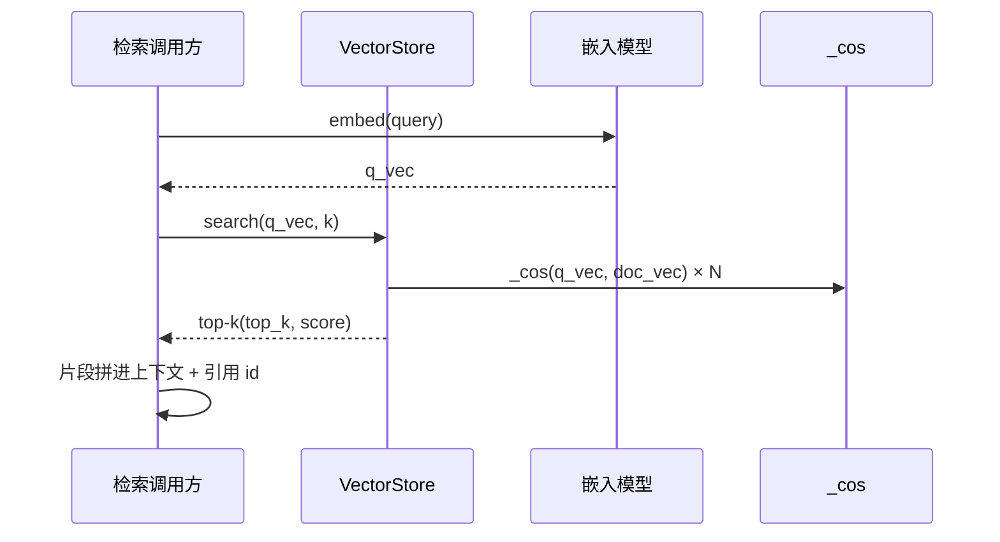

# 第 2 章　Embedding、向量检索与引用

> **EvoFlow 对照状态 / Alignment status：** 🔍 结构已核对（路径、行数、符号均取自源码实测），**行为**（调用顺序、边界条件）尚未逐行核对。

## 本章目标
用最小的代价实现「能召回、能排序、能引用」的检索。

## 最小闭环
建索引 → 查询 → top-k 片段 → 注入上下文 → 回答带引用。

## 调用逻辑 / Invocation logic



- **入口**：`VectorStore.add(ids, vectors)` 建索引，`search(q_vec, k)` 查询；嵌入由调用方做，store 不依赖网络。
- **关键节点**：`_cos` 自己算余弦，不引 numpy（少一个依赖、也方便手写理解）；维度不一致必须早失败，不能悄悄截断。
- **出口**：返回 `(id, score)` 列表，低于阈值直接丢弃，宁少勿滥。
- **最容易断的地方**：入库与查询用了两个不同嵌入模型；top-k 取回后没有引用 id，回答无法溯源。

## 真实模块地图（已核对：路径 · 行数 · 符号）

| 文件 | 行数 | 关键符号 | 模块常量 |
|---|---|---|---|
| `packages/harness/evoflow/knowledge/service.py:39` | 687 | `_enrich_dataset`、`dataset_llm_index_enabled`、`list_datasets` | — |
| `packages/harness/evoflow/knowledge/index_builder.py:9` | 77 | `build_document_summary`、`enrich_chunk_indexes`、`embedding_text_for_chunk` | — |
| `app/gateway/routers/knowledge.py` | 418 | `CreateDatasetRequest`、`UpdateDatasetRequest`、`SyncLocalRequest`；`_org_admin_dep`、`list_knowledge_bases`、`create_knowledge_base` | — |

## 核心概念
- **混合检索**：向量（语义）+ BM25/FTS（关键词），两路结果融合（RRF 或加权）。
- **改写成查询**：多轮对话里先把「它」还原成实体再检索。
- **重排（rerank）**：top-50 → rerank → top-5，成本可控且效果显著。

## 自研实现要点
```text
embed(chunk.text) → 1536/768 维 → 存 sqlite-vec / faiss
retrieve(q): vec_top20 + fts_top20 → 去重 → rerank → 取 5 → 附 chunk_id
```

## 业务规则
- 向量维度与模型绑定，换模型必须重建索引（记录 `embedding_model` 版本）。
- 检索结果必须带 `score`，低分直接不注入（宁可不答也别乱答）。

## 常见坑
- 换 embedding 模型不重建 → 相似度全乱。
- 只做向量 → 专有名词查不到。
- 召回过量 → 上下文被垃圾片段占满。

## 验收
- [ ] 专有名词查询命中
- [ ] 语义改写查询命中
- [ ] 索引版本与模型版本一致

### 源码核对记录（路径与符号实测）

- `packages/harness/evoflow/knowledge/service.py`（687 行）
  - 模块自述：Knowledge base service layer — business logic for CRUD, file upload, search. All DB operations go through the …
- `packages/harness/evoflow/knowledge/index_builder.py`（77 行）
  - 模块自述：Build document summary + per-chunk index strings (rule-based, no user config).…
- `app/gateway/routers/knowledge.py`（418 行）：类 `CreateDatasetRequest`、`UpdateDatasetRequest`、`SyncLocalRequest`、`CreateFolderRequest`；环境变量 `EVOFLOW_HOME`、`EVOFLOW_KB_UPLOAD_DIR`
  - 模块自述：Knowledge base API router. Provides CRUD for knowledge bases, file upload, chunk listing, semantic search, and…

> 本节只证明**路径、行数、符号存在**；调用顺序与边界条件仍属「行为」，未逐行核对。

## 对照 EvoFlow 核对清单
- [ ] `knowledge/vector/` 的具体实现与表结构
- [ ] 是否内置 rerank

## 从零实现（手把手）
> 读完这章你能把块向量化存进 SQLite，并按余弦相似度召回 top-k。
> 路径均相对 `backend/`，代码注释写「为什么」。

### Step 1　新建 vector_store.py：存 + 查
**文件**：`packages/harness/myagentflow/knowledge/vector_store.py（新建）`
**要写的逻辑**：向量以 JSON 存 TEXT 列（先不引向量库）；检索在 Python 里算余弦。数据量大再换 FAISS。

**代码**

```python
"""向量存储：SQLite + Python 余弦。

为什么先不上向量库：几千块规模下，一次全表扫描 <10ms，
引入 FAISS 只会让部署多一个依赖。
"""
from __future__ import annotations

import json
import math
import sqlite3
from pathlib import Path

_SCHEMA = """
CREATE TABLE IF NOT EXISTS chunks (
    id        INTEGER PRIMARY KEY AUTOINCREMENT,
    doc_id    TEXT NOT NULL,
    heading   TEXT NOT NULL,
    text      TEXT NOT NULL,
    vector    TEXT NOT NULL
);
"""


def _cos(a: list[float], b: list[float]) -> float:
    dot = sum(x * y for x, y in zip(a, b))
    na = math.sqrt(sum(x * x for x in a)) or 1.0
    nb = math.sqrt(sum(y * y for y in b)) or 1.0
    return dot / (na * nb)


class VectorStore:
    def __init__(self, db_path: str | Path):
        Path(db_path).parent.mkdir(parents=True, exist_ok=True)
        self._conn = sqlite3.connect(str(db_path), check_same_thread=False)
        self._conn.executescript(_SCHEMA)

    def add(self, doc_id: str, heading: str, text: str, vector: list[float]) -> None:
        self._conn.execute(
            "INSERT INTO chunks (doc_id, heading, text, vector) VALUES (?, ?, ?, ?)",
            (doc_id, heading, text, json.dumps(vector)),
        )
        self._conn.commit()

    def search(self, query_vec: list[float], top_k: int = 3) -> list[dict]:
        rows = self._conn.execute("SELECT doc_id, heading, text, vector FROM chunks").fetchall()
        scored = [
            {"doc_id": r[0], "heading": r[1], "text": r[2], "score": _cos(query_vec, json.loads(r[3]))}
            for r in rows
        ]
        return sorted(scored, key=lambda x: x["score"], reverse=True)[:top_k]
```

**验证**

```bash
uv run python -c "
from myagentflow.knowledge.vector_store import VectorStore
s = VectorStore('/tmp/myaf-vec.sqlite')
s.add('d1','A','猫喜欢鱼',[1,0]); s.add('d1','B','狗喜欢骨头',[0,1])
print(s.search([1,0], 1))
"
```

### Step 2　写测试：同一向量排第一
**文件**：`tests/chapters/test_ch05_02_vector.py（新建）`
**要写的逻辑**：查询向量与某块完全一致时，该块 score≈1 且排第一。

**代码**

```python
from __future__ import annotations


def test_top1(tmp_path):
    from myagentflow.knowledge.vector_store import VectorStore

    s = VectorStore(tmp_path / "v.sqlite")
    s.add("d1", "A", "猫", [1.0, 0.0])
    s.add("d1", "B", "狗", [0.0, 1.0])
    top = s.search([1.0, 0.0], top_k=1)[0]
    assert top["text"] == "猫" and abs(top["score"] - 1.0) < 1e-6
```

**验证**

```bash
uv run pytest tests/chapters/test_ch05_02_vector.py -v
# 期望：1 passed
```

### 与 EvoFlow 对照

| 我们的做法 | EvoFlow | 为什么 |
|---|---|---|
| 向量存 TEXT | `knowledge/` 的向量表 | 先跑通，别为规模提前上库 |
| 余弦 + top_k | 检索入口 | 归一化后才可比 |

### 知识点

- [RAG 在线检索流水线：召回、排序、组装上下文](https://harbor404.fushenlin.com/notes/rag-online-pipeline/)
- [系统课入口：向量与检索](https://g0-000.github.io/agent-book/)

### 验收

```bash
uv run pytest tests/chapters/test_ch05_02_vector.py -q
```
