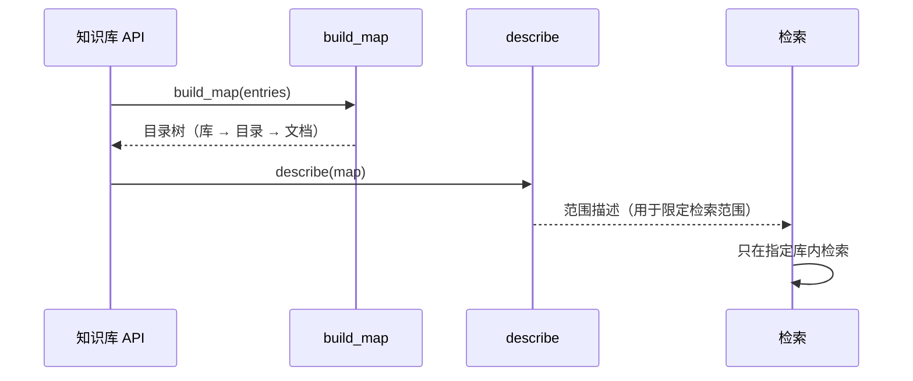

# 第 3 章　Owned Knowledge 与知识地图

> **EvoFlow 对照状态 / Alignment status：** 🔍 结构已核对（路径、行数、符号均取自源码实测），**行为**（调用顺序、边界条件）尚未逐行核对。

## 本章目标
让「知识」成为一种有归属、有结构的资产：属于某个工作区/项目，并能以脑图形式呈现。

## 最小闭环
创建知识库 → 导入资料 → 看到目录树 → 在对话中按知识库范围检索。

## 调用逻辑 / Invocation logic



- **入口**：导入资料后 `build_map()` 由条目元数据（库 id、目录、文档名）构建树，不读正文。
- **关键节点**：树只做展示与范围裁剪，不参与召回排序；`describe()` 输出一段可读的范围说明，用于告诉模型「你看到的是哪个库」。
- **出口**：检索时把库/目录作为过滤条件传给向量检索，而不是检索完再筛。
- **最容易断的地方**：把知识地图当成索引本体（改了树但没重建索引）；空库时 `describe` 返回空串导致 prompt 出现空段落。

## 真实模块地图（已核对：路径 · 行数 · 符号）

| 文件 | 行数 | 关键符号 | 模块常量 |
|---|---|---|---|
| `packages/harness/evoflow/knowledge/folders.py` | 176 | `root_folder_id`、`ensure_root_folder`、`list_folders` | ROOT_NAME |
| `packages/harness/evoflow/knowledge/service.py` | 687 | `_enrich_dataset`、`dataset_llm_index_enabled`、`list_datasets` | — |
| `app/gateway/routers/knowledge_owned.py` | 840 | `ReindexBaseBody`；`list_bases`、`create_base`、`get_base` | — |

## 核心概念
- **归属（ownership）**：知识库绑定 workspace/user，检索时默认只搜自己有权限的。
- **知识地图**：节点 = 主题，边 = 从属/相关；由文档结构 + 记忆巩固共同生成。
- **作用域隔离**：团队知识 vs 个人知识必须能共存且不串味。

## 自研实现要点
```text
kb(id, owner_scope, name, created_at)
kb_doc(kb_id, doc_id); kb_node(node_id, kb_id, parent_id, title, ref_chunk_ids)
检索时先过滤 kb_id ∈ 当前 scope，再做向量检索
```

## 业务规则
- 跨知识库检索必须显式指定，不做隐式全局召回。
- 知识地图节点可追溯到源 chunk。

## 常见坑
- 权限只在 UI 做过滤，检索层不过滤 → 越权召回。
- 思维导图与源文档脱钩，改文档后图不更新。

## 验收
- [ ] 未授权知识库检索不到
- [ ] 地图节点可点回原文
- [ ] 文档更新后地图增量刷新

### 源码核对记录（路径与符号实测）

- `packages/harness/evoflow/knowledge/folders.py`（176 行）
  - 模块自述：Wiki-style folder tree for knowledge bases.…
- `packages/harness/evoflow/knowledge/service.py`（687 行）
  - 模块自述：Knowledge base service layer — business logic for CRUD, file upload, search. All DB operations go through the …
- `app/gateway/routers/knowledge_owned.py`（840 行）：类 `ReindexBaseBody`
  - 模块自述：Owned knowledge base Gateway API — local-first RAG (spec: owned-knowledge-base-spec.md).…

> 本节只证明**路径、行数、符号存在**；调用顺序与边界条件仍属「行为」，未逐行核对。

## 对照 EvoFlow 核对清单
- [ ] `knowledge/owned/` 的存储形态
- [ ] 知识地图生成管线（memory + knowledge 交汇）

## 从零实现（手把手）
> 读完这章你能把「自己的知识库」组织成一张地图：文档 → 标题树 → 块 id。
> 路径均相对 `backend/`，代码注释写「为什么」。

### Step 1　新建 map.py：文档树 + 块索引
**文件**：`packages/harness/myagentflow/knowledge/map.py（新建）`
**要写的逻辑**：`build_map()` 输出 `{doc_id: {heading: [chunk_id...]}}`；`describe()` 给模型看的概览，限制条数避免爆上下文。

**代码**

```python
"""知识地图：文档 → 标题 → 块 id。

为什么要地图：让模型先看「有哪些文档」，再决定检索哪一篇，
比直接 top-k 更省 token，也更少答错文档。
"""
from __future__ import annotations

from collections import defaultdict
from typing import Iterable


def build_map(items: Iterable[dict]) -> dict[str, dict[str, list[int]]]:
    tree: dict[str, dict[str, list[int]]] = defaultdict(lambda: defaultdict(list))
    for it in items:                       # it: {doc_id, heading, chunk_id}
        tree[it["doc_id"]][it["heading"]].append(it["chunk_id"])
    return {doc: dict(secs) for doc, secs in tree.items()}


def describe(tree: dict[str, dict[str, list[int]]], max_docs: int = 5,
             max_sections: int = 3) -> str:
    lines = []
    for doc, sections in list(tree.items())[:max_docs]:
        count = sum(len(v) for v in sections.values())
        names = list(sections)[:max_sections]
        lines.append(f"- {doc}（{count} 块）：" + "、".join(names))
    return "\n".join(lines)
```

**验证**

```bash
uv run python -c "
from myagentflow.knowledge.map import build_map, describe
tree = build_map([{'doc_id':'d1','heading':'A','chunk_id':1},{'doc_id':'d1','heading':'B','chunk_id':2}])
print(describe(tree))
"
```

### Step 2　写测试：结构正确 + 截断
**文件**：`tests/chapters/test_ch05_03_map.py（新建）`
**要写的逻辑**：两篇文档各自独立；`max_docs=1` 只输出一篇。

**代码**

```python
from __future__ import annotations


def test_map_and_describe():
    from myagentflow.knowledge.map import build_map, describe

    items = [
        {"doc_id": "d1", "heading": "A", "chunk_id": 1},
        {"doc_id": "d1", "heading": "A", "chunk_id": 2},
        {"doc_id": "d2", "heading": "B", "chunk_id": 3},
    ]
    tree = build_map(items)
    assert tree["d1"]["A"] == [1, 2]
    assert "d1（2 块）" in describe(tree)
    assert "d2" not in describe(tree, max_docs=1)
```

**验证**

```bash
uv run pytest tests/chapters/test_ch05_03_map.py -v
# 期望：1 passed
```

### 与 EvoFlow 对照

| 我们的做法 | EvoFlow | 为什么 |
|---|---|---|
| 文档 → 标题 → 块 id | `knowledge/` 的知识地图 | 先看目录再检索，省 token |
| 概览要截断 | 地图描述 | 全量目录会占满上下文 |

### 知识点

- [RAG / GraphRAG / LightRAG 选型：知识为何要建图](https://harbor404.fushenlin.com/notes/rag-graphrag-lightrag-architecture/)
- [系统课入口：知识组织](https://g0-000.github.io/agent-book/)

### 验收

```bash
uv run pytest tests/chapters/test_ch05_03_map.py -q
```
