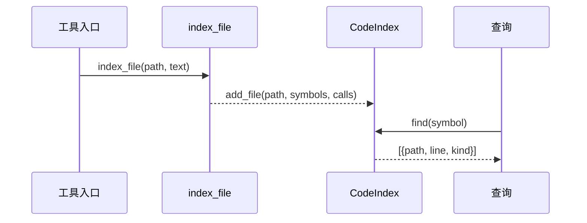

# 第 4 章　Workspace 代码索引与符号上下文

> **EvoFlow 对照状态 / Alignment status：** 🔍 结构已核对（路径、行数、符号均取自源码实测），**行为**（调用顺序、边界条件）尚未逐行核对。

## 本章目标
让 Agent 在读代码时不必「全文搜索 + 猜」，而是用符号表和引用关系精确定位。

## 最小闭环
打开工作区 → 建索引 → 「函数 X 定义在哪」→「谁调用了 X」→ 给出文件:行号。

## 调用逻辑 / Invocation logic



- **入口**：`index_file()` 只做「一个文件 → 符号表」，不递归、不读 git，扫描由上层决定。
- **关键节点**：索引里必须存 `path:line`，只存文件名等于没索引；同名符号要按 kind（def/class）区分。
- **出口**：`find()` 返回带行号的定义列表，「谁调用了 X」来自 calls 边。
- **最容易断的地方**：改文件不增量更新；把注释里的同名文本当成定义。

## 真实模块地图（已核对：路径 · 行数 · 符号）

| 文件 | 行数 | 关键符号 | 模块常量 |
|---|---|---|---|
| `packages/harness/evoflow/code_index/store.py:104` | 1927 | `resolve_index_root`、`_workspace_hash`、`index_db_path` | CODE_INDEX_REL_DIR、CODE_INDEX_DB_NAME |
| `packages/harness/evoflow/code_index/symbols.py:38` | 208 | `_append`、`_line_at`、`_regex_python_symbols` | — |
| `packages/harness/evoflow/code_index/internal_refs.py:19` | 173 | `_append_ref`、`extract_python_internal_refs`、`extract_js_ts_internal_refs` | — |
| `packages/harness/evoflow/code_index/import_bindings.py:43` | 144 | `python_import_aliases`、`_parse_js_named_bindings`、`js_ts_import_aliases` | — |
| `packages/harness/evoflow/code_index/type_relations.py:34` | 552 | `_line_at`、`_strip_generics`、`_split_type_parts` | — |
| `packages/harness/evoflow/code_index/tree_sitter_core.py:79` | 214 | `language_for_path`、`tree_sitter_available`、`parse_tree` | — |
| `packages/harness/evoflow/code_index/tokenize.py:22` | 145 | `index_tokenizer_version`、`split_identifier`、`_segment_cjk` | — |
| `packages/harness/evoflow/code_index/lsp_client.py:81` | 217 | `LspClient`；`_kind_name`、`flatten_document_symbols`、`_language_id` | — |
| `packages/harness/evoflow/code_index/lsp_pool.py:19` | 91 | `_session_key`、`get_lsp_client`、`try_lsp_symbols` | — |
| `packages/harness/evoflow/code_index/watcher.py:93` | 177 | `CodeIndexWatcherRegistry`；`_watch_key`、`start_index_watch`、`stop_index_watch` | — |
| `packages/harness/evoflow/code_index/format_results.py:8` | 134 | `format_search_index_body` | — |
| `packages/harness/evoflow/code_index/deps.py:29` | 395 | `_is_internal_spec`、`_discover_package_roots`、`_resolve_py_module` | — |

## 核心概念
- **FTS5 + 符号表**：文本检索给「大概位置」，符号表给「精确跳转」。
- **tree-sitter 优先，LSP 可选**：前者零依赖可离线，后者精度高但重。
- **增量**：watcher 只重解变更文件及其反向依赖。
- **预算**：返回给模型的不是整文件，而是签名 + 片段窗口。

## 自研实现要点
```text
symbols(file, name, kind, start_line, end_line, container)
refs(from_file, to_symbol, line)
query: name = "run" → 精确 → 前缀 → FTS
返回：path:line + 3 行上下文 + 调用者列表
```

## 业务规则
- 索引目录放工作区内（`.evoflow/code_index/`），随项目迁移。
- 大仓库必须限制索引文件数与体积，超出给警告。
- 二进制/生成物不索引。

## 常见坑
- 每次查询都全量解析 → 慢到不可用。
- 只做 grep → 同名函数混淆、无法区分定义与调用。
- 把整文件塞给模型 → 上下文爆。

## 验收
- [ ] 定义/引用查询准确率 ≥ 90%
- [ ] 增量更新 < 10s（中等仓库）
- [ ] 返回体积可控

### 源码核对记录（路径与符号实测）

- `packages/harness/evoflow/code_index/store.py`（1927 行）
  - 模块自述：SQLite FTS5 workspace index. When indexing runs ------------------ - **Full rebuild (blocking API)**: ``POST /…
- `packages/harness/evoflow/code_index/symbols.py`（208 行）
  - 模块自述：Per-language symbol extraction (tree-sitter first, LSP, AST/regex fallback).…
- `packages/harness/evoflow/code_index/internal_refs.py`（173 行）
  - 模块自述：Workspace-internal symbol use refs (Python / JS / TS / Java).…
- `packages/harness/evoflow/code_index/import_bindings.py`（144 行）
  - 模块自述：Map local import binding names -> workspace file paths.…
- `packages/harness/evoflow/code_index/type_relations.py`（552 行）
  - 模块自述：Class extends / implements (workspace-internal, best-effort).…
- `packages/harness/evoflow/code_index/tree_sitter_core.py`（214 行）
  - 模块自述：Unified tree-sitter symbol extraction (Python / JS / TS / Java).…
- `packages/harness/evoflow/code_index/tokenize.py`（145 行）
  - 模块自述：Code-aware tokenization for FTS index + query expansion. SQLite FTS5 ``unicode61`` keeps CamelCase identifiers…
- `packages/harness/evoflow/code_index/lsp_client.py`（217 行）：类 `LspClient`
  - 模块自述：Minimal LSP JSON-RPC client over stdio (documentSymbol).…
- `packages/harness/evoflow/code_index/lsp_pool.py`（91 行）
  - 模块自述：Pooled LSP sessions per (workspace, language server profile).…
- `packages/harness/evoflow/code_index/watcher.py`（177 行）：类 `CodeIndexWatcherRegistry`
  - 模块自述：Background workspace file watcher → incremental code index updates.…
- `packages/harness/evoflow/code_index/format_results.py`（134 行）
  - 模块自述：Format ``search_index`` payloads for tool output (shared by search tools).…
- `packages/harness/evoflow/code_index/deps.py`（395 行）
  - 模块自述：File-level import dependency extraction (Python / JS / TS / Java).…

> 本节只证明**路径、行数、符号存在**；调用顺序与边界条件仍属「行为」，未逐行核对。

## 对照 EvoFlow 核对清单
- [ ] `code_index/store.py` 的表结构与 FTS5 用法
- [ ] LSP 与 tree-sitter 的降级策略

## 从零实现（手把手）
> 读完这章你能用 `ast` 扫出自己的代码地图：模块、类、函数、行号，供 Agent 精确跳转。
> 路径均相对 `backend/`，代码注释写「为什么」。

### Step 1　新建 store.py：ast 遍历 + 落表
**文件**：`packages/harness/myagentflow/code_index/store.py（新建）`
**要写的逻辑**：只索引定义（模块/类/函数/方法），不索引语句；存 `path, kind, name, line`，供「跳到哪一行」用。

**代码**

```python
"""代码索引：用 ast 抽符号，不靠正则。

为什么必须用 ast：注释里的 `def foo` 和字符串里的 `class Bar` 会骗过正则，
索引一旦有两成错，Agent 就会跳到不存在的行。
"""
from __future__ import annotations

import ast
import sqlite3
from pathlib import Path

_SCHEMA = """
CREATE TABLE IF NOT EXISTS symbols (
    path TEXT NOT NULL,
    kind TEXT NOT NULL,
    name TEXT NOT NULL,
    line INTEGER NOT NULL
);
CREATE INDEX IF NOT EXISTS idx_symbols_name ON symbols(name);
"""


def index_file(py_path: Path) -> list[tuple[str, str, str, int]]:
    tree = ast.parse(py_path.read_text(encoding="utf-8"), filename=str(py_path))
    path = str(py_path)
    out: list[tuple[str, str, str, int]] = [(path, "module", py_path.stem, 1)]
    for node in ast.walk(tree):
        if isinstance(node, (ast.FunctionDef, ast.AsyncFunctionDef)):
            out.append((path, "function", node.name, node.lineno))
        elif isinstance(node, ast.ClassDef):
            out.append((path, "class", node.name, node.lineno))
    return out


class CodeIndex:
    def __init__(self, db_path: str | Path):
        Path(db_path).parent.mkdir(parents=True, exist_ok=True)
        self._conn = sqlite3.connect(str(db_path), check_same_thread=False)
        self._conn.executescript(_SCHEMA)

    def add_file(self, py_path: Path) -> int:
        rows = index_file(py_path)
        self._conn.executemany("INSERT INTO symbols VALUES (?, ?, ?, ?)", rows)
        self._conn.commit()
        return len(rows)

    def find(self, name: str) -> list[dict]:
        rows = self._conn.execute(
            "SELECT path, kind, line FROM symbols WHERE name=? ORDER BY path, line", (name,)
        ).fetchall()
        return [{"path": r[0], "kind": r[1], "line": r[2]} for r in rows]
```

**验证**

```bash
uv run python -c "
from pathlib import Path
from myagentflow.code_index.store import CodeIndex
i = CodeIndex('/tmp/myaf-code.sqlite'); print(i.add_file(Path('packages/harness/myagentflow/code_index/store.py')))
print(i.find('index_file'))
"
```

### Step 2　写测试：类与函数都能找到，行号对得上
**文件**：`tests/chapters/test_ch05_04_code_index.py（新建）`
**要写的逻辑**：临时写一个样例 py，索引后按名字查，行号必须有值。

**代码**

```python
from __future__ import annotations


def test_index(tmp_path):
    from myagentflow.code_index.store import CodeIndex

    src = tmp_path / "demo.py"
    src.write_text("class A:\n    def m(self):\n        pass\n\ndef f():\n    pass\n", encoding="utf-8")

    idx = CodeIndex(tmp_path / "c.sqlite")
    idx.add_file(src)
    assert idx.find("A")[0]["line"] == 1
    assert idx.find("m")[0]["kind"] == "function"
    assert idx.find("f")[0]["line"] == 5
```

**验证**

```bash
uv run pytest tests/chapters/test_ch05_04_code_index.py -v
# 期望：1 passed
```

### 与 EvoFlow 对照

| 我们的做法 | EvoFlow | 为什么 |
|---|---|---|
| `ast.walk` 抽定义 | `code_index/store.py` | 正则会被注释/字符串骗 |
| 存 path/kind/name/line | 同文件 | 少 line 就没法跳转 |

### 知识点

- [RAG 离线流水线：切块与增量更新（与代码索引同构的部分）](https://harbor404.fushenlin.com/notes/rag-offline-pipeline/)
- [系统课入口：检索](https://g0-000.github.io/agent-book/)

### 验收

```bash
uv run pytest tests/chapters/test_ch05_04_code_index.py -q
```
