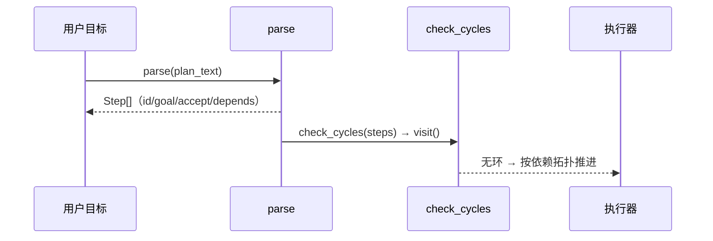

# 第 1 章　Plan 定义解析与 Goal 图

> **EvoFlow 对照状态 / Alignment status：** 🔍 结构已核对（路径、行数、符号均取自源码实测），**行为**（调用顺序、边界条件）尚未逐行核对。

## 本章目标
把「用户一句话」变成「可校验的计划结构」，并让目标之间有关系（依赖、包含、互斥）。

## 最小闭环
用户说「做一份竞品分析报告」→ 生成 4 步计划 → 每步有验收标准 → 执行时按依赖推进。

## 调用逻辑 / Invocation logic



- **入口**：`parse()` 把文本计划转成 `Step` 列表，每步必须带验收标准，没有验收标准就解析失败。
- **关键节点**：`check_cycles()` 用 DFS `visit()` 查环，环不报错而是给出环路径，方便改计划。
- **出口**：执行器按依赖顺序推进，某步失败只阻塞依赖它的步骤。
- **最容易断的地方**：步骤没有唯一 id（依赖对不上）；验收标准写成「完成即可」。

## 真实模块地图（已核对：路径 · 行数 · 符号）

| 文件 | 行数 | 关键符号 | 模块常量 |
|---|---|---|---|
| `packages/harness/evoflow/tools/builtins/plan_tool.py` | 585 | `PlanStepInput`、`PlanInput`；`_json_loads_if_string`、`_coerce_string_list_field`、`_coerce_to_str` | — |
| `app/gateway/routers/goal.py` | 473 | `StartGoalRequest`、`AfterChatTurnRequest`、`SubmitFeedbackRequest`；`get_goal_service`、`_require_goal_session_visible`、`start_goal` | — |
| `app/gateway/v4/goal_engine.py` | 989 | `V4GoalEngine`、`GoalRejectedError`；`escape_goal_prompt_text`、`build_goal_verification_prompt`、`build_goal_continuation_prompt` | MAX_CONTINUATIONS、MAX_SAME_NEXT_ACTION_STREAK、VERIFIER_HISTORY_LIMIT |
| `app/gateway/routers/plans.py` | 137 | `CreateBindingBody`、`PatchBindingBody`、`VerifyBindingBody`；`_http_error`、`get_catalog`、`get_bindings` | — |
| `packages/harness/evoflow/tools/builtins/plan_tool.py` | 585 | `PlanStepInput`、`PlanInput`；`_json_loads_if_string`、`_coerce_string_list_field`、`_coerce_to_str` | — |

## 核心概念
- **计划结构**：`{steps:[{id, goal, inputs, outputs, done_when, depends_on}]}`。
- **Goal 图**：节点是目标，边是「依赖/派生/冲突」；图的意义是**可重排**（并行 vs 串行）。
- **计划守卫**：模型「忘了计划」时，中间件把计划重新注入，避免跑偏。
- **命名陷阱**：`evoflow/plans/` 指的是**模型订阅套餐**，不是任务计划。

## 自研实现要点
```text
plan(id, session_id, version, steps_json, status)
step(id, plan_id, seq, goal, done_when, status, output_ref)
```

## 业务规则
- 计划变更必须版本化，不原地改（否则无法回溯为什么改）。
- 每步的 `done_when` 必须可判定（有产物/有事实），不能写「做好了」。
- 计划步数上限（如 12）防无限细化。

## 常见坑
- 计划只写在回复里 → 下一轮模型就忘了。
- 步骤颗粒度过细 → 计划本身消耗大量 token。
- 目标之间隐含依赖未声明 → 并行执行撞车。

## 验收
- [ ] 计划可持久化并在后续轮次被引用
- [ ] 依赖关系决定执行顺序
- [ ] 每步完成有客观判据

### 源码核对记录（路径与符号实测）

- `packages/harness/evoflow/tools/builtins/plan_tool.py`（585 行）：类 `PlanStepInput`、`PlanInput`
  - 模块自述：Submit structured plan for collaboration gates (has_plan / plan_guard).…
- `app/gateway/routers/goal.py`（473 行）：类 `StartGoalRequest`、`AfterChatTurnRequest`、`SubmitFeedbackRequest`、`GoalSessionResponse`；环境变量 `EVOFLOW_LANGGRAPH_API_KEY`、`EVOFLOW_LANGGRAPH_URL`
- `app/gateway/v4/goal_engine.py`（989 行）：类 `V4GoalEngine`、`GoalRejectedError`；环境变量 `EVOFLOW_LANGGRAPH_API_KEY`、`EVOFLOW_LANGGRAPH_URL`
  - 模块自述：ZCode 式会话目标引擎（v4 主聊天目标模式）。 对齐 ZCode core 的目标处理方式（apps/zcode-cli/packages/core 的 target/goal 链路）： - ``/goal <ob…
- `app/gateway/routers/plans.py`（137 行）：类 `CreateBindingBody`、`PatchBindingBody`、`VerifyBindingBody`
  - 模块自述：Gateway API for Plan Bundle (Connector mode).…
- `packages/harness/evoflow/tools/builtins/plan_tool.py`（585 行）：类 `PlanStepInput`、`PlanInput`
  - 模块自述：Submit structured plan for collaboration gates (has_plan / plan_guard).…

> 本节只证明**路径、行数、符号存在**；调用顺序与边界条件仍属「行为」，未逐行核对。

## 对照 EvoFlow 核对清单
- [ ] `plan_tool.py` 的 schema（`<task_plan>` JSON 格式）
- [ ] `plan_guard_middleware` 的重注入策略

## 从零实现（手把手）
> 读完这章你能把一段 Markdown 计划解析成步骤列表，并把步骤连成有依赖的 DAG。
> 路径均相对 `backend/`，代码注释写「为什么」。

### Step 1　新建 parser.py：解析 + 建图
**文件**：`packages/harness/myagentflow/plans/parser.py（新建）`
**要写的逻辑**：认 `- [ ] 步骤` 行；`depends:` 写依赖；解析后检测环，有环直接报错而不是跑起来才死锁。

**代码**

```python
"""计划解析：Markdown → 步骤 DAG。

为什么建图时就查环：跑到一半发现互相等待，前面的步骤全白做。
"""
from __future__ import annotations

import re
from dataclasses import dataclass, field

_STEP = re.compile(r"^\s*-\s*\[[ xX]\]\s*(.+)$")
_DEP = re.compile(r"depends:\s*([\w\-, ]+)")


@dataclass
class Step:
    id: str
    title: str
    depends: list[str] = field(default_factory=list)


def parse(markdown: str) -> list[Step]:
    steps: list[Step] = []
    for line in markdown.splitlines():
        m = _STEP.match(line)
        if not m:
            continue
        title = m.group(1).strip()
        dep = _DEP.search(title)
        deps = [d.strip() for d in dep.group(1).split(",")] if dep else []
        sid = f"s{len(steps) + 1}"
        steps.append(Step(id=sid, title=_DEP.sub("", title).strip(), depends=deps))
    check_cycles(steps, by_title=True)
    return steps


def check_cycles(steps: list[Step], by_title: bool = False) -> None:
    """依赖写的是标题时，先映射成 id 再查环。"""
    if by_title:
        index = {s.title: s.id for s in steps}
        for s in steps:
            s.depends = [index.get(d, d) for d in s.depends]
    graph = {s.id: s.depends for s in steps}
    state: dict[str, int] = {}

    def visit(node: str) -> None:
        if state.get(node) == 1:
            raise ValueError(f"计划存在环：{node}")
        if state.get(node) == 2:
            return
        state[node] = 1
        for dep in graph.get(node, []):
            visit(dep)
        state[node] = 2

    for node in graph:
        visit(node)
```

**验证**

```bash
uv run python -c "
from myagentflow.plans.parser import parse
print([ (s.id, s.title, s.depends) for s in parse('- [ ] 读代码\n- [ ] 写实现 depends: 读代码') ])
"
```

### Step 2　写测试：正常依赖 + 环报错
**文件**：`tests/chapters/test_ch07_01_plan.py（新建）`
**要写的逻辑**：两步依赖解析正确；`A depends: B` 且 `B depends: A` 必须抛 ValueError。

**代码**

```python
from __future__ import annotations

import pytest


def test_parse_dep():
    from myagentflow.plans.parser import parse

    steps = parse("- [ ] 读代码\n- [ ] 写实现 depends: 读代码")
    assert steps[1].depends == [steps[0].id]


def test_cycle_detected():
    from myagentflow.plans.parser import parse

    with pytest.raises(ValueError):
        parse("- [ ] A depends: B\n- [ ] B depends: A")
```

**验证**

```bash
uv run pytest tests/chapters/test_ch07_01_plan.py -v
# 期望：2 passed
```

### 与 EvoFlow 对照

| 我们的做法 | EvoFlow | 为什么 |
|---|---|---|
| `- [ ]` 行当步骤 | `plans/` 的计划解析 | 用户手写计划就是这个格式 |
| 解析即查环 | 计划建图 | 跑到一半死锁代价更高 |

### 知识点

- [DeepAgent：复杂任务如何拆成可执行步骤](https://harbor404.fushenlin.com/notes/deepagent-complex-task-framework/)
- [LangGraph 课程：DAG 与状态传递](https://g0-000.github.io/agent-book/langgraph/)

### 验收

```bash
uv run pytest tests/chapters/test_ch07_01_plan.py -q
```
