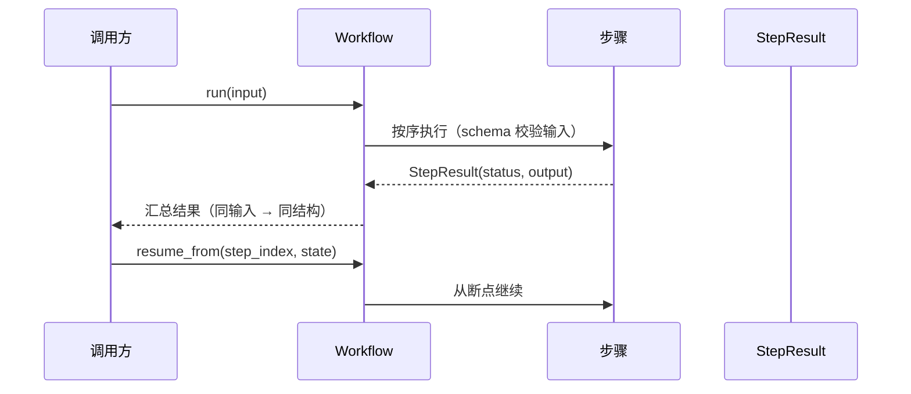

# 第 3 章　Workflow、App Center、Stage 与任务输入

> **EvoFlow 对照状态 / Alignment status：** 🔍 结构已核对（路径、行数、符号均取自源码实测），**行为**（调用顺序、边界条件）尚未逐行核对。

## 本章目标
把「一次性的对话」升级为「可复用的流程」，并支持由 Agent 生成应用/页面。

## 最小闭环
定义 workflow（步骤 + 输入 schema）→ 用同一输入跑两次得到结构一致的结果 → 应用中心可查看。

## 调用逻辑 / Invocation logic



- **入口**：`run(input)` 先按 `input_schema` 校验，再逐步执行；`resume_from()` 从指定步骤带状态续跑。
- **关键节点**：每步产出 `StepResult`，失败要标 `status` 而不是抛异常中断整个 workflow。
- **出口**：同一输入两次运行结构必须一致（可重放），这是 app center 能展示的前提。
- **最容易断的地方**：步骤间靠全局变量传值；恢复时重跑已完成步骤造成副作用重复。

## 真实模块地图（已核对：路径 · 行数 · 符号）

| 文件 | 行数 | 关键符号 | 模块常量 |
|---|---|---|---|
| `packages/harness/evoflow/scheduler/tool_executor.py` | 140 | `_preview`、`execute_op`、`log_scheduler_invocation` | — |
| `packages/harness/evoflow/collab/app_engine.py` | 191 | `_render_text`、`_render_value`、`_render_steps` | PARAM_RE |
| `packages/harness/evoflow/collab/app_generator.py` | 162 | `_merge_declared_parameters`、`generate_app_from_plan` | — |
| `packages/harness/evoflow/collab/app_runner.py` | 1848 | `_dispatch_result_ok`、`is_workflow_bound_task`、`dispatch_workflow_task_now` | — |
| `packages/harness/evoflow/collab/app_schema.py` | 608 | `_as_str`、`_as_str_list`、`normalize_parameter` | — |
| `packages/harness/evoflow/collab/app_canvas.py` | 79 | `_default_position`、`canvas_from_steps` | START_NODE_ID、ANSWER_NODE_ID |
| `app/gateway/routers/apps.py` | 864 | `GenerateAppRequest`、`DryRunAppRequest`、`CreateAppKeyRequest`；`_audit_actor`、`_audit`、`_normalize_plan_for_storage` | — |
| `app/gateway/routers/apps_debug.py` | 134 | `DebugRunStepRequest`、`DebugRunFromRequest`；`debug_run_step_endpoint`、`debug_run_from_endpoint`、`get_step_trace_endpoint` | — |
| `packages/harness/evoflow/collab/app_engine.py` | 191 | `_render_text`、`_render_value`、`_render_steps` | PARAM_RE |

## 核心概念
- **Workflow = 有 schema 的计划**：输入/输出可校验，才能被重复调用。
- **Stage**：长流程的中间态（草稿 → 待审 → 发布）。
- **App Center**：把 Agent 产出的可交互页面当作一等产物管理。

## 自研实现要点
```text
workflow(id, name, inputs_schema, steps_json, version)
run(workflow_id, inputs) → run_id → 每步产物带 stage
```

## 业务规则
- 工作流版本化；旧版本可回放。
- 应用产物必须可离线打开（不依赖 Agent 在线）。
- 输入校验失败立即返回，不进模型。

## 常见坑
- 把工作流写成「提示词模板」，没有 schema → 不可自动化。
- 应用产物存在临时目录 → 重启即丢。

## 验收
- [ ] 同输入两次结果结构一致
- [ ] 产物可独立打开
- [ ] 版本可回放

### 源码核对记录（路径与符号实测）

- `packages/harness/evoflow/scheduler/tool_executor.py`（140 行）
  - 模块自述：Invoke host_direct tools from the local scheduler.…
- `packages/harness/evoflow/collab/app_engine.py`（191 行）
  - 模块自述：Application parameter rendering engine. Converts parameterized App definitions (with `{{param}}` placeholders)…
- `packages/harness/evoflow/collab/app_generator.py`（162 行）
  - 模块自述：Application generator: create reusable App definitions from model-generated plans. When a lead agent (or any m…
- `packages/harness/evoflow/collab/app_runner.py`（1848 行）；环境变量 `EVOFLOW_LANGGRAPH_URL`、`EVOFLOW_WORKFLOW_PROJECT_PATH`
  - 模块自述：Application execution runner: unified entry for both execution modes. - **lead_supervised**: Uses existing pla…
- `packages/harness/evoflow/collab/app_schema.py`（608 行）
  - 模块自述：Application document JSON contract + normalize (single write-path for App blobs). ## Storage layers (do not tr…
- `packages/harness/evoflow/collab/app_canvas.py`（79 行）
  - 模块自述：Canvas layout helpers for App workflows.…
- `app/gateway/routers/apps.py`（864 行）：类 `GenerateAppRequest`、`DryRunAppRequest`、`CreateAppKeyRequest`、`SaveAsAppRequest`
  - 模块自述：Application management and execution endpoints.…
- `app/gateway/routers/apps_debug.py`（134 行）：类 `DebugRunStepRequest`、`DebugRunFromRequest`
  - 模块自述：Debug endpoints for workflow applications. Provides single-step debug execution, run-from-step, and step trace…
- `packages/harness/evoflow/collab/app_engine.py`（191 行）
  - 模块自述：Application parameter rendering engine. Converts parameterized App definitions (with `{{param}}` placeholders)…

> 本节只证明**路径、行数、符号存在**；调用顺序与边界条件仍属「行为」，未逐行核对。

## 对照 EvoFlow 核对清单
- [ ] `app_engine.py` 的执行模型
- [ ] `stage/` 的状态定义

## 从零实现（手把手）
> 读完这章你能把「多步骤流程」定义成可复用对象，并按步骤顺序执行、记录每步产物。
> 路径均相对 `backend/`，代码注释写「为什么」。

### Step 1　新建 workflow.py：定义 + 顺序执行
**文件**：`packages/harness/myagentflow/plans/workflow.py（新建）`
**要写的逻辑**：`Workflow` 持有步骤列表；`run()` 逐步执行，任一步失败即停，并把已完成步骤的产物保留下来。

**代码**

```python
"""流程（Workflow）：一组有序步骤 + 一次执行记录。

为什么失败要保留已完成产物：用户修完失败那一步后，
不该从第一步重跑（重跑会重复写文件、重复调外部接口）。
"""
from __future__ import annotations

import time
from dataclasses import dataclass, field
from typing import Any, Callable


@dataclass
class StepResult:
    name: str
    ok: bool
    output: Any = None
    error: str | None = None


@dataclass
class Workflow:
    name: str
    steps: list[tuple[str, Callable[[], Any]]] = field(default_factory=list)
    history: list[StepResult] = field(default_factory=list)

    def run(self) -> list[StepResult]:
        for name, fn in self.steps:
            try:
                out = fn()
                self.history.append(StepResult(name, True, out))
            except Exception as exc:
                self.history.append(StepResult(name, False, error=str(exc)))
                break                    # 失败即停：后面的步骤依赖前面的结果
        return self.history

    def resume_from(self, index: int) -> list[StepResult]:
        """从第 index 步继续（前面已成功的产物留在 history 里）。"""
        for name, fn in self.steps[index:]:
            try:
                self.history.append(StepResult(name, True, fn()))
            except Exception as exc:
                self.history.append(StepResult(name, False, error=str(exc)))
                break
        return self.history
```

**验证**

```bash
uv run python -c "
from myagentflow.plans.workflow import Workflow
w = Workflow('demo', [('a', lambda: 1), ('b', lambda: 1/0)])
for r in w.run(): print(r.name, r.ok, r.error)
print('resume:', w.resume_from(1)[-1].name)
"
```

### Step 2　写测试：失败即停 + 可续跑
**文件**：`tests/chapters/test_ch07_03_workflow.py（新建）`
**要写的逻辑**：第二步失败时第三步不执行；`resume_from(1)` 从第二步重试。

**代码**

```python
from __future__ import annotations


def test_stop_and_resume():
    from myagentflow.plans.workflow import Workflow

    calls = []
    w = Workflow("w", [
        ("a", lambda: calls.append("a") or 1),
        ("b", lambda: 1 / 0),
        ("c", lambda: calls.append("c") or 3),
    ])
    w.run()
    assert calls == ["a"]                 # c 没执行
    assert w.history[-1].ok is False

    w.steps[1] = ("b", lambda: calls.append("b") or 2)
    w.resume_from(1)
    assert calls == ["a", "b", "c"]
```

**验证**

```bash
uv run pytest tests/chapters/test_ch07_03_workflow.py -v
# 期望：1 passed
```

### 与 EvoFlow 对照

| 我们的做法 | EvoFlow | 为什么 |
|---|---|---|
| 顺序执行失败即停 | `plans/` 的 workflow | 后面步骤依赖前面产物 |
| 保留已完成产物可续跑 | 同文件 resume | 全量重跑会重复副作用 |

### 知识点

- [Harbor404 · 幂等性设计](https://harbor404.fushenlin.com/notes/idempotency-design/)：为什么要能安全重试
- agent-book：Workflow 编排

### 验收

```bash
uv run pytest tests/chapters/test_ch07_03_workflow.py -q
```
