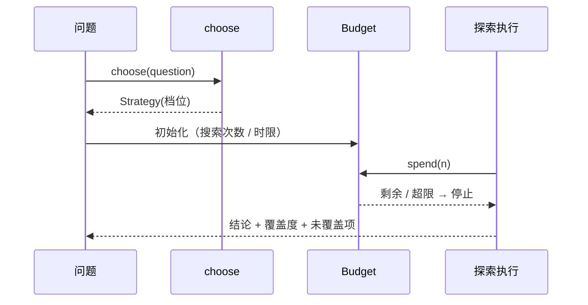

# 第 4 章　探索预算、策略路由与思维图

> **EvoFlow 对照状态 / Alignment status：** 🔍 结构已核对（路径、行数、符号均取自源码实测），**行为**（调用顺序、边界条件）尚未逐行核对。

## 本章目标
面对「开放式问题」，让 Agent 知道**该搜多少、何时停、停时给什么**。

## 最小闭环
探索类问题 → 分配预算（搜索次数/时间）→ 到点停止 → 输出「当前结论 + 覆盖度 + 未覆盖项」。

## 调用逻辑 / Invocation logic



- **入口**：`choose()` 按问题类型给策略档位（快答 / 常规 / 深挖），档位决定预算，不由模型自己加码。
- **关键节点**：`spend()` 每消耗一次就扣减，返回剩余；耗尽立刻停并输出「当前结论 + 覆盖度」。
- **出口**：结果必须带未覆盖项，让用户知道「不是查完了，是预算用完了」。
- **最容易断的地方**：预算只在进入时判一次，中途无限追加；停止后不给覆盖度。

## 真实模块地图（已核对：路径 · 行数 · 符号）

| 文件 | 行数 | 关键符号 | 模块常量 |
|---|---|---|---|
| `packages/harness/evoflow/exploration/exploration_budget.py:34` | 267 | `_Attempt`；`_thread_key`、`_normalize_root`、`_find_sig` | — |
| `packages/harness/evoflow/exploration/action_bias.py:31` | 199 | `looks_like_edit_task`、`resolve_task_type`、`_read_count` | — |
| `packages/harness/evoflow/exploration/search_tool_matrix.py:111` | 208 | `_format_table`、`format_search_tool_matrix_en`、`format_search_tool_matrix_zh` | SEARCH_MATRIX_MARKER_EN、SEARCH_MATRIX_MARKER_ZH、SEARCH_TOOL_ROWS_EN |
| `packages/harness/evoflow/exploration/task_router.py:48` | 111 | `looks_like_filename_query`、`suggest_find_file_message`、`classify_task_type_heuristic` | TASK_LOCATE_FILE、TASK_UNDERSTAND_CODE、TASK_DATA_BUG |
| `packages/harness/evoflow/exploration/exploration_budget.py:34` | 267 | `_Attempt`；`_thread_key`、`_normalize_root`、`_find_sig` | — |
| `packages/harness/evoflow/exploration/task_router.py:48` | 111 | `looks_like_filename_query`、`suggest_find_file_message`、`classify_task_type_heuristic` | TASK_LOCATE_FILE、TASK_UNDERSTAND_CODE、TASK_DATA_BUG |

## 核心概念
- **任务路由**：先判定问题类型（事实查询 / 深度研究 / 创意生成 / 代码任务），再选策略。
- **预算三元组**：时间、调用次数、token。三者任一耗尽即收尾。
- **思维图**：把探索路径画成图（分支 = 待验证假设），用于避免重复探索。

## 自研实现要点
```text
Budget(deadline, max_calls, max_tokens)
每次动作前 check()；耗尽 → 走 finalize(partial=True)
```

## 业务规则
- 预算对用户可见（至少可解释「为何停」）。
- 不得为凑结论编造来源；未覆盖项必须显式列出。

## 常见坑
- 无预算 → 无限搜索。
- 预算只看次数不看时间 → 单次慢请求拖死。
- 探索结论不带覆盖度 → 用户误以为「已穷尽」。

## 验收
- [ ] 到点必停
- [ ] 输出含覆盖度与未覆盖项
- [ ] 重复探索被图结构抑制

### 源码核对记录（路径与符号实测）

- `packages/harness/evoflow/exploration/exploration_budget.py`（267 行）：类 `_Attempt`
  - 模块自述：Per-thread exploration attempt tracking and low-signal detection.…
- `packages/harness/evoflow/exploration/action_bias.py`（199 行）
  - 模块自述：Task-type action hints: move from exploration loops to the correct deliverable.…
- `packages/harness/evoflow/exploration/search_tool_matrix.py`（208 行）
  - 模块自述：Canonical boundaries and examples for search_code_index vs rg vs find. Single source of truth — imported by le…
- `packages/harness/evoflow/exploration/task_router.py`（111 行）
  - 模块自述：Heuristic task classification and tool-routing hints.…
- `packages/harness/evoflow/exploration/exploration_budget.py`（267 行）：类 `_Attempt`
  - 模块自述：Per-thread exploration attempt tracking and low-signal detection.…
- `packages/harness/evoflow/exploration/task_router.py`（111 行）
  - 模块自述：Heuristic task classification and tool-routing hints.…

> 本节只证明**路径、行数、符号存在**；调用顺序与边界条件仍属「行为」，未逐行核对。

## 对照 EvoFlow 核对清单
- [ ] `exploration_budget.py` 的真实阈值来源
- [ ] `task_router.py` 的分类规则

## 从零实现（手把手）
> 读完这章你能给「多试几次」设上限，并根据剩余预算切换策略：穷举 → 启发式 → 直接放弃。
> 路径均相对 `backend/`，代码注释写「为什么」。

### Step 1　新建 router.py：预算 + 三档策略
**文件**：`packages/harness/myagentflow/plans/router.py（新建）`
**要写的逻辑**：按「剩余步数 / 剩余时间」两维判断；预算耗尽直接给 `stop`，不要靠模型自己觉得够了。

**代码**

```python
"""探索预算：给「再试一次」一个硬上限。

为什么必须硬上限：模型天然倾向再试一次，没有外部约束时，
一个死循环能烧掉整晚的额度和上下文。
"""
from __future__ import annotations

from dataclasses import dataclass
from enum import Enum


class Strategy(str, Enum):
    exhaustive = "exhaustive"    # 预算充足：可以枚举
    heuristic = "heuristic"      # 预算一般：只走最可能的路径
    stop = "stop"                # 预算耗尽：停手并汇报


@dataclass(frozen=True)
class Budget:
    max_steps: int = 20
    max_seconds: int = 600
    steps_used: int = 0
    seconds_used: int = 0


def choose(b: Budget) -> Strategy:
    step_ratio = 1 - b.steps_used / max(1, b.max_steps)
    time_ratio = 1 - b.seconds_used / max(1, b.max_seconds)
    remaining = min(step_ratio, time_ratio)
    if remaining <= 0:
        return Strategy.stop
    if remaining < 0.3:
        return Strategy.heuristic
    return Strategy.exhaustive


def spend(b: Budget, steps: int = 1, seconds: int = 0) -> Budget:
    return Budget(b.max_steps, b.max_seconds, b.steps_used + steps, b.seconds_used + seconds)
```

**验证**

```bash
uv run python -c "
from myagentflow.plans.router import Budget, choose, spend
b = Budget(max_steps=10, max_seconds=100)
print(choose(b)); b = spend(b, steps=9); print(choose(b)); b = spend(b, steps=1); print(choose(b))
"
```

### Step 2　写测试：三档都覆盖
**文件**：`tests/chapters/test_ch07_04_budget.py（新建）`
**要写的逻辑**：满预算 exhaustive、八成用掉 heuristic、用尽 stop。

**代码**

```python
from __future__ import annotations


def test_three_tiers():
    from myagentflow.plans.router import Budget, Strategy, choose

    assert choose(Budget()) is Strategy.exhaustive
    assert choose(Budget(max_steps=10, steps_used=8)) is Strategy.heuristic
    assert choose(Budget(max_steps=10, steps_used=10)) is Strategy.stop
```

**验证**

```bash
uv run pytest tests/chapters/test_ch07_04_budget.py -v
# 期望：1 passed
```

### 与 EvoFlow 对照

| 我们的做法 | EvoFlow | 为什么 |
|---|---|---|
| 步数/时间双约束 | `plans/` 的探索预算 | 单看步数会被慢工具绕过 |
| 预算耗尽由外部判 stop | 同文件 | 模型自己判断「够了」不可靠 |

### 知识点

- [推理链路延迟优化：预算、超时与降级怎么定](https://harbor404.fushenlin.com/notes/llm-agent-latency-optimization/)
- [系统课入口：Agent 循环控制](https://g0-000.github.io/agent-book/)

### 验收

```bash
uv run pytest tests/chapters/test_ch07_04_budget.py -q
```
