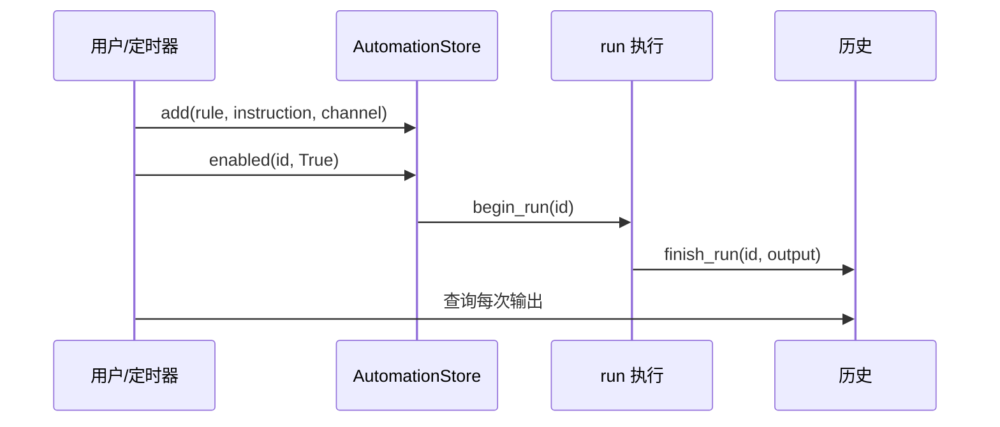

# 第 1 章　Automation 定义、执行与运行历史

> **EvoFlow 对照状态 / Alignment status：** 🔍 结构已核对（路径、行数、符号均取自源码实测），**行为**（调用顺序、边界条件）尚未逐行核对。

## 本章目标
把「每天早上 9 点给我做一份行业简报」变成一条可管理、可回放的记录。

## 最小闭环
创建自动化（规则 + 指令 + 渠道）→ 到点生成 run → 结果写入会话并推送 → 历史里可查每次输出。

## 调用逻辑 / Invocation logic



- **入口**：`add()` 存规则（触发条件 + 指令 + 渠道），启用状态由 `enabled()` 单独控制。
- **关键节点**：每次触发 `begin_run()` 建一条运行记录，`finish_run()` 写输出与状态，历史不覆盖只追加。
- **出口**：历史可按自动化 id 查，展示每次「跑了什么、产出什么」。
- **最容易断的地方**：禁用后仍被调度器捞起；失败不写记录，历史看起来像「没跑过」。

## 真实模块地图（已核对：路径 · 行数 · 符号）

| 文件 | 行数 | 关键符号 | 模块常量 |
|---|---|---|---|
| `packages/harness/evoflow/automation/output_paths.py` | 147 | `_slug_segment`、`resolve_automation_outputs_root`、`_normalize_ext` | — |
| `app/gateway/routers/automation_scheduler.py` | 665 | `_coerce_app_parameters`、`_apply_workflow_binding`、`_stamp_app_name` | — |
| `app/gateway/automation_runner.py` | 2212 | `_scheduler_owner_id`、`_langgraph_run_semaphore`、`_task_wants_langgraph_run` | DEFAULT_INTERVAL_SECONDS、AUTOMATIONS_DIR |
| `app/gateway/automation_chat_session.py` | 217 | `automation_session_key`、`_automation_session_title`、`_automation_session_context` | — |
| `packages/harness/evoflow/persistence/automation_repositories.py` | 540 | `_row_dict`、`list_automations`、`load_automation` | SLOT_CLAIM_STALE_MS_DEFAULT |
| `packages/harness/evoflow/persistence/channel_push_repositories.py` | 1473 | `new_push_id`、`_clip`、`_payload_to_json` | — |
| `app/gateway/routers/sessions.py` | 159 | `SessionSearchRequest`、`SessionSearchResult`、`SessionSearchResponse`；`_filter_search_hits`、`search_sessions`、`search_sessions_get` | — |

## 核心概念
- **定义与执行分离**：definition（规则+指令）→ occurrence（每次触发）→ run（执行）。
- **独立会话**：自动化有自己的会话线，不污染用户主对话。
- **输出路径**：产物写到约定目录，便于用户找。

## 自研实现要点
```text
automation(id, rule, prompt, channel, enabled, created_at)
occurrence(id, automation_id, planned_at, status, run_id)
run(run_id, session_id, started_at, status, artifact_refs)
```

## 业务规则
- 同一 automation 同一时刻只允许一个运行中 occurrence。
- 失败重试上限（如 2 次），超限标记需人工。
- 禁用即不再产生新 occurrence。

## 常见坑
- 定义与执行混在一张表 → 历史无法追溯。
- 自动化复用用户主会话 → 上下文互相污染。
- 无上限重试 → 失败后刷屏。

## 验收
- [ ] 每次触发有独立 run 记录
- [ ] 禁用后无新触发
- [ ] 历史可按时间/状态筛选

### 源码核对记录（路径与符号实测）

- `packages/harness/evoflow/automation/output_paths.py`（147 行）
  - 模块自述：Canonical deliverable paths for prompt-only automation runs.…
- `app/gateway/routers/automation_scheduler.py`（665 行）
  - 模块自述：Automation scheduler API: status, CRUD on ``~/.evoflow/tasks/automations``, manual run. CRUD mirrors ``evopane…
- `app/gateway/automation_runner.py`（2212 行）；环境变量 `EVOFLOW_AUTOMATIONS_DIR`、`EVOFLOW_AUTOMATION_CATCHUP`、`EVOFLOW_AUTOMATION_CATCHUP_LOOKBACK_MINUTES`、`EVOFLOW_AUTOMATION_CATCHUP_MAX_RUNS`
  - 模块自述：Background scheduler for EvoPanel-style automations under ``~/.evoflow/tasks/automations``. Default execution …
- `app/gateway/automation_chat_session.py`（217 行）
  - 模块自述：Link scheduled automation LangGraph runs to EvoPanel ``evoflow_chat_sessions``.…
- `packages/harness/evoflow/persistence/automation_repositories.py`（540 行）
  - 模块自述：Scheduled automations (cron / once) in ``evoflow_automations``.…
- `packages/harness/evoflow/persistence/channel_push_repositories.py`（1473 行）
  - 模块自述：SQLite audit log for channel push / callback leave-a-trail. Failures must never break the push path — callers …
- `app/gateway/routers/sessions.py`（159 行）：类 `SessionSearchRequest`、`SessionSearchResult`、`SessionSearchResponse`
  - 模块自述：Gateway router for session search.…

> 本节只证明**路径、行数、符号存在**；调用顺序与边界条件仍属「行为」，未逐行核对。

## 对照 EvoFlow 核对清单
- [ ] `automation_repositories` 的字段与 occurrence 语义
- [ ] `automation_runner` 如何选择模型与工具

## 从零实现（手把手）
> 读完这章你能定义一条自动化规则（何时、做什么），并留下每次执行的记录。
> 路径均相对 `backend/`，代码注释写「为什么」。

### Step 1　新建 store.py：定义表 + 历史表
**文件**：`packages/harness/myagentflow/automation/store.py（新建）`
**要写的逻辑**：`automations(id, cron, prompt, enabled)` 存规则；`runs(automation_id, status, started_at)` 存每次执行；执行前先写 `running`，避免崩溃后无法判断是否跑过。

**代码**

```python
"""自动化：规则 + 执行历史。

为什么执行前先写 running：进程被杀时，只看历史会以为「从没跑过」，
先写一条 running 才能让「上次是否完成」可判断。
"""
from __future__ import annotations

import sqlite3
import time
import uuid
from pathlib import Path

_SCHEMA = """
CREATE TABLE IF NOT EXISTS automations (
    id TEXT PRIMARY KEY, name TEXT NOT NULL, cron TEXT NOT NULL,
    prompt TEXT NOT NULL, enabled INTEGER NOT NULL DEFAULT 1
);
CREATE TABLE IF NOT EXISTS runs (
    id TEXT PRIMARY KEY, automation_id TEXT NOT NULL,
    status TEXT NOT NULL, started_at REAL NOT NULL, finished_at REAL
);
"""


class AutomationStore:
    def __init__(self, db_path: str | Path):
        Path(db_path).parent.mkdir(parents=True, exist_ok=True)
        self._conn = sqlite3.connect(str(db_path), check_same_thread=False)
        self._conn.executescript(_SCHEMA)

    def add(self, name: str, cron: str, prompt: str) -> str:
        ident = uuid.uuid4().hex[:8]
        self._conn.execute("INSERT INTO automations (id, name, cron, prompt) VALUES (?, ?, ?, ?)",
                           (ident, name, cron, prompt))
        self._conn.commit()
        return ident

    def enabled(self) -> list[dict]:
        rows = self._conn.execute("SELECT id, name, cron, prompt FROM automations WHERE enabled=1").fetchall()
        return [{"id": r[0], "name": r[1], "cron": r[2], "prompt": r[3]} for r in rows]

    def begin_run(self, automation_id: str) -> str:
        ident = uuid.uuid4().hex[:8]
        self._conn.execute("INSERT INTO runs VALUES (?, ?, ?, ?, NULL)",
                           (ident, automation_id, "running", time.time()))
        self._conn.commit()
        return ident

    def finish_run(self, run_id: str, status: str) -> None:
        self._conn.execute("UPDATE runs SET status=?, finished_at=? WHERE id=?",
                           (status, time.time(), run_id))
        self._conn.commit()
```

**验证**

```bash
uv run python -c "
from myagentflow.automation.store import AutomationStore
s = AutomationStore('/tmp/myaf-auto.sqlite'); a = s.add('日报','0 9 * * *','总结昨天的提交')
r = s.begin_run(a); s.finish_run(r, 'ok'); print(s.enabled())
"
```

### Step 2　写测试：历史可查 + 禁用不返回
**文件**：`tests/chapters/test_ch08_01_automation.py（新建）`
**要写的逻辑**：执行一条后 runs 里有记录；把 enabled 置 0 后不再出现在列表。

**代码**

```python
from __future__ import annotations


def test_history_and_disable(tmp_path):
    from myagentflow.automation.store import AutomationStore

    s = AutomationStore(tmp_path / "a.sqlite")
    a = s.add("日报", "0 9 * * *", "总结")
    r = s.begin_run(a); s.finish_run(r, "ok")
    assert s._conn.execute("SELECT status FROM runs WHERE id=?", (r,)).fetchone()[0] == "ok"

    s._conn.execute("UPDATE automations SET enabled=0 WHERE id=?", (a,)); s._conn.commit()
    assert s.enabled() == []
```

**验证**

```bash
uv run pytest tests/chapters/test_ch08_01_automation.py -v
# 期望：1 passed
```

### 与 EvoFlow 对照

| 我们的做法 | EvoFlow | 为什么 |
|---|---|---|
| 先写 running 再执行 | `automation/` 的执行记录 | 崩溃后才能判断「跑到一半」 |
| enabled 开关 | 自动化列表 | 禁用要能立刻生效 |

### 知识点

- [agent-book](https://g0-000.github.io/agent-book/)：定时与主动 Agent
- Harbor404：定时任务的补偿执行

### 验收

```bash
uv run pytest tests/chapters/test_ch08_01_automation.py -q
```
