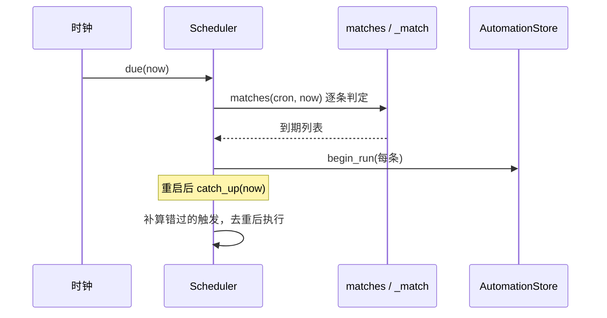

# 第 2 章　定时规则、调度器与重启补偿

> **EvoFlow 对照状态 / Alignment status：** 🔍 结构已核对（路径、行数、符号均取自源码实测），**行为**（调用顺序、边界条件）尚未逐行核对。

## 本章目标
用一个能扛重启的调度器，把「时间」变成可靠的事件源。

## 最小闭环
注册 `0 9 * * *` → 到点触发 → 进程重启后补算「错过的触发」→ 不重复。

## 调用逻辑 / Invocation logic



- **入口**：`due(now)` 只算「这一分钟该跑哪些」，不自己起线程。
- **关键节点**：`matches()` 支持 `*`、区间、步长三类语法；`catch_up()` 在进程重启后补算错过的时间点，但同一时间点只补一次。
- **出口**：到期的自动化交给执行器，调度器不执行业务。
- **最容易断的地方**：重启补算把停机期间所有分钟都补一遍（雪崩）；cron 解析不考虑本地时区。

## 真实模块地图（已核对：路径 · 行数 · 符号）

| 文件 | 行数 | 关键符号 | 模块常量 |
|---|---|---|---|
| `app/gateway/routers/automation_scheduler.py` | 665 | `_coerce_app_parameters`、`_apply_workflow_binding`、`_stamp_app_name` | — |
| `packages/harness/evoflow/proactive/schedule.py` | 383 | `is_schedule_off`、`_parse_rrule_parts`、`looks_like_legacy_rrule` | DEFAULT_HEARTBEAT_CRON、SCHEDULE_OFF |
| `packages/harness/evoflow/scheduler/tool_executor.py` | 140 | `_preview`、`execute_op`、`log_scheduler_invocation` | — |
| `app/gateway/startup_gate.py` | 165 | `StartupGateMiddleware`；`_path`、`_is_exempt`、`_needs_core_routers` | — |
| `app/gateway/background_startup.py` | 1341 | `init_startup_state`、`is_startup_ready`、`resolve_local_embedding_warmup_target` | — |
| `app/gateway/routers/automation_scheduler.py` | 665 | `_coerce_app_parameters`、`_apply_workflow_binding`、`_stamp_app_name` | — |
| `packages/harness/evoflow/proactive/schedule.py` | 383 | `is_schedule_off`、`_parse_rrule_parts`、`looks_like_legacy_rrule` | DEFAULT_HEARTBEAT_CRON、SCHEDULE_OFF |

## 核心概念
- **调度表（不是内存定时器）**：`next_fire_at` 落库，重启后按表重算。
- **补偿策略**：missed 窗口内按「最多补 N 次 / 只补最近一次 / 不补」可配置。
- **时钟**：统一用 UTC 存储，展示用本地时区；DST 边界需测试。
- **单飞（single-flight）**：多实例部署时用分布式锁防重复触发。

## 自研实现要点
```text
schedules(id, expr, tz, next_fire_at, last_fire_at, status)
loop: 每 15s 扫描 next_fire_at <= now → 抢锁 → 建 occurrence → 推 next_fire_at
```

## 业务规则
- 时间表达式必须校验并给出人类可读解释。
- 补算必须写清 `planned_at` 与 `actual_at` 的差异。
- 锁过期时间 > 单次执行时长。

## 常见坑
- 内存定时器 → 重启全丢。
- 多副本各跑一遍 → 用户收到重复消息。
- 夏令时切换导致同一时间触发两次。

## 验收
- [ ] 重启后无漏触发/重复触发
- [ ] 时区正确（含 DST）
- [ ] 多实例只有一个执行

### 源码核对记录（路径与符号实测）

- `app/gateway/routers/automation_scheduler.py`（665 行）
  - 模块自述：Automation scheduler API: status, CRUD on ``~/.evoflow/tasks/automations``, manual run. CRUD mirrors ``evopane…
- `packages/harness/evoflow/proactive/schedule.py`（383 行）
  - 模块自述：Proactive role schedule — same cron stack as automation tasks.…
- `packages/harness/evoflow/scheduler/tool_executor.py`（140 行）
  - 模块自述：Invoke host_direct tools from the local scheduler.…
- `app/gateway/startup_gate.py`（165 行）：类 `StartupGateMiddleware`
  - 模块自述：Return structured 503 while Gateway routes / LangGraph are still starting.…
- `app/gateway/background_startup.py`（1341 行）；环境变量 `EVOFLOW_APP_SERVER_STDIO`、`EVOFLOW_EMBEDDING_WARMUP_DELAY_SEC`、`EVOFLOW_HOME`、`EVOFLOW_LEAD_AGENT_WARM`
  - 模块自述：Gateway background startup — runs after early lifespan yield.…
- `app/gateway/routers/automation_scheduler.py`（665 行）
  - 模块自述：Automation scheduler API: status, CRUD on ``~/.evoflow/tasks/automations``, manual run. CRUD mirrors ``evopane…
- `packages/harness/evoflow/proactive/schedule.py`（383 行）
  - 模块自述：Proactive role schedule — same cron stack as automation tasks.…

> 本节只证明**路径、行数、符号存在**；调用顺序与边界条件仍属「行为」，未逐行核对。

## 对照 EvoFlow 核对清单
- [ ] `automation_scheduler.py` 的扫描间隔与补偿规则
- [ ] `proactive/schedule.py` 与 automation 的关系

## 从零实现（手把手）
> 读完这章你能算出「下一次该跑的时刻」，并在重启后把错过的任务补上。
> 路径均相对 `backend/`，代码注释写「为什么」。

### Step 1　新建 scheduler.py：最小 cron 匹配 + 补偿
**文件**：`packages/harness/myagentflow/automation/scheduler.py（新建）`
**要写的逻辑**：只支持 `分 时 日 月 周` 五段与 `*`；`due()` 判断某分钟是否命中；`catch_up()` 找出上次执行之后错过的次数上限。

**代码**

```python
"""调度器：最小 cron + 重启补偿。

为什么不用 croniter：只支持五段和 `*` 就够本章用，
自己写反而能讲清「每分钟对齐」这件事；要全语法再引库。
"""
from __future__ import annotations

import time
from dataclasses import dataclass


def _match(field: str, value: int) -> bool:
    if field == "*":
        return True
    for part in field.split(","):
        if part.startswith("*/"):
            step = int(part[2:])
            if step and value % step == 0:
                return True
        elif "-" in part:
            lo, hi = part.split("-")
            if int(lo) <= value <= int(hi):
                return True
        elif value == int(part):
            return True
    return False


def matches(cron: str, ts: float) -> bool:
    minute, hour, day, month, weekday = cron.split()
    t = time.localtime(ts)
    return (
        _match(minute, t.tm_min) and _match(hour, t.tm_hour) and _match(day, t.tm_mday)
        and _match(month, t.tm_mon) and _match(weekday, (t.tm_wday + 1) % 7)
    )


@dataclass
class Scheduler:
    last_run: dict[str, float]

    def due(self, automation_id: str, cron: str, now: float | None = None) -> bool:
        now = now or time.time()
        if not matches(cron, now):
            return False
        # 同一分钟内只触发一次
        return int(now // 60) * 60 != int(self.last_run.get(automation_id, 0) // 60) * 60

    def catch_up(self, automation_id: str, cron: str, now: float | None = None,
                 limit: int = 3) -> int:
        """重启后补跑：从 last_run 到 now 之间命中的分钟数（最多 limit 次）。"""
        now = now or time.time()
        last = self.last_run.get(automation_id, now - 3600)
        count = 0
        ts = last - (last % 60) + 60
        while ts <= now and count < limit:
            if matches(cron, ts):
                count += 1
            ts += 60
        return count
```

**验证**

```bash
uv run python -c "
import time
from myagentflow.automation.scheduler import matches, Scheduler
now = time.time()
print(matches('* * * * *', now), matches('0 9 * * *', now))
s = Scheduler(last_run={}); print(s.catch_up('a','*/5 * * * *', now=now, limit=3))
"
```

### Step 2　写测试：每分钟命中 + 补跑有上限
**文件**：`tests/chapters/test_ch08_02_scheduler.py（新建）`
**要写的逻辑**：`* * * * *` 恒命中；`*/5` 一小时内最多补 3 次。

**代码**

```python
from __future__ import annotations


def test_cron_basics():
    from myagentflow.automation.scheduler import Scheduler, matches

    now = 1_700_000_000.0          # 固定时间，避免测试随「今天星期几」飘
    assert matches("* * * * *", now)
    s = Scheduler(last_run={})
    assert 0 < s.catch_up("a", "*/5 * * * *", now=now, limit=3) <= 3
```

**验证**

```bash
uv run pytest tests/chapters/test_ch08_02_scheduler.py -v
# 期望：1 passed
```

### 与 EvoFlow 对照

| 我们的做法 | EvoFlow | 为什么 |
|---|---|---|
| 五段 cron + `*` 子集 | `automation/` 的调度 | 全语法容易写错，先跑通 |
| 同一分钟只触发一次 | 调度去重 | 否则重启会连发 |
| 补跑有上限 | `catch_up(limit=)` | 停机一天不该补 1440 次 |

### 知识点

- [Harbor404](https://harbor404.fushenlin.com/)：定时任务的重复执行
- agent-book：主动 Agent

### 验收

```bash
uv run pytest tests/chapters/test_ch08_02_scheduler.py -q
```
