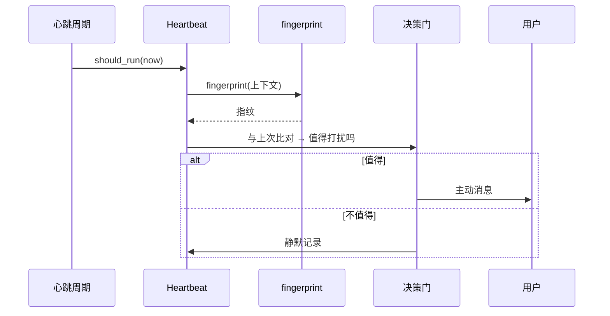

# 第 3 章　Heartbeat 主动任务与智能体员工

> **EvoFlow 对照状态 / Alignment status：** 🔍 结构已核对（路径、行数、符号均取自源码实测），**行为**（调用顺序、边界条件）尚未逐行核对。

## 本章目标
让 Agent 在没人提问时也会「抬头看一眼」：检查任务、发现异常、主动汇报。

## 最小闭环
心跳周期到 → 决策门判断「是否值得打扰用户」→ 是则生成一条主动消息 → 否则静默记录。

## 调用逻辑 / Invocation logic



- **入口**：每个心跳周期先 `should_run()`：时间到 + 上下文有变化才继续。
- **关键节点**：`fingerprint()` 把「任务状态/未读变化」压成一个指纹，指纹相同就不打扰——这是防骚扰的核心。
- **出口**：值得打扰才发消息，否则只写日志，用户无感。
- **最容易断的地方**：指纹包含时间戳（每分钟都不同）；没有任何阈值，变成定时推送。

## 真实模块地图（已核对：路径 · 行数 · 符号）

| 文件 | 行数 | 关键符号 | 模块常量 |
|---|---|---|---|
| `packages/harness/evoflow/proactive/engine.py` | 1471 | `ProactiveEngine`；`_role_name_for_agent`、`_cancel_running_langgraph_runs`、`_is_execution_failure` | — |
| `packages/harness/evoflow/proactive/decision_gate.py` | 1172 | `DecisionGate`；`_parse_iso_datetime` | — |
| `packages/harness/evoflow/proactive/duty_runs.py` | 439 | `_new_run_id`、`_row_to_dict`、`start_duty_run` | — |
| `packages/harness/evoflow/proactive/employee_automation.py` | 322 | `employee_via_automation_enabled`、`employee_automation_task_id`、`agent_code_from_employee_task` | EMPLOYEE_AUTOMATION_KIND |
| `packages/harness/evoflow/proactive/employee_prompt.py` | 52 |  | — |
| `employee_prompting.py` | — | — | ✗ 源码树中未找到该文件 |
| `packages/harness/evoflow/proactive/departments.py` | 608 | `DepartmentRepository`；`_sanitize_name`、`_new_id`、`_row_dict` | — |
| `packages/harness/evoflow/proactive/cycle_limits.py` | 196 | `effective_max_initiatives`、`round_token`、`round_refs` | DEFAULT_MAX_INITIATIVES |
| `packages/harness/evoflow/proactive/decision_gate.py` | 1172 | `DecisionGate`；`_parse_iso_datetime` | — |

## 核心概念
- **心跳不是轮询一切**：只跑「有 duty 的」检查项，避免空转。
- **决策门**：抑制「没什么可说」的心跳——主动打扰是有成本的。
- **智能体员工**：有岗位、职责、汇报关系，可按部门组织。
- **静默优先**：默认不发消息，只在有结论/异常时发。

## 自研实现要点
```text
heartbeat: for duty in duties: if due → run(duty) → result
gate: 判断 result 是否有新信息 + 是否超频 → send or record
```

## 业务规则
- 每日主动消息条数上限。
- 相同内容不重复推送（内容指纹去重）。
- 用户静音时段不打扰。

## 常见坑
- 心跳过密 → 电费与 token 双烧。
- 决策门过松 → 变成骚扰机器人。
- 员工职责不清 → 同一件事两个员工重复汇报。

## 验收
- [ ] 无新信息时不发消息
- [ ] 超频被抑制
- [ ] 每条主动消息可追溯到 duty

### 源码核对记录（路径与符号实测）

- `packages/harness/evoflow/proactive/engine.py`（1471 行）：类 `ProactiveEngine`；环境变量 `EVOFLOW_LANGGRAPH_URL`、`EVOFLOW_PROACTIVE_ASSISTANT_ID`、`EVOFLOW_PROACTIVE_MODEL`
  - 模块自述：ProactiveEngine - the LLM-driven think cycle. Perceives domain state -> thinks -> produces initiatives -> deci…
- `packages/harness/evoflow/proactive/decision_gate.py`（1172 行）：类 `DecisionGate`
  - 模块自述：DecisionGate - routes risky initiatives through human approval. Approval channels: 1. **Feishu** - interactive…
- `packages/harness/evoflow/proactive/duty_runs.py`（439 行）
  - 模块自述：Employee duty / heartbeat run index (``evoflow_duty_runs``). SSOT for「巡检记录」list entries: every scheduler / hea…
- `packages/harness/evoflow/proactive/employee_automation.py`（322 行）；环境变量 `EVOFLOW_EMPLOYEE_VIA_AUTOMATION`
  - 模块自述：Employee heartbeat as a first-class automation rule. Architecture ------------ * **Definition (规则)**: each act…
- `packages/harness/evoflow/proactive/employee_prompt.py`（52 行）
  - 模块自述：Compat shim — canonical SSOT is ``evoflow.proactive.employee_prompting``. Prefer:: from evoflow.proactive.empl…
- `packages/harness/evoflow/proactive/departments.py`（608 行）：类 `DepartmentRepository`
  - 模块自述：Department registry for smart employees (proactive roles). Roles keep a free-text ``department`` column for pr…
- `packages/harness/evoflow/proactive/cycle_limits.py`（196 行）
  - 模块自述：Per-cycle initiative ceiling for smart-employee duty rounds. ``max_initiatives_per_cycle`` used to be enforced…
- `packages/harness/evoflow/proactive/decision_gate.py`（1172 行）：类 `DecisionGate`
  - 模块自述：DecisionGate - routes risky initiatives through human approval. Approval channels: 1. **Feishu** - interactive…

> 本节只证明**路径、行数、符号存在**；调用顺序与边界条件仍属「行为」，未逐行核对。

## 对照 EvoFlow 核对清单
- [ ] `decision_gate.py` 的判定维度
- [ ] `departments.py` 的组织模型

## 从零实现（手把手）
> 读完这章你能让 Agent 每隔一段时间「自己看一眼」，但空闲时不烧 token。
> 路径均相对 `backend/`，代码注释写「为什么」。

### Step 1　新建 heartbeat.py：变化检测 + 节流
**文件**：`packages/harness/myagentflow/automation/heartbeat.py（新建）`
**要写的逻辑**：每轮只算「世界状态指纹」；指纹没变就跳过（不调模型）；变了才触发任务，并限制每小时最多 N 次。

**代码**

```python
"""心跳：状态没变就别叫模型。

为什么用指纹而不是时间：
按时间触发的话，一切正常时也在烧 token；
按指纹触发，只有「真的有变化」才动作。
"""
from __future__ import annotations

import hashlib
import time
from dataclasses import dataclass, field


def fingerprint(values: dict[str, str]) -> str:
    raw = "|".join(f"{k}={values[k]}" for k in sorted(values))
    return hashlib.sha256(raw.encode()).hexdigest()[:16]


@dataclass
class Heartbeat:
    max_per_hour: int = 6
    _last_fp: str | None = None
    _events: list[float] = field(default_factory=list)

    def should_run(self, state: dict[str, str], now: float | None = None) -> bool:
        now = now or time.time()
        fp = fingerprint(state)
        if fp == self._last_fp:
            return False                     # 没变化：省一次模型调用
        self._events = [t for t in self._events if now - t < 3600]
        if len(self._events) >= self.max_per_hour:
            return False                     # 变化太频繁：节流
        self._last_fp = fp
        self._events.append(now)
        return True
```

**验证**

```bash
uv run python -c "
from myagentflow.automation.heartbeat import Heartbeat
h = Heartbeat()
print(h.should_run({'ci':'green'}), h.should_run({'ci':'green'}), h.should_run({'ci':'red'}))
"
```

### Step 2　写测试：不变不跑 + 超频被拦
**文件**：`tests/chapters/test_ch08_03_heartbeat.py（新建）`
**要写的逻辑**：同状态第二次 False；连续 7 次变化只有 6 次通过。

**代码**

```python
from __future__ import annotations


def test_heartbeat():
    from myagentflow.automation.heartbeat import Heartbeat

    h = Heartbeat(max_per_hour=6)
    assert h.should_run({"a": "1"}) is True
    assert h.should_run({"a": "1"}) is False
    for i in range(10):
        h.should_run({"a": str(i)})       # 前 5 次通过，之后被节流
    assert len(h._events) <= 6
```

**验证**

```bash
uv run pytest tests/chapters/test_ch08_03_heartbeat.py -v
# 期望：1 passed
```

### 与 EvoFlow 对照

| 我们的做法 | EvoFlow | 为什么 |
|---|---|---|
| 状态指纹去重 | `automation/` 的心跳 | 没变化也调模型 = 白烧钱 |
| 每小时上限 | 心跳节流 | 状态抖动会让它变成死循环 |

### 知识点

- [Harbor404 · 推理链路延迟优化](https://harbor404.fushenlin.com/notes/llm-agent-latency-optimization/)：减少无谓调用的收益
- agent-book：主动 Agent

### 验收

```bash
uv run pytest tests/chapters/test_ch08_03_heartbeat.py -q
```
