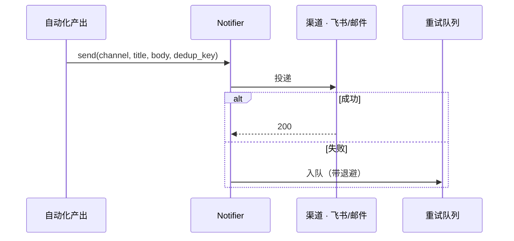

# 第 4 章　通知渠道投递与任务管理界面

> **EvoFlow 对照状态 / Alignment status：** 🔍 结构已核对（路径、行数、符号均取自源码实测），**行为**（调用顺序、边界条件）尚未逐行核对。

## 本章目标
把「结果」可靠地送到人眼前：IM 渠道、应用内消息、任务中心。

## 最小闭环
自动化产出报告 → 选择飞书渠道 → 投递成功 → 任务中心可见 → 失败进入重试队列。

## 调用逻辑 / Invocation logic



- **入口**：`send()` 必须带 `dedup_key`，同一产出重复触发不会发两遍。
- **关键节点**：投递结果分「成功 / 可重试 / 永久失败」三类，只有可重试入队。
- **出口**：任务中心显示投递状态，失败可手动重发。
- **最容易断的地方**：失败无限重试；渠道之间互相影响（一个渠道挂掉拖垮全部）。

## 真实模块地图（已核对：路径 · 行数 · 符号）

| 文件 | 行数 | 关键符号 | 模块常量 |
|---|---|---|---|
| `app/gateway/channel_result_push.py` | 682 | `_channel_label`、`_parse_context_json`、`_short_id` | PUSH_CHANNELS |
| `packages/harness/evoflow/proactive/feishu_notify.py:34` | 717 | `_approval_channels`、`_feishu_channel_not_opted_out`、`_outbound_feishu_target` | — |
| `packages/harness/evoflow/proactive/feishu_binding.py:21` | 409 | `feishu_binding_public`、`_channels_section`、`_persist_feishu_accounts` | — |
| `app/channels/message_bus.py` | 474 | `InboundMessageType`、`InboundMessage`、`ResolvedAttachment` | — |
| `packages/harness/evoflow/plans/service.py:22` | 191 | `_reload_chat_models`、`list_catalog`、`list_bindings` | — |
| `packages/harness/evoflow/uploads/manager.py:17` | 203 | `PathTraversalError`；`validate_thread_id`、`get_uploads_dir`、`ensure_uploads_dir` | — |
| `packages/harness/evoflow/persistence/channel_push_repositories.py:23` | 1473 | `new_push_id`、`_clip`、`_payload_to_json` | — |
| `app/gateway/channel_result_push.py` | 682 | `_channel_label`、`_parse_context_json`、`_short_id` | PUSH_CHANNELS |

## 核心概念
- **投递是一次事务**：`pending → sent → failed(retry)`，有幂等键 `(occurrence_id, channel, target)`。
- **降级链**：主渠道失败 → 备用渠道 → 应用内未读。
- **任务中心是最终事实来源**：渠道消息可能丢，任务中心必须有记录。

## 自研实现要点
```text
push(id, ref_id, channel, target, status, attempts, last_error, sent_at)
重试：指数退避，上限 5 次，之后标 dead 并告警
```

## 业务规则
- 不在消息里放密钥/内部路径。
- 长结果用「摘要 + 链接/文件」而非整段刷屏。
- 用户撤回授权后立即停止投递。

## 常见坑
- 投递失败静默 → 用户以为没做。
- 重试无上限 → 渠道封禁。
- 渠道消息与任务中心状态不一致。

## 验收
- [ ] 投递失败可见并可重试
- [ ] 重复投递被幂等键拦截
- [ ] 消息内容无敏感信息

### 源码核对记录（路径与符号实测）

- `app/gateway/channel_result_push.py`（682 行）
  - 模块自述：Push task/goal completion summaries to a chosen IM channel target.…
- `packages/harness/evoflow/proactive/feishu_notify.py`（717 行）
  - 模块自述：Proactive Feishu notifications — bind-first, 1:1, no spam. Routing contract ---------------- * **Who may recei…
- `packages/harness/evoflow/proactive/feishu_binding.py`（409 行）
  - 模块自述：Per-employee Feishu PersonalAgent binding helpers. Each smart employee can QR-scan (same flow as Settings → IM…
- `app/channels/message_bus.py`（474 行）：类 `InboundMessageType`、`InboundMessage`、`ResolvedAttachment`、`OutboundMessage`
  - 模块自述：MessageBus — async pub/sub hub that decouples channels from the agent dispatcher.…
- `packages/harness/evoflow/plans/service.py`（191 行）
  - 模块自述：Plan Bundle public service API.…
- `packages/harness/evoflow/uploads/manager.py`（203 行）：类 `PathTraversalError`
  - 模块自述：Shared upload management logic. Pure business logic — no FastAPI/HTTP dependencies. Both Gateway and Client de…
- `packages/harness/evoflow/persistence/channel_push_repositories.py`（1473 行）
  - 模块自述：SQLite audit log for channel push / callback leave-a-trail. Failures must never break the push path — callers …
- `app/gateway/channel_result_push.py`（682 行）
  - 模块自述：Push task/goal completion summaries to a chosen IM channel target.…

> 本节只证明**路径、行数、符号存在**；调用顺序与边界条件仍属「行为」，未逐行核对。

## 对照 EvoFlow 核对清单
- [ ] `channel_result_push.py` 的投递编排
- [ ] `channel_push_repositories` 的幂等键

## 从零实现（手把手）
> 读完这章你能把「跑完了」这件事投递到多个渠道，并且失败可重试、不重复轰炸。
> 路径均相对 `backend/`，代码注释写「为什么」。

### Step 1　新建 notify.py：投递 + 去重
**文件**：`packages/harness/myagentflow/automation/notify.py（新建）`
**要写的逻辑**：每个渠道一个 sender；用 `dedup_key` 去重（同一事件只发一次）；单个渠道失败不影响其他渠道。

**代码**

```python
"""通知投递：多渠道 + 去重 + 失败隔离。

为什么失败要隔离：一个 webhook 挂了不该让桌面通知也发不出去。
"""
from __future__ import annotations

from collections.abc import Callable
from dataclasses import dataclass, field


@dataclass
class Notifier:
    senders: dict[str, Callable[[str], bool]] = field(default_factory=dict)
    _sent: set[str] = field(default_factory=set)

    def send(self, channel: str, text: str, dedup_key: str | None = None) -> dict[str, str]:
        """返回每个渠道的结果：sent / skipped / failed。"""
        results: dict[str, str] = {}
        key = dedup_key or text
        for name, fn in self.senders.items():
            if channel not in {"all", name}:
                continue
            if f"{name}:{key}" in self._sent:
                results[name] = "skipped"
                continue
            try:
                ok = fn(text)
                results[name] = "sent" if ok else "failed"
                if ok:
                    self._sent.add(f"{name}:{key}")
            except Exception:
                results[name] = "failed"      # 单渠道异常不影响别的渠道
        return results
```

**验证**

```bash
uv run python -c "
from myagentflow.automation.notify import Notifier
n = Notifier({'desktop': lambda t: True, 'webhook': lambda t: 1/0})
print(n.send('all', '完成', dedup_key='run-1'))
print(n.send('all', '完成', dedup_key='run-1'))
"
```

### Step 2　写测试：去重 + 失败隔离
**文件**：`tests/chapters/test_ch08_04_notify.py（新建）`
**要写的逻辑**：第二次同 key 返回 skipped；webhook 抛异常时 desktop 仍是 sent。

**代码**

```python
from __future__ import annotations


def test_dedup_and_isolation():
    from myagentflow.automation.notify import Notifier

    n = Notifier({"desktop": lambda t: True, "webhook": lambda t: 1 / 0})
    first = n.send("all", "完成", dedup_key="r1")
    assert first["desktop"] == "sent" and first["webhook"] == "failed"
    second = n.send("all", "完成", dedup_key="r1")
    assert second["desktop"] == "skipped"
```

**验证**

```bash
uv run pytest tests/chapters/test_ch08_04_notify.py -v
# 期望：1 passed
```

### 与 EvoFlow 对照

| 我们的做法 | EvoFlow | 为什么 |
|---|---|---|
| dedup_key 去重 | `automation/` 的通知投递 | 重试会导致用户收到三条相同消息 |
| 渠道失败隔离 | 同文件 | 一个渠道挂了不该全挂 |

### 知识点

- [Harbor404](https://harbor404.fushenlin.com/)：通知与重试
- agent-book：事件投递

### 验收

```bash
uv run pytest tests/chapters/test_ch08_04_notify.py -q
```
