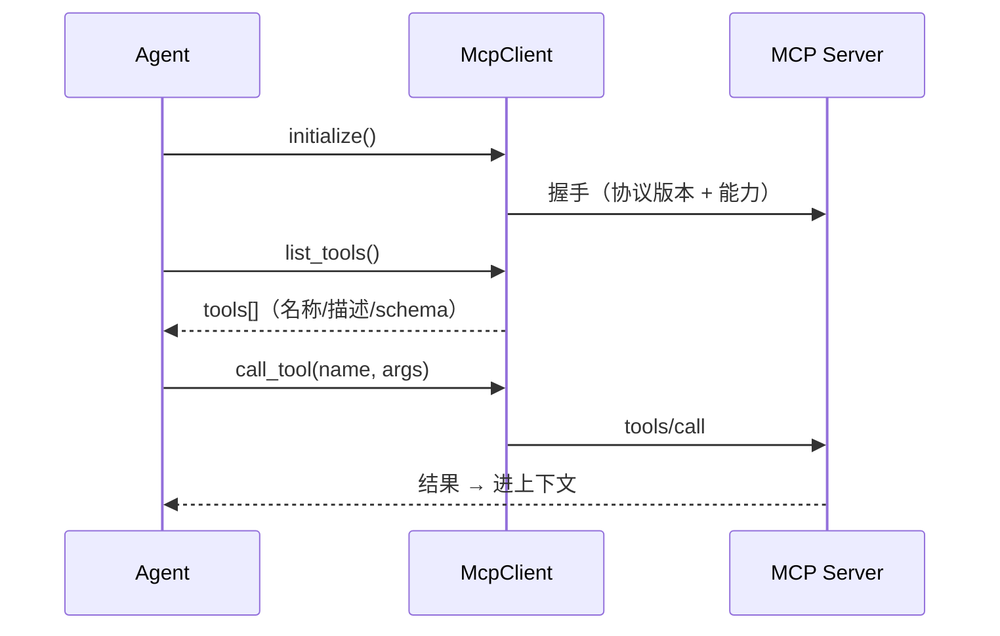

# 第 1 章　MCP 连接、发现、调用与 OAuth

> **EvoFlow 对照状态 / Alignment status：** 🔍 结构已核对（路径、行数、符号均取自源码实测），**行为**（调用顺序、边界条件）尚未逐行核对。

## 本章目标
把「一个外部服务」变成「一组可调用工具」，并解决连接复用、权限、结果体积三个问题。

## 最小闭环
配置一个 MCP server（stdio）→ 启动并握手 → 列出 tools → 调用一次 → 结果进上下文。

## 调用逻辑 / Invocation logic



- **入口**：`initialize()` 先握手拿能力集，再 `list_tools()`，顺序不能反。
- **关键节点**：`_request()` 统一封装 JSON-RPC 请求/响应与超时；工具 schema 直接交给模型，不在本地改描述。
- **出口**：`call_tool()` 返回结构化结果，失败要区分「工具报错」与「连接断了」。
- **最容易断的地方**：握手失败仍继续列工具；进程退出没 `close()` 留下僵尸子进程。

## 真实模块地图（已核对：路径 · 行数 · 符号）

| 文件 | 行数 | 关键符号 | 模块常量 |
|---|---|---|---|
| `packages/harness/evoflow/mcp/client.py` | 79 | `build_server_params`、`build_servers_config` | — |
| `packages/harness/evoflow/mcp/pool.py` | 450 | `_ServerEntry`、`McpConnectionPool`；`call_timeout_sec`、`server_timeout_sec_from_config`、`_walk_exception_tree` | — |
| `packages/harness/evoflow/mcp/tools.py` | 443 | `_get_mcp_config_path`、`load_mcp_config`、`_merge_trusted_project_servers` | — |
| `packages/harness/evoflow/mcp/binding.py` | 157 | `warn_if_legacy_mcp_skill_binding_env`、`mcp_server_tool_id`、`allowed_mcp_server_ids` | MCP_TOOL_PREFIX、MCP_TOOL_DELIMITER、HOST_PLUGIN_KERNEL_SERVERS |
| `packages/harness/evoflow/mcp/annotations.py` | 80 | `_qualified_key`、`record_tool_annotations`、`record_tools_annotations` | — |
| `packages/harness/evoflow/mcp/config_io.py` | 122 | `_looks_like_server_entry`、`unwrap_mcp_servers_dict`、`is_bogus_mcp_server_map` | — |
| `packages/harness/evoflow/mcp/workspace_scope.py` | 187 | `resolve_project_root`、`project_mcp_paths`、`load_project_mcp_servers` | TRUST_STATUS_TRUSTED、TRUST_STATUS_CHANGED、TRUST_STATUS_UNTRUSTED |
| `packages/harness/evoflow/mcp/status.py` | 213 | `_infer_mcp_transport`、`mcp_config_stale`、`build_mcp_status_snapshot` | — |
| `packages/harness/evoflow/mcp/oauth.py` | 217 | `_OAuthToken`、`OAuthTokenManager`；`build_oauth_tool_interceptor`、`get_initial_oauth_headers` | — |
| `packages/harness/evoflow/mcp/result_budget.py` | 251 | `text_budget_chars`、`image_inline_bytes`、`_images_dir` | — |
| `packages/harness/evoflow/mcp/prompt_section.py` | 56 | `resolve_mcp_server_names`、`mcp_prompt_fingerprint`、`build_mcp_skill_prompt_section` | — |
| `packages/harness/evoflow/mcp/native_prompt.py` | 38 | `build_mcp_native_prompt_section`、`build_mcp_native_prompt_section_safe`、`mcp_native_prompt_fingerprint` | — |
| `app/gateway/routers/mcp.py` | 393 | `McpOAuthConfigResponse`、`McpServerConfigResponse`、`McpServerRuntimeStatus`；`get_mcp_configuration`、`update_mcp_configuration`、`get_mcp_project_scope` | — |
| `app/gateway/routers/mcp_server.py` | 250 | `_verify_bearer_token`、`_build_caller_ctx`、`_wants_sse` | — |
| `packages/harness/evoflow/mcp/pool.py` | 450 | `_ServerEntry`、`McpConnectionPool`；`call_timeout_sec`、`server_timeout_sec_from_config`、`_walk_exception_tree` | — |
| `packages/harness/evoflow/mcp/result_budget.py` | 251 | `text_budget_chars`、`image_inline_bytes`、`_images_dir` | — |

## 核心概念
- **发现是动态的**：`tools/list` 结果随 server 变化，必须缓存 + 失效重取。
- **进程 vs HTTP**：stdio server 要按 workspace 隔离并回收；HTTP server 要处理 401/刷新。
- **结果预算**：MCP 返回可能是巨大 JSON → 必须截断并落盘（同 Part 3）。
- **工具命名冲突**：多 server 同名工具要用 `server.tool` 前缀。

## 自研实现要点
```text
McpServer(id, transport, cmd/url, env, scopes)
McpTool(server_id, name, schema, cached_at)
call: 取连接（池化）→ 序列化请求 → 超时 → 结果整形 → 审计
```

## 业务规则
- server 崩溃自动重启但限次数；连续失败禁用并告警。
- OAuth token 存加密库，不进日志。
- 只挂载当前 workspace 允许的 server。

## 常见坑
- 每次调用都新起进程 → 慢且泄漏。
- 不设超时 → 一个卡住的 server 拖死整轮。
- 把全部工具 schema 塞进 prompt → 上下文直接爆。

## 验收
- [ ] server 重启后工具可用
- [ ] 工具总数 200+ 时按需加载
- [ ] 大结果自动截断落盘

### 源码核对记录（路径与符号实测）

- `packages/harness/evoflow/mcp/client.py`（79 行）
  - 模块自述：MCP client using langchain-mcp-adapters.…
- `packages/harness/evoflow/mcp/pool.py`（450 行）：类 `_ServerEntry`、`McpConnectionPool`；环境变量 `EVOFLOW_MCP_CALL_TIMEOUT_SEC`
  - 模块自述：Persistent MCP connection pool（对齐 ZCode 连接池语义）. langchain-mcp-adapters 的 ``get_tools()`` 语义是"每次 tool call 新建 s…
- `packages/harness/evoflow/mcp/tools.py`（443 行）；环境变量 `EVOFLOW_MCP_SERVER_TIMEOUT_SEC`
  - 模块自述：Load MCP tools using langchain-mcp-adapters.…
- `packages/harness/evoflow/mcp/binding.py`（157 行）；环境变量 `EVOFLOW_MCP_TOOL_BINDING`
  - 模块自述：runtime-aligned MCP binding: native LangChain tools only (no skill/terminal path).…
- `packages/harness/evoflow/mcp/annotations.py`（80 行）
  - 模块自述：MCP tool annotation registry — 风险分级用的 hints 记录。 langchain-mcp-adapters 把 MCP 协议的 ``annotations``（readOnlyHint …
- `packages/harness/evoflow/mcp/config_io.py`（122 行）；环境变量 `EVOFLOW_MCP_CONFIG`
  - 模块自述：MCP config file I/O — 常见 IDE ``mcp.json`` format support.…
- `packages/harness/evoflow/mcp/workspace_scope.py`（187 行）；环境变量 `EVOFLOW_MCP_PROJECT_DIR`
  - 模块自述：Workspace（项目）级 MCP 配置与信任门（对齐 Zcode 项目 scope）. 对齐 Zcode-vs-EvoFlow MCP 分析 #3： - **项目级配置**：项目根（默认进程 cwd，``EVOFLO…
- `packages/harness/evoflow/mcp/status.py`（213 行）
  - 模块自述：MCP runtime status snapshot for Gateway APIs (read-only, never triggers init).…
- `packages/harness/evoflow/mcp/oauth.py`（217 行）：类 `_OAuthToken`、`OAuthTokenManager`
  - 模块自述：OAuth token support for MCP HTTP/SSE servers.…
- `packages/harness/evoflow/mcp/result_budget.py`（251 行）；环境变量 `EVOFLOW_MCP_IMAGES_DIR`、`EVOFLOW_MCP_IMAGE_INLINE_BYTES`、`EVOFLOW_MCP_TEXT_BUDGET_CHARS`
  - 模块自述：MCP tool result budget — 对齐 Zcode 的 resultBudget / 图片归一化。 MCP server 可能返回大 base64 图片和超大文本。Zcode 的做法： - 图片 bloc…
- `packages/harness/evoflow/mcp/prompt_section.py`（56 行）
  - 模块自述：MCP role binding helpers and deprecated prompt builders (native binding only).…
- `packages/harness/evoflow/mcp/native_prompt.py`（38 行）
  - 模块自述：MCP prompt helpers (deprecated — no system-prompt injection). MCP tools are mounted as normal ``mcp__<server>_…
- `app/gateway/routers/mcp.py`（393 行）：类 `McpOAuthConfigResponse`、`McpServerConfigResponse`、`McpServerRuntimeStatus`、`McpConfigResponse`
- `app/gateway/routers/mcp_server.py`（250 行）
  - 模块自述：FastAPI router exposing the MCP Server endpoint at ``/mcp``. Wires the transport-agnostic JSON-RPC engine in :…
- `packages/harness/evoflow/mcp/pool.py`（450 行）：类 `_ServerEntry`、`McpConnectionPool`；环境变量 `EVOFLOW_MCP_CALL_TIMEOUT_SEC`
  - 模块自述：Persistent MCP connection pool（对齐 ZCode 连接池语义）. langchain-mcp-adapters 的 ``get_tools()`` 语义是"每次 tool call 新建 s…
- `packages/harness/evoflow/mcp/result_budget.py`（251 行）；环境变量 `EVOFLOW_MCP_IMAGES_DIR`、`EVOFLOW_MCP_IMAGE_INLINE_BYTES`、`EVOFLOW_MCP_TEXT_BUDGET_CHARS`
  - 模块自述：MCP tool result budget — 对齐 Zcode 的 resultBudget / 图片归一化。 MCP server 可能返回大 base64 图片和超大文本。Zcode 的做法： - 图片 bloc…

> 本节只证明**路径、行数、符号存在**；调用顺序与边界条件仍属「行为」，未逐行核对。

## 对照 EvoFlow 核对清单
- [ ] `mcp/pool.py` 的连接生命周期
- [ ] `result_budget.py` 的截断阈值
- [ ] 多实例负载均衡问题（参考 Harbor404📚）

## 从零实现（手把手）
> 读完这章你能连上一个 stdio MCP 服务：发 initialize、列工具、调工具，并处理 OAuth 缺失。
> 路径均相对 `backend/`，代码注释写「为什么」。

### Step 1　新建 client.py：JSON-RPC 三步
**文件**：`packages/harness/myagentflow/mcp/client.py（新建）`
**要写的逻辑**：一行 JSON 一个请求；`initialize` → `tools/list` → `tools/call`；错误码统一翻译成异常。

**代码**

```python
"""最小 MCP 客户端：stdio + JSON-RPC。

为什么先只做 stdio：HTTP/SSE 传输要多处理一层鉴权与重连，
stdio 能把「协议本身」讲清楚。
"""
from __future__ import annotations

import json
import subprocess
from typing import Any


class McpClient:
    def __init__(self, command: list[str]) -> None:
        self._proc = subprocess.Popen(
            command, stdin=subprocess.PIPE, stdout=subprocess.PIPE, text=True, bufsize=1
        )
        self._id = 0

    def _request(self, method: str, params: dict[str, Any] | None = None) -> dict[str, Any]:
        self._id += 1
        payload = {"jsonrpc": "2.0", "id": self._id, "method": method, "params": params or {}}
        assert self._proc.stdin and self._proc.stdout
        self._proc.stdin.write(json.dumps(payload) + "\n")
        self._proc.stdin.flush()
        line = self._proc.stdout.readline()
        if not line:
            raise RuntimeError(f"MCP 服务无响应：{method}")
        resp = json.loads(line)
        if "error" in resp:
            raise RuntimeError(f"MCP 错误 {resp['error'].get('code')}: {resp['error'].get('message')}")
        return resp.get("result", {})

    def initialize(self) -> dict[str, Any]:
        return self._request("initialize", {"protocolVersion": "2024-11-05", "capabilities": {}})

    def list_tools(self) -> list[dict[str, Any]]:
        return self._request("tools/list").get("tools", [])

    def call_tool(self, name: str, args: dict[str, Any]) -> Any:
        return self._request("tools/call", {"name": name, "arguments": args})

    def close(self) -> None:
        self._proc.terminate()
```

**验证**

```bash
uv run python -c "from myagentflow.mcp.client import McpClient; print('import ok')"
```

### 与 EvoFlow 对照

| 我们的做法 | EvoFlow | 为什么 |
|---|---|---|
| 一行 JSON 一个请求 | `mcp/` 的 stdio 传输 | 换行分隔才好按行读 |
| error 统一抛异常 | 同文件 | 让上游只处理一种失败形态 |

### 知识点

- [MCP 中台 Tool 数量治理：连接、发现、授权](https://harbor404.fushenlin.com/notes/mcp-tool-governance-architecture/)
- [系统课入口：工具协议](https://g0-000.github.io/agent-book/)

### 验收

```bash
uv run python -c "from myagentflow.mcp.client import McpClient; print('ok')"
```
