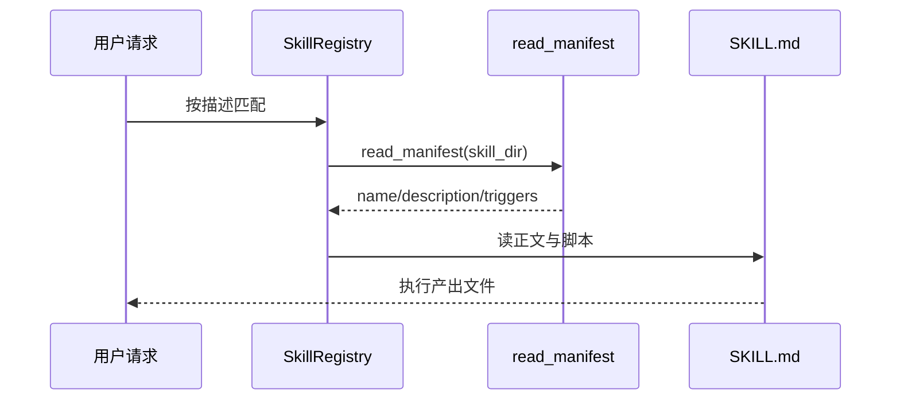

# 第 3 章　Skills、资源市场与 Community Provider

> **EvoFlow 对照状态 / Alignment status：** 🔍 结构已核对（路径、行数、符号均取自源码实测），**行为**（调用顺序、边界条件）尚未逐行核对。

## 本章目标
把「一类任务的做事方法」打包成可安装、可版本化的资产，而不是每次靠提示词重新教。

## 最小闭环
安装一个 skill 目录（含 `SKILL.md`）→ 触发时按描述命中 → 加载正文与脚本 → 执行后产出文件。

## 调用逻辑 / Invocation logic



- **入口**：`install()` 登记 skill 目录，`list()` 返回可用清单；匹配靠 description 而不是名字。
- **关键节点**：`read_manifest()` 必须能容忍没有 frontmatter 的旧 skill；触发词与描述分开存。
- **出口**：命中后加载正文，脚本按需执行，产物落到工作区。
- **最容易断的地方**：只按名字匹配导致同义请求漏掉；把整篇 SKILL.md 无脑塞进上下文。

## 真实模块地图（已核对：路径 · 行数 · 符号）

| 文件 | 行数 | 关键符号 | 模块常量 |
|---|---|---|---|
| `packages/harness/evoflow/skills/loader.py` | 814 | `clear_skills_cache`、`get_cached_skills_prompt_section`、`_build_mtime_map` | — |
| `packages/harness/evoflow/skills/parser.py` | 66 | `parse_skill_file` | — |
| `packages/harness/evoflow/skills/frontmatter.py` | 49 | `split_skill_frontmatter` | — |
| `packages/harness/evoflow/skills/selection.py` | 66 | `extract_skill_mentions`、`select_skills_for_turn` | — |
| `packages/harness/evoflow/skills/injection.py` | 126 | `skill_injection_execution_hint`、`_stat_signature`、`_read_skill_body` | — |
| `packages/harness/evoflow/skills/active.py` | 20 | `set_active_skills`、`reset_active_skills`、`get_active_skills` | — |
| `packages/harness/evoflow/skills/bound.py` | 184 | `is_bound_meta`、`is_bound_registry`、`list_bound_skill_dirs` | INSTALL_MODE_BOUND |
| `packages/harness/evoflow/skills/installer.py` | 488 | `SkillAlreadyExistsError`；`is_link_or_junction`、`path_occupied`、`remove_link_or_junction` | MAX_ZIP_ENTRIES、MAX_ZIP_FILES |
| `packages/harness/evoflow/skills/user_install.py` | 415 | `get_user_skills_root`、`_skills_root_from_source_tree`、`resolve_system_skills_source` | — |
| `packages/harness/evoflow/skills/skillhub_pack.py` | 517 | `SkillInstallResult`、`ExpertPackInstallResult`；`_http_get`、`parse_skillset_slug`、`fetch_skillset` | SKILLHUB_API、AVATAR_CDN、AVATAR_VERSION |
| `packages/harness/evoflow/skills/security.py` | 95 | `scan_for_security_issues`、`scan_skill_directory` | — |
| `packages/harness/evoflow/skills/validation.py` | 108 | `_validate_skill_frontmatter` | ALLOWED_FRONTMATTER_PROPERTIES |
| `packages/harness/evoflow/skills/skill_scope.py` | 23 | `SkillScope` | — |
| `packages/harness/evoflow/config/paths.py` | 415 | `Paths`；`get_paths`、`reset_paths_cache`、`resolve_path` | VIRTUAL_PATH_PREFIX |
| `packages/harness/evoflow/skills/skill_uri.py` | 162 | `parse_skill_uri`、`resolve_skill_uri`、`resolve_skill_path_for_command` | SKILL_URI_PREFIX |
| `app/gateway/routers/skills.py` | 544 | `SkillResponse`、`SkillsListResponse`、`SkillUpdateRequest`；`_resolve_skills_base_path`、`_scope_skill_roots_from_request`、`_load_skills_for_request` | — |

## 核心概念
- **描述即路由**：`description` 是触发器，写得含糊就永远不命中或误命中。
- **渐进加载**：先只加载 `name/description`，命中后才读正文（省 token）。
- **目录即包**：`SKILL.md` + `scripts/` + `assets/`，可整体安装/卸载。
- **安全**：skill 可含脚本 → 必须校验来源与可执行范围。

## 自研实现要点
```text
skills(id, name, description, path, version, scope, installed_at)
match(query): 描述关键词 + 语义 → top1 → 读正文 → 注入
```

## 业务规则
- skill 名唯一；重名安装需显式覆盖。
- skill 内的脚本继承会话的工具权限，不额外提权。
- 卸载必须清理注入缓存。

## 常见坑
- 把长文档写进 `SKILL.md` 正文 → 命中即爆上下文。
- description 写成「帮助用户」→ 永不命中。
- 安装了但选择器没刷新 → 用不上。

## 验收
- [ ] 描述命中率可测试
- [ ] 未命中不注入正文
- [ ] 安装/卸载幂等

### 源码核对记录（路径与符号实测）

- `packages/harness/evoflow/skills/loader.py`（814 行）；环境变量 `EVOFLOW_HOME`、`EVOFLOW_SKILLS_PATH`、`EVOFLOW_SKILLS_ROOT_CTX_TTL_S`
- `packages/harness/evoflow/skills/parser.py`（66 行）
- `packages/harness/evoflow/skills/frontmatter.py`（49 行）
  - 模块自述：Shared SKILL.md frontmatter parsing.…
- `packages/harness/evoflow/skills/selection.py`（66 行）
  - 模块自述：Select skills to load for the current model turn.…
- `packages/harness/evoflow/skills/injection.py`（126 行）
  - 模块自述：Build model-visible SKILL.md injection blocks.…
- `packages/harness/evoflow/skills/active.py`（20 行）
  - 模块自述：Turn-level active skill names for shell path rewriting.…
- `packages/harness/evoflow/skills/bound.py`（184 行）
  - 模块自述：In-place (bound) skill registration — skill stays on disk; only DB points at it. Unlike copy/link installs und…
- `packages/harness/evoflow/skills/installer.py`（488 行）：类 `SkillAlreadyExistsError`
  - 模块自述：Shared skill archive installation logic. Pure business logic — no FastAPI/HTTP dependencies. Both Gateway and …
- `packages/harness/evoflow/skills/user_install.py`（415 行）；环境变量 `EVOFLOW_HOME`、`EVOFLOW_SKILLS_PATH`
  - 模块自述：User skills store: ``~/.evoflow/skills/{public,custom}``. ``public/`` is mirrored from bundled/repo system ski…
- `packages/harness/evoflow/skills/skillhub_pack.py`（517 行）：类 `SkillInstallResult`、`ExpertPackInstallResult`
  - 模块自述：Install SkillHub expert packages (skillsets) as custom agents + skills. Public API used by Gateway and the deb…
- `packages/harness/evoflow/skills/security.py`（95 行）
  - 模块自述：Skill content security scanning.…
- `packages/harness/evoflow/skills/validation.py`（108 行）
  - 模块自述：Skill frontmatter validation utilities. Pure-logic validation of SKILL.md frontmatter — no FastAPI or HTTP dep…
- `packages/harness/evoflow/skills/skill_scope.py`（23 行）：类 `SkillScope`
  - 模块自述：Skill discovery scope / precedence (native-style multi-root).…
- `packages/harness/evoflow/config/paths.py`（415 行）：类 `Paths`；环境变量 `EVOFLOW_DEBUG_PATHS`、`EVOFLOW_HOME`、`EVOFLOW_HOST_BASE_DIR`
- `packages/harness/evoflow/skills/skill_uri.py`（162 行）
  - 模块自述：Compact ``skill:<key>`` references for tools and prompts (saves tokens vs long paths).…
- `app/gateway/routers/skills.py`（544 行）：类 `SkillResponse`、`SkillsListResponse`、`SkillUpdateRequest`、`SkillInstallRequest`

> 本节只证明**路径、行数、符号存在**；调用顺序与边界条件仍属「行为」，未逐行核对。

## 对照 EvoFlow 核对清单
- [ ] `skills/selection.py` 的匹配算法
- [ ] `skillhub_pack.py` 的包格式

## 从零实现（手把手）
> 读完这章你能把「技能包」做成可安装的目录：manifest + 入口 + 版本，安装时校验。
> 路径均相对 `backend/`，代码注释写「为什么」。

### Step 1　新建 registry.py：manifest 校验 + 安装
**文件**：`packages/harness/myagentflow/skills/registry.py（新建）`
**要写的逻辑**：`manifest.json` 至少要有 name/version/entry；安装时检查重名与版本格式，缺字段直接拒绝。

**代码**

```python
"""技能包注册：manifest 校验 + 安装列表。

为什么安装时就校验：坏包在运行时才炸，用户看到的是「Agent 突然不能用了」，
很难联想到是某个技能包的问题。
"""
from __future__ import annotations

import json
import re
from dataclasses import dataclass
from pathlib import Path

_VER = re.compile(r"^\d+\.\d+\.\d+$")


@dataclass(frozen=True)
class Manifest:
    name: str
    version: str
    entry: str


def read_manifest(pkg_dir: Path) -> Manifest:
    data = json.loads((pkg_dir / "manifest.json").read_text(encoding="utf-8"))
    for key in ("name", "version", "entry"):
        if not data.get(key):
            raise ValueError(f"manifest 缺少字段：{key}")
    if not _VER.match(data["version"]):
        raise ValueError(f"版本号不合法：{data['version']}（应为 x.y.z）")
    return Manifest(data["name"], data["version"], data["entry"])


class SkillRegistry:
    def __init__(self) -> None:
        self._installed: dict[str, Manifest] = {}

    def install(self, pkg_dir: Path) -> Manifest:
        m = read_manifest(pkg_dir)
        if m.name in self._installed:
            raise ValueError(f"技能已安装：{m.name}（升级请走 upgrade）")
        self._installed[m.name] = m
        return m

    def list(self) -> list[dict]:
        return [{"name": m.name, "version": m.version} for m in self._installed.values()]
```

**验证**

```bash
uv run python -c "
import json, pathlib, tempfile
from myagentflow.skills.registry import SkillRegistry
d = pathlib.Path(tempfile.mkdtemp()); (d/'manifest.json').write_text(json.dumps({'name':'pdf','version':'1.0.0','entry':'m:f'}))
r = SkillRegistry(); print(r.install(d), r.list())
"
```

### 与 EvoFlow 对照

| 我们的做法 | EvoFlow | 为什么 |
|---|---|---|
| manifest 三字段必填 | `skills/` 的包结构 | 缺 entry 时装载器根本不知道调什么 |
| 版本号强校验 | 同文件 | 版本乱写会让升级逻辑失效 |

### 知识点

- [MCP 中台 Tool 治理：清单、版本与权限](https://harbor404.fushenlin.com/notes/mcp-tool-governance-architecture/)

### 验收

```bash
uv run python -c "from myagentflow.skills.registry import SkillRegistry; print('ok')"
```
