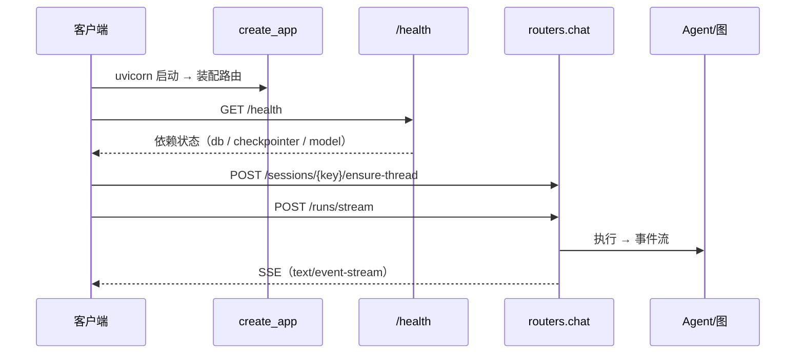

# 第 1 章　Gateway 启动依赖与聊天 API

> **EvoFlow 对照状态 / Alignment status：** 🔍 结构已核对（路径、行数、符号均取自源码实测），**行为**（调用顺序、边界条件）尚未逐行核对。

## 本章目标
让服务「该起来时才起来」，并把会话/消息/流的 API 边界定清楚。

## 最小闭环
`/health` 返回依赖状态 → `POST /sessions/{key}/ensure-thread` 建线程 → `POST /runs/stream` 出流。

## 调用逻辑 / Invocation logic



- **入口**：`create_app()` 只负责装配依赖与路由，不在启动时连接模型（起不来会拖死整个网关）。
- **关键节点**：`/health` 逐个探依赖并返回结构化状态，便于部署时判断「哪一层没起来」；`ensure-thread` 幂等建线程。
- **出口**：`/runs/stream` 用生成器 `gen()` 逐条 yield SSE，客户端断开即停止。
- **最容易断的地方**：在 import 期初始化数据库/模型（测试无法离线跑）；SSE 忘了带 `Cache-Control: no-cache`。

## 真实模块地图（已核对：路径 · 行数 · 符号）

| 文件 | 行数 | 关键符号 | 模块常量 |
|---|---|---|---|
| `app/gateway/app.py` | 543 | `lifespan`、`create_app`、`__getattr__` | — |
| `app/gateway/gateway_shell.py` | 60 | `_desktop_stdio_mode`、`install_pre_start_middleware`、`load_webui_settings_deferred` | — |
| `app/gateway/router_registry.py` | 277 | `_include_module_router`、`register_core_routers`、`register_extended_routers` | — |
| `app/gateway/startup_gate.py` | 165 | `StartupGateMiddleware`；`_path`、`_is_exempt`、`_needs_core_routers` | — |
| `app/gateway/background_startup.py` | 1341 | `init_startup_state`、`is_startup_ready`、`resolve_local_embedding_warmup_target` | — |
| `app/gateway/cold_start_prewarm.py` | 167 | `mark_core_routers_ready`、`wait_core_routers_ready`、`core_routers_ready` | — |
| `app/gateway/health_routes.py` | 150 | `register_health_routes` | — |
| `app/gateway/routers/chat_sessions.py` | 2063 | `ForkSessionBody`、`TruncateSessionBody`；`_transcript_db_busy_http`、`_request_principal_id`、`_require_session_access` | — |
| `packages/harness/evoflow/admin/sessions.py:15` | 355 | `_cutoff_iso`、`_get_db`、`_search_messages` | — |
| `packages/harness/evoflow/assets/memory_runs.py:13` | 52 | `record_asset_phase_run` | — |
| `packages/harness/evoflow/webui/middleware.py:64` | 190 | `_is_public_share_get`、`_is_public_path`、`_extract_token` | — |
| `packages/harness/evoflow/mcp/oauth.py:17` | 217 | `_OAuthToken`、`OAuthTokenManager`；`build_oauth_tool_interceptor`、`get_initial_oauth_headers` | — |
| `packages/harness/evoflow/code_index/deps.py:29` | 395 | `_is_internal_spec`、`_discover_package_roots`、`_resolve_py_module` | — |
| `app/gateway/db_async.py` | 25 | `run_db` | — |
| `app/gateway/runtime_adapters.py` | 346 | `register_runtime_adapters` | — |
| `app/gateway/lazy_langgraph.py` | 324 | `ExternalLangGraphProxy`、`LazyLangGraphMount`；`mount_langgraph_in_process`、`ensure_langgraph_mounted`、`_read_request_body` | — |
| `tests/test_traffic_lanes.py` | 120 | `test_health_is_control`、`test_stream_is_stream`、`test_tasks_catalog_is_best_effort` | — |

## 核心概念
- **启动门（startup gate）**：DB/migration/插件 未就绪时拒绝流量而不是假装健康。
- **路由注册表**：所有 router 集中注册，便于审计「有哪些入口」。
- **两种运行模式**：in-process LangGraph 与 external LangGraph 代理（`lazy_langgraph.py`）。
- **长连接通道**：`/runs/stream` 属 stream lane，与普通请求分开治理（`test_traffic_lanes.py`）。

## 自研实现要点
```text
on_startup: migrate → warm caches → set state.ready=True
middleware: trace_id → auth → rate_limit → route
```

## 业务规则
- 健康检查区分 `liveness` 与 `readiness`。
- 未鉴权请求不进业务代码。
- 每个流都有最大时长与心跳。

## 常见坑
- 健康检查只返回 200，但 DB 挂了 → 假健康。
- 长连接与短请求同一连接池 → 互相拖死。
- 迁移在请求路径里跑 → 首次请求超时。

## 验收
- [ ] 依赖未就绪时 readiness=false
- [ ] 流有心跳与超时
- [ ] 路由清单可导出

### 源码核对记录（路径与符号实测）

- `app/gateway/app.py`（543 行）；环境变量 `EVOFLOW_ANYIO_THREAD_LIMIT`、`EVOFLOW_EMBED_APP_SERVER`、`EVOFLOW_FE_LOG`、`EVOFLOW_FE_LOG_ENABLE`
- `app/gateway/gateway_shell.py`（60 行）；环境变量 `EVOFLOW_APP_SERVER_STDIO`
  - 模块自述：Middleware that must be registered before uvicorn startup (not in deferred router pass).…
- `app/gateway/router_registry.py`（277 行）；环境变量 `EVOFLOW_V4_DEMO`、`EVOFLOW_V4_ROUTES`
  - 模块自述：Register Gateway API routers (lazy imports — run after liveness bind).…
- `app/gateway/startup_gate.py`（165 行）：类 `StartupGateMiddleware`
  - 模块自述：Return structured 503 while Gateway routes / LangGraph are still starting.…
- `app/gateway/background_startup.py`（1341 行）；环境变量 `EVOFLOW_APP_SERVER_STDIO`、`EVOFLOW_EMBEDDING_WARMUP_DELAY_SEC`、`EVOFLOW_HOME`、`EVOFLOW_LEAD_AGENT_WARM`
  - 模块自述：Gateway background startup — runs after early lifespan yield.…
- `app/gateway/cold_start_prewarm.py`（167 行）；环境变量 `EVOFLOW_SKIP_GATEWAY_PREWARM`
  - 模块自述：Cold-start prewarm — run BEFORE the asyncio event loop accepts HTTP. CPython: fat imports + ``ensure_app_schem…
- `app/gateway/health_routes.py`（150 行）
  - 模块自述：Health probes — registered first so liveness is available before heavy API routers.…
- `app/gateway/routers/chat_sessions.py`（2063 行）：类 `ForkSessionBody`、`TruncateSessionBody`；环境变量 `EVOFLOW_SESSIONS_LIST_SHED_LIMIT`、`EVOFLOW_SESSIONS_LIST_TIMEOUT_S`
  - 模块自述：Chat session index + application-owned transcript (not LangGraph checkpoint).…
- `packages/harness/evoflow/admin/sessions.py`（355 行）
  - 模块自述：Past chat session search (evoflow.db) — replaces built-in ``session_search`` tool.…
- `packages/harness/evoflow/assets/memory_runs.py`（52 行）
  - 模块自述：Thin helpers: record Asset Hub Phase1/Phase2 runs into the DB log.…
- `packages/harness/evoflow/webui/middleware.py`（190 行）
  - 模块自述：JWT authentication middleware for WebUI remote access. When WebUI is enabled, this middleware gates remote req…
- `packages/harness/evoflow/mcp/oauth.py`（217 行）：类 `_OAuthToken`、`OAuthTokenManager`
  - 模块自述：OAuth token support for MCP HTTP/SSE servers.…
- `packages/harness/evoflow/code_index/deps.py`（395 行）
  - 模块自述：File-level import dependency extraction (Python / JS / TS / Java).…
- `app/gateway/db_async.py`（25 行）；环境变量 `EVOFLOW_DB_THREAD_POOL_SIZE`
  - 模块自述：Offload sync SQLite repository work from the Gateway asyncio event loop. FastAPI handlers must not call ``get_…
- `app/gateway/runtime_adapters.py`（346 行）
  - 模块自述：Register application-layer adapters into the kernel runtime ports. This is the **only** sanctioned bridge from…
- `app/gateway/lazy_langgraph.py`（324 行）：类 `ExternalLangGraphProxy`、`LazyLangGraphMount`；环境变量 `EVOFLOW_FORCE_BG_JOB_ISOLATED_LOOPS`
  - 模块自述：Deferred LangGraph in-process mount — keeps ``create_app()`` import-light.…
- `tests/test_traffic_lanes.py`（120 行）
  - 模块自述：Gateway traffic lane classifier — unknown APIs must not default to Control.…

> 本节只证明**路径、行数、符号存在**；调用顺序与边界条件仍属「行为」，未逐行核对。

## 对照 EvoFlow 核对清单
- [ ] `startup_gate.py` 的就绪判定
- [ ] `test_traffic_lanes.py` 的 lane 划分

## 从零实现（手把手）
> 读完这章你能起一个真正的 HTTP 网关：一个聊天接口，返回 SSE 流。
> 路径均相对 `backend/`，代码注释写「为什么」。

### Step 1　新建 main.py：装配路由与健康检查
**文件**：`app/gateway/main.py（新建，路径相对 `backend/`）`
**要写的逻辑**：`create_app()` 只做装配；健康检查要能反映「检查点能否打开」，否则重启后挂的是别的东西。

**代码**

```python
"""网关入口：只做装配，不写业务。

为什么健康检查要碰一下 checkpointer：
进程活着但数据库打不开是最常见的「假健康」，
只看 200 会让负载均衡一直往这台机器派活。
"""
from __future__ import annotations

from fastapi import FastAPI


def create_app() -> FastAPI:
    from app.gateway.routers.chat import router as chat_router

    app = FastAPI(title="my-agent-flow")
    app.include_router(chat_router, prefix="/api")

    @app.get("/health")
    def health() -> dict[str, str]:
        from myagentflow.agents.checkpointer.provider import get_checkpointer

        try:
            get_checkpointer()
            db = "ok"
        except Exception as exc:          # 数据库打不开：不是健康
            db = f"error: {exc}"
        return {"status": "ok" if db == "ok" else "degraded", "checkpointer": db}

    return app


app = create_app()
```

**验证**

```bash
uv run uvicorn app.gateway.main:app --port 8070
# 另开终端：curl -s localhost:8070/health
# 期望：{"status":"ok","checkpointer":"ok"}
```

### Step 2　新建 chat.py：SSE 流式接口
**文件**：`app/gateway/routers/chat.py（新建）`
**要写的逻辑**：`POST /api/chat` 收 `{thread_id, text}`；用 `StreamingResponse` 吐 SSE；`event_stream` 里必须处理客户端断开。

**代码**

```python
"""聊天接口：一个 POST，一条 SSE 流。"""
from __future__ import annotations

from fastapi import APIRouter
from fastapi.responses import StreamingResponse
from pydantic import BaseModel

router = APIRouter()


class ChatIn(BaseModel):
    thread_id: str = "default"
    text: str


@router.post("/chat")
async def chat(body: ChatIn) -> StreamingResponse:
    from langchain_core.messages import HumanMessage

    from myagentflow.agents.lead_agent.graph import build_graph
    from myagentflow.config.settings import load_config
    from myagentflow.models.factory import build_chat_model
    from myagentflow.runtime.streaming import stream_graph

    graph = build_graph(build_chat_model(load_config().model))

    async def gen():
        # 断线时 StreamingResponse 会取消这个生成器，资源随 with 清理
        async for chunk in stream_graph(
            graph,
            {"messages": [HumanMessage(content=body.text)]},
            {"configurable": {"thread_id": body.thread_id}},
        ):
            yield chunk

    return StreamingResponse(gen(), media_type="text/event-stream")
```

**验证**

```bash
curl -N -X POST localhost:8070/api/chat \
  -H 'content-type: application/json' \
  -d '{"thread_id":"t1","text":"你好"}'
# 期望：event: token / event: done 交替输出
```

### 与 EvoFlow 对照

| 我们的做法 | EvoFlow | 为什么 |
|---|---|---|
| 健康检查碰 checkpointer | `app/gateway/` 的健康检查 | 「进程活着但库打不开」是最常见假健康 |
| 聊天返回 SSE | Gateway 的流式接口 | 一次性 JSON 会让用户等整轮跑完 |

### 知识点

- [agent-book](https://g0-000.github.io/agent-book/)：网关与流式
- Harbor404：SSE 断线与重连

### 验收

```bash
curl -s localhost:8070/health
```
