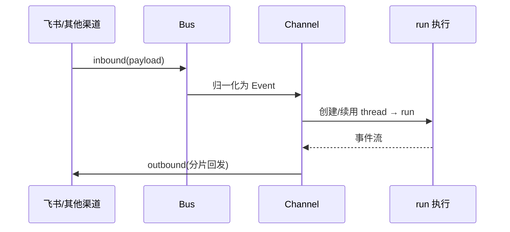

# 第 3 章　渠道适配器、消息总线与渠道状态

> **EvoFlow 对照状态 / Alignment status：** 🔍 结构已核对（路径、行数、符号均取自源码实测），**行为**（调用顺序、边界条件）尚未逐行核对。

## 本章目标
新增一个 IM 渠道只需实现「收/发」两个接口，其余全部复用。

## 最小闭环
飞书收到 @ 消息 → 归一化为内部事件 → 创建 run → 结果分片回发到飞书。

## 调用逻辑 / Invocation logic



- **入口**：真实方法是 `app/channels/message_bus.py:151` `publish_inbound(msg: InboundMessage)`，队列由 `:175` 的 `inbound_queue` property 暴露；**没有 `Bus.inbound()` / `Bus.outbound()` 这两个方法名**（原文写的是想象出的 API）。
- **关键节点**：`Event` 至少带 `channel/user/thread/text/msg_id`；`msg_id` 用于幂等，重复回调不重复执行。
- **出口**：`message_bus.py:341` `publish_outbound(msg: OutboundMessage)`；分片/限流由渠道实现自己处理，总线只投递。
- **最容易断的地方**：渠道回调重试导致重复回复；长回答一次性发被渠道截断。

## 真实模块地图（已核对：路径 · 行数 · 符号）

| 文件 | 行数 | 关键符号 | 模块常量 |
|---|---|---|---|
| `app/channels/base.py` | 240 | `Channel`；`_diag_log_path`、`_diag_write` | — |
| `packages/harness/evoflow/uploads/manager.py:17` | 203 | `PathTraversalError`；`validate_thread_id`、`get_uploads_dir`、`ensure_uploads_dir` | — |
| `packages/harness/evoflow/plans/service.py:22` | 191 | `_reload_chat_models`、`list_catalog`、`list_bindings` | — |
| `app/channels/message_bus.py` | 474 | `InboundMessageType`、`InboundMessage`、`ResolvedAttachment` | — |
| `app/channels/channel_io_log.py` | 75 | `_now_iso`、`_format_text_block`、`log_channel_inbound` | — |
| `app/channels/feishu.py` | 4130 | `_FeishuInboundDeduper`、`FeishuChannel`；`_import_lark_sdk`、`_feishu_sender_is_bot`、`_feishu_mention_open_ids` | — |
| `app/channels/feishu_inbound_parse.py` | 332 | `FeishuMediaRef`、`ParsedFeishuInbound`；`parse_feishu_message`、`_coerce_content_dict`、`_looks_like_post` | — |
| `app/channels/feishu_inbound_coalesce.py` | 311 | `FeishuInboundCoalescer` | — |
| `app/channels/feishu_inbound_media.py` | 271 | `FeishuInboundMediaCache`；`_default_filename`、`_guess_mime`、`_detect_image_ext` | — |
| `app/channels/feishu_stream_bridge.py` | 342 | `SubtaskStreamState`、`FeishuStreamBridge`；`get_feishu_stream_bridge`、`init_feishu_stream_bridge` | — |
| `app/channels/sse_feishu_bridge.py` | 713 | `SSEEventType`、`SSEEvent`、`CardTemplate`；`stream_to_feishu_card` | — |
| `app/channels/wecom.py` | 1776 | `_MessageDeduplicator`、`WecomChannel`；`_coerce_list`、`_normalize_entry`、`_entry_matches` | DEFAULT_WS_URL、APP_CMD_SUBSCRIBE、APP_CMD_CALLBACK |
| `app/channels/dingtalk.py` | 461 | `_MessageDeduplicator`、`DingtalkChannel`；`_coerce_set`、`_truthy` | MAX_MESSAGE_LENGTH、RECONNECT_BACKOFF |
| `app/channels/weixin.py` | 1252 | `_MessageDeduplicator`、`_ContextTokenStore`、`_TypingTicketCache`；`_safe_id`、`_json_dumps`、`_random_wechat_uin` | ILINK_BASE_URL、WEIXIN_CDN_BASE_URL、ILINK_APP_ID |
| `app/channels/telegram.py` | 330 | `TelegramChannel` | — |
| `app/channels/slack.py` | 247 | `SlackChannel` | — |
| `app/channels/message_bus.py` | 474 | `InboundMessageType`、`InboundMessage`、`ResolvedAttachment` | — |

## 核心概念
- **入站归一**：不同 IM 的消息结构差异极大 → 先归一成 `InboundMessage`。
- **合并（coalesce）**：用户连发多条要合并成一轮，否则 Agent 回 N 次。
- **分片回发**：IM 有长度限制 → 按语义切分 + 顺序保证。
- **渠道状态**：连接、限流、被踢下线都要能让用户看到。

## 自研实现要点
```text
InboundMessage{channel, chat_id, user_id, text, attachments[], reply_to}
OutboundChunk{channel, chat_id, seq, text, is_final}
adapter: receive() / send(chunk) / status()
```

## 业务规则
- 群聊只在被 @ 或命中规则时响应。
- 回发内容过滤内部路径与密钥。
- 渠道断线自动重连并指数退避。

## 常见坑
- 逐条消息都触发一轮 → 刷屏 + 烧钱。
- 长回复不分片 → 400 或被截断。
- 重复投递（webhook 重发）未去重。

## 验收
- [ ] 连发 3 条合并为 1 轮
- [ ] 长回复完整送达
- [ ] webhook 重试不重复执行

### 源码核对记录（路径与符号实测）

- `app/channels/base.py`（240 行）：类 `Channel`；环境变量 `EVOFLOW_CHANNEL_DIAG_LOG`、`EVOFLOW_DIAG_LOG`
  - 模块自述：Abstract base class for IM channels.…
- `packages/harness/evoflow/uploads/manager.py`（203 行）：类 `PathTraversalError`
  - 模块自述：Shared upload management logic. Pure business logic — no FastAPI/HTTP dependencies. Both Gateway and Client de…
- `packages/harness/evoflow/plans/service.py`（191 行）
  - 模块自述：Plan Bundle public service API.…
- `app/channels/message_bus.py`（474 行）：类 `InboundMessageType`、`InboundMessage`、`ResolvedAttachment`、`OutboundMessage`
  - 模块自述：MessageBus — async pub/sub hub that decouples channels from the agent dispatcher.…
- `app/channels/channel_io_log.py`（75 行）
  - 模块自述：Complete IM channel message I/O logging (user inbound / assistant outbound).…
- `app/channels/feishu.py`（4130 行）：类 `_FeishuInboundDeduper`、`FeishuChannel`；环境变量 `EVOFLOW_FEISHU_LIVE_STREAM`、`EVOFLOW_GATEWAY_URL`、`EVOFLOW_PANEL_URL`、`EVOFLOW_WEBUI_PUBLIC_URL`
  - 模块自述：Feishu/Lark channel — connects to Feishu via WebSocket (no public IP needed). ⚠️ COMPLIANCE NOTICE This integr…
- `app/channels/feishu_inbound_parse.py`（332 行）：类 `FeishuMediaRef`、`ParsedFeishuInbound`
  - 模块自述：Parse Feishu ``im.message.receive_v1`` payloads into text + media refs. Feishu sends **one ``message_type`` pe…
- `app/channels/feishu_inbound_coalesce.py`（311 行）：类 `FeishuInboundCoalescer`
  - 模块自述：Short-window coalesce for Feishu inbound chat + media events. Feishu delivers image/file and follow-up text as…
- `app/channels/feishu_inbound_media.py`（271 行）：类 `FeishuInboundMediaCache`
  - 模块自述：Download Feishu inbound media into durable user-home files for the agent. Files land under:: {EVOFLOW_HOME}/ch…
- `app/channels/feishu_stream_bridge.py`（342 行）：类 `SubtaskStreamState`、`FeishuStreamBridge`
  - 模块自述：Feishu Stream Bridge — 子任务流式输出桥接器 将子任务（subagent/task_tool）的 stream_writer 输出桥接到飞书MessageBus， 实现子任务执行过程的实时流式推送到…
- `app/channels/sse_feishu_bridge.py`（713 行）：类 `SSEEventType`、`SSEEvent`、`CardTemplate`、`FeishuCardAPI`
  - 模块自述：SSE to Feishu Card Bridge — 流式响应桥接器 将 AI 的 SSE 流式输出转换为飞书消息卡片的实时更新。 支持 Markdown 渲染、代码块高亮、节流控制和智能分段。 典型使用场景: 1. …
- `app/channels/wecom.py`（1776 行）：类 `_MessageDeduplicator`、`WecomChannel`；环境变量 `EVOFLOW_CHANNEL_DIAG_LOG`、`EVOFLOW_LOG_DIR`、`EVOFLOW_WECOM_DIAG_LOG`
  - 模块自述：WeCom (Enterprise WeChat) channel for EvoFlow. Connects to WeCom via the **AI Bot WebSocket gateway** (出站长连接，无…
- `app/channels/dingtalk.py`（461 行）：类 `_MessageDeduplicator`、`DingtalkChannel`
  - 模块自述：DingTalk (钉钉) channel for EvoFlow. Connects to DingTalk via **Stream Mode** (official ``dingtalk-stream`` SDK)…
- `app/channels/weixin.py`（1252 行）：类 `_MessageDeduplicator`、`_ContextTokenStore`、`_TypingTicketCache`、`WeixinChannel`；环境变量 `EVOFLOW_HOME`
  - 模块自述：Weixin **个人微信** channel — iLink HTTP 长轮询（与 Hermes ``gateway/platforms/weixin.py`` 一致）。 企微 **AI Bot**（WebSocket…
- `app/channels/telegram.py`（330 行）：类 `TelegramChannel`
  - 模块自述：Telegram channel — connects via long-polling (no public IP needed).…
- `app/channels/slack.py`（247 行）：类 `SlackChannel`
  - 模块自述：Slack channel — connects via Socket Mode (no public IP needed).…
- `app/channels/message_bus.py`（474 行）：类 `InboundMessageType`、`InboundMessage`、`ResolvedAttachment`、`OutboundMessage`
  - 模块自述：MessageBus — async pub/sub hub that decouples channels from the agent dispatcher.…

> 本节只证明**路径、行数、符号存在**；调用顺序与边界条件仍属「行为」，未逐行核对。

## 对照 EvoFlow 核对清单
- [ ] `message_bus.py` 的投递语义
- [ ] `feishu_inbound_coalesce.py` 的合并窗口

## 从零实现（手把手）
> 读完这章你能加一个新渠道（比如飞书/Telegram），只需实现「收消息、发消息」两个方法。
> 路径均相对 `backend/`，代码注释写「为什么」。

### Step 1　新建 base.py：渠道协议 + 总线
**文件**：`app/channels/base.py（新建）`
**要写的逻辑**：`Channel` 抽象两个方法；`Bus` 负责把入站消息转成统一事件，出站按 `channel` 路由回去；未知渠道直接报错。

**代码**

```python
"""渠道抽象：任何 IM 都只需实现 recv/send。

为什么用统一事件：同一个 Agent 要能同时服务 Web、IM、CLI，
每加一个渠道就改一遍 Agent 是灾难。
"""
from __future__ import annotations

from abc import ABC, abstractmethod
from dataclasses import dataclass, field
from typing import Any


@dataclass
class Event:
    channel: str
    thread_id: str
    text: str
    raw: dict[str, Any] = field(default_factory=dict)


class Channel(ABC):
    name: str = "channel"

    @abstractmethod
    def send(self, thread_id: str, text: str) -> None: ...


class Bus:
    def __init__(self) -> None:
        self._channels: dict[str, Channel] = {}

    def register(self, channel: Channel) -> None:
        self._channels[channel.name] = channel

    def inbound(self, channel: str, thread_id: str, text: str, raw: dict | None = None) -> Event:
        if channel not in self._channels:
            raise KeyError(f"未知渠道：{channel}")
        return Event(channel=channel, thread_id=f"{channel}:{thread_id}", text=text, raw=raw or {})

    def outbound(self, event: Event, text: str) -> None:
        self._channels[event.channel].send(event.thread_id, text)
```

**验证**

```bash
uv run python -c "
from app.channels.base import Bus, Channel
class Echo(Channel):
    name = 'echo'
    def send(self, thread_id, text): print('->', thread_id, text)
b = Bus(); b.register(Echo())
e = b.inbound('echo','u1','hi'); b.outbound(e, 'hello')
"
```

### 与 EvoFlow 对照

| 我们的做法 | EvoFlow | 为什么 |
|---|---|---|
| 渠道只需 recv/send | `app/channels/` 的适配器 | 每加渠道改 Agent 会失控 |
| thread_id 加渠道前缀 | 同文件 inbound | 不同渠道的同名用户不能串会话 |

### 知识点

- [大模型网关详解：转发、重试与降级](https://harbor404.fushenlin.com/notes/llm-gateway-comprehensive-guide/)

### 验收

```bash
uv run python -c "from app.channels.base import Bus; print('ok')"
```
