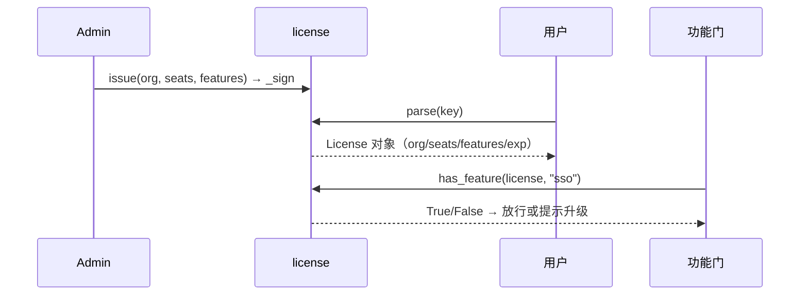

# 第 3 章　组织分发、License、Admin 与审批

> **EvoFlow 对照状态 / Alignment status：** 🔍 结构已核对（路径、行数、符号均取自源码实测），**行为**（调用顺序、边界条件）尚未逐行核对。

## 本章目标
让「谁能安装什么、能用多少、谁批准」在组织内可管理。

## 最小闭环
管理员创建组织 → 分配席位 → 用户激活 License → 使用受限功能 → 审批流记录。

## 调用逻辑 / Invocation logic



- **入口**：`issue()` 由管理员签发，`_sign()` 做签名，客户端拿到的是不可篡改的 key。
- **关键节点**：`parse()` 验签 + 校验过期与席位；`has_feature()` 只判功能位，不判具体用量。
- **出口**：功能门返回布尔 + 原因，UI 据此展示「需要升级」。
- **最容易断的地方**：只在前端隐藏按钮、后端不校验；席位统计用客户端上报。

## 真实模块地图（已核对：路径 · 行数 · 符号）

| 文件 | 行数 | 关键符号 | 模块常量 |
|---|---|---|---|
| `app/gateway/routers/organizations.py` | 293 | `SourceSpec`、`InstallOptions`、`PreflightRequest`；`_source_dict`、`_options_dict`、`api_preflight` | — |
| `packages/harness/evoflow/license/gate.py` | 26 | `require_premium` | — |
| `packages/harness/evoflow/license/entitlements.py` | 175 | `LicenseStatus`；`_parse_expires_at`、`get_license_status`、`is_premium_active` | ENFORCE_LICENSE_VERIFY |
| `packages/harness/evoflow/license/machine.py` | 64 | `normalize_machine_id`、`_fingerprint_bytes`、`_windows_machine_guid` | — |
| `packages/harness/evoflow/license/issued_store.py` | 215 | `_row_to_dict`、`_effective_status`、`_enrich` | STATUS_ACTIVE、STATUS_REVOKED、STATUS_EXPIRED |
| `app/gateway/routers/license.py` | 212 | `ActivateBody`、`LicenseStatusResponse`、`IssueCodeBody`；`_parse_expires`、`_require_can_issue`、`license_status` | — |
| `packages/harness/evoflow/authz/admin_grants.py` | 115 | `is_org_admin`、`list_org_admins`、`promote_org_admin` | — |
| `app/gateway/routers/audit.py` | 47 | `list_audit_actions_endpoint` | — |
| `packages/harness/evoflow/persistence/audit_log.py` | 167 | `_ensure_table`、`record_action`、`list_actions` | — |
| `packages/harness/evoflow/license/codec.py` | 329 | `LicenseCodecError`；`_b64url_decode`、`_normalize_payload_mid`、`_mid_to_bytes` | CODE_PREFIX、LEGACY_PREFIX、PAYLOAD_VERSION |

## 核心概念
- **entitlement（权益）** 与 **seat（席位）** 分离：功能开关 ≠ 人数限制。
- **机器绑定**：License 常与机器指纹绑定，需处理换机与离线。
- **审批（approval）** 是治理动作：谁在什么条件下批准了例外。
- **降级路径**：License 失效后应降级而非直接不可用（视策略）。

## 自研实现要点
```text
org(id, name, seats); member(org_id, principal, role)
entitlement(feature, limit, valid_until)
license(codec, machine_fp, issued_at, revoked)
```

## 业务规则
- 席位超限时明确提示，不静默拒绝。
- License 校验失败要在 UI 可解释。
- 审批记录不可被普通用户删除。

## 常见坑
- 只在前端判断权益 → 后端可绕过。
- 机器指纹随硬件变化频繁 → 频繁失效。
- 审批流无超时 → 请求永远挂起。

## 验收
- [ ] 超席位使用被拦
- [ ] License 失效可解释
- [ ] 审批记录完整

### 源码核对记录（路径与符号实测）

- `app/gateway/routers/organizations.py`（293 行）：类 `SourceSpec`、`InstallOptions`、`PreflightRequest`、`InstallRequest`
  - 模块自述：Organization Pack / 资源包 Gateway API — Phase 1.…
- `packages/harness/evoflow/license/gate.py`（26 行）
  - 模块自述：FastAPI dependency helpers for premium entitlement.…
- `packages/harness/evoflow/license/entitlements.py`（175 行）：类 `LicenseStatus`
  - 模块自述：Entitlement checks for premium features (tasks / apps / proactive).…
- `packages/harness/evoflow/license/machine.py`（64 行）
  - 模块自述：Stable short machine id for license binding.…
- `packages/harness/evoflow/license/issued_store.py`（215 行）
  - 模块自述：Persist issued activation codes for ops ledger UI / CLI.…
- `app/gateway/routers/license.py`（212 行）：类 `ActivateBody`、`LicenseStatusResponse`、`IssueCodeBody`
  - 模块自述：Product license activation + issued-code ledger API.…
- `packages/harness/evoflow/authz/admin_grants.py`（115 行）
  - 模块自述：Org admin grants (separate from resource ACL).…
- `app/gateway/routers/audit.py`（47 行）
  - 模块自述：Operation audit log — admin read API (append-only store, see audit_log.py).…
- `packages/harness/evoflow/persistence/audit_log.py`（167 行）
  - 模块自述：Append-only operation audit log (enterprise governance). 记录「谁在什么时候对什么资源做了什么」——发布/改定义/删除/运行/密钥等管理动作。 设计约束： - **…
- `packages/harness/evoflow/license/codec.py`（329 行）：类 `LicenseCodecError`
  - 模块自述：Short local activation codes (EF3) + legacy EF2 verify. EF3 format (issued):: EF3-XXXXX-XXXXX-XXXXX-XXXXX-XXXX…

> 本节只证明**路径、行数、符号存在**；调用顺序与边界条件仍属「行为」，未逐行核对。

## 对照 EvoFlow 核对清单
- [ ] `license/codec.py` 的签名/编码方式
- [ ] `entitlements.py` 的功能清单

## 从零实现（手把手）
> 读完这章你能做一份「离线许可」：内容 + 签名，校验不过就不开功能。
> 路径均相对 `backend/`，代码注释写「为什么」。

### Step 1　新建 license.py：签发 + 验签 + 功能位
**文件**：`packages/harness/myagentflow/authz/license.py（新建）`
**要写的逻辑**：payload 里放 `features` 与 `expires`；验签用 HMAC；`has_feature()` 同时查有效期，过期一律 False。

**代码**

```python
"""离线许可：签名内容 + 功能位。

为什么许可要签名：许可文件会被用户改，
不签名的 JSON 等于把「企业版」写在明文里等别人改。
"""
from __future__ import annotations

import base64
import hashlib
import hmac
import json
import time


def _sign(payload: str, key: str) -> str:
    return base64.urlsafe_b64encode(
        hmac.new(key.encode(), payload.encode(), hashlib.sha256).digest()
    ).decode().rstrip("=")


def issue(features: list[str], days: int, key: str) -> str:
    payload = base64.urlsafe_b64encode(
        json.dumps({"features": features, "expires": time.time() + days * 86400}).encode()
    ).decode().rstrip("=")
    return f"{payload}.{_sign(payload, key)}"


def parse(lic: str, key: str, now: float | None = None) -> dict:
    try:
        payload, sig = lic.split(".")
    except ValueError as exc:
        raise ValueError("许可格式不合法") from exc
    if not hmac.compare_digest(_sign(payload, key), sig):
        raise ValueError("许可签名不匹配")
    data = json.loads(base64.urlsafe_b64decode(payload + "=" * (-len(payload) % 4)))
    if (now or time.time()) > data["expires"]:
        raise ValueError("许可已过期")
    return data


def has_feature(lic: str, key: str, feature: str, now: float | None = None) -> bool:
    try:
        return feature in parse(lic, key, now).get("features", [])
    except ValueError:
        return False          # 许可不可信：一律当没有
```

**验证**

```bash
uv run python -c "
from myagentflow.authz.license import issue, has_feature
lic = issue(['sso','audit'], 30, 'k')
print(has_feature(lic,'k','sso'), has_feature(lic,'k','tauri'))
"
```

### 与 EvoFlow 对照

| 我们的做法 | EvoFlow | 为什么 |
|---|---|---|
| 许可=签名 JSON | `authz/` 的许可校验 | 明文许可一改就变企业版 |
| 过期即全部关闭 | 同文件 has_feature | 过期后只关部分功能会让语义混乱 |

### 知识点

- [大模型网关：配额、分发与开关](https://harbor404.fushenlin.com/notes/llm-gateway-comprehensive-guide/)

### 验收

```bash
uv run python -c "from myagentflow.authz.license import issue; print(issue(['a'],1,'k'))"
```
