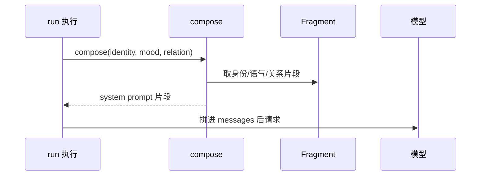

# 第 6 章　人格内核：身份、情绪、记忆与成长

> **EvoFlow 对照状态 / Alignment status：** 🔍 结构已核对（路径、行数、符号均取自源码实测），**行为**（调用顺序、边界条件）尚未逐行核对。

## 本章目标
让 Agent 有**一致的自我**：稳定的说话方式、情绪基线、对关系的记忆，而不是每次换个人。

## 最小闭环
同一用户多次对话 → 称呼与语气一致 → 情绪状态可影响表达强度 → 关键关系事实被记住。

## 调用逻辑 / Invocation logic



- **入口**：`compose()` 把身份、情绪、关系三类 `Fragment` 合成一段 system 文本，顺序固定。
- **关键节点**：片段之间冲突时后者覆盖前者，且总长要有限制（人格不能吃掉上下文预算）。
- **出口**：输出纯文本片段，不写死具体措辞模板。
- **最容易断的地方**：人格写死成一大段 prompt 导致每次请求都超预算；情绪状态影响事实判断。

## 真实模块地图（已核对：路径 · 行数 · 符号）

| 文件 | 行数 | 关键符号 | 模块常量 |
|---|---|---|---|
| `packages/harness/evoflow/person_kernel.py:54` | 2033 | `extract_identity_block`、`extract_lessons_section`、`omit_identity_section` | — |
| `packages/harness/evoflow/person_affect.py:70` | 351 | `clamp01`、`default_hormones`、`legacy_from_hormones` | HORMONE_AXES、LEGACY_AXES、HORMONE_DEFAULTS |
| `packages/harness/evoflow/person_wrap_up_reflect.py:67` | 720 | `build_person_wrap_up_user_prompt`、`_extract_json_object`、`parse_wrap_up_llm_result` | PERSON_WRAP_UP_SYSTEM |
| `packages/harness/evoflow/person_kernel.py:54` | 2033 | `extract_identity_block`、`extract_lessons_section`、`omit_identity_section` | — |

## 核心概念
- **人格是约束不是表演**：稳定的价值观与表达边界，比「人设形容词」更可靠。
- **情绪是状态变量**：`valence/arousal` 之类的低维状态，影响措辞与主动性，但**不得影响事实判断**。
- **成长**：把反思与记忆沉淀为长期偏好，但要可回滚。
- **一致性检查**：跨轮次称呼、立场不得自相矛盾。

## 自研实现要点
```text
persona(id, traits_json, boundaries[], voice_style)
affect(principal, valence, arousal, updated_at)  -- 缓慢衰减
reflect(run_id) → {what_worked, what_failed, preference_delta}
```

## 业务规则
- 人格不得用于操纵用户情绪或施压。
- 情绪状态不写入事实记忆。
- 用户明确要求「别这样说话」时立即调整并记住。

## 常见坑
- 人格写成一长串形容词 → 换模型就漂移。
- 情绪影响结论 → 不可接受。
- 反思无回滚 → 越改越偏。

## 验收
- [ ] 跨 5 轮语气一致
- [ ] 情绪不改变事实结论
- [ ] 偏好变更可回滚

### 源码核对记录（路径与符号实测）

- `packages/harness/evoflow/person_kernel.py`（2033 行）；环境变量 `EVOFLOW_CRAFT_AUTO_SKILL`
  - 模块自述：Person Kernel helpers: identity / memory / metabolism / relations / craft (Phases A–E). Design SSOT: ``interna…
- `packages/harness/evoflow/person_affect.py`（351 行）
  - 模块自述：Unified affect substrate for all agents (xiaomi + employees). Hormone axes (0–1) are the source of truth; lega…
- `packages/harness/evoflow/person_wrap_up_reflect.py`（720 行）
  - 模块自述：LLM duty wrap-up reflection — distill shift evidence into person state. Prompt lineage (adapted, not copied wh…
- `packages/harness/evoflow/person_kernel.py`（2033 行）；环境变量 `EVOFLOW_CRAFT_AUTO_SKILL`
  - 模块自述：Person Kernel helpers: identity / memory / metabolism / relations / craft (Phases A–E). Design SSOT: ``interna…

> 本节只证明**路径、行数、符号存在**；调用顺序与边界条件仍属「行为」，未逐行核对。

## 对照 EvoFlow 核对清单
- [ ] `person_kernel.py` 的状态字段
- [ ] `person_wrap_up_reflect.py` 的产出形态

## 从零实现（手把手）
> 读完这章你能把「人格」做成可组合的提示片段，并保证总长度不超预算。
> 路径均相对 `backend/`，代码注释写「为什么」。

### Step 1　新建 persona.py：片段拼装 + 截断
**文件**：`packages/harness/myagentflow/agents/persona.py（新建）`
**要写的逻辑**：人格由多个片段组成（身份、语气、禁令）；拼装时按优先级保序，超预算从低优先级裁。

**代码**

```python
"""人格：可组合片段 + 预算内保序拼装。

为什么分片段：人格要能按场景覆盖（比如客服场景换语气），
一整段提示词没法局部替换。
"""
from __future__ import annotations

from dataclasses import dataclass


@dataclass(frozen=True)
class Fragment:
    name: str
    text: str
    priority: int = 10        # 数字越大越先保留


def compose(fragments: list[Fragment], max_chars: int = 2000) -> str:
    ordered = sorted(fragments, key=lambda f: -f.priority)
    kept, used = [], 0
    for f in ordered:
        if used + len(f.text) > max_chars:
            continue           # 低优先级的直接丢，不做半句截断
        kept.append(f.text)
        used += len(f.text)
    return "\n\n".join(kept)
```

**验证**

```bash
uv run python -c "
from myagentflow.agents.persona import Fragment, compose
fs = [Fragment('身份','你是严谨的工程助手',30), Fragment('语气','回复简短',20), Fragment('长禁令','x'*3000,1)]
print(compose(fs, 200))
"
```

### 与 EvoFlow 对照

| 我们的做法 | EvoFlow | 为什么 |
|---|---|---|
| 片段 + 优先级 | `agents/` 的人格装配 | 一整段提示词无法局部覆盖 |
| 超预算整段丢弃 | 同文件 compose | 半句截断会留下残句 |

### 知识点

- [提示词注入防御：系统提示词也要防覆盖](https://harbor404.fushenlin.com/notes/agent-prompt-injection-defense/)
- [Claude Code 记忆机制：人格与记忆的边界](https://harbor404.fushenlin.com/notes/10-claude-code/)

### 验收

```bash
uv run python -c "from myagentflow.agents.persona import compose; print('ok')"
```
