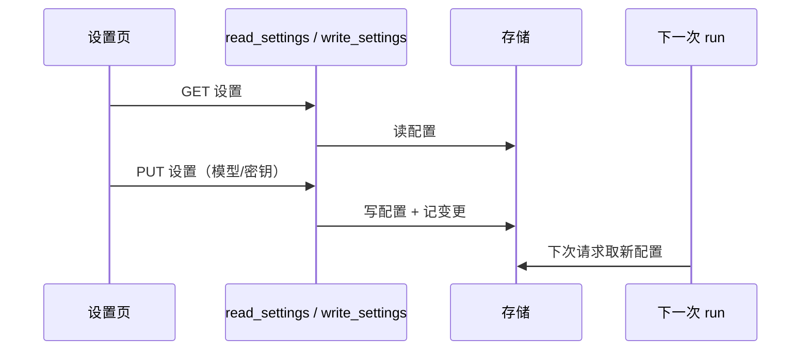

# 第 2 章　设置、Agent、知识、任务与管理页面

> **EvoFlow 对照状态 / Alignment status：** 🔍 结构已核对（路径、行数、符号均取自源码实测），**行为**（调用顺序、边界条件）尚未逐行核对。

## 本章目标
让「配置」变成可理解的产品界面，而不是让人改 YAML。

## 最小闭环
设置页改模型 → 保存 → 立即生效（下一次请求用新模型）→ 有变更记录。

## 调用逻辑 / Invocation logic



- **入口**：**没有 `read_settings()` / `write_settings()`**。EvoFlow 的设置读写是 `persistence/config_repositories.py:1113` `get_app_setting(key)` 与 `:1132` `set_app_setting(key, value)`，存储落在 `evoflow_app_settings` 键值表；另有 `persistence/runtime_settings.py:71` `overlay_runtime_settings_from_db()` 在启动时把库里的值覆盖到 YAML 配置上。**没有版本号字段**，并发覆盖靠 SQLite 事务而不是乐观锁。
- **关键节点**：密钥类字段写入时脱敏、读出时只回 `masked`；变更要记审计（谁改了什么）。
- **出口**：下一次 run 立即生效，不要求重启进程。
- **最容易断的地方**：配置缓存在模块级变量里不失效；把明文密钥回显到前端。

## 真实模块地图（已核对：路径 · 行数 · 符号）

| 文件 | 行数 | 关键符号 | 模块常量 |
|---|---|---|---|
| `app/gateway/routers/panel_settings.py` | 48 | `PanelSettingsResponse`、`PanelSettingsPatchBody`；`_principal_id`、`get_panel_ui_settings`、`patch_panel_ui_settings` | — |
| `app/gateway/routers/models.py` | 1156 | `ModelResponse`、`ModelsListResponse`、`SetPrimaryModelRequest`；`_to_model_response`、`list_models`、`get_primary_model` | — |
| `packages/harness/evoflow/models/factory.py:80` | 1245 | `_strip_provider_internal_keys`、`_is_local_noauth_endpoint`、`_normalize_reasoning_effort` | — |
| `app/gateway/routers/agents.py` | 1555 | `AgentResponse`、`AgentsListResponse`、`AgentCreateRequest`；`_normalize_agent_tools_for_api`、`_matches_agent_list_filters`、`_agent_runtime_available_for_ui` | AGENT_NAME_PATTERN |
| `packages/harness/evoflow/subagents/registry.py:17` | 223 | `_timeout_for_subagent`、`_resolve_subagent_system_prompt`、`_agent_config_to_subagent_config` | — |
| `app/gateway/routers/knowledge.py` | 418 | `CreateDatasetRequest`、`UpdateDatasetRequest`、`SyncLocalRequest`；`_org_admin_dep`、`list_knowledge_bases`、`create_knowledge_base` | — |
| `app/gateway/routers/knowledge_owned.py` | 840 | `ReindexBaseBody`；`list_bases`、`create_base`、`get_base` | — |
| `packages/harness/evoflow/admin/memory.py:19` | 62 | `_normalize_agent`、`list_memory_agents`、`get_memory` | — |
| `app/gateway/routers/sessions.py` | 159 | `SessionSearchRequest`、`SessionSearchResult`、`SessionSearchResponse`；`_filter_search_hits`、`search_sessions`、`search_sessions_get` | — |
| `app/gateway/routers/automation_scheduler.py` | 665 | `_coerce_app_parameters`、`_apply_workflow_binding`、`_stamp_app_name` | — |
| `packages/harness/evoflow/persistence/panel_settings.py:48` | 106 | `_panel_key`、`_deep_merge_defaults`、`get_panel_settings` | PANEL_SETTINGS_KEY、DEFAULT_PANEL_SETTINGS |
| `packages/harness/evoflow/models/factory.py:80` | 1245 | `_strip_provider_internal_keys`、`_is_local_noauth_endpoint`、`_normalize_reasoning_effort` | — |

## 核心概念
- **配置三层**：文件配置（启动项）→ 数据库配置（用户可改）→ 会话级覆盖（临时）。
- **生效半径**：改模型影响新 run，不影响正在跑的 run。
- **变更记录**：谁改了什么、什么时候，可回滚。
- **表单即 schema**：后端返回 schema，前端渲染，避免两边硬编码。

## 自研实现要点
```text
GET /settings/schema → {sections:[{key, type, default, help}]}
PUT /settings → 校验 → 落库 → 发布变更事件
```

## 业务规则
- 密钥字段永远不回显明文。
- 危险开关二次确认。
- 配置变更走审计。

## 常见坑
- 配置缓存不失效 → 改了不生效。
- 前端硬编码选项 → 后端新增值就崩。
- 密钥在 GET 响应里返回 → 泄露。

## 验收
- [ ] 改配置无需重启
- [ ] 密钥不明文回显
- [ ] 变更可回滚

### 源码核对记录（路径与符号实测）

- `app/gateway/routers/panel_settings.py`（48 行）：类 `PanelSettingsResponse`、`PanelSettingsPatchBody`
  - 模块自述：EvoPanel preferences stored in ``evoflow_app_settings`` (per principal).…
- `app/gateway/routers/models.py`（1156 行）：类 `ModelResponse`、`ModelsListResponse`、`SetPrimaryModelRequest`、`ModelInvokeMessage`
- `packages/harness/evoflow/models/factory.py`（1245 行）；环境变量 `EVOFLOW_STRESS_VENDOR_BASE_URL`、`EVOFLOW_VOLC_ASSUMED_OUTPUT_CAP`、`EVOFLOW_VOLC_COMPLETION_RESERVE_TOKENS`
- `app/gateway/routers/agents.py`（1555 行）：类 `AgentResponse`、`AgentsListResponse`、`AgentCreateRequest`、`SkillHubExpertInstallRequest`
  - 模块自述：CRUD API for custom agents.…
- `packages/harness/evoflow/subagents/registry.py`（223 行）
  - 模块自述：Subagent registry for managing available subagents.…
- `app/gateway/routers/knowledge.py`（418 行）：类 `CreateDatasetRequest`、`UpdateDatasetRequest`、`SyncLocalRequest`、`CreateFolderRequest`；环境变量 `EVOFLOW_HOME`、`EVOFLOW_KB_UPLOAD_DIR`
  - 模块自述：Knowledge base API router. Provides CRUD for knowledge bases, file upload, chunk listing, semantic search, and…
- `app/gateway/routers/knowledge_owned.py`（840 行）：类 `ReindexBaseBody`
  - 模块自述：Owned knowledge base Gateway API — local-first RAG (spec: owned-knowledge-base-spec.md).…
- `packages/harness/evoflow/admin/memory.py`（62 行）
  - 模块自述：Memory admin (updater + config, no tools coupling).…
- `app/gateway/routers/sessions.py`（159 行）：类 `SessionSearchRequest`、`SessionSearchResult`、`SessionSearchResponse`
  - 模块自述：Gateway router for session search.…
- `app/gateway/routers/automation_scheduler.py`（665 行）
  - 模块自述：Automation scheduler API: status, CRUD on ``~/.evoflow/tasks/automations``, manual run. CRUD mirrors ``evopane…
- `packages/harness/evoflow/persistence/panel_settings.py`（106 行）
  - 模块自述：EvoPanel UI preferences in ``evoflow_app_settings``. Per-principal key: ``panel.ui:<principal_id>``. Legacy gl…
- `packages/harness/evoflow/models/factory.py`（1245 行）；环境变量 `EVOFLOW_STRESS_VENDOR_BASE_URL`、`EVOFLOW_VOLC_ASSUMED_OUTPUT_CAP`、`EVOFLOW_VOLC_COMPLETION_RESERVE_TOKENS`

> 本节只证明**路径、行数、符号存在**；调用顺序与边界条件仍属「行为」，未逐行核对。

## 对照 EvoFlow 核对清单
- [ ] `panel_settings.py` 的 schema 结构
- [ ] `models/factory.py` 的模型热切换

## 从零实现（手把手）
> 读完这章你能做设置页：改模型、开关记忆、看任务历史，改动立刻生效（不重启）。
> 路径均相对 `backend/`，代码注释写「为什么」。

### Step 1　新建 settings.py 路由：读 + 写 + 热生效
**文件**：`app/gateway/routers/settings.py（新建）`
**要写的逻辑**：`GET` 返回脱敏配置（不返回 api_key）；`PUT` 只允许改白名单字段；改完清一次 checkpointer 单例，让新配置生效。

**代码**

```python
"""设置页接口：读配置（脱敏）、改配置（白名单）、热生效。"""
from __future__ import annotations

import os

from fastapi import APIRouter
from pydantic import BaseModel

router = APIRouter()

_ALLOWED = {"MYAF_MODEL_NAME", "MYAF_MODEL_BASE_URL", "MYAF_CHECKPOINTER"}


class SettingsIn(BaseModel):
    values: dict[str, str]


@router.get("/settings")
def read_settings() -> dict:
    from myagentflow.config.app_config import get_app_config

    cfg = get_app_config()
    return {
        "model": {"provider": cfg.model.provider, "name": cfg.model.name,
                  "base_url": cfg.model.base_url, "api_key": "***" if cfg.model.api_key else None},
        "checkpointer": cfg.checkpointer,
    }


@router.put("/settings")
def write_settings(body: SettingsIn) -> dict:
    changed = {}
    for key, value in body.values.items():
        if key not in _ALLOWED:
            raise ValueError(f"不允许修改：{key}")     # 白名单：防止改 PATH 之类
        os.environ[key] = value
        changed[key] = value

    from myagentflow.agents.checkpointer.provider import reset_checkpointer

    reset_checkpointer()          # 配置变了：让下次 get_checkpointer() 重建
    return {"changed": changed}
```

**验证**

```bash
curl -s localhost:8070/api/settings
curl -s -X PUT localhost:8070/api/settings -H 'content-type: application/json' \
  -d '{"values":{"MYAF_MODEL_NAME":"gpt-4o"}}'
# 期望：第一次返回脱敏配置；第二次返回 changed
```

### 与 EvoFlow 对照

| 我们的做法 | EvoFlow | 为什么 |
|---|---|---|
| 读时脱敏 api_key | `webui/` 的设置接口 | 设置页不该把密钥回显 |
| 写时白名单 | 同文件 | 任意环境变量可写等于本机任意代码执行 |
| 改完 reset 单例 | 同文件 | 不 reset 新配置不生效 |

### 知识点

- [系统课入口：产品面与配置](https://g0-000.github.io/agent-book/)
- [大模型网关：配置项与配额的关系](https://harbor404.fushenlin.com/notes/llm-gateway-comprehensive-guide/)

### 验收

```bash
curl -s localhost:8070/api/settings
```
