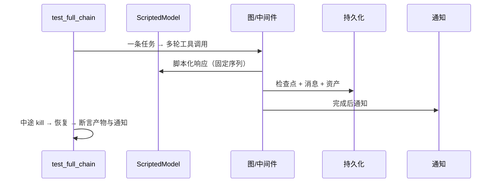

# 第 1 章　从用户任务贯通全部功能域

> **EvoFlow 对照状态 / Alignment status：** 🔍 结构已核对（路径、行数、符号均取自源码实测），**行为**（调用顺序、边界条件）尚未逐行核对。

## 本章目标
设计一条端到端验收任务，把 13 个部分串起来，作为「复刻完成」的判据。

## 最小闭环
一条任务 → 全链路跑通 → 中途中断 → 恢复 → 产物落盘 → 通知送达。

## 调用逻辑 / Invocation logic



- **入口**：`test_full_chain` 用 `ScriptedModel` 把模型行为钉成固定脚本，整条链路可离线重放。
- **关键节点**：覆盖「跑通 / 中断 / 恢复 / 产物落盘 / 通知」五段，任一段缺失都不算全链路。
- **出口**：断言最终产物存在、通知只发一次、恢复后不重复执行已完成步骤。
- **最容易断的地方**：只在 happy path 跑一遍；恢复测试没真的杀进程。

## 真实模块地图（已核对：路径 · 行数 · 符号）

| 文件 | 行数 | 关键符号 | 模块常量 |
|---|---|---|---|
| `tests/test_v4_bridge_e2e.py` | 413 | `_reset_hub_sessions`、`_subscribe`、`_ops_in_queue` | GATEWAY_BASE |
| `app/gateway/v4/hydration.py` | 1075 | `_is_hidden_context_user_tool_name`、`_is_hidden_duty_brief_text`、`_is_hidden_task_notification_text` | — |
| `tests/test_v4_bridge_e2e.py` | 413 | `_reset_hub_sessions`、`_subscribe`、`_ops_in_queue` | GATEWAY_BASE |
| `app/gateway/v4/hydration.py` | 1075 | `_is_hidden_context_user_tool_name`、`_is_hidden_duty_brief_text`、`_is_hidden_task_notification_text` | — |

## 验收矩阵

| # | 环节 | 观察点 | 失败表现 |
|---|---|---|---|
| 1 | 会话建立 | thread 复用，不新建 | 历史断层 |
| 2 | 计划生成 | 步骤有 `done_when` | 计划只在回复里 |
| 3 | 代码索引 | 定义/引用可定位 | 全靠 grep |
| 4 | 上下文 | 压缩后仍可答 | 答非所问 |
| 5 | 审批 | 写操作弹审批 | 静默执行 |
| 6 | 中断恢复 | 不重复副作用 | 重复发消息 |
| 7 | 产物 | 文件落地且有 id | 只在对话里 |
| 8 | 通知 | 渠道送达且有记录 | 静默失败 |
| 9 | 观测 | 有 trace 与用量 | 无法定位 |

## 运行
```bash
cd <复刻仓库> && python3 -m unittest discover -s <复刻代码目录>/tests -v
cd <EvoFlow 仓库> && uv run --project backend pytest -q backend/tests/test_v4_bridge_e2e.py
```

## 业务规则
- 每一步都必须有「可观察证据」，不接受「已完成」的口头结论。
- 中断点至少测 3 处（模型调用前、工具执行中、落库后）。

## 常见坑
- 只测 happy path → 一断就崩。
- 各域单独测都过，串起来时序错。

### 源码核对记录（路径与符号实测）

- `tests/test_v4_bridge_e2e.py`（413 行）；环境变量 `EVOFLOW_E2E_GATEWAY`、`EVOFLOW_E2E_THREAD_ID`
  - 模块自述：T3 — H3-B-3 端到端: 真实流事件序列 → v4 hub 行映射 + 多轮 + 思考 + 工具。 目标(用户原话): "调用真实流接口测试 / 参数返回是否正确 / 多轮工具 / 思考是否正常" 策略: 1) …
- `app/gateway/v4/hydration.py`（1075 行）；环境变量 `EVOFLOW_V4_HYDRATE_RUNNING_MAX_AGE_S`
  - 模块自述：V4 会话历史 hydration：首次订阅时把持久 transcript 建成 ZCode v4 行。 动机：v4 投影此前只有 live 镜像（agui_mirror）的数据——打开历史会话时面板为空。 订阅面的正确…
- `tests/test_v4_bridge_e2e.py`（413 行）；环境变量 `EVOFLOW_E2E_GATEWAY`、`EVOFLOW_E2E_THREAD_ID`
  - 模块自述：T3 — H3-B-3 端到端: 真实流事件序列 → v4 hub 行映射 + 多轮 + 思考 + 工具。 目标(用户原话): "调用真实流接口测试 / 参数返回是否正确 / 多轮工具 / 思考是否正常" 策略: 1) …
- `app/gateway/v4/hydration.py`（1075 行）；环境变量 `EVOFLOW_V4_HYDRATE_RUNNING_MAX_AGE_S`
  - 模块自述：V4 会话历史 hydration：首次订阅时把持久 transcript 建成 ZCode v4 行。 动机：v4 投影此前只有 live 镜像（agui_mirror）的数据——打开历史会话时面板为空。 订阅面的正确…

> 本节只证明**路径、行数、符号存在**；调用顺序与边界条件仍属「行为」，未逐行核对。

## 对照 EvoFlow 核对清单
- [ ] `test_v4_bridge_e2e.py` 覆盖的桥接路径
- [ ] `hydration.py` 的重连语义是否与本方一致

## 从零实现（手把手）
> 读完这章你有一条端到端验收：一句话任务 → 计划 → 工具 → 记忆 → 事件流 → 落库。
> 路径均相对 `backend/`，代码注释写「为什么」。

### Step 1　写端到端测试：五个域各断言一次
**文件**：`tests/chapters/test_ch13_01_e2e.py（新建）`
**要写的逻辑**：不调真模型（用假模型），但把计划解析、工具注册、记忆写入、事件流、消息落库都走一遍。

**代码**

```python
from __future__ import annotations


class ScriptedModel:
    """假模型：按顺序返回固定回复，保证测试可重复。"""

    def __init__(self):
        self.calls = 0

    def invoke(self, messages, *_a, **_k):
        from langchain_core.messages import AIMessage

        self.calls += 1
        return AIMessage(content="done")


def test_full_chain(monkeypatch, tmp_path):
    from myagentflow.agents.lead_agent.graph import build_graph
    from myagentflow.memory.agent_memory import AgentMemoryManager
    from myagentflow.persistence.chat_message_repositories import append_message, list_messages
    from myagentflow.plans.parser import parse
    from myagentflow.runtime.events import EventStream
    from myagentflow.tools.builtins.echo import register_echo
    from myagentflow.tools.registry import ToolRegistry

    plan = parse("- [ ] 读代码\n- [ ] 写实现 depends: 读代码")
    assert plan[1].depends == [plan[0].id]

    registry = ToolRegistry(); register_echo(registry)
    graph = build_graph(ScriptedModel())
    out = graph.invoke({"messages": [{"role": "user", "content": "hi"}]})
    assert out["messages"][-1].content == "done"

    monkeypatch.setenv("MYAF_DB_PATH", str(tmp_path / "m.sqlite"))
    append_message("t1", "user", "hi"); append_message("t1", "assistant", "done")
    assert [m["role"] for m in list_messages("t1")] == ["user", "assistant"]

    mem = AgentMemoryManager(tmp_path)
    mem.remember("t1", "用户偏好中文")

    sse = EventStream().emit("done").to_sse()
    assert sse.startswith("id: 1")
```

**验证**

```bash
uv run pytest tests/chapters/test_ch13_01_e2e.py -v
# 期望：1 passed
```

### 与 EvoFlow 对照

| 我们的做法 | EvoFlow | 为什么 |
|---|---|---|
| 全链路一个测试 | `tests/` 的集成层 | 单章测试全绿也可能集成处断裂 |
| 假模型固定回复 | 测试替身 | 真模型会让结果随机 |

### 知识点

- [agent-book](https://g0-000.github.io/agent-book/)：整体架构
- Harbor404：集成测试设计

### 验收

```bash
uv run pytest tests/chapters/test_ch13_01_e2e.py -q
```
