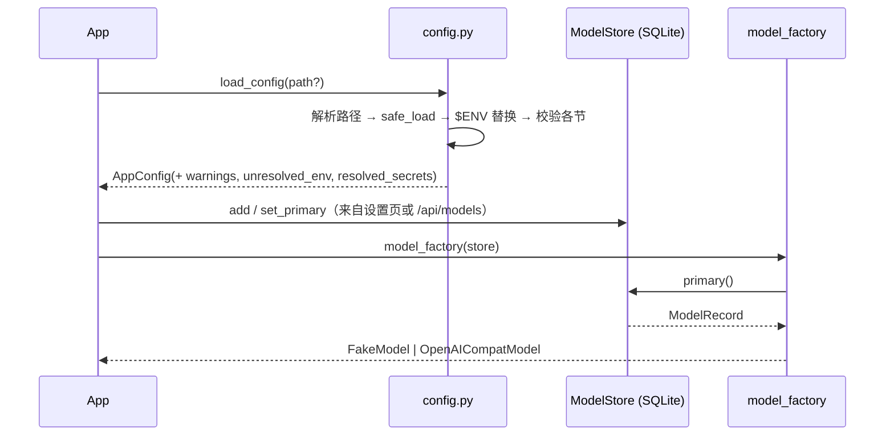
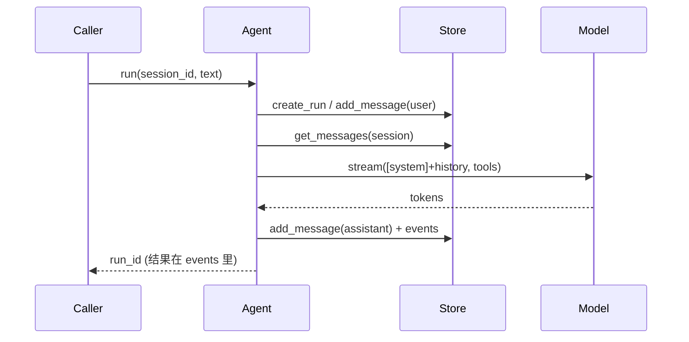
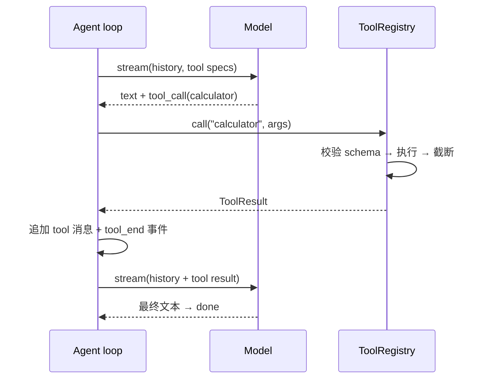
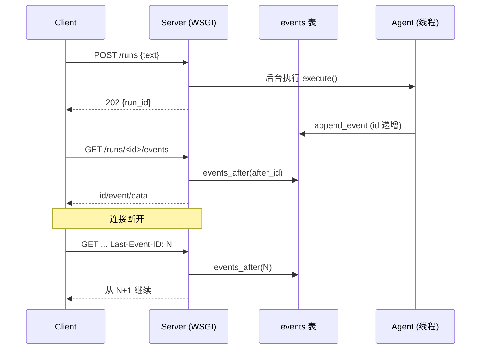

<!-- source: README.md -->

# 《Evo-Flow Study & Replica Project Documentation》

**EvoFlow 学习与复刻项目文档 · v0.1（Part 1 完整，其余待材料）**

> 本文档采用 **Part → Chapter → Section** 三级结构，中英混写（中文讲解，英文保留术语）。每个模块包含：**最小闭环、调用逻辑、核心概念、示例代码、业务规则、验收**。

## 当前状态 / Status（请先读这一节）
| 项目 | 状态 |
|---|---|
| 第 1 部分（最小闭环） | ✅ 文档完整；代码 **已实现并通过 35 个离线测试**；**第 1 章已与 EvoFlow 的 `config.example.yaml` 核对** |
| 第 2–13 部分 | ⬜ 等你的资料批次；目前只有章节骨架 |
| 与 EvoFlow 一致性 | **第 1 章 ✅ 已核对公开配置文件**；第 2–5 章 🟡 尚未核对源码（真实运行时是 LangGraph + middleware，结构不同，需重写）。示例代码是独立的自研参考实现，不是 EvoFlow 的源码 |
| 资料阅读范围 | 已读 EvoFlow README 与 `config.example.yaml` 全文、Agent-Book 目录、Harbor404 列表页；已拿到 `backend/` **完整文件树（仅文件名，未读源码）**，见 [后端模块地图](01-backend-module-map.md) 与 [资料来源](00-sources-and-license.md) |

## 目录 / Contents
- [后端模块地图 Backend module map](01-backend-module-map.md) — 🆕 来自真实文件树；指出了第 1 部分需要重写的地方
- **[第 1 部分　最小闭环 / Minimal Closed Loop](part-01-minimal-closed-loop/README.md)** — ✅ 已实现并测试
  - [第 1 章　配置与模型供应商 Configuration](part-01-minimal-closed-loop/ch1-config-and-model.md)
  - [第 2 章　Agent 与单轮执行 Single Turn](part-01-minimal-closed-loop/ch2-agent-and-single-turn.md)
  - [第 3 章　会话与消息存储 Sessions](part-01-minimal-closed-loop/ch3-sessions-and-messages.md)
  - [第 4 章　工具协议与首批工具 Tools](part-01-minimal-closed-loop/ch4-tools.md)
  - [第 5 章　流式事件与断线恢复 Streaming](part-01-minimal-closed-loop/ch5-streaming-events.md)
  - [第 6 章　综合验收 Acceptance](part-01-minimal-closed-loop/ch6-part-acceptance.md)
- **第 2 部分　持久化与运行生命周期 / Durability and Run Lifecycle** — ⬜ 待材料
  - 第 1 章　检查点与线程恢复 Checkpoints
  - 第 2 章　运行生命周期与取消 Run lifecycle
  - 第 3 章　CLI 与 stdio App Server
  - 第 4 章　分享生命周期 Sharing
- **第 3 部分　工具深化与上下文控制 / Tool Depth and Context Control** — ⬜ 待材料
  - 第 1 章　文件/终端与宿主边界
  - 第 2 章　后台命令、浏览器桥与 Computer Use
  - 第 3 章　Middleware 调用链与工具审计
  - 第 4 章　上下文预算、压缩与自动后续动作
- **第 4 部分　记忆与长期资产 / Memory and Long-Term Assets** — ⬜ 待材料
  - 第 1 章　会话短期记忆与长期记忆
  - 第 2 章　记忆巩固、知识图谱与提示注入防御
  - 第 3 章　资产、产物、事项与反思
- **第 5 部分　知识库与代码理解 / Knowledge Base and Code Understanding** — ⬜ 待材料
  - 第 1 章　上传解析与切块
  - 第 2 章　Embedding、向量检索与引用
  - 第 3 章　Owned Knowledge 与知识地图
  - 第 4 章　Workspace 代码索引与符号上下文
- **第 6 部分　委派、隔离与危险操作治理 / Delegation, Isolation, Dangerous Ops** — ⬜ 待材料
  - 第 1 章　子代理注册、选择与结果汇总
  - 第 2 章　沙箱、宿主执行与权限配置
  - 第 3 章　会话工具绑定、审批、取消与清理
- **第 7 部分　计划、目标、协作与探索 / Planning, Goals, Collaboration, Exploration** — ⬜ 待材料
  - 第 1 章　Plan 定义解析与 Goal 图
  - 第 2 章　协作账本、团队分工、任务中心与会议
  - 第 3 章　Workflow、App Center、Stage 与任务输入
  - 第 4 章　探索预算、策略路由与思维图
  - 第 5 章　暂停恢复、幂等与重复执行
- **第 8 部分　自动化与主动 Agent / Automation and Proactive Agents** — ⬜ 待材料
  - 第 1 章　Automation 定义、执行与运行历史
  - 第 2 章　定时规则、调度器与重启补偿
  - 第 3 章　Heartbeat 主动任务与智能体员工
  - 第 4 章　通知渠道投递与任务管理界面
- **第 9 部分　外部能力生态 / External Capability Ecosystem** — ⬜ 待材料
  - 第 1 章　MCP 连接、发现、调用与 OAuth
  - 第 2 章　插件扩展壳、运行桥接与 Capability 授权
  - 第 3 章　Skills、资源市场与 Community Provider
  - 第 4 章　外部 Agent Adapter 与 A2A 互操作
- **第 10 部分　HTTP 网关与渠道 / HTTP Gateway and Channels** — ⬜ 待材料
  - 第 1 章　Gateway 启动依赖与聊天 API
  - 第 2 章　兼容协议、语音与 OpenAI/LangGraph 代理
  - 第 3 章　渠道适配器、消息总线与渠道状态
- **第 11 部分　身份、组织与运维治理 / Identity, Organization, Governance** — ⬜ 待材料
  - 第 1 章　Principal、ACL、Workspace 与身份入口
  - 第 2 章　JWT、OIDC、Guardrails 与入口保护
  - 第 3 章　组织分发、License、Admin 与审批
  - 第 4 章　Trace、日志、运行诊断、成本与用量
  - 第 5 章　Eval 质量评估与回归闭环
  - 第 6 章　人格内核：身份、情绪、记忆与成长
- **第 12 部分　Web、桌面与产品体验 / Web, Desktop, Product Experience** — ⬜ 待材料
  - 第 1 章　Web 启动、聊天会话与历史
  - 第 2 章　设置、Agent、知识、任务与管理页面
  - 第 3 章　UI RPC 服务与 Provider 系统
  - 第 4 章　Tauri 桌面权限、语音与发布安装
- **第 13 部分　全量集成与复刻验收 / Full Integration and Replica Acceptance** — ⬜ 待材料
  - 第 1 章　从用户任务贯通全部功能域
  - 第 2 章　EvoFlow 对照台账与差异说明

## 代码 / Code
- [`code/`](code/)：`evoflow_min`（纯标准库 Python 3.12）、`tests/`、`demo.py`
- 运行：`cd code && python3 -m unittest discover -s tests -v && python3 demo.py`

## 如何分批喂材料 / How to send batches
1. 每批请说明对应的 Part/Chapter（或直接贴 EvoFlow 的目录、源码片段、文档页）。
2. 我会：**先核对** 已写章节 → **改正** 与 EvoFlow 不一致之处 → **补写** 新章节（含完整业务逻辑与可运行代码，并配测试）→ 更新状态标记。
3. 状态标记：✅ 已与来源核对 · 🟡 自研参考实现、待核对 · ⬜ 待材料。

## 写作约定 / Conventions
- 每章结构：目标 → 最小闭环 → 调用逻辑 → 核心概念 → 示例代码 → 业务规则 → 常见坑 → 验收 → 对照 EvoFlow 核对清单。
- 代码以标准库为主、全部可离线测试；需要外部服务的部分会明确标注「未联网验证」。
- 许可：见 [资料来源与许可](00-sources-and-license.md)。

---

<!-- source: 00-sources-and-license.md -->

# 资料来源与许可 / Sources and License

## 已登记资料 / Source register
| # | 来源 | 内容 | 已读范围 |
|---|---|---|---|
| 1 | EvoFlow 仓库 README（EvovexAI/EvoFlow） | 产品定位、能力清单、运行环境、许可证 | 已读 README；**未读源码与 docs/** |
| 1b | EvoFlow 仓库 `config.example.yaml`（blob 页面） | 全部配置节与注释 | ✅ **已读全文（796 行）** |
| 1c | EvoFlow `AGENTS.md`、`docs/contribute/` | 贡献者仓库地图 | ⬜ 抓取被限流，未读 |
| 1d | 你提供的 `zip -r backend.zip` 输出 | `backend/` 完整文件树 | ✅ 仅文件名，见模块地图 |
| 2 | Agent-Book（G0-000）首页、WorkAgentHarness 目录 | 学习路线、章节目录 | 已读首页与目录；**未读章节正文**（页面抓取受限） |
| 3 | Harbor404 个人站 | 28 篇 AI / Agent / 后端技术笔记（视频笔记） | 已读列表页；**未读笔记正文** |

## 访问说明 / Access notes
GitHub 的 **目录（tree）页面** 对自动化工具返回「禁止自动访问」；**文件（blob）页面** 可以读取，但会触发限流。因此：公开仓库里的单个文件可以逐个读，目录结构要靠你提供的文件树。

## Harbor404 笔记与本文档的对应关系 / Mapping（仅按标题）
| 笔记 | 可能用于 |
|---|---|
| [LLM / Agent 推理链路延迟优化](https://harbor404.fushenlin.com/notes/llm-agent-latency-optimization/) | 第 1 部分第 5 章；第 3 部分 |
| [企业级 Agent 提示词注入防御：四层纵深防御实践](https://harbor404.fushenlin.com/notes/agent-prompt-injection-defense/) | 第 4 部分（注入防御）；第 11 部分 |
| [10分钟详解 claude code 记忆机制](https://harbor404.fushenlin.com/notes/10-claude-code/) | 第 4 部分（记忆） |
| [MCP 中台 Tool 数量治理成熟架构方案](https://harbor404.fushenlin.com/notes/mcp-tool-governance-architecture/) / [MCP Server 多实例与负载均衡问题](https://harbor404.fushenlin.com/notes/mcp-server-multi-instance-load-balancing/) | 第 9 部分 |
| [10分钟详解 RAG：离线构建流水线](https://harbor404.fushenlin.com/notes/rag-offline-pipeline/) / [在线检索流水线](https://harbor404.fushenlin.com/notes/rag-online-pipeline/) / [RAG、GraphRAG 与 LightRAG](https://harbor404.fushenlin.com/notes/rag-graphrag-lightrag-architecture/) / [RAG 评测体系](https://harbor404.fushenlin.com/notes/rag-evaluation-system/) | 第 5 部分；第 11 部分（Eval） |
| [DeepAgent：从普通 Agent 到复杂任务执行框架](https://harbor404.fushenlin.com/notes/deepagent-complex-task-framework/) / [Multi-Agent 五种常见架构](https://harbor404.fushenlin.com/notes/multi-agent-five-architectures/) / [5分钟直击Agent意图识别](https://harbor404.fushenlin.com/notes/5-agent/) | 第 6、7 部分 |
| [幂等性设计](https://harbor404.fushenlin.com/notes/idempotency-design/) | 第 7 部分（暂停恢复与幂等）；第 2 部分 |
| [Agent 评测体系](https://harbor404.fushenlin.com/notes/agent-evaluation-system/) | 第 11 部分（Eval） |
| [大模型网关详解](https://harbor404.fushenlin.com/notes/llm-gateway-comprehensive-guide/) | 第 10 部分 |
| [日志分析平台的演变](https://harbor404.fushenlin.com/notes/note-b7134f72/) | 第 11 部分（Trace / 日志） |

> 这些笔记是 **通用技术背景**，不是 EvoFlow 的实现说明。引用时只会吸收通用原理，并标明出处。

## 许可 / License
EvoFlow 使用 **PolyForm Noncommercial License 1.0.0**：源码可见；个人学习、研究与非商业使用允许；**商业使用需书面授权**；不是 OSI 开源许可证。

本文档与代码的原则：
1. 内容为学习用的 **自研重写**，不复制 EvoFlow 或笔记站的原文与源码。
2. 示例代码是独立实现的参考版本。
3. 如要商用，请先取得 EvoFlow 版权方授权。
4. 这不是法律意见，请以仓库 LICENSE 为准。

---

<!-- source: 01-backend-module-map.md -->

# 后端模块地图 / Backend Module Map

> **来源 / Source：** 你的 `zip -r backend.zip` 输出日志（完整文件树）。
> **可靠度 / Reliability：** ✅ 文件与目录 **确实存在**（来自日志）；🟡 它们的 **职责** 是我从文件名推断的；⬜ **源码内容尚未阅读**。凡标 🟡 的地方，读到源码后都可能需要改正。

## 0. 已被 `config.example.yaml` 证实的推断 / Confirmed by the real config file
- ✅ **LangGraph 体系**：有 `checkpointer`（memory / sqlite / postgres）、「LangGraph Server `localhost:2024` + Gateway `localhost:8001`」、`assistant_id: lead_agent`、`recursion_limit`。
- ✅ **middleware 链真实存在**：配置注释直接提到 `TokenUsageMiddleware`、已卸载的 `SessionIntentMiddleware`、统一的 summarization 中间件。
- ✅ **编排模式** `react | hybrid | local_scheduler`（与 `evoflow/scheduler/`、`<task_plan>` JSON 的说法吻合——这解释了「工具调用调度」）。
- ✅ **工具延迟加载**：`tool_search`（对应 `deferred_tool_filter_middleware`）。
- ✅ **大结果落盘**：`tool_results` 的 `<persisted-output>` 信封（对应 `large_result_store.py`、`tool_output_truncation.py`）。
- ✅ **代码索引**：`<workspace>/.evoflow/code_index/index.db`，FTS5 + 符号表，tree-sitter 优先、LSP 可选、文件监视（对应 `code_index/*`）。
- ✅ **数据目录**：`data/app/evoflow.db`、`data/checkpoints/checkpoints.db`、`data/observability/…`、`data/logs/`。

## 1. 顶层结构 / Top-level layout
| 路径 | 角色（推断） |
|---|---|
| `backend/app/gateway/` | HTTP 网关（路由、流式输出、鉴权、语音、v4 协议） |
| `backend/app/channels/` | IM 渠道（feishu、dingtalk、wecom、weixin、telegram、slack）+ message_bus |
| `backend/packages/harness/evoflow/` | **运行时库 harness**：Agent、工具、记忆、知识、协作、持久化…… |
| `backend/tests/` | 数百个测试文件，文件名几乎就是行为说明书 |
| `backend/packaging/` | 打包（PyInstaller spec、macOS/Unix/Windows 脚本、官方插件包） |
| `backend/langgraph.json` | LangGraph 部署描述 → 运行时基于 LangGraph/LangChain |
| `backend/scripts/arch_ban_app_imports.py` + baseline | 疑似「harness 不得反向 import app」的分层检查 |

## 2. 对 Part 1 的结构性修正 / What changes for Part 1
1. **Agent 循环不是自写的 while 循环。** `agents/lead_agent/agent.py`、`graph_cache.py`、`langgraph_run_config.py`、三个 `langgraph_*_patch.py` 说明主 Agent 是 **LangGraph 图**；真正的「循环扩展点」是 `agents/middlewares/` 下 **约 70 个 middleware**（动态 system prompt、工具错误处理、悬空 tool_call 修复、循环检测、预算、压缩、审批、模型降级…）。我的 Part 1 把 middleware 放到了第 3 部分——**应前移并重写**。
2. **流式输出是多层的。** LangGraph 流 → AG-UI 编码/归一化（`agui_stream_encode.py`、`agui_stream_normalizer.py`）→ **v4 协议投影**（`v4/agui_to_v4_projector.py`、`v4/hydration.py`、`v4/command_inbox.py`）→ 落库镜像（`streaming/stream_mirror*.py`、`persistence/stream_mirror_repositories.py`）→ 断线恢复（`stream_resume_handler.py`、`routers/stream_resume.py`）。思路与我的「事件日志 + Last-Event-ID」一致，但复杂得多。
3. **`v4_demo/` 很可能是官方的最小参考**：`protocol_v4_min.py`、`orchestrator.py`、`projection.py`、`writer_registry.py`、`routes.py`。第 5 章应 **先读它**。
4. **配置分三层：** `config/`（约 45 个配置模块，`app_config.py` 为核心）、`models/`（`factory.py`、`resolver.py`、`credential_loader.py`、`credential_sanitize.py`、多个 `patched_*` 厂商适配）、DB 里的连接（`persistence/model_connections.py`）。与 README「模型在界面里配置」吻合。
5. **持久化是仓库层：** `persistence/` 有几十个 `*_repositories.py`（session、chat_message、live_run、stream_mirror、task、goal、plan、tool_approval、automation…），含 schema 基线检查脚本。我的 3 张表要换成这套划分。

## 3. 命名陷阱 / Naming traps
| 名字 | 容易误解成 | 看文件名更像是 |
|---|---|---|
| `evoflow/plans/` | 任务规划 | **模型订阅套餐**（`aliyun_token_plan`、`volc_agent_plan`） |
| `evoflow/scheduler/` | 定时任务 | **工具调用调度**（`tool_executor`、`post_edit_lint`、`prefetch_stream`） |
| `evoflow/core/scheduler/` | 定时任务 | 子任务/子 Agent 调度（`task_scheduler`、`subagent_runner`） |
| 定时 Automation | — | `app/gateway/automation_runner.py`、`routers/automation_scheduler.py`、`proactive/schedule.py` |
| 任务规划 Plan | — | `tools/builtins/plan_tool.py`、`collab/plan_*.py`、`plan_guard_middleware.py`、`plan_doc_middleware.py` |

## 4. 各部分 → 真实模块 / Parts → real modules（🟡 按文件名推断）
| Part | 主题 | 重点模块 |
|---|---|---|
| 1 | 最小闭环 | `config/app_config.py`、`models/factory.py`、`agents/lead_agent/*`、`agents/middlewares/*`、`persistence/{session,chat_message,live_run}_repositories.py`、`app/gateway/streaming/*`、`v4_demo/*` |
| 2 | 持久化与生命周期 | `agents/checkpointer/*`、`session_execution/{lifecycle,commands,langgraph_cancel}.py`、`cancellation/*`、`zombie_run_sweeper.py`、`run_status_reconcile.py`、`cli/*`、`app_server/{stdio_rpc,embed,chat_bridge}.py`、`routers/share.py`、`persistence/chat_share_repositories.py` |
| 3 | 工具与上下文 | `tools/{host_direct,zcode_port,builtins}/*`、`tool_output_truncation.py`、`large_result_store.py`、`context/*`、`agents/context_compaction_core.py`、`middlewares/{context_compaction,tool_history_ager,large_content_offload}_middleware.py` |
| 4 | 记忆与资产 | `memory/*`、`agents/memory/*`、`agents/memory_plugins/*`、`assets/*`（含 `prompts/memories/*.md` 两阶段管线）、`person_*.py` |
| 5 | 知识与代码索引 | `knowledge/{parser,chunker,embedding/*,vector/sqlite_vec,owned/*}`、`code_index/*`（tree-sitter + LSP + watcher） |
| 6 | 委派与隔离 | `subagents/*`、`sandbox/*`、`community/aio_sandbox/*`、`execution_security/*`、`guardrails/*`、`agents/tool_approval_*`、`session_tool_binding/*` |
| 7 | 计划/目标/协作 | `agents/goal/*`、`agents/mission_state/*`、`collab/*`（任务状态机、workflow、app 引擎）、`exploration/*`、`exploration_graph/*`、`collab/supervisor_plan_gate.py`、`tools/builtins/supervisor/*` |
| 8 | 自动化与主动 Agent | `proactive/*`（`DESIGN.md`、`USAGE.md`）、`app/gateway/automation_runner.py`、`workflow_scheduler`、`channel_result_push.py` |
| 9 | 外部能力 | `mcp/*`、`plugins/*`、`capability/*`、`skills/*`、`organizations/*`、`a2a/*`、`external_agents/*`、`routers/{mcp,mcp_server,a2a,plugins,skills}.py` |
| 10 | 网关与渠道 | `app/gateway/{app,router_registry,middleware,health_routes,startup_gate}.py`、`openai_*`、`routers/langgraph_proxy.py`、`speech/*`、`app/channels/*` |
| 11 | 身份与治理 | `authz/*`、`webui/{auth,oidc}.py`、`license/*`、`observability/*`、`eval/*`（约 60 个场景）、`persistence/{usage_ledger,audit_log}.py` |
| 12 | Web/桌面 | 本日志只含 `backend/`；前端在 `evopanel/`（Tauri），**尚未提供** |
| 13 | 集成 | `eval/scenarios/*`、`tests/test_v4_bridge_e2e.py` |

## 5. 把测试文件名当作规格 / Tests as spec（Part 1 相关）
- **配置与模型：** `test_model_resolver`、`test_model_resolver_e2e`、`test_resolve_effective_max_output_tokens`、`test_create_payload_sanitize`、`test_thinking_disable_fallback`、`test_supports_thinking_false_omits`、`test_rate_limit_no_model_switch`、`test_model_content_rate_limit`、`test_profile_aware_home`
- **Agent 循环：** `test_turn_tail_tool_loop`、`test_dangling_tool_call_sanitize`、`test_loop_detection_middleware`、`test_model_request_budget`、`test_session_budget_middleware`、`test_lead_middleware_unique_names`、`test_dynamic_prompt_role_revision`、`test_prompt_drift_guard`、`test_structured_output_contract`、`test_model_error_shows_as_ai_reply`、`test_task_tool_completed_without_done`、`test_vendor_stream_first_token_watchdog`、`test_run_status_interrupted_not_sticky`、`test_stop_trace_and_reconcile`
- **会话与存储：** `test_upsert_message_by_message_id`、`test_session_runtime_registry`、`test_sessions_status_compact`、`test_transcript_run_id_enrich`、`test_sqlite_stale_cursor_heal`、`test_app_repositories_read_pool`、`test_read_pool_fallback`、`test_persistence_pressure`、`test_schema_post_baseline_columns`
- **工具：** `test_bash_tool_timeout`、`test_bash_readonly_policy`、`test_host_direct_file_tools`、`test_pseudo_tool_markup`、`test_platform_args_json_coerce`、`test_serve_file_guards`、`test_tool_approval_grant_sweep`
- **流式：** `test_stream_thread_state_dedup`、`test_v4_hydration_resubscribe`、`test_v4_hydration_running_restore`、`test_v4_catchup_from_transcript`、`test_v4_snapshot_tail_window`、`test_v4_command_queue`、`test_v4_bridge_e2e`、`test_agui_mirror_multi_turn`、`test_live_run_snapshot_single_flight`、`test_live_run_heartbeat_upsert`、`test_v4_remint_user_input_dedup`、`test_v4_run_error_info`、`test_v4_conversation_stop`

这些名字暗示了真实系统踩过的坑（悬空 tool_call、首 token 超时、游标过期、重复用户输入、断线后恢复运行中状态……）。我自研的 Part 1 目前没有覆盖其中大部分。

## 6. 后端自带的文档（优先阅读）/ In-repo docs to read first
`backend/ARCHITECTURE.md` · `backend/README.md` · `backend/AGENTS.md` · `backend/STREAM_TRACE_DEBUG.md` · `backend/docs/README.md` · `backend/docs/ZCODE_BACKGROUND_SUBAGENT_RETROFIT.md` · `proactive/DESIGN.md` · `proactive/USAGE.md` · `assets/prompts/memories/README.md` · `app/channels/FEISHU_REQUIREMENTS.md` · `app/channels/WEIXIN_REQUIREMENTS.md` · `packaging/OFFICIAL-PLUGINS.md`

## 7. 许可提示 / License notes
- `tools/zcode_port/` 与 `docs/ZCODE_BACKGROUND_SUBAGENT_RETROFIT.md` 暗示部分代码来自 **ZCode（Apache-2.0）**，NOTICE 里有说明。
- `agents/memory_plugins/memory_port/plugins_memory/*`（honcho、mem0、supermemory 等）看起来从其他项目移植，来源与许可需看 NOTICE。
- 打包脚本里有 `pyarmor`（代码混淆）与 `license/` 授权模块：发行版可能与源码行为不同。

---

<!-- source: part-01-minimal-closed-loop/README.md -->

# 第 1 部分　最小闭环 / Part 1: Minimal Closed Loop

目标：用 **纯标准库 Python** 跑通一条完整链路——配置 → 模型 → Agent → 会话存储 → 工具 → 流式输出。

| 章 | 主题 | 代码 |
|---|---|---|
| [第 1 章](ch1-config-and-model.md) | 配置与模型（✅ 已与 `config.example.yaml` 核对） | `config.py`, `model_store.py`, `models.py`, `config.example.yaml` |
| [第 2 章](ch2-agent-and-single-turn.md) | Agent 与单轮执行 | `agent.py` |
| [第 3 章](ch3-sessions-and-messages.md) | 会话与消息存储 | `store.py` |
| [第 4 章](ch4-tools.md) | 工具协议与首批工具 | `tools.py`, `agent.py` |
| [第 5 章](ch5-streaming-events.md) | 流式事件与断线恢复 | `server.py`, `store.py` |
| [第 6 章](ch6-part-acceptance.md) | 综合验收 | `tests/`, `demo.py` |

## 依赖关系 / Dependencies
```text
config → models ─┐
tools ───────────┼→ agent → server
store ───────────┘
```

## 状态 / Status
- 代码：✅ 已实现，**35 个离线测试通过**。
- 第 1 章：✅ 已与 EvoFlow 公开的 `config.example.yaml` 核对（见章内「已核对的事实」）。
- 第 2–5 章：🟡 仍是自研参考实现。模块地图显示真实运行时是 **LangGraph + middleware 链**，这几章需要等源码后重写。

---

<!-- source: part-01-minimal-closed-loop/ch1-config-and-model.md -->

# 第 1 章　配置与模型 / Configuration and Models

> **EvoFlow 对照状态 / Alignment status**
> ✅ **已核对：** 配置文件格式、字段名、`$ENV` 规则、`use:` 路径、模型存放位置——来自 EvoFlow 公开仓库根目录的 `config.example.yaml`（796 行，已读全文）。
> 🟡 **自研：** 文件里没写明的默认值、SQLite 列结构、API 返回格式、默认数据目录。下文逐条标出。
> ⬜ **未读：** 解析这些配置的 EvoFlow 源码（`config/app_config.py` 等）。所以「校验细节」是我们自己的设计，不代表 EvoFlow 的校验行为。

## 本章目标 / Goals
- 用 **YAML + `$ENV` 替换 + 类型化配置节** 描述应用配置，并在启动时 **fail fast**。
- 理解一个关键设计：**聊天模型不在 YAML 里，而在 SQLite**（`ModelStore`）。
- 建立 **credential boundary**：密钥只来自环境变量或模型库，且不会出现在 repr、日志、API 列表中。
- 通过 **model factory** 取得「主模型」；测试用 **FakeModel**。

## 1. 已核对的事实 / Verified facts
| # | 事实（来自 `config.example.yaml`） | 本章对应实现 |
|---|---|---|
| 1 | 默认读取工作目录下的 `config.yaml`；可用环境变量 `DEER_FLOW_CONFIG_PATH` 改路径（名字沿用自 DeerFlow） | `resolve_config_path`：参数 → `EVOFLOW_CONFIG_PATH` → 旧名 → `./config.yaml` |
| 2 | 任何字段值都可写 `$ENV_VAR`（如 `api_key: $OPENAI_API_KEY`） | `substitute_env`（整值引用；也支持 `${VAR}`） |
| 3 | `use:` 是 `"package.module:class_or_var"` 字符串（沙箱、工具、护栏 provider 都用它） | `resolve_variable` |
| 4 | `config_version`（上游示例为 11），schema 变化时递增；`make config-upgrade` 合并新字段 | 版本告警；升级命令不复刻 |
| 5 | **聊天模型和 `primary_model` 只存在 SQLite**（`evoflow.db` 的 `evoflow_models` / `evoflow_app_settings`）；YAML 里残留的 `models:` / `primary_model:` **启动时被忽略**；在 EvoPanel「设置 → 模型」或 Gateway `GET/POST/PUT/DELETE /api/models` 管理 | `ModelStore`、`parse_config` 的忽略告警 |
| 6 | 联网搜索偏好存在 DB 键 `web.search`；`config.yaml` 的 `web.backend` 对搜索无效 | `ModelStore.get/set_setting` |
| 7 | `token_usage.pricing`：键支持通配符、**最长匹配优先**；未配置的模型费用记 0（界面显示 —） | `TokenUsage.price_for / cost` |
| 8 | `summarization.trigger` 可写单个或列表，**任一满足即触发（OR）**；类型 `tokens / messages / fraction`；`threshold_ratio: 0.90`，`aggressive_ratio: 1.0`；`keep` 指定保留量 | `Summarization.should_summarize` |
| 9 | `checkpointer.type` ∈ memory / sqlite / postgres；桌面默认 sqlite，路径 `data/checkpoints/checkpoints.db`；memory 不会被清理 | `Checkpointer` |
| 10 | 应用库 `data/app/evoflow.db`；「每个数据库一个子目录」；根目录的旧版扁平文件会在 Gateway 启动时迁移 | `Storage`、`DataPaths` |
| 11 | `execution_security.profile` ∈ read-only / workspace / danger-full-access；`approval` ∈ untrusted / on-request / never；**会话档位覆盖全局值** | `ExecutionSecurity`（会话覆盖留给第 6 部分） |
| 12 | `guardrails`：`enabled`、`fail_closed`（默认 true）、`provider.use + config`；拒绝的调用返回一条错误 ToolMessage，让 Agent 自行调整 | `Guardrails`（行为留给第 6 部分） |
| 13 | `agent_orchestration.default` ∈ react / hybrid / local_scheduler，默认 hybrid | `AgentOrchestration` |
| 14 | `subagents.timeout_seconds` 默认 900，可按 agent 覆盖 | `Subagents.timeout_for` |
| 15 | `skills`：`container_path: /mnt/skills`、`repo_skills_dir: .evoflow/skills`、`extra_roots` | `Skills` |
| 16 | `tool_search.enabled`：MCP 工具只在 system prompt 里列名字，运行时用 `tool_search` 发现（延迟加载） | `ToolSearch`（行为留给第 9 部分） |
| 17 | `tool_results`：超大工具输出落盘，prompt 里只保留摘要 + 路径；`history_keep_full_tools: 3` | `ToolResults`（行为留给第 3 部分） |
| 18 | `data_retention`：日志 7 天；每个线程只保留 5 个 checkpoint；可 vacuum | `DataRetention` |
| 19 | 观测默认关闭（`observability.enabled: false`），开发者用 `EVOFLOW_OBSERVABILITY=1` | `Observability` |
| 20 | **部署形态：** LangGraph Server（`http://localhost:2024`）+ Gateway（`http://localhost:8001`）两个服务；IM 渠道通过它们访问 | 第 10 部分 |
| 21 | 注释里出现 `TokenUsageMiddleware`、已卸载的 `SessionIntentMiddleware`，以及「统一的 summarization 中间件」 | 佐证：运行时确实是 **middleware 链**（见模块地图） |

## 2. 取舍说明 / What we replicate, simplify, or skip
| 类别 | 内容 |
|---|---|
| **复刻（行为与上表一致）** | #1–#19 的加载、替换、校验与纯计算行为 |
| **只建类型、不实现行为** | sandbox、execution_security、guardrails、skills、tool_results、memory、observability、data_retention——后续章节再用 |
| **放进 `extra` 不校验** | `channels`、`code_index`、`web`、`title`、`working_memory`、`acp_agents`、`session_intent` 等（对应章节再建模） |
| **🟡 自研（未核对）** | 配置节里 **文件没写的默认值**；`evoflow_models` 的列；API 的返回格式（密钥掩码为 `***abcd`）；默认数据目录 `.evoflow` |
| **未复刻** | `make config-upgrade`；旧 YAML 一次性导入（`sync_models_from_yaml_to_db`）；Gateway HTTP 路由；「测试连接」 |

## 最小闭环 / Minimal closed loop
```python
cfg   = load_config("config.yaml")                                   # ① 读 YAML → 替换 $ENV → 类型化 + 校验
paths = DataPaths.from_env()                                         #    相对路径落在 base_dir 下
store = ModelStore(paths.ensure_parent(cfg.storage.sqlite_path))     # ② 模型库（SQLite）
store.add("main", "openai_compatible", "gpt-x", "https://api.example.com/v1", os.environ["OPENAI_API_KEY"])
store.set_primary("main")
model = model_factory(store)                                         # ③ 取主模型；没有主模型会给出可读错误
```

## 调用逻辑 / Invocation logic


## 1.1 配置文件与加载 / File and loading
**核心概念**
- **整值 `$VAR`**：只有整个值是 `$NAME` 或 `${NAME}` 才替换；`"prefix-$NAME"` 不会替换。（🟡 上游示例只展示整值形式，是否支持内嵌未知。）
- **缺失的环境变量不致命**：字段变成 `None` → 使用默认值，并记入 `unresolved_env` 与 `warnings`。这与上游注释一致（飞书的 `push_secret`：环境变量未设置时「该行被忽略，Gateway 仍能启动」）。是否对 **所有** 字段都如此，🟡 未核对。
- **未知顶层键不拒绝**：放进 `extra`，保证向前兼容。

**业务规则**
1. 路径优先级：显式参数 > `EVOFLOW_CONFIG_PATH` > `DEER_FLOW_CONFIG_PATH` > `./config.yaml`。
2. 文件不存在、YAML 语法错误、顶层不是映射 → `ConfigError`，带文件路径或原因。
3. `config_version` 缺失/过旧/过新 → 告警，不阻止启动；类型不是整数 → 报错。
4. 空文件等于 `{}`，全部走默认值。

## 1.2 类型化配置节与行为 / Typed sections and behaviour
每个配置节是一个 `frozen dataclass`，字段名与上游示例一致。几个值得讲的 **行为**：

**① 定价通配符（#7）**
```python
pricing = {"glm-*": (0.6, 2.2), "glm-4-flash*": (0, 0)}
# "glm-4.5"        -> 命中 "glm-*"
# "glm-4-flash-x"  -> 两个都命中，取 **更长** 的 pattern -> 免费
# "other"          -> 未配置 -> 费用 0（界面显示 —）
```

**② 压缩触发（#8）**：`trigger` 是列表，**任一** 条件满足就触发（OR）：
`tokens >= value`、`messages >= value`、`tokens >= fraction × 模型最大输入`。`enabled: false` 时永不触发。

**③ 校验（🟡 我们的设计）**：枚举值（profile、approval、orchestration、checkpointer.type）、范围（ratio ∈ (0,1]，`aggressive_ratio ≥ threshold_ratio`）、`bool` 不能用 `1` 代替、`sqlite/postgres` 必须带 `connection_string`、启用 guardrails 必须有 provider、工具名不可重复。

## 1.3 模型存放在 SQLite / Models live in SQLite
**为什么不放 YAML（推断 🟡）：** 模型由界面管理、需要运行时增删改、带 API Key；放进数据库后可以热更新，也不必把密钥写进可能被提交的文本文件。（上游文件只说明「模型只在 SQLite」，没有说明原因。）

**API 对照（方法 ↔ 上游路由）**
| 方法 | 上游路由 | 说明 |
|---|---|---|
| `add` | `POST /api/models` | 校验 kind、`openai_compatible` 必须有 `base_url`、名称唯一 |
| `list` / `get` | `GET /api/models` | **列表里密钥只返回掩码** `***abcd`，另给 `has_api_key` |
| `update` | `PUT /api/models/{name}` | 只改传入的字段；不传 `api_key` 表示保持不变 |
| `delete` | `DELETE /api/models/{name}` | 删除主模型时同时清除 `primary_model` |
| `set_primary` / `primary` | 设置页「设为主模型」 | 停用的模型不能做主模型 |
| `get/set_setting` | `evoflow_app_settings` 键值 | 如 `web.search` |

> 表名 `evoflow_models` / `evoflow_app_settings` 与键名 `primary_model`、`web.search` 是 ✅；**列结构、返回字段是 🟡**。

## 1.4 凭证边界 / Credential boundary
1. **来源**：密钥来自环境变量（`$VAR`）或模型库，不写在 YAML 明文里。
2. **表示**：`ModelRecord.__repr__` 固定输出 `api_key='***'`；列表接口只给掩码。
3. **输出**：`AppConfig.redactor()` 汇总 **所有被 `$VAR` 替换进来的值**（保守地全部当作密钥）+ 可选的模型库密钥；`RedactingFilter` 在日志出口统一替换；再用正则兜底 `sk-...` 形态。

**常见坑**：只在日志里脱敏，却把密钥带进异常消息或 URL → Agent 的 `error` 事件同样要过 `Redactor`（见第 2 章）。

## 1.5 模型工厂与 FakeModel / Factory and FakeModel
- 没有设置主模型 → `ConfigError("no primary model configured: add one in Settings -> Models ...")`，对应上游 README 的首次使用流程：**设置 → 模型 → 添加服务商与 API Key → 设为主模型**。
- `FakeModel` 用于离线测试，可脚本化「先调用工具，再给答案」，并记录收到的 messages。
- `OpenAICompatModel` **没有联网测试过**，也不是流式解析，只展示 adapter 形状。

## 1.6 `use:` 动态加载 / Dynamic loading
`resolve_variable("package.module:attr.sub")` 把字符串变成对象，沙箱 provider、工具、护栏 provider 都靠它。**安全提醒：** 它会 `import` 任意模块，等于执行配置里指定的代码，所以 **配置文件必须被当作可信输入**；不要把来自用户的字符串直接喂给它。

## 示例代码 / Sample code
### `evoflow_min/config.py`
```python
"""Configuration (Chapter 1): YAML file + $ENV substitution + typed sections.

Design mirrors what EvoFlow's public config.example.yaml shows (verified):
  * config.yaml in the working directory; path overridable by an environment variable
  * any value may be written "$ENV_VAR"
  * chat models are NOT in YAML: they live in SQLite (see model_store.py)
  * "use: package.module:attr" strings are resolved to Python objects
Section field names and defaults below follow that file; where the real defaults are unknown we say so in the docs.
"""
from __future__ import annotations
import fnmatch, importlib, logging, os, re
from dataclasses import dataclass, field
from pathlib import Path
import yaml

CONFIG_VERSION = 1            # EvoFlow's own example file uses a larger number; ours is independent
CONFIG_ENV_VARS = ("EVOFLOW_CONFIG_PATH", "DEER_FLOW_CONFIG_PATH")   # second name = legacy name seen upstream

class ConfigError(ValueError):
    pass

# ---------------------------------------------------------------- small validators
def _sec(raw: dict, name: str) -> dict:
    v = raw.get(name)
    if v is None:
        return {}
    if not isinstance(v, dict):
        raise ConfigError(f"{name} must be a mapping")
    return v

def _val(sec: str, d: dict, key: str, default, types):
    v = d.get(key)
    if v is None:                                   # missing, or an unresolved $ENV -> default
        return default
    types = types if isinstance(types, tuple) else (types,)
    if isinstance(v, bool) and bool not in types:
        raise ConfigError(f"{sec}.{key} must be {_names(types)}")
    if not isinstance(v, types):
        raise ConfigError(f"{sec}.{key} must be {_names(types)}, got {type(v).__name__}")
    return v

def _names(types): return "/".join(t.__name__ for t in types)

def _choice(sec: str, key: str, v, allowed):
    if v not in allowed:
        raise ConfigError(f"{sec}.{key} must be one of {sorted(allowed)}, got {v!r}")
    return v

def _range(sec: str, key: str, v, lo, hi, lo_open=False):
    if (v < lo) or (lo_open and v == lo) or v > hi:
        raise ConfigError(f"{sec}.{key} out of range: {v}")
    return v

# ---------------------------------------------------------------- sections
@dataclass(frozen=True)
class Price:
    input_per_mtok: float
    output_per_mtok: float

@dataclass(frozen=True)
class TokenUsage:
    enabled: bool = True
    pricing: dict = field(default_factory=dict)      # wildcard pattern -> Price
    def price_for(self, model: str) -> Price | None:
        best = None
        for pat, price in self.pricing.items():      # longest matching pattern wins
            if fnmatch.fnmatchcase(model, pat) and (best is None or len(pat) > len(best[0])):
                best = (pat, price)
        return best[1] if best else None
    def cost(self, model: str, input_tokens: int, output_tokens: int) -> float:
        p = self.price_for(model)                    # unpriced models cost 0 (UI shows a dash)
        return 0.0 if p is None else (input_tokens * p.input_per_mtok + output_tokens * p.output_per_mtok) / 1_000_000

@dataclass(frozen=True)
class ToolConfig:
    name: str
    use: str
    options: dict = field(default_factory=dict)

@dataclass(frozen=True)
class ToolSearch:
    enabled: bool = True          # MCP tools are listed by name and loaded on demand

@dataclass(frozen=True)
class Sandbox:
    use: str | None = None
    options: dict = field(default_factory=dict)

PROFILES = {"read-only", "workspace", "danger-full-access"}
APPROVALS = {"untrusted", "on-request", "never"}

@dataclass(frozen=True)
class ExecutionSecurity:
    enabled: bool = False
    auto_enable_when_helpers_ready: bool = True
    profile: str = "workspace"
    approval: str = "on-request"
    windows_level: str = "restricted-token"
    allow_passthrough: bool = True

@dataclass(frozen=True)
class Guardrails:
    enabled: bool = False
    fail_closed: bool = True
    provider_use: str | None = None
    provider_config: dict = field(default_factory=dict)

@dataclass(frozen=True)
class Subagents:
    timeout_seconds: int = 900
    agents: dict = field(default_factory=dict)        # name -> timeout override
    def timeout_for(self, name: str) -> int:
        return self.agents.get(name, self.timeout_seconds)

@dataclass(frozen=True)
class Skills:
    path: str | None = None
    container_path: str = "/mnt/skills"
    extra_roots: tuple = ()
    repo_skills_dir: str = ".evoflow/skills"

@dataclass(frozen=True)
class Trigger:
    type: str          # tokens | messages | fraction
    value: float

@dataclass(frozen=True)
class Summarization:
    enabled: bool = True
    threshold_ratio: float = 0.90
    aggressive_ratio: float = 1.0
    protect_first_n: int = 3
    protect_tail_messages: int = 20
    protect_tail_tool_rounds: int = 3
    triggers: tuple = (Trigger("tokens", 15564),)
    keep: Trigger = Trigger("messages", 10)
    trim_tokens_to_summarize: int = 15564
    def should_summarize(self, tokens: int, messages: int, max_input_tokens: int | None = None) -> bool:
        if not self.enabled:
            return False
        for t in self.triggers:                       # OR logic: any trigger fires
            if t.type == "tokens" and tokens >= t.value: return True
            if t.type == "messages" and messages >= t.value: return True
            if t.type == "fraction" and max_input_tokens and tokens >= t.value * max_input_tokens: return True
        return False

@dataclass(frozen=True)
class ToolResults:
    enabled: bool = True
    threshold_chars: int = 12000
    medium_threshold_chars: int = 4000
    summary_max_chars: int = 1200
    history_keep_full_tools: int = 3
    max_age_hours: int = 24

@dataclass(frozen=True)
class Memory:
    enabled: bool = True
    storage_path: str = "memory.json"
    debounce_seconds: int = 30
    max_facts: int = 100
    fact_confidence_threshold: float = 0.7
    injection_enabled: bool = True
    max_injection_tokens: int = 2000
    external_provider: str = ""

@dataclass(frozen=True)
class Checkpointer:
    type: str = "memory"                # memory | sqlite | postgres
    connection_string: str | None = None

@dataclass(frozen=True)
class Storage:
    backend: str = "sqlite"
    sqlite_path: str = "data/app/evoflow.db"

@dataclass(frozen=True)
class Observability:
    enabled: bool = False
    file_mirror: bool = False
    sqlite_path: str = "data/observability/evoflow_observability.db"

@dataclass(frozen=True)
class DataRetention:
    enabled: bool = True
    interval_hours: int = 24
    logs_days: int = 7
    observability_days: int = 90
    task_stream_days: int = 90
    task_status_events_days: int = 90
    automation_runs_per_task: int = 50
    checkpoint_orphan_days: int = 90
    checkpoint_inactive_session_days: int = 30
    checkpoint_keep_per_thread: int = 5
    vacuum_sqlite: bool = True

@dataclass(frozen=True)
class AgentOrchestration:
    default: str = "hybrid"             # react | hybrid | local_scheduler

@dataclass(frozen=True)
class AppConfig:
    config_version: int = CONFIG_VERSION
    log_level: str = "info"
    token_usage: TokenUsage = TokenUsage()
    tools: tuple = ()
    tool_search: ToolSearch = ToolSearch()
    sandbox: Sandbox = Sandbox()
    execution_security: ExecutionSecurity = ExecutionSecurity()
    guardrails: Guardrails = Guardrails()
    subagents: Subagents = Subagents()
    skills: Skills = Skills()
    tool_results: ToolResults = ToolResults()
    summarization: Summarization = Summarization()
    memory: Memory = Memory()
    checkpointer: Checkpointer = Checkpointer()
    storage: Storage = Storage()
    observability: Observability = Observability()
    data_retention: DataRetention = DataRetention()
    agent_orchestration: AgentOrchestration = AgentOrchestration()
    extra: dict = field(default_factory=dict)          # sections not modeled yet (kept, not rejected)
    warnings: tuple = ()
    unresolved_env: tuple = ()
    resolved_secrets: tuple = ()
    def redactor(self, extra_secrets=()) -> "Redactor":
        return Redactor(list(self.resolved_secrets) + list(extra_secrets))

# ---------------------------------------------------------------- builders
def _trigger(sec: str, d) -> Trigger:
    if not isinstance(d, dict) or "type" not in d or "value" not in d:
        raise ConfigError(f"{sec} must be a mapping with type and value")
    t = _choice(sec, "type", d["type"], {"tokens", "messages", "fraction"})
    v = d["value"]
    if isinstance(v, bool) or not isinstance(v, (int, float)):
        raise ConfigError(f"{sec}.value must be a number")
    if t == "fraction": _range(sec, "value", v, 0, 1, lo_open=True)
    elif v <= 0 or int(v) != v: raise ConfigError(f"{sec}.value must be a positive integer")
    return Trigger(t, v)

def _build(raw: dict, warnings: list) -> dict:
    out: dict = {}
    out["log_level"] = _choice("log_level", "log_level", str(raw.get("log_level") or "info").lower(), {"debug", "info", "warning", "error"})
    tu = _sec(raw, "token_usage"); pricing = {}
    for pat, p in (_sec(tu, "pricing")).items():
        if not isinstance(p, dict): raise ConfigError(f"token_usage.pricing[{pat}] must be a mapping")
        i, o = p.get("input_per_mtok", 0), p.get("output_per_mtok", 0)
        if any(isinstance(x, bool) or not isinstance(x, (int, float)) or x < 0 for x in (i, o)):
            raise ConfigError(f"token_usage.pricing[{pat}] prices must be non-negative numbers")
        pricing[pat] = Price(float(i), float(o))
    out["token_usage"] = TokenUsage(_val("token_usage", tu, "enabled", True, bool), pricing)
    tools, seen = [], set()
    for t in raw.get("tools") or []:
        if not isinstance(t, dict) or not t.get("name") or not t.get("use"):
            raise ConfigError("each tools entry needs name and use")
        if t["name"] in seen: raise ConfigError(f"duplicate tool name: {t['name']}")
        seen.add(t["name"])
        tools.append(ToolConfig(t["name"], t["use"], {k: v for k, v in t.items() if k not in ("name", "use")}))
    out["tools"] = tuple(tools)
    out["tool_search"] = ToolSearch(_val("tool_search", _sec(raw, "tool_search"), "enabled", True, bool))
    sb = _sec(raw, "sandbox"); out["sandbox"] = Sandbox(sb.get("use"), {k: v for k, v in sb.items() if k != "use"})
    es = _sec(raw, "execution_security")
    out["execution_security"] = ExecutionSecurity(
        _val("execution_security", es, "enabled", False, bool),
        _val("execution_security", es, "auto_enable_when_helpers_ready", True, bool),
        _choice("execution_security", "profile", es.get("profile") or "workspace", PROFILES),
        _choice("execution_security", "approval", es.get("approval") or "on-request", APPROVALS),
        _val("execution_security", es, "windows_level", "restricted-token", str),
        _val("execution_security", es, "allow_passthrough", True, bool))
    g = _sec(raw, "guardrails"); prov = g.get("provider") or {}
    enabled = _val("guardrails", g, "enabled", False, bool)
    if enabled and not prov.get("use"):
        raise ConfigError("guardrails.enabled requires guardrails.provider.use")
    out["guardrails"] = Guardrails(enabled, _val("guardrails", g, "fail_closed", True, bool), prov.get("use"), prov.get("config") or {})
    sa = _sec(raw, "subagents"); per = {}
    for n, v in _sec(sa, "agents").items():
        t = (v or {}).get("timeout_seconds")
        if t is not None:
            if isinstance(t, bool) or not isinstance(t, int) or t <= 0: raise ConfigError(f"subagents.agents.{n}.timeout_seconds must be a positive integer")
            per[n] = t
    ts = _val("subagents", sa, "timeout_seconds", 900, int)
    if ts <= 0: raise ConfigError("subagents.timeout_seconds must be positive")
    out["subagents"] = Subagents(ts, per)
    sk = _sec(raw, "skills")
    out["skills"] = Skills(sk.get("path"), _val("skills", sk, "container_path", "/mnt/skills", str),
                           tuple(sk.get("extra_roots") or ()), _val("skills", sk, "repo_skills_dir", ".evoflow/skills", str))
    tr = _sec(raw, "tool_results"); D = ToolResults()
    out["tool_results"] = ToolResults(*(_val("tool_results", tr, f, getattr(D, f), (bool,) if f == "enabled" else (int,)) for f in
        ("enabled", "threshold_chars", "medium_threshold_chars", "summary_max_chars", "history_keep_full_tools", "max_age_hours")))
    sm = _sec(raw, "summarization"); S = Summarization()
    raw_tr = sm.get("trigger")
    triggers = S.triggers if raw_tr is None else tuple(_trigger("summarization.trigger", t) for t in (raw_tr if isinstance(raw_tr, list) else [raw_tr]))
    if not triggers: raise ConfigError("summarization.trigger needs at least one trigger")
    thr = _range("summarization", "threshold_ratio", float(_val("summarization", sm, "threshold_ratio", S.threshold_ratio, (int, float))), 0, 1, lo_open=True)
    agg = _range("summarization", "aggressive_ratio", float(_val("summarization", sm, "aggressive_ratio", S.aggressive_ratio, (int, float))), 0, 1, lo_open=True)
    if agg < thr: raise ConfigError("summarization.aggressive_ratio must be >= threshold_ratio")
    out["summarization"] = Summarization(
        _val("summarization", sm, "enabled", True, bool), thr, agg,
        _val("summarization", sm, "protect_first_n", S.protect_first_n, int),
        _val("summarization", sm, "protect_tail_messages", S.protect_tail_messages, int),
        _val("summarization", sm, "protect_tail_tool_rounds", S.protect_tail_tool_rounds, int),
        triggers, _trigger("summarization.keep", sm["keep"]) if sm.get("keep") else S.keep,
        _val("summarization", sm, "trim_tokens_to_summarize", S.trim_tokens_to_summarize, int))
    m = _sec(raw, "memory"); M = Memory()
    out["memory"] = Memory(_val("memory", m, "enabled", True, bool), _val("memory", m, "storage_path", M.storage_path, str),
        _val("memory", m, "debounce_seconds", M.debounce_seconds, int), _val("memory", m, "max_facts", M.max_facts, int),
        _range("memory", "fact_confidence_threshold", float(_val("memory", m, "fact_confidence_threshold", M.fact_confidence_threshold, (int, float))), 0, 1),
        _val("memory", m, "injection_enabled", True, bool), _val("memory", m, "max_injection_tokens", M.max_injection_tokens, int),
        _val("memory", m, "external_provider", "", str))
    cp = _sec(raw, "checkpointer"); ct = _choice("checkpointer", "type", cp.get("type") or "memory", {"memory", "sqlite", "postgres"})
    if ct != "memory" and not cp.get("connection_string"):
        raise ConfigError(f"checkpointer.connection_string is required for type {ct}")
    out["checkpointer"] = Checkpointer(ct, cp.get("connection_string"))
    st = _sec(raw, "storage")
    out["storage"] = Storage(_choice("storage", "backend", st.get("backend") or "sqlite", {"sqlite"}), _val("storage", st, "sqlite_path", Storage.sqlite_path, str))
    ob = _sec(raw, "observability")
    out["observability"] = Observability(_val("observability", ob, "enabled", False, bool), _val("observability", ob, "file_mirror", False, bool),
                                         _val("observability", ob, "sqlite_path", Observability.sqlite_path, str))
    dr = _sec(raw, "data_retention"); DR = DataRetention()
    vals = {f: _val("data_retention", dr, f, getattr(DR, f), bool if isinstance(getattr(DR, f), bool) else int) for f in DR.__dataclass_fields__}
    out["data_retention"] = DataRetention(**vals)
    ao = _sec(raw, "agent_orchestration")
    out["agent_orchestration"] = AgentOrchestration(_choice("agent_orchestration", "default", ao.get("default") or "hybrid", {"react", "hybrid", "local_scheduler"}))
    return out

MODELED = {"config_version", "log_level", "token_usage", "tools", "tool_search", "sandbox", "execution_security", "guardrails", "subagents",
           "skills", "tool_results", "summarization", "memory", "checkpointer", "storage", "observability", "data_retention", "agent_orchestration"}
IGNORED_MODEL_KEYS = ("models", "primary_model")        # upstream: ignored at startup, models live in SQLite

# ---------------------------------------------------------------- loading
_ENVREF = re.compile(r"^\$(?:\{([A-Za-z_]\w*)\}|([A-Za-z_]\w*))$")

def substitute_env(obj, env, unresolved: list, resolved: list):
    if isinstance(obj, dict): return {k: substitute_env(v, env, unresolved, resolved) for k, v in obj.items()}
    if isinstance(obj, list): return [substitute_env(v, env, unresolved, resolved) for v in obj]
    if isinstance(obj, str):
        m = _ENVREF.match(obj)
        if m:
            name = m.group(1) or m.group(2)
            if env.get(name) in (None, ""):
                unresolved.append(name); return None          # tolerated: the field falls back to its default
            resolved.append(env[name]); return env[name]
    return obj

def resolve_config_path(explicit=None, env=None, cwd=None) -> Path:
    env = os.environ if env is None else env
    if explicit: return Path(explicit)
    for var in CONFIG_ENV_VARS:
        if env.get(var): return Path(env[var])
    return Path(cwd or os.getcwd()) / "config.yaml"

def parse_config(raw, env=None) -> AppConfig:
    env = os.environ if env is None else env
    if raw is None: raw = {}
    if not isinstance(raw, dict): raise ConfigError("config must be a mapping at the top level")
    unresolved, resolved, warnings = [], [], []
    raw = substitute_env(raw, env, unresolved, resolved)
    ver = raw.get("config_version", 0)
    if isinstance(ver, bool) or not isinstance(ver, int): raise ConfigError("config_version must be an integer")
    if ver < CONFIG_VERSION: warnings.append(f"config_version {ver} is older than {CONFIG_VERSION}; merge new fields (config upgrade)")
    if ver > CONFIG_VERSION: warnings.append(f"config_version {ver} is newer than this build supports ({CONFIG_VERSION})")
    for k in IGNORED_MODEL_KEYS:
        if k in raw: warnings.append(f"'{k}' in config is ignored; manage models in the model store (Settings -> Models)")
    for name in sorted(set(unresolved)): warnings.append(f"environment variable {name} is not set")
    built = _build(raw, warnings)
    extra = {k: v for k, v in raw.items() if k not in MODELED and k not in IGNORED_MODEL_KEYS}
    return AppConfig(config_version=ver or CONFIG_VERSION, extra=extra, warnings=tuple(warnings),
                     unresolved_env=tuple(sorted(set(unresolved))), resolved_secrets=tuple(dict.fromkeys(resolved)), **{k: v for k, v in built.items()})

def load_config(path=None, env=None, cwd=None) -> AppConfig:
    p = resolve_config_path(path, env, cwd)
    try:
        text = p.read_text(encoding="utf-8")
    except FileNotFoundError:
        raise ConfigError(f"config file not found: {p}") from None
    try:
        raw = yaml.safe_load(text)
    except yaml.YAMLError as e:
        raise ConfigError(f"config file is not valid YAML: {e}") from None
    return parse_config(raw, env)

def resolve_variable(path: str):
    """'package.module:attr' -> the object. NOTE: imports arbitrary code, so the config file must be trusted."""
    if not isinstance(path, str) or ":" not in path:
        raise ConfigError("use path must look like 'package.module:attr'")
    mod, _, attr = path.partition(":")
    try: obj = importlib.import_module(mod)
    except ImportError as e: raise ConfigError(f"cannot import {mod!r}: {e}") from None
    for part in attr.split("."):
        try: obj = getattr(obj, part)
        except AttributeError: raise ConfigError(f"{mod!r} has no attribute {attr!r}") from None
    return obj

@dataclass(frozen=True)
class DataPaths:
    """Relative paths in config (data/app/evoflow.db ...) resolve under base_dir."""
    base_dir: Path
    @classmethod
    def from_env(cls, env=None, cwd=None):
        env = os.environ if env is None else env
        return cls(Path(env["EVOFLOW_HOME"]) if env.get("EVOFLOW_HOME") else Path(cwd or os.getcwd()) / ".evoflow")
    def resolve(self, p) -> Path | str:
        if str(p) == ":memory:": return ":memory:"
        q = Path(p).expanduser()
        return q if q.is_absolute() else self.base_dir / q
    def ensure_parent(self, p):
        r = self.resolve(p)
        if r != ":memory:": r.parent.mkdir(parents=True, exist_ok=True)
        return r

# ---------------------------------------------------------------- redaction (credential boundary)
_KEYLIKE = re.compile(r"\b(sk|key|tok)-[A-Za-z0-9_\-]{8,}\b")

class Redactor:
    def __init__(self, secrets=None):
        self._secrets = sorted({s for s in (secrets or []) if s}, key=len, reverse=True)
    def __call__(self, text: str) -> str:
        for s in self._secrets: text = text.replace(s, "***")
        return _KEYLIKE.sub("***", text)

class RedactingFilter(logging.Filter):
    def __init__(self, redactor: Redactor):
        super().__init__(); self.redactor = redactor
    def filter(self, record: logging.LogRecord) -> bool:
        record.msg = self.redactor(record.getMessage()); record.args = (); return True
```

### `evoflow_min/model_store.py`
```python
"""Models live in SQLite, not in config.yaml (Chapter 1).

Verified upstream facts: tables are named evoflow_models and evoflow_app_settings; the primary model and e.g. the
'web.search' preference are rows in evoflow_app_settings; the UI/Gateway API (GET/POST/PUT/DELETE /api/models) manages them.
Column layout below is OUR design (the real schema was not read)."""
from __future__ import annotations
import json, sqlite3, threading, time
from dataclasses import dataclass
from .config import ConfigError

KINDS = {"fake", "openai_compatible"}
PRIMARY_KEY = "primary_model"

@dataclass(frozen=True, repr=False)
class ModelRecord:
    name: str
    kind: str
    model: str
    base_url: str = ""
    api_key: str = ""
    enabled: bool = True
    def __repr__(self):
        return f"ModelRecord(name={self.name!r}, kind={self.kind!r}, model={self.model!r}, api_key='***')"

def mask(key: str) -> str:
    return "" if not key else ("***" + key[-4:] if len(key) > 8 else "***")

class ModelStore:
    def __init__(self, path=":memory:"):
        self._db = sqlite3.connect(str(path), check_same_thread=False)
        self._db.row_factory = sqlite3.Row
        self._lock = threading.Lock()
        with self._lock:
            self._db.executescript("""
            CREATE TABLE IF NOT EXISTS evoflow_models(name TEXT PRIMARY KEY, kind TEXT NOT NULL, model TEXT NOT NULL,
              base_url TEXT NOT NULL DEFAULT '', api_key TEXT NOT NULL DEFAULT '', enabled INTEGER NOT NULL DEFAULT 1, created_at REAL);
            CREATE TABLE IF NOT EXISTS evoflow_app_settings(key TEXT PRIMARY KEY, value TEXT NOT NULL);""")
    def _x(self, sql, args=()):
        with self._lock:
            cur = self._db.execute(sql, args); self._db.commit(); return cur
    @staticmethod
    def _validate(name, kind, base_url):
        if not name or not isinstance(name, str): raise ConfigError("model name is required")
        if kind not in KINDS: raise ConfigError(f"model {name}: unsupported kind {kind!r}")
        if kind == "openai_compatible" and not base_url: raise ConfigError(f"model {name}: base_url is required")
    @staticmethod
    def _rec(r) -> ModelRecord:
        return ModelRecord(r["name"], r["kind"], r["model"], r["base_url"], r["api_key"], bool(r["enabled"]))
    # --- POST /api/models
    def add(self, name, kind, model=None, base_url="", api_key="") -> ModelRecord:
        self._validate(name, kind, base_url)
        if self.get(name): raise ConfigError(f"model {name} already exists")
        self._x("INSERT INTO evoflow_models VALUES (?,?,?,?,?,1,?)", (name, kind, model or name, base_url, api_key, time.time()))
        return self.get(name)
    # --- GET /api/models(/name)
    def get(self, name) -> ModelRecord | None:
        r = self._x("SELECT * FROM evoflow_models WHERE name=?", (name,)).fetchone()
        return self._rec(r) if r else None
    def list(self) -> list[dict]:
        """API view: keys are masked and never returned in full."""
        primary = self.get_setting(PRIMARY_KEY)
        rows = self._x("SELECT * FROM evoflow_models ORDER BY created_at, name").fetchall()
        return [{"name": r["name"], "kind": r["kind"], "model": r["model"], "base_url": r["base_url"], "api_key": mask(r["api_key"]),
                 "has_api_key": bool(r["api_key"]), "enabled": bool(r["enabled"]), "primary": r["name"] == primary} for r in rows]
    # --- PUT /api/models/name   (only the fields you pass change; api_key omitted = keep)
    def update(self, name, **fields) -> ModelRecord:
        cur = self.get(name)
        if cur is None: raise ConfigError(f"unknown model {name!r}")
        allowed = {"kind", "model", "base_url", "api_key", "enabled"}
        bad = set(fields) - allowed
        if bad: raise ConfigError(f"cannot update fields: {sorted(bad)}")
        new = {**cur.__dict__, **fields}
        self._validate(name, new["kind"], new["base_url"])
        self._x("UPDATE evoflow_models SET kind=?, model=?, base_url=?, api_key=?, enabled=? WHERE name=?",
                (new["kind"], new["model"], new["base_url"], new["api_key"], int(bool(new["enabled"])), name))
        if not new["enabled"] and self.get_setting(PRIMARY_KEY) == name: self.clear_setting(PRIMARY_KEY)
        return self.get(name)
    # --- DELETE /api/models/name
    def delete(self, name) -> None:
        if self.get(name) is None: raise ConfigError(f"unknown model {name!r}")
        self._x("DELETE FROM evoflow_models WHERE name=?", (name,))
        if self.get_setting(PRIMARY_KEY) == name: self.clear_setting(PRIMARY_KEY)
    def set_primary(self, name) -> None:
        rec = self.get(name)
        if rec is None: raise ConfigError(f"unknown model {name!r}")
        if not rec.enabled: raise ConfigError(f"model {name} is disabled")
        self.set_setting(PRIMARY_KEY, name)
    def primary(self) -> ModelRecord | None:
        n = self.get_setting(PRIMARY_KEY)
        rec = self.get(n) if n else None
        return rec if rec and rec.enabled else None
    def secrets(self) -> list[str]:
        return [r["api_key"] for r in self._x("SELECT api_key FROM evoflow_models").fetchall() if r["api_key"]]
    # --- app settings (key -> JSON value), e.g. 'web.search'
    def get_setting(self, key, default=None):
        r = self._x("SELECT value FROM evoflow_app_settings WHERE key=?", (key,)).fetchone()
        return json.loads(r["value"]) if r else default
    def set_setting(self, key, value) -> None:
        self._x("INSERT INTO evoflow_app_settings VALUES (?,?) ON CONFLICT(key) DO UPDATE SET value=excluded.value", (key, json.dumps(value)))
    def clear_setting(self, key) -> None:
        self._x("DELETE FROM evoflow_app_settings WHERE key=?", (key,))
```

### `evoflow_min/models.py`（工厂部分）
```python
def model_factory(store: ModelStore, name: str | None = None, fake_script: list | None = None) -> ChatModel:
    """Primary model unless a name is given. No model configured is a user-facing error, not a crash."""
    rec = store.get(name) if name else store.primary()
    if rec is None:
        raise ConfigError(f"unknown model {name!r}" if name else "no primary model configured: add one in Settings -> Models and set it as primary")
    if not rec.enabled:
        raise ConfigError(f"model {rec.name} is disabled")
    if rec.kind == "fake":
        return FakeModel(fake_script or [{"text": "ok"}])
    return OpenAICompatModel(rec.base_url, rec.api_key, rec.model)
```

### `config.example.yaml`（我们自己的示例，结构参照上游）
```yaml
# evoflow_min example configuration (our own file, modeled on the sections EvoFlow's public example shows)
# Copy to config.yaml. Any value can be "$ENV_VAR". Chat models are NOT configured here (see model_store.py).
config_version: 1
log_level: info

token_usage:
  enabled: true
  pricing:                         # USD per million tokens; wildcard keys, longest match wins
    "glm-*": { input_per_mtok: 0.6, output_per_mtok: 2.2 }
    "glm-4-flash*": { input_per_mtok: 0.0, output_per_mtok: 0.0 }

tools:
  - name: calculator
    use: evoflow_min.tools:calculator_tool
  - name: web_fetch
    use: evoflow_min.tools:calculator_tool      # placeholder target; real tools arrive in later parts
    timeout: 10

tool_search:
  enabled: true

sandbox:
  use: collections:OrderedDict                  # stand-in for a provider class

execution_security:
  enabled: false
  profile: workspace                            # read-only | workspace | danger-full-access
  approval: on-request                          # untrusted | on-request | never

guardrails:
  enabled: true
  fail_closed: true
  provider:
    use: collections:OrderedDict
    config:
      denied_tools: ["bash", "write_file"]

subagents:
  timeout_seconds: 900
  agents:
    bash: { timeout_seconds: 300 }

summarization:
  enabled: true
  threshold_ratio: 0.90
  trigger:
    - { type: tokens, value: 15564 }
    - { type: messages, value: 50 }
  keep: { type: messages, value: 10 }

memory:
  enabled: true
  max_facts: 100
  fact_confidence_threshold: 0.7

checkpointer:
  type: sqlite
  connection_string: data/checkpoints/checkpoints.db

storage:
  backend: sqlite
  sqlite_path: data/app/evoflow.db

observability:
  enabled: false

secrets_demo:
  api_key: $DEMO_API_KEY                        # resolved from the environment; unset -> field falls back to default
```

## 验收 / Acceptance（24 个新测试，全部离线）
| 检查项 | 测试 |
|---|---|
| 空配置走默认值；示例文件可加载且无告警 | `Defaults` |
| `$VAR` / `${VAR}`、嵌套、缺失容忍；路径优先级；加载错误；数据目录 | `EnvAndPaths` |
| 19 类非法配置被拒绝；版本告警；`models:` 被忽略并告警 | `Validation` |
| 定价最长匹配；压缩触发 OR；单个触发器；`use:` 解析 | `Behaviour` |
| 日志与配置密钥脱敏；`sk-` 兜底 | `Credentials` |
| 模型 CRUD、主模型、掩码、停用、持久化、`web.search` 设置 | `Models` |
| 无主模型给出可读错误；返回 Fake 或真实适配器；脚本透传 | `Factory` |

运行：`cd code && python3 -m unittest discover -s tests -v`（合计 35 个测试）。

## 待核对清单 / Still to verify against EvoFlow source
- [ ] `config/app_config.py`：真实的校验与默认值（尤其是示例里没写出的字段）
- [ ] 对缺失环境变量的统一处理方式
- [ ] `persistence/model_connections.py`、`config/models_yaml.py`：模型表的真实列、API 返回格式、密钥是否加密存储（`persistence/secret_store.py`）
- [ ] `models/factory.py`、`resolver.py`：模型解析（含按会话覆盖）与厂商适配（`patched_*`）
- [ ] 默认 `base_dir`（我们暂定 `.evoflow`；示例注释提到 `$EVOFLOW_HOME` 与 `backend/.evo-flow/`）
- [ ] Gateway `/api/models` 的请求与响应字段、「测试连接」流程

## 对后续章节的影响 / Impact on later chapters
| 配置节 | 用在 |
|---|---|
| `checkpointer`、`data_retention` | 第 2 部分（检查点与清理） |
| `tools`、`tool_search`、`tool_results`、`summarization`、`agent_orchestration` | 第 3 部分（工具、上下文、编排模式） |
| `memory` | 第 4 部分 |
| `sandbox`、`execution_security`、`guardrails`、`subagents` | 第 6 部分 |
| `skills`、`acp_agents` | 第 9 部分 |
| `token_usage`、`observability` | 第 11 部分 |

---

<!-- source: part-01-minimal-closed-loop/ch2-agent-and-single-turn.md -->

# 第 2 章　Agent 构造与单轮执行 / Agent Construction and Single-Turn Execution

> **EvoFlow 对照状态 / Alignment status：** 🟡 本章是按通用 Agent Runtime 设计实现的 **自研参考实现**，尚未与 EvoFlow 源码逐项核对。核对清单见本章末尾。

## 本章目标 / Goals
- 一个 **Agent** = role prompt + model + tools + store。
- 一次 **run** 是一个可观察的执行单元：有 `run_id`、状态、事件序列。
- 同一个 Agent 实例可以被多个 session 复用，**不共享会话状态**。

## 最小闭环 / Minimal closed loop
`start_run(session) → execute() → 事件: run_start → token... → done`

没有工具调用时，循环第一轮就结束，这就是「单轮执行」。

## 调用逻辑 / Invocation logic


## 2.1 Agent 构造与角色提示 / Construction and role prompt
**核心概念**
- **role prompt**：system message，**每轮动态渲染、不入库**。这样改提示词不会污染历史。
- **slots**：`"You are {role}."` 这类变量槽，由 `render_prompt(**slots)` 填充。
- **max_steps**：防止模型与工具无限循环（第 4 章详述）。

## 2.2 单轮执行与结果返回 / Single-turn execution and result return
**为什么返回 run_id 而不是文本：** 结果以 **事件流** 交付（第 5 章），同步调用方可在 `done` 事件里读取最终文本；异步调用方通过 SSE 订阅。这样同步与流式共用同一条路径。

**错误处理 / Error handling：** 任何异常都被转成 `error` 事件，并把 run 状态置为 `failed`；错误消息会先经过 `Redactor`。

## 示例代码 / Sample code
### `evoflow_min/agent.py`
```python
"""Agent: role prompt + model + tools + store. One run = loop until the model stops. (Chapters 1.2 and 1.4)"""
from __future__ import annotations
from dataclasses import dataclass
from .config import Redactor
from .store import Store
from .tools import ToolRegistry

TERMINAL = ("done", "error")

class Agent:
    def __init__(self, model, registry: ToolRegistry, store: Store, role_prompt: str = "You are a helpful assistant.",
                 max_steps: int = 6, redactor: Redactor | None = None):
        self.model, self.registry, self.store = model, registry, store
        self.role_prompt, self.max_steps = role_prompt, max_steps
        self.redact = redactor or Redactor()

    def render_prompt(self, **slots) -> str:
        return self.role_prompt.format(**slots) if slots else self.role_prompt

    def start_run(self, session_id: str) -> str:
        if not self.store.session_exists(session_id):
            raise KeyError(f"unknown session: {session_id}")
        return self.store.create_run(session_id)

    def execute(self, session_id: str, run_id: str, user_text: str) -> None:
        emit = lambda t, d=None: self.store.append_event(run_id, t, d or {})
        try:
            emit("run_start", {"session_id": session_id})
            self.store.add_message(session_id, "user", user_text)
            total = {"input": 0, "output": 0}
            for _ in range(self.max_steps):
                messages = [{"role": "system", "content": self.render_prompt()}] + self.store.get_messages(session_id)
                text, calls = [], []
                for kind, payload in self.model.stream(messages, self.registry.specs()):
                    if kind == "token":
                        text.append(payload); emit("token", {"text": payload})
                    elif kind == "tool_call":
                        calls.append(payload)
                    elif kind == "done":
                        for k in total: total[k] += payload.get("usage", {}).get(k, 0)
                self.store.add_message(session_id, "assistant", "".join(text),
                                       tool_calls=[{"id": c.id, "name": c.name, "arguments": c.arguments} for c in calls] or None)
                if not calls:
                    self.store.set_run_status(run_id, "done")
                    emit("done", {"text": "".join(text), "usage": total}); return
                for c in calls:
                    emit("tool_start", {"id": c.id, "name": c.name, "arguments": c.arguments})
                    res = self.registry.call(c.name, c.arguments)
                    body = res.content if res.ok else f"ERROR: {res.error}"
                    self.store.add_message(session_id, "tool", body, tool_call_id=c.id, name=c.name)
                    emit("tool_end", {"id": c.id, "ok": res.ok, "truncated": res.truncated, "content": body})
            raise RuntimeError(f"max_steps ({self.max_steps}) reached")
        except Exception as e:
            self.store.set_run_status(run_id, "failed")
            emit("error", {"message": self.redact(f"{type(e).__name__}: {e}")})

    def run(self, session_id: str, user_text: str) -> str:
        rid = self.start_run(session_id)
        self.execute(session_id, rid, user_text)
        return rid
```

## 业务规则 / Business rules
1. 未知 `session_id` → `KeyError`（HTTP 层映射为 404）。
2. 用户消息先落库，再调用模型 —— 即使模型失败，用户输入也不丢。
3. 事件是 **追加写**，永不修改。
4. 终止事件只有 `done` 与 `error` 两种（`TERMINAL`）。

## 验收 / Acceptance
- [x] FakeModel 单轮返回预期结果（`Ch2Agent.test_single_turn`）
- [x] 同一 Agent 跨 session 无状态串扰（`test_role_prompt_slots_and_isolation`）

## 对照 EvoFlow 核对清单
- [ ] EvoFlow 中「Agent 角色」的数据结构（岗位、提示词、工具集、模型绑定）
- [ ] run / task / thread 三个概念在 EvoFlow 里的边界
- [ ] 错误事件的字段与分类

---

<!-- source: part-01-minimal-closed-loop/ch3-sessions-and-messages.md -->

# 第 3 章　会话与消息存储 / Sessions and Message Storage

> **EvoFlow 对照状态 / Alignment status：** 🟡 本章是按通用 Agent Runtime 设计实现的 **自研参考实现**，尚未与 EvoFlow 源码逐项核对。核对清单见本章末尾。

## 本章目标 / Goals
让对话在进程重启后仍能继续，并清楚区分三类数据：**messages（模型可见历史）**、**runs（执行记录）**、**events（过程日志）**。

## 最小闭环 / Minimal closed loop
`create_session → add_message(user) → ...→ 重启 → get_messages 仍然一致`

## 数据模型 / Data model
```text
sessions 1 ──< messages     # 模型看到的历史（user / assistant / tool）
sessions 1 ──< runs 1 ──< events   # 一次执行的过程日志，用于 UI 与恢复
```

| 表 / Table | 用途 / Purpose | 是否进入模型上下文 |
|---|---|---|
| `messages` | 对话历史，包含 assistant 的 `tool_calls` 与 `tool` 结果 | ✅ |
| `runs` | 状态：running / done / failed | ❌ |
| `events` | token、tool_start、tool_end、done、error | ❌ |

## 3.1 会话与业务消息存储 / Session and business messages
**核心概念**
- **模型消息**必须保持 provider 要求的顺序：assistant 的 `tool_calls` 之后必须紧跟对应 `tool_call_id` 的 `tool` 消息。
- **业务消息**（例如 UI 里的状态提示、审批卡片）不应混进模型历史；本阶段先用 `events` 承载，后续章节再扩展独立的业务消息表。

**业务规则**
1. `AUTOINCREMENT` 主键保证消息顺序稳定。
2. 工具参数与 tool_calls 以 JSON 存储，读取时还原为 dict。
3. SQLite 用一把进程内锁串行化写入（`check_same_thread=False` 的代价）。

## 示例代码 / Sample code
### `evoflow_min/store.py`
```python
"""SQLite persistence: sessions, messages, runs, event log. (Chapters 1.3 and 1.5)"""
from __future__ import annotations
import json, sqlite3, threading, time, uuid

SCHEMA = """
CREATE TABLE IF NOT EXISTS sessions(id TEXT PRIMARY KEY, title TEXT, created_at REAL);
CREATE TABLE IF NOT EXISTS messages(id INTEGER PRIMARY KEY AUTOINCREMENT, session_id TEXT, role TEXT,
  content TEXT, tool_calls TEXT, tool_call_id TEXT, name TEXT, created_at REAL);
CREATE TABLE IF NOT EXISTS runs(id TEXT PRIMARY KEY, session_id TEXT, status TEXT, created_at REAL);
CREATE TABLE IF NOT EXISTS events(id INTEGER PRIMARY KEY AUTOINCREMENT, run_id TEXT, type TEXT, data TEXT, created_at REAL);
CREATE INDEX IF NOT EXISTS idx_messages_session ON messages(session_id, id);
CREATE INDEX IF NOT EXISTS idx_events_run ON events(run_id, id);
"""

class Store:
    def __init__(self, path: str = ":memory:"):
        self._db = sqlite3.connect(path, check_same_thread=False)
        self._db.row_factory = sqlite3.Row
        self._lock = threading.Lock()
        with self._lock:
            self._db.executescript(SCHEMA)
    def _x(self, sql, args=()):
        with self._lock:
            cur = self._db.execute(sql, args); self._db.commit(); return cur
    def create_session(self, title: str = "") -> str:
        sid = uuid.uuid4().hex[:12]
        self._x("INSERT INTO sessions VALUES (?,?,?)", (sid, title, time.time())); return sid
    def session_exists(self, sid: str) -> bool:
        return self._x("SELECT 1 FROM sessions WHERE id=?", (sid,)).fetchone() is not None
    def add_message(self, sid, role, content, tool_calls=None, tool_call_id=None, name=None) -> int:
        cur = self._x("INSERT INTO messages(session_id,role,content,tool_calls,tool_call_id,name,created_at) VALUES (?,?,?,?,?,?,?)",
                      (sid, role, content, json.dumps(tool_calls) if tool_calls else None, tool_call_id, name, time.time()))
        return cur.lastrowid
    def get_messages(self, sid) -> list[dict]:
        rows = self._x("SELECT * FROM messages WHERE session_id=? ORDER BY id", (sid,)).fetchall()
        out = []
        for r in rows:
            m = {"role": r["role"], "content": r["content"]}
            if r["tool_calls"]: m["tool_calls"] = json.loads(r["tool_calls"])
            if r["tool_call_id"]: m["tool_call_id"] = r["tool_call_id"]
            if r["name"]: m["name"] = r["name"]
            out.append(m)
        return out
    def create_run(self, sid) -> str:
        rid = uuid.uuid4().hex[:12]
        self._x("INSERT INTO runs VALUES (?,?,?,?)", (rid, sid, "running", time.time())); return rid
    def set_run_status(self, rid, status): self._x("UPDATE runs SET status=? WHERE id=?", (status, rid))
    def run_status(self, rid) -> str | None:
        r = self._x("SELECT status FROM runs WHERE id=?", (rid,)).fetchone(); return r["status"] if r else None
    def append_event(self, rid, etype, data) -> int:
        return self._x("INSERT INTO events(run_id,type,data,created_at) VALUES (?,?,?,?)", (rid, etype, json.dumps(data), time.time())).lastrowid
    def events_after(self, rid, after_id: int = 0) -> list[dict]:
        rows = self._x("SELECT id,type,data FROM events WHERE run_id=? AND id>? ORDER BY id", (rid, after_id)).fetchall()
        return [{"id": r["id"], "type": r["type"], "data": json.loads(r["data"])} for r in rows]
```

## 常见坑 / Pitfalls
- 把 system prompt 存进 messages：以后改提示词会出现新旧混杂。
- 只存最终 assistant 文本、丢掉 tool 消息：重放历史时模型会「忘记」自己调用过工具。
- 多线程共享一个 sqlite 连接却不加锁。

## 验收 / Acceptance
- [x] 重启后对话继续（`Ch3Store.test_persist_across_restart`）
- [x] 消息顺序与角色保留：`user → assistant → tool → assistant`

## 扩展练习 / Extensions
1. 为 session 增加 `title` 自动生成。
2. 增加消息分页与按时间裁剪。
3. 引入 migration 版本表（为后续章节的新表做准备）。

## 对照 EvoFlow 核对清单
- [ ] EvoFlow 使用的存储（SQLite / PostgreSQL / 其他）与表结构
- [ ] 「会话」与「业务消息」的实际划分
- [ ] 分享、检查点（第 2 部分）如何关联会话

---

<!-- source: part-01-minimal-closed-loop/ch4-tools.md -->

# 第 4 章　工具协议与首批工具 / Tool Protocol and First Tools

> **EvoFlow 对照状态 / Alignment status：** 🟡 本章是按通用 Agent Runtime 设计实现的 **自研参考实现**，尚未与 EvoFlow 源码逐项核对。核对清单见本章末尾。

## 本章目标 / Goals
- 一个带 **schema** 与 **alias** 的工具注册表。
- 统一的 **结果信封 / result envelope**：`ok / content / truncated / error`。
- 一个安全的内置工具：**calculator（AST 白名单，绝不 `eval`）**。
- Agent 循环：`模型 → 工具 → 模型`，直到模型停止或达到 `max_steps`。

## 最小闭环 / Minimal closed loop
用户问 `12*(3+4)?` → 模型发出 `calculator` 调用 → 工具返回 `84` → 模型输出最终答案。

## 调用逻辑 / Invocation logic


## 4.1 工具目录、别名与 Schema / Catalog, aliases, and schema
**核心概念**
- **name vs alias**：模型可能用不同写法调用同一工具（如 `calc`）；注册时检查冲突，查找时先解析 alias。
- **schema**：同时服务于两件事 —— 告诉模型怎么传参、在执行前校验参数。
- **specs()**：只把 `name / description / parameters` 暴露给模型，不暴露 handler。

## 4.2 工具结果协议与截断 / Result protocol and truncation
**业务规则**
1. 工具失败 **不抛异常**，而是返回 `ok=false` 的 `ToolResult`，错误会作为 `tool` 消息回给模型，让它有机会自我修正。
2. 输出超过 `max_chars` 时截断，并附上被截断的字符数；`truncated=true` 同步体现在事件里。
3. 未知工具、缺参数、类型不符都走同一结果信封。

## 4.3 内置计算工具与安全求值 / Calculator and safe evaluation
`ast.parse` 后只放行：数字常量、`+ - * / // % **`、一元 `+ -`。额外限制：表达式长度 ≤ 200，指数绝对值 ≤ 100（防止 `2**1000000` 拖垮进程）。属性访问、函数调用、名称、`bool` 常量一律拒绝。

## 4.4 Agent 循环 / The agent loop
```python
for _ in range(self.max_steps):
                messages = [{"role": "system", "content": self.render_prompt()}] + self.store.get_messages(session_id)
                text, calls = [], []
                for kind, payload in self.model.stream(messages, self.registry.specs()):
                    if kind == "token":
                        text.append(payload); emit("token", {"text": payload})
                    elif kind == "tool_call":
                        calls.append(payload)
                    elif kind == "done":
                        for k in total: total[k] += payload.get("usage", {}).get(k, 0)
                self.store.add_message(session_id, "assistant", "".join(text),
                                       tool_calls=[{"id": c.id, "name": c.name, "arguments": c.arguments} for c in calls] or None)
                if not calls:
                    self.store.set_run_status(run_id, "done")
                    emit("done", {"text": "".join(text), "usage": total}); return
                for c in calls:
                    emit("tool_start", {"id": c.id, "name": c.name, "arguments": c.arguments})
                    res = self.registry.call(c.name, c.arguments)
                    body = res.content if res.ok else f"ERROR: {res.error}"
                    self.store.add_message(session_id, "tool", body, tool_call_id=c.id, name=c.name)
                    emit("tool_end", {"id": c.id, "ok": res.ok, "truncated": res.truncated, "content": body})
            raise RuntimeError(f"max_steps ({self.max_steps}) reached")
```

**关键设计**
- 每次迭代都 **重新读取** 存储里的历史，使「恢复」与「循环」共用同一份真相（第 2 部分的 checkpoint 会依赖这一点）。
- `max_steps` 触发时抛错，被外层捕获为 `error` 事件，run 状态为 `failed`。
- 模型一次可以发出多个 tool_call，这里按顺序执行；并行执行留作扩展。

## 示例代码 / Sample code
### `evoflow_min/tools.py`
```python
"""Tool registry, result envelope, truncation, safe calculator. (Chapter 1.4)"""
from __future__ import annotations
import ast, operator
from dataclasses import dataclass, field
from typing import Callable

@dataclass
class ToolResult:
    ok: bool
    content: str
    truncated: bool = False
    error: str | None = None

@dataclass
class Tool:
    name: str
    description: str
    schema: dict                     # JSON-schema-like: {"type":"object","properties":{...},"required":[...]}
    handler: Callable[..., str]
    aliases: tuple[str, ...] = ()

_TYPES = {"string": str, "integer": int, "number": (int, float), "boolean": bool, "object": dict, "array": list}

def validate_args(schema: dict, args: dict) -> str | None:
    if not isinstance(args, dict):
        return "arguments must be an object"
    for key in schema.get("required", []):
        if key not in args:
            return f"missing required argument: {key}"
    for key, spec in schema.get("properties", {}).items():
        if key in args:
            py = _TYPES.get(spec.get("type"))
            v = args[key]
            if py and (not isinstance(v, py) or (spec["type"] != "boolean" and isinstance(v, bool))):
                return f"argument {key} must be {spec['type']}"
    return None

class ToolRegistry:
    def __init__(self, max_chars: int = 2000):
        self._tools: dict[str, Tool] = {}
        self._alias: dict[str, str] = {}
        self.max_chars = max_chars
    def register(self, tool: Tool) -> None:
        for n in (tool.name, *tool.aliases):
            if n in self._tools or n in self._alias:
                raise ValueError(f"tool name already registered: {n}")
        self._tools[tool.name] = tool
        for a in tool.aliases:
            self._alias[a] = tool.name
    def get(self, name: str) -> Tool | None:
        return self._tools.get(self._alias.get(name, name))
    def specs(self) -> list[dict]:
        return [{"name": t.name, "description": t.description, "parameters": t.schema} for t in self._tools.values()]
    def call(self, name: str, args: dict) -> ToolResult:
        tool = self.get(name)
        if tool is None:
            return ToolResult(False, "", error=f"unknown tool: {name}")
        err = validate_args(tool.schema, args)
        if err:
            return ToolResult(False, "", error=err)
        try:
            out = str(tool.handler(**args))
        except Exception as e:                       # tool failures become data, not crashes
            return ToolResult(False, "", error=f"{type(e).__name__}: {e}")
        if len(out) > self.max_chars:
            return ToolResult(True, out[: self.max_chars] + f"\n...[truncated {len(out) - self.max_chars} chars]", truncated=True)
        return ToolResult(True, out)

# ---- safe calculator: AST allow-list, never eval() ---------------------------
_BIN = {ast.Add: operator.add, ast.Sub: operator.sub, ast.Mult: operator.mul,
        ast.Div: operator.truediv, ast.FloorDiv: operator.floordiv, ast.Mod: operator.mod, ast.Pow: operator.pow}
_UN = {ast.UAdd: operator.pos, ast.USub: operator.neg}

def safe_eval(expr: str):
    if len(expr) > 200:
        raise ValueError("expression too long")
    def ev(n):
        if isinstance(n, ast.Expression): return ev(n.body)
        if isinstance(n, ast.Constant) and isinstance(n.value, (int, float)) and not isinstance(n.value, bool): return n.value
        if isinstance(n, ast.BinOp) and type(n.op) in _BIN:
            a, b = ev(n.left), ev(n.right)
            if isinstance(n.op, ast.Pow) and abs(b) > 100:
                raise ValueError("exponent too large")
            return _BIN[type(n.op)](a, b)
        if isinstance(n, ast.UnaryOp) and type(n.op) in _UN: return _UN[type(n.op)](ev(n.operand))
        raise ValueError(f"unsupported syntax: {type(n).__name__}")
    return ev(ast.parse(expr, mode="eval"))

def calculator_tool() -> Tool:
    return Tool("calculator", "Evaluate an arithmetic expression.",
                {"type": "object", "properties": {"expression": {"type": "string"}}, "required": ["expression"]},
                lambda expression: safe_eval(expression), aliases=("calc",))
```

## 常见坑 / Pitfalls
- 用 `eval` 实现 calculator。
- 工具异常直接抛出导致整个 run 崩溃，模型没有机会重试。
- 工具输出不限长，把上下文窗口撑爆（第 3 部分的上下文预算会继续处理）。
- 把 handler 放进发给模型的 spec 里。

## 验收 / Acceptance
- [x] 模型请求的计算得到正确结果（`test_loop_with_tool`）
- [x] 超长输出带标记截断；别名可用；缺参被拒绝（`test_truncation_and_errors`）
- [x] 恶意表达式被拒绝（`test_calc_safety`）
- [x] 无限工具循环被 `max_steps` 终止（`test_max_steps_guard`）

## 后续扩展预告 / What builds on this
- 第 3 部分：文件/终端工具、中间件审计、上下文预算。
- 第 9 部分：MCP 工具映射进同一个注册表。可参考 Harbor404 笔记《MCP 中台 Tool 数量治理成熟架构方案》（[链接](https://harbor404.fushenlin.com/notes/mcp-tool-governance-architecture/)，仅看过标题，尚未阅读正文）。

## 对照 EvoFlow 核对清单
- [ ] 工具目录的 alias 与 schema 约定
- [ ] 工具结果协议与截断策略
- [ ] 内置工具清单与宿主边界

---

<!-- source: part-01-minimal-closed-loop/ch5-streaming-events.md -->

# 第 5 章　流式事件与断线恢复 / Streaming Events and SSE Recovery

> **EvoFlow 对照状态 / Alignment status：** 🟡 本章是按通用 Agent Runtime 设计实现的 **自研参考实现**，尚未与 EvoFlow 源码逐项核对。核对清单见本章末尾。

## 本章目标 / Goals
- 定义带 **单调递增 id** 的事件；事件先写入存储，再推给客户端。
- 用 **SSE（Server-Sent Events）** 流式输出。
- 支持 **`Last-Event-ID` 重放**：断线重连后既不丢事件也不重复。

## 最小闭环 / Minimal closed loop
`POST /sessions → POST /sessions/<id>/runs → GET /runs/<id>/events`（断线后带 `Last-Event-ID` 再 GET）

## 调用逻辑 / Invocation logic


## 5.1 流事件的生产 / Producing stream events
| 事件 type | 含义 | data 关键字段 |
|---|---|---|
| `run_start` | 执行开始 | `session_id` |
| `token` | 一段增量文本 | `text` |
| `tool_start` | 工具开始 | `id, name, arguments` |
| `tool_end` | 工具结束 | `id, ok, truncated, content` |
| `done` | 正常结束（终止事件） | `text, usage` |
| `error` | 失败结束（终止事件） | `message`（已脱敏） |

**为什么「先写库、再推送」：** 事件日志是唯一真相。推送只是读日志；连接断了不会丢数据，Agent 也不需要知道有没有客户端在听。

## 5.2 流式消费与 SSE 恢复 / Consuming streams and recovery
**协议细节**
- 每条消息格式：`id: <n>\nevent: <type>\ndata: <json>\n\n`。
- 浏览器 `EventSource` 重连时自动携带 `Last-Event-ID`；服务端据此调用 `events_after(run_id, after_id)`。
- 终止事件发出后关闭流；超时（`timeout`）也会关闭，客户端可重连。

**语义 / Delivery semantics**
- 服务端按 id 严格递增输出；客户端以「已处理的最大 id」作为游标，所以是 **至少一次发送 + 客户端按 id 去重 = 效果上恰好一次**。
- 这里的 id 同时是 **幂等键**：同一个 id 重复到达可以直接丢弃。

## 示例代码 / Sample code
### `evoflow_min/server.py`
```python
"""WSGI app: create sessions, start runs, stream events over SSE with Last-Event-ID replay. (Chapter 1.5)"""
from __future__ import annotations
import json, re, threading, time
from .agent import Agent, TERMINAL
from .store import Store

def sse_format(ev: dict) -> bytes:
    return f"id: {ev['id']}\nevent: {ev['type']}\ndata: {json.dumps(ev['data'], ensure_ascii=False)}\n\n".encode()

def make_app(agent: Agent, store: Store, background: bool = True, poll: float = 0.01, timeout: float = 10.0):
    def respond(start, code, body: dict):
        data = json.dumps(body).encode()
        start(code, [("Content-Type", "application/json"), ("Content-Length", str(len(data)))]); return [data]
    def app(environ, start):
        method, path = environ["REQUEST_METHOD"], environ["PATH_INFO"]
        if method == "POST" and path == "/sessions":
            return respond(start, "201 Created", {"session_id": store.create_session()})
        m = re.fullmatch(r"/sessions/(\w+)/runs", path)
        if method == "POST" and m:
            sid = m.group(1)
            try:
                body = json.loads(environ["wsgi.input"].read(int(environ.get("CONTENT_LENGTH") or 0)) or b"{}")
                rid = agent.start_run(sid)
            except KeyError:
                return respond(start, "404 Not Found", {"error": "unknown session"})
            except json.JSONDecodeError:
                return respond(start, "400 Bad Request", {"error": "invalid JSON"})
            if not body.get("text"):
                return respond(start, "400 Bad Request", {"error": "text is required"})
            job = lambda: agent.execute(sid, rid, body["text"])
            threading.Thread(target=job, daemon=True).start() if background else job()
            return respond(start, "202 Accepted", {"run_id": rid})
        m = re.fullmatch(r"/runs/(\w+)/events", path)
        if method == "GET" and m:
            rid = m.group(1)
            if store.run_status(rid) is None:
                return respond(start, "404 Not Found", {"error": "unknown run"})
            last = environ.get("HTTP_LAST_EVENT_ID") or "0"
            after = int(last) if last.isdigit() else 0
            start("200 OK", [("Content-Type", "text/event-stream"), ("Cache-Control", "no-cache")])
            def gen():
                nonlocal after
                deadline = time.time() + timeout
                while time.time() < deadline:
                    for ev in store.events_after(rid, after):
                        after = ev["id"]; yield sse_format(ev)
                        if ev["type"] in TERMINAL: return
                    time.sleep(poll)
            return gen()
        return respond(start, "404 Not Found", {"error": "not found"})
    return app
```

### 演示脚本输出 / Demo output（`python demo.py`，真实运行结果）
```text
== full stream ==
id: 1  event: run_start   {"session_id": "..."}
id: 2  event: token       {"text": "Let "}
id: 3  event: token       {"text": "me "}
id: 4  event: token       {"text": "compute."}
id: 5  event: tool_start  {"id": "call_1_0", "name": "calculator", "arguments": {"expression": "12*(3+4)"}}
id: 6  event: tool_end    {"id": "call_1_0", "ok": true, "truncated": false, "content": "84"}
id: 7..10 event: token    "The " "answer " "is " "84"
id: 11 event: done        {"text": "The answer is 84", "usage": {...}}

== reconnect with Last-Event-ID: 5 ==
id: 6 ... id: 11   （从 6 开始，没有重复、没有遗漏）
```
> 为便于阅读，上面把每条事件压缩成了一行；真实输出遵循 SSE 多行格式。

## 常见坑 / Pitfalls
- 用内存队列而不是持久化日志：重启或断线就丢事件。
- 事件 id 不单调（例如用时间戳）：重放会乱序或重复。
- 流不会结束：忘记在终止事件后关闭；或没有超时。
- 轮询（本实现的 `poll`）在高并发下浪费资源 → 生产环境改用通知机制（条件变量、Redis Stream、数据库 LISTEN/NOTIFY）。

## 性能与延迟 / Performance notes
首个 token 的延迟、增量大小、批量写库的频率都会影响体验。可参考 Harbor404《LLM / Agent 推理链路延迟优化》（[链接](https://harbor404.fushenlin.com/notes/llm-agent-latency-optimization/)，仅看过标题）。

## 验收 / Acceptance
- [x] 客户端按顺序看到 token 与工具事件（`test_end_to_end_and_resume`）
- [x] 断线后重连，无丢失、无重复（同上，用 `ids[2]` 模拟断点）
- [x] 错误路径：未知 session → 404；缺 `text` → 400（`test_errors`）
- [x] SSE 格式与非 ASCII 内容（`test_sse_format`）

## 对照 EvoFlow 核对清单
- [ ] EvoFlow 的事件类型、字段与版本
- [ ] 它的恢复机制（SSE / WebSocket / 其他）与游标语义
- [ ] 事件日志的保留与清理策略

---

<!-- source: part-01-minimal-closed-loop/ch6-part-acceptance.md -->

# 第 6 章　第 1 部分综合验收 / Part 1 Acceptance

## 验收场景 / Scenario
发送一条需要计算的消息 → 观察流式事件（token、tool_start/tool_end、done）→ 重启服务 → 历史与结果完整。

## 运行 / How to run
```bash
cd code
python3 -m unittest discover -s tests -v   # 35 个测试，全部离线
python3 demo.py                            # 打印一次完整 SSE 流和一次断线重连
```

## 通过标准 / Pass criteria
| # | 检查项 | 对应测试 |
|---|---|---|
| 1 | 配置加载/校验、模型库、密钥不泄露 | `tests/test_ch1_config.py`（24 个） |
| 2 | 单轮执行、Agent 无状态串扰 | `test_part1.py::Ch2Agent` |
| 3 | 重启后会话仍在 | `test_part1.py::Ch3Store`, `Part1Acceptance` |
| 4 | 工具循环、安全求值、截断、max_steps | `test_part1.py::Ch4Tools` |
| 5 | SSE 顺序、重放、错误路径 | `test_part1.py::Ch5Stream` |

## 已知限制 / Known limitations（诚实清单）
- 真实模型适配器 `OpenAICompatModel` **未经联网验证**，且不是流式解析。
- SSE 使用轮询，未做并发压测。
- 存储用 SQLite + 全局锁，不适合高并发。
- 没有取消、检查点、鉴权 —— 分别属于第 2、11 部分。
- 第 1 章已与公开的 `config.example.yaml` 核对；第 2–5 章是自研参考实现，**尚未与 EvoFlow 源码核对**（真实运行时是 LangGraph + middleware，结构不同）。
